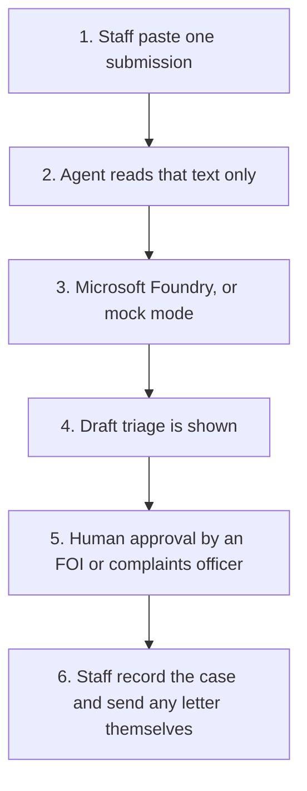

# FOI and complaint triage

<span class="status status-available">Available</span> · Autonomy A1 · Experiment 01

An assistant for UK public sector staff who triage Freedom of Information (FOI) requests, Environmental Information Regulations (EIR) requests, subject access requests (SARs), and complaints.

The agent prepares a structured brief. A person decides. The repository README marks the experiment complete, which means the starter is written: Python code, a permissions manifest, a security note, and a Copilot Studio build guide. A live model evaluation is still marked as pending in that folder.

If this page and [`agent-manifest.yaml`](https://github.com/rahul-bachina/copilot-agent-experiments/blob/main/experiments/01-foi-complaint-triage/agent-manifest.yaml) disagree, the manifest is the control.

## The problem

Public bodies are receiving long submissions that mix a complaint with an FOI request, an EIR request, or a SAR. Staff have to find each question, see whether anything looks urgent, judge whether the request may exceed the FOI cost limit, and work out which team should take it.

The experiment's own problem statement cites a Sky News report of 20 October 2026 that complaints to English councils had increased 78% and Department for Work and Pensions complaints 64% since ChatGPT launched. Those figures are the report's, not a measurement from this repository. The Information Commissioner's Office position recorded in the experiment is that an AI-written request is still valid, and that authorities may ask for clarification when a request is long, repetitive, or broad.

## Who it helps

**Staff.** The agent reads one submission and returns the separate asks, each with a quote from the text, a suggested type, a suggested team, any urgency or safeguarding flag, a cost-limit note, and a draft clarification letter. Staff still use their own case system.

**Residents and requesters.** A person still accepts, clarifies, or refuses the request. The agent is written so that it must not recommend rejection because a request looks AI-generated, uses a template, or is written in a particular style. The experiment treats that as an accessibility point: some people use tools or templates because of disability, language, or unfamiliarity with formal writing.

**The organisation.** The folder gives information-rights and governance colleagues a manifest, a risk register, a kill switch, and a mapping towards the Algorithmic Transparency Recording Standard. It does not file that record.

## What it does

From one free-text submission, pasted by an authorised member of staff, the agent returns:

- each distinct ask, with a quote from the source
- a classification: FOI, EIR, SAR, complaint, or mixed, with a rationale and a confidence level
- a suggested department and team
- urgency and safeguarding flags, including a marker when a person should look immediately
- a view on whether the request is likely to exceed the FOI cost limit
- a draft clarification letter, where the agent thinks one is needed, for a person to edit
- bulk or template signals as information only

The runnable code is Python. With Microsoft Foundry credentials it calls a model. The experiment README names GPT-4o as the deployment. Without credentials, `--mock` uses rule-based Python. Mock mode is for trying the pipeline. It is not the quality of a model.

## What it does not do

These are switched off in the manifest, not left to the prompt.

- It does not approve, reject, or close a request.
- It does not send email, letters, or any other message. A clarification letter is draft text.
- It does not write to a case system, a database, or any other store.
- It does not make the statutory decision, including exemptions and cost-limit decisions.
- It does not auto-reject because of wording, origin, or a guess that the text was generated.
- It does not read case systems, HR records, finance systems, email, identity databases, or a requester's earlier requests.
- It does not give legal advice.

## How the work flows

The same steps are listed here and drawn below. Step 5 is the human approval. Anything after that is done by staff in the systems they already use.

1. A member of staff pastes one submission.
2. The agent reads that text, and its own instructions. It does not look up the requester.
3. Microsoft Foundry returns structured JSON, or mock mode does if no credentials are set.
4. The draft shows the type, the asks with quotes, flags, a routing suggestion, a cost note, and a clarification letter if one was drafted.
5. **Human approval.** An FOI or complaints officer accepts or corrects the classification, the routing, any safeguarding escalation, the cost-limit view, and the letter before it is sent.
6. Staff record the case and send any letter through their normal route. The agent has no connector for that.



## Architecture diagram

The diagram below is the file shipped in the experiment, copied into this site at build time.

![Architecture diagram of the FOI complaint triage agent. Public sector staff submit free text. The triage agent extracts asks, classifies the type, flags urgency and suggests routing. It calls Microsoft Foundry for structured JSON, or uses mock mode. The structured brief returns to staff, who review it and decide. A note on the diagram says the agent assists and never decides, does not reject requests automatically, and that staff make the final decision. Copilot Studio with Power Automate is shown as an alternative interface.](img/01-foi-architecture.png)

## Microsoft stack

| Piece | Role in this experiment |
| --- | --- |
| Python | The triage agent you can run from the folder. |
| Microsoft Foundry | Optional language-model call. The README uses a GPT-4o deployment name. No Foundry resource is created by the repository. |
| Mock mode | Rule-based Python, so the pipeline can be tried with no credentials. |
| JSON Schema | Checks the shape of the output. |
| Copilot Studio and Power Automate | A build guide for a staff-facing topic that calls Foundry. It is not an importable solution. |
| Microsoft Entra ID, Conditional Access, Key Vault, Purview, Application Insights, prompt shields | Named in the security guide as the controls for a deployment. This repository does not turn them on. |

## Security and permissions

Manifest `exp-01-foi-triage`, version 1.0.0. Owner in the manifest: Information Rights Team. Autonomy **A1**, human approves everything. `auto_actions_enabled` is false. Writes are disabled. Sends are disabled. All five high-risk actions (approve or reject, regulated decision, production record change, external send, spend) are disabled.

The contact address in the manifest, `foi-triage-support@example.gov.uk`, is a placeholder. So are the kill-switch contacts on `example.gov.uk`.

**What a run may read.** The submission a member of staff pastes, and the static instructions. The text may contain names, contact details, and special-category data. The agent does not store it. Retention of whatever staff then file is the organisation's case schedule, which this repository does not set.

**What it must not read.** Case systems, HR, finance, email, requester identity databases, and previous requests by the same person. The manifest says each request is assessed on its own content, not by profiling the requester.

**Human approval, all mandatory.**

| Before anyone relies on it | Who |
| --- | --- |
| Accept the classification | FOI or complaints officer |
| Act on the routing suggestion | FOI or complaints officer |
| Escalate a safeguarding flag | FOI or complaints officer, or the safeguarding lead |
| Send the clarification letter | FOI or complaints officer |
| Apply the cost-limit assessment | FOI or complaints officer |

Viewing the draft, or running it again, has no external effect and does not need a separate approval.

**UK GDPR, as written in the manifest.** Lead basis Article 6(1)(e), public task, with Article 6(1)(c), legal obligation, as the secondary basis, because responding to FOI, EIR, and SAR requests is a statutory duty. Special-category data may appear. The manifest cites Article 9(2)(g), substantial public interest, and Data Protection Act 2018 Schedule 1, Part 2, paragraph 6. Safeguards named there: classification only, no decision on that data, human review, and no persistence beyond the session. Production inference is assumed to run in UK South or UK West. That assumption is for the deploying organisation to confirm. This page is not a DPIA.

**Prompt injection.** The manifest lists prompt hardening, structured output, Microsoft Foundry prompt shields, human review, and the absence of any external action. The residual risk it records is a misleading classification, contained because a person reviews every output and the agent cannot act.

**Risk register, assessed 24 October 2026.** Likelihood × impact. Residual risk in the manifest is Low for each row after the controls. Inherent risk is not all Low.

| ID | Risk | Inherent | Residual | Owner in the manifest |
| --- | --- | --- | --- | --- |
| R1 | Wrong classification delays the response | Medium | Low | FOI team lead |
| R2 | A safeguarding concern is missed | High | Low | Safeguarding lead |
| R3 | Prompt injection produces a misleading draft | Medium | Low | Information security |
| R4 | Bias in classification or routing | Medium | Low | FOI team lead |
| R5 | Data breach through the model service | Medium | Low | Information security |
| R6 | The service is unavailable | Low | Low | IT operations |
| R7 | Someone sees a triage output who should not | Medium | Low | Information security |

**Logging.** The manifest says to log the invocation, the user, the size of the input rather than the text, the triage id, flags, and errors. It assumes Application Insights and the organisation's SIEM. Those are deployment choices.

**Kill switch.** Turn the Copilot Studio agent off, revoke the key in Key Vault, block access with Conditional Access, or block the connector with a Power Platform DLP policy. Who can do each of those is in the manifest.

**Review.** Last reviewed 24 October 2026. Next review 24 April 2027. Reviewer named as the Information Governance Board, which the manifest marks as an assumption.

**ATRS.** The manifest maps agent name, description, scope, human oversight, risk, and the UK GDPR section to ATRS fields. The experiment says a public-facing deployment would likely need a record. This starter is written for staff, not for the public to use directly. The organisation submits any record. This repository does not.

The full note for governance readers is [`docs/security-and-permissions.md`](https://github.com/rahul-bachina/copilot-agent-experiments/blob/main/experiments/01-foi-complaint-triage/docs/security-and-permissions.md).

## How to try it

Python 3.10 or newer. No credentials are required for mock mode. No key is stored in the repository.

```bash
cd experiments/01-foi-complaint-triage
python -m pip install -r requirements.txt
python src/triage_agent.py --mock --input examples/sample_request.txt
```

A Foundry run is the same command without `--mock`. It expects `AZURE_OPENAI_ENDPOINT`, `AZURE_OPENAI_API_KEY`, and `AZURE_OPENAI_DEPLOYMENT`. You supply those in your own environment.

The synthetic set has 12 cases. The experiment README records a mock-mode pipeline smoke test of 12 of 12 cases processed. Mock mode was tuned to that set. The README says this shows that the pipeline runs and says nothing about model accuracy. Real-model evaluation is marked pending.

Unit tests:

```bash
python -m pytest tests/ -v
```

Copilot Studio is rebuilt by hand from [`copilot-studio/README.md`](https://github.com/rahul-bachina/copilot-agent-experiments/blob/main/experiments/01-foi-complaint-triage/copilot-studio/README.md). There is nothing to import.

## Limitations

- Mock mode is keyword matching. It will not behave like a model.
- The agent does not learn from staff decisions. That is deliberate.
- Classification assumes the UK FOI, EIR, and data-protection framework.
- It is not a legal tool and does not advise on exemptions.
- Several deployment choices are marked as assumptions in the manifest, including UK region, retention, a one-hour safeguarding review, Application Insights, the escalation contacts, and the reviewing board.
- The security guide lists Dynamic Permissions, Dynamic Agent Risk, and Dynamic Conditional Access as announced, with availability unverified. Do not rely on them until that is confirmed.
- "What I learned" in the experiment README is still empty, waiting on a real-model test.

## Source

- [Experiment folder](https://github.com/rahul-bachina/copilot-agent-experiments/tree/main/experiments/01-foi-complaint-triage)
- [Permissions manifest](https://github.com/rahul-bachina/copilot-agent-experiments/blob/main/experiments/01-foi-complaint-triage/agent-manifest.yaml)
- [Security and permissions](https://github.com/rahul-bachina/copilot-agent-experiments/blob/main/experiments/01-foi-complaint-triage/docs/security-and-permissions.md)
- [Experiment README](https://github.com/rahul-bachina/copilot-agent-experiments/blob/main/experiments/01-foi-complaint-triage/README.md)
