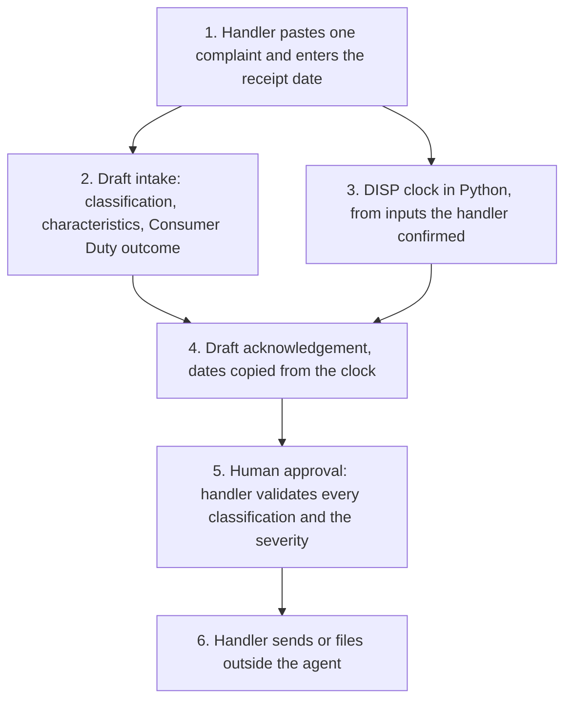

# Consumer Duty complaint intake

<span class="status status-available">Available</span> · Autonomy A1 · Experiment 02 · Catalogue ID C006

A starter for FCA-regulated firms. It helps a complaints handler turn one inbound complaint into a structured intake: what was said, whether it meets the Handbook definition of a complaint, product and root cause, characteristics a handler should review, the DISP clock, the Consumer Duty outcome the facts appear to touch, and a draft acknowledgement.

The repository README marks it as a starter. That is accurate. This revision contains the permissions manifest, a deterministic DISP clock, 22 synthetic fixtures, a mock intake used only as a smoke test, and build notes for Copilot Studio, Microsoft Foundry, and Dynamics 365 Customer Service. Nothing in the folder calls a model.

If this page and [`agent-manifest.yaml`](https://github.com/rahul-bachina/copilot-agent-experiments/blob/main/experiments/02-consumer-duty-complaint-intake/agent-manifest.yaml) disagree, the manifest is the control.

## The problem

DISP requires a firm to recognise a complaint, acknowledge it, and respond within a fixed time. The time limit depends on the kind of complaint. The summary-resolution route is three business days. The usual final response is eight weeks. An electronic-money or payment-services complaint is 15 business days, or 35 in exceptional circumstances. The Financial Ombudsman Service has its own referral windows. Missing a date, or letting a model invent one, is a conduct failure.

The Consumer Duty (PRIN 2A) asks firms to look at whether a complaint shows a problem in products and services, price and value, consumer understanding, or consumer support. Vulnerability guidance asks firms to notice a characteristic and respond to the need, without sticking the label "vulnerable" on the customer.

Handlers still have to read the email, the form, or the transcript and work this out. The agent prepares that reading. The handler decides.

The Handbook pages cited in the experiment were opened on 24 October 2026. DISP 1.6, retrieved that day, showed a future version dated 25 October 2027. That future text is not encoded.

## Who it helps

**Handlers.** They get a proposed classification, a product and root cause, a severity for them to change, vulnerability characteristics with the words that prompted them, DISP dates from code, a Consumer Duty outcome to accept or change, and a draft acknowledgement that says it must not be sent as it stands.

**Customers.** The firm still sends any letter. The agent does not uphold, reject, or set redress. It does not label the customer vulnerable, and it does not write a marker onto a customer record. A dissatisfaction that alleges no financial loss, material distress, or material inconvenience is flagged as outside the DISP definition rather than forced onto the clock.

**The firm.** Dates come from `src/disp_clock.py`, which does not call a model and does not use the network. The same inputs always produce the same JSON. High-risk actions are disabled in the manifest. The folder is a starter a complaints owner, a DPO, and an architect can review before anyone connects it to a tenant.

## What it does

**The clock**, which is the part you can run today, calculates dates for England and Wales:

| Clock | Rule, as cited in the experiment | What the code does |
| --- | --- | --- |
| Summary resolution route closes | DISP 1.5.1R | Close of the third business day after the day of receipt. The day of receipt is not counted. |
| Acknowledgement | DISP 1.6.1R | "Prompt". The Handbook sets no number of days, so the clock does not invent one. |
| Final or other written response | DISP 1.6.2R | End of eight weeks after receipt, implemented as 56 days. The date is not moved if it falls on a weekend or a bank holiday. |
| E-money or payment-services final response | DISP 1.6.2AR | 15 business days, or 35 if a human has flagged exceptional circumstances. Without the provider's closed dates, those dates are a non-operative reference. |
| Ombudsman, if the firm has not responded | DISP 2.8.1R | The day after the firm's deadline, once that period has elapsed. |
| Six months to refer | DISP 2.8.2R(1) | Runs from the date the firm sent the final response, redress determination, or summary resolution communication. |
| Six years / three years | DISP 2.8.2R(2) | The later of six years after the event and three years after awareness. Awareness is an input. The clock does not infer it. |

Two Handbook definitions of "business day" are not the same. DISP 1.5 uses days that are not a weekend, Christmas Day, Good Friday, or a bank holiday in that part of the United Kingdom. This module uses England and Wales. DISP 1.6.2A uses days the payment service provider is open for a payment transaction. A provider can be open on a Saturday or a bank holiday. Until the handler supplies those closed dates, the 15-day and 35-day figures are not the legal deadline.

The three-business-day route exists only if the complainant has indicated acceptance. The clock does not decide that.

**The mock intake** proposes whether the text meets the glossary definition of a complaint, a product, a root cause, a severity, vulnerability characteristics, and which Consumer Duty outcome the facts appear to touch. It is a keyword stand-in tuned to the synthetic fixtures. It is not a model.

**The build notes** describe a later shape: Copilot Studio for the handler, Microsoft Foundry for extraction and the draft, and the clock remaining in Python. Dynamics 365 Customer Service is described as a boundary. The starter does not connect to it.

## What it does not do

These are disabled in the manifest.

- It does not decide that a complaint is upheld, rejected, or resolved.
- It does not decide redress, a refund, a goodwill payment, or a waiver of fees.
- It does not send the acknowledgement, a summary resolution communication, a holding response, or a final response.
- It does not create, update, resolve, or close a Dynamics 365 case, or write any other production record.
- It does not refer a complaint to the Financial Ombudsman Service, or decide that the Ombudsman can or cannot consider it.
- It does not decide exceptional circumstances, eligible-complainant status, or that a time limit is waived.
- It does not label a customer as vulnerable, or write a vulnerability marker onto a customer record.
- It does not decide that the firm has breached the Consumer Duty.
- It does not give legal, regulatory, or case-outcome advice.
- It does not calculate DISP dates inside a model.
- It does not use a Scottish or Northern Ireland bank-holiday calendar, and it does not forecast one-off proclaimed bank holidays.
- It is not a customer-facing bot. The Copilot Studio guide says a customer chatting with it would be a different product and is out of scope.

## How the work flows

Step 5 is the human approval. Sending and filing stay outside the agent even after the handler accepts the draft.

1. The handler pastes one complaint and enters the receipt date. They confirm the route if they want a payment-services or e-money clock. A suggested route is not applied until they confirm it.
2. Extraction proposes: complaint or not, product, root cause, severity, vulnerability characteristics with quotes, and which Consumer Duty outcome the facts appear to touch. In this folder that step is the mock intake. A Foundry call is described and not built.
3. The Python clock calculates dates from those confirmed inputs. Exceptional circumstances are a flag a person sets. The model must not set it. If the provider's opening days are missing, the 15-day and 35-day dates come back non-operative.
4. A draft acknowledgement is assembled. It copies the dates from the clock. It says it must not be sent as it stands.
5. **Human approval.** The handler accepts or changes every classification and the severity, the route, any vulnerability characteristic before it is recorded, and the acknowledgement before it is sent.
6. The handler sends or files in the firm's own systems, under their own security role. The agent has no tool for that.



What is not a tool of the agent, even after step 5: sending to the customer, a Dynamics 365 production write, upholding, rejecting, redress, closure, an Ombudsman referral, and a vulnerability label on the customer.

## Architecture diagram

The diagram below is the file shipped in the experiment, copied into this site at build time.

![Architecture diagram titled Complaint intake, Consumer Duty / DISP. The handler pastes one complaint, enters the receipt date, and confirms the route before a payment-services or e-money clock is used. Extraction proposes classification, product, root cause, severity, vulnerability drivers, and a Consumer Duty outcome. The DISP clock is Python, not the model: three business days, eight weeks, and 15 or 35 business days only if the handler supplies the provider's calendar. The handler then validates every classification and the severity, edits the draft, and sends or files in the firm's own systems. A separate box states what is not a tool of the agent: no send, no Dynamics 365 write, resolve or close, no uphold, reject or redress, and no vulnerability label on the customer.](img/02-consumer-duty-architecture.png)

## Microsoft stack

| Piece | Role in this experiment |
| --- | --- |
| Python standard library | `src/disp_clock.py`. No Azure credentials and no network. |
| Mock intake | `src/intake.py`. Keyword stand-in for extraction and the draft. |
| pytest | The only declared dependency. Used by the unit tests. |
| Copilot Studio | Build guide for a handler-facing agent. Not an importable solution. One action is allowed in that guide: a flow that returns the clock JSON and then stops. |
| Power Automate | Only as that clock action, called with a locked-down identity. The guide says not to add 15 working days with the flow's own calendar. |
| Microsoft Foundry | Optional extractor and drafter, described in `docs/foundry.md`. No Foundry resource is created here. The model is told not to calculate dates. |
| Dynamics 365 Customer Service | Not connected. The handler pastes the complaint. A later read or a draft-only custom table is described as a boundary, and the manifest would have to change in the same change as any connector. |
| Key Vault | Named for a key if a managed identity cannot be used, and as a way to remove Foundry access. Not provisioned. |

## Security and permissions

Manifest `exp-02-consumer-duty-complaint-intake`, version 0.1.0. Owner in the manifest: Complaints operations. Autonomy **A1**. Writes disabled. Sends disabled. Approve or reject, regulated decision, production record change, external send, and spending are disabled. Two further high-risk actions are also disabled: referring to the Financial Ombudsman Service, and labelling the customer as vulnerable.

Contacts in the manifest use `example.com`. They are placeholders, not a firm.

**What a run may read.** The complaint text the handler supplies, the receipt date, and, if the handler has confirmed them, the route and the provider's closed dates. Plus the static instructions. The Python starter does not persist the text.

**What it must not read.** Dynamics 365 production data, customer vulnerability markers, core banking or policy systems, mailboxes, Financial Ombudsman Service systems, and other customers' complaints. A later read of one open incident is described in the Dynamics note. It is not built, and the manifest must be edited before it is.

**Human approval, before anyone relies on the output.**

| Decision | Who |
| --- | --- |
| Accept or correct the classification | Complaints handler |
| Confirm product, root cause, and severity | Complaints handler |
| Confirm the route passed into the clock | Complaints handler |
| Confirm exceptional circumstances before a 35-business-day date is used | Complaints handler |
| Review a vulnerability characteristic before it is recorded anywhere | Complaints handler |
| Edit and send the acknowledgement | Complaints handler |
| Uphold, reject, redress, or close | Authorised complaints decision-maker. Outside the agent even after the draft is approved. |

Viewing a draft, re-running it, and calculating the clock from inputs the handler has typed do not need a separate approval. Relying on a suggested payment-services route does.

**UK GDPR.** Do not copy experiment 01. This agent is for a firm, not a public authority. The manifest's lead basis is Article 6(1)(c), legal obligation under DISP, and it says the firm's DPO confirms that before any production use. Article 6(1)(b) may also be relevant where the complaint is about the customer contract. Complaint text can contain health information. The manifest does **not** assert an Article 9 condition. The firm has to choose one before any live processing of special-category data. The customer is not labelled vulnerable, nothing is written to a customer record, and a handler reviews a flag before it is recorded. Production inference, if used, should run in Microsoft Foundry in UK South or UK West. Confirm the data-use terms at deployment. This page is not a DPIA.

**Prompt injection.** Fixtures include instructions to ignore the rules, send the email, mark the customer vulnerable, treat a 2014 balance as current, and move the receipt date. The security note says the mock intake keeps the handler's receipt date, refuses to send, refuses to label the customer, and leaves uphold, reject, redress, close, and Ombudsman referral in `decisions_not_taken`. `tests/test_intake_safety.py` checks that an instruction to uphold, pay, send, or label does not become an action. The residual risk recorded is a misleading draft. The handler is the control. There is no autonomous action behind a bad draft.

**Risk register, assessed 24 October 2026 for this starter rather than a named firm.** Residual risk is not all Low. Do not read the table as a finished firm assessment.

| ID | Risk | Inherent | Residual | Owner in the manifest |
| --- | --- | --- | --- | --- |
| R1 | A wrong classification makes a handler miss a DISP deadline | High | Medium | Complaints operations |
| R2 | A vulnerability characteristic is missed, or a customer is labelled | High | Medium | Complaints operations |
| R3 | Prompt injection produces an uphold, a redress figure, or a send | High | Low | Information security |
| R4 | Special-category data in a complaint is retained or reused | High | Medium | Data protection officer |
| R5 | Stale Handbook text after the future DISP 1.6 version dated 25 October 2027 | Medium | Medium | Complaints operations |

**Logging.** This starter writes no log. Before live use the manifest says to log who ran it, when, the size of the text rather than the text, the clock inputs and the rule ids, the handler's edits, and any schema rejection. Do not log the complaint in an application trace. The complaint belongs on the case file.

**Kill switch.** Turn the Copilot Studio agent off. Remove the Foundry access used by any orchestration. If a connector has been added despite the default, block it in a Power Platform DLP policy.

**Review.** Reviewed for this starter on 24 October 2026. Next review 24 April 2027, and sooner if DISP changes or England and Wales bank holidays change by proclamation.

**Assumptions the firm must confirm.** England and Wales calendar. Article 6(1)(c) as the lead basis, and an Article 9 condition before live special-category processing. UK-region Foundry, not trained on the firm's complaints. No Dynamics connector without a manifest change. Placeholder contacts.

There is no ATRS mapping in this manifest. ATRS is a public-sector standard. A firm does not complete an ATRS record by using this starter.

## How to try it

Python 3.10 or newer. No Azure credentials and no network. The clock uses the standard library. pytest is installed from `requirements.txt`.

```bash
cd experiments/02-consumer-duty-complaint-intake
python -m pip install -r requirements.txt
python -m pytest tests/ -v
python eval/evaluate.py
python src/disp_clock.py --received 2026-01-02 --route general
```

`eval/evaluate.py` prints a mock smoke test. The 22 fixtures are synthetic and the classifier is a keyword stand-in tuned to them. `eval/smoke_report.json` is that run, saved so a reviewer can see it without re-running. The file labels itself a mock smoke test and not a measure of model accuracy. It records 22 of 22 fixtures processed by that stand-in. No model was called. The DISP dates inside that run are the deterministic calculation.

Worked examples from the experiment README, which match the clock:

- Complaint received Friday 2 January 2026, general route, England and Wales. Summary resolution route closes on Wednesday 7 January 2026. Final response is due by the end of Friday 27 February 2026. If no qualifying response has been sent, the DISP 2.8.1R referral point used here is Saturday 28 February 2026.
- Payment-services complaint received Thursday 24 December 2026. On the England and Wales reference calendar the 15th business day is Tuesday 19 January 2027. That date is not operative until the handler confirms the provider's opening days.

```bash
python src/disp_clock.py --received 2026-12-24 --route psd
python src/disp_clock.py --received 2026-01-05 --route psd --psp-use-england-wales-calendar
```

The third command is operative only because the flag asserts that this provider is closed on England and Wales weekends and bank holidays.

A proclaimed extra bank holiday, or a statutory Monday that was moved, is passed in. The experiment README uses Early May 2020 as the example:

```bash
python src/disp_clock.py --received 2020-05-01 \
  --extra-closed 2020-05-08 --cancel-bank-holiday 2020-05-04
```

Use the synthetic fixtures in `eval/synthetic_dataset.json` if you rebuild the Copilot Studio topic. Do not paste a real complaint into a shared test environment. The fixtures, the sample, and the smoke report use invented people and a fictional firm, Northbridge Mutual.

## Limitations

- The standing bank-holiday pattern matches the GOV.UK England and Wales list for 2021 and 2024–2028, which was the list read on 24 October 2026. It does not include one-off proclamations. Early May 2020 and the spring bank holiday in 2022 were moved. The coronation bank holiday on 8 May 2023 is not included unless the caller passes it.
- Scotland and Northern Ireland need a different closed-day set.
- "Eight weeks after" is implemented as 56 days. "Six months after" and the six-year and three-year periods use the corresponding date, or the last day of the month if that day does not exist. The Ombudsman decides a dispute about the count.
- The day after the firm's deadline is used as the first day the complainant may refer under DISP 2.8.1R. Confirm this with the firm's own procedure if it uses a more cautious internal date.
- DISP 1.6.4R, written acceptance that can disapply the eight-week rule for a non-payment-services complaint, is described and is not applied automatically.
- The wording required by DISP 1 Annex 3R is not copied. The experiment says that page was not opened.
- The mock smoke test is not a model score. A live Foundry run has not been done.
- This is not legal advice and it is not a statement of the firm's compliance.

## Source

- [Experiment folder](https://github.com/rahul-bachina/copilot-agent-experiments/tree/main/experiments/02-consumer-duty-complaint-intake)
- [Permissions manifest](https://github.com/rahul-bachina/copilot-agent-experiments/blob/main/experiments/02-consumer-duty-complaint-intake/agent-manifest.yaml)
- [Security and permissions](https://github.com/rahul-bachina/copilot-agent-experiments/blob/main/experiments/02-consumer-duty-complaint-intake/docs/security-and-permissions.md)
- [Architecture note](https://github.com/rahul-bachina/copilot-agent-experiments/blob/main/experiments/02-consumer-duty-complaint-intake/docs/architecture.md)
- [Experiment README](https://github.com/rahul-bachina/copilot-agent-experiments/blob/main/experiments/02-consumer-duty-complaint-intake/README.md)
