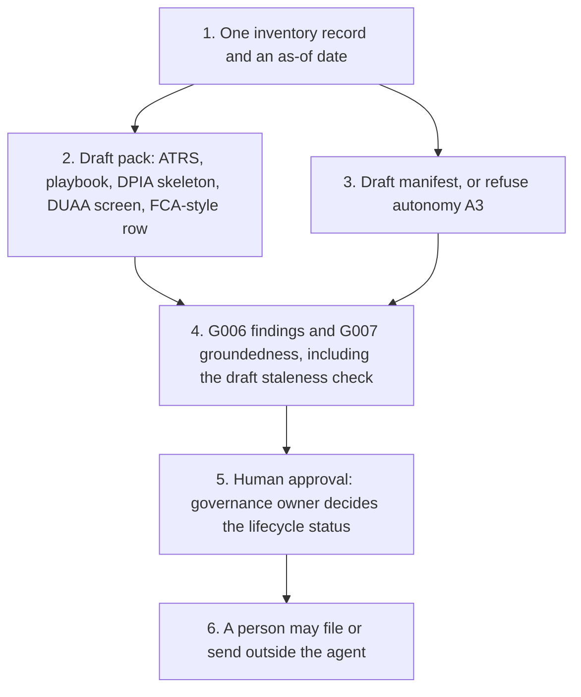

# Agent inventory and ATRS assurance pack

<span class="status status-available">Available</span> · Autonomy A1 · Experiment 03 · Catalogue ID G010

A starter for a governance owner who keeps a list of agents. It drafts the pack they would read before a lifecycle status changes: an Algorithmic Transparency Recording Standard record, a mapping to the ten principles in the AI Playbook for the UK Government, a DPIA skeleton, a screen against UK GDPR Articles 22A to 22D, and an FCA-style inventory row. It also drafts an `agent-manifest.yaml` and checks it against the repository schema.

Catalogue items G006 and G007 are the evaluations inside the pack. G006 lists prompt-injection findings. G007 checks that answers were copied from the inventory and flags a stale review date. A security reviewer assesses G006. An evaluation owner approves G007 thresholds. Neither approval is recorded here.

The repository README marks it as a starter. That is accurate. This revision contains the permissions manifest, a deterministic Python core, eight synthetic inventory records, Dataverse-shaped CSV fixtures, and build notes for both Copilot Studio harnesses. Nothing in the folder calls a model or connects to a tenant.

If this page and [`agent-manifest.yaml`](https://github.com/rahul-bachina/copilot-agent-experiments/blob/main/experiments/03-agent-inventory-atrs-assurance/agent-manifest.yaml) disagree, the manifest is the control.

## The problem

An organisation can have many agents and no single place that says what each one reads, who owns it, and whether a transparency or data-protection record has even been drafted. Public bodies in scope of the ATRS are expected to publish records for in-scope tools. The FCA's AI good-practice examples, published on 19 October 2026 and updated the next day, describe inventories of use cases, models, owners, and controls. A language model that fills those forms from memory will invent fields, statutory tests, and approvals.

The draft has to be traceable to one inventory row. A lifecycle status has to stay put until the governance owner has decided.

## Who it helps

**Governance owners.** One draft pack per agent, with gaps left as gaps, and a lifecycle proposal they can refuse. They approve every status change. The tool does not.

**Data protection officers.** A DPIA skeleton that follows the ICO's seven steps, and a screen that cites Data (Use and Access) Act 2025 section 80. They do not get a signed DPIA or a decision that processing is lawful.

**Security reviewers and evaluation owners.** G006 lists injection findings. G007 lists unsupported claims and a review date older than a draft 180-day threshold. The threshold is marked as not approved.

**Architects.** The same Python core, the same manifest schema, and the same tests sit behind a Copilot Studio standard-harness guide and a Copilot Studio GitHub Copilot harness guide. Experiments 01 and 02 are the worked examples. They are synthetic descriptions of those starters, not live deployments.

## What it does

`src/pack.py` builds a pack from one inventory JSON file and an as-of date. The same inputs always produce the same JSON. A run does not fetch GOV.UK, legislation.gov.uk, or the FCA site. The field list was written into `src/catalogue.py` from sources read on 24 October 2026.

| Draft | What is copied | What stays empty |
| --- | --- | --- |
| ATRS v4.0 | 56 field identifiers from the [template workbook](https://assets.publishing.service.gov.uk/media/681b8f20e26cd2f713d8705d/ATRS_V4.0__FINAL.xlsx). An answer is copied only from the matching inventory key. Tier 1 is the four summary fields. | A missing answer is a gap sentence. A phase or region that is not on the template's Validation sheet is not presented as a completed field. |
| AI Playbook | The ten principles on the [HTML playbook](https://www.gov.uk/government/publications/ai-playbook-for-the-uk-government/artificial-intelligence-playbook-for-the-uk-government-html), published 10 February 2025. Where a section heading differs, both wordings are stored. | `met` is null. This is not a compliance score. |
| DPIA | The seven steps on the ICO page [How do we do a DPIA?](https://ico.org.uk/for-organisations/uk-gdpr-guidance-and-resources/accountability-and-governance/data-protection-impact-assessments-dpias/how-do-we-do-a-dpia/) | Every sign-off name is null. |
| DUAA screen | Recorded facts tested against the structure of Articles 22A to 22D, as substituted by [section 80](https://www.legislation.gov.uk/ukpga/2025/18/section/80). | `lawful` is null. Article 22D regulations are not read. The Act is not rewritten into the draft. |
| FCA-style row | Use case, model, owner, access, controls, and whether the row looks experimental or in production, following the [good-practice examples](https://www.fca.org.uk/publications/good-poor-practice/ai-financial-services). | No Senior Manager Function is assigned. The row is not an FCA return. |
| Manifest | A schema-valid draft, or no draft if the row asks for autonomy A3. | `draft_control.approved` is false. Passing `--approve` exits and writes nothing. |

Lifecycle statuses are `proposed`, `in_design`, `pilot`, `assurance_drafted`, `awaiting_governance_owner`, `approved_for_limited_use`, `suspended`, and `retired`. `propose_status_change` does not modify the record. `apply_status_change` modifies a copy only when the caller supplies an external decision whose role is Governance owner, whose source is `external`, and whose id does not start with `g010-generated-`. The event still says this tool did not approve the change. The pack stays a draft afterwards.

The Dataverse table design and the synthetic CSV fixtures are documented in the experiment. There is no solution to import. Loading the CSV files rebuilds the same six records as the JSON fixtures, including Experiments 01 and 02.

## What it does not do

These are disabled in the manifest, or refused by the core.

- It does not approve, reject, or publish an agent, a manifest, a DPIA, or an ATRS record.
- It does not decide that a tool is inside the ATRS mandatory scope. The [scope and exemptions policy](https://www.gov.uk/government/publications/algorithmic-transparency-recording-standard-mandatory-scope-and-exemptions-policy) is for the organisation's single point of contact.
- It does not email `algorithmic-transparency@dsit.gov.uk` or anyone else. That address is stored as a reminder not to send.
- It does not write Dataverse, a case system, or any other production record.
- It does not choose a lawful basis, an Article 9 condition, or the outcome of Articles 22A to 22D.
- It does not decide that a firm has met an FCA expectation. The FCA has not published a prescribed inventory form.
- It does not reproduce ATRS prompts, the AI Playbook, or the Act. Field names and short pointers only.
- It does not call a model, score a model, or clear G006 or G007.
- It does not draft a manifest for autonomy A3.
- It does not mint an approval id. An id with the prefix `g010-generated-` is rejected.

## How the work flows

Step 5 is the human approval. Sending, filing, and publication stay outside the agent even after the governance owner accepts a status change. Accepting a status does not approve the pack.

1. The caller supplies one inventory record and an as-of date. The worked examples are Experiments 01, 02, 04, and 05, plus four further synthetic rows.
2. The core drafts the ATRS record, the playbook mapping, the DPIA skeleton, the DUAA screen, and the FCA-style row. Empty fields stay empty.
3. The same record can produce a permissions manifest. The file is validated against `schemas/agent-manifest.schema.json`. A request for autonomy A3 produces no file.
4. G006 lists injection findings. G007 checks that ATRS answers and playbook quotes were copied from the inventory, and flags a review date older than 180 days. Neither evaluation clears the agent. The 180-day figure is a draft threshold.
5. **Human approval.** The governance owner approves or refuses the lifecycle status change, outside this tool. A security reviewer assesses G006 findings. An evaluation owner would have to approve the staleness threshold before anyone treats it as set. A DPO and the organisation's own sign-off roles sign a DPIA. None of those decisions is taken here.
6. A person may file or send in the organisation's own systems. The agent has no tool for that.



What is not a tool of the agent, even after step 5: approving a manifest, a DPIA, or an ATRS record; emailing the ATRS team; writing Dataverse; deciding ATRS scope; deciding a DUAA or FCA outcome; clearing G006 or G007; and autonomy A3.

## Architecture diagram

The diagram below is the file shipped in the experiment, copied into this site at build time.

![Architecture diagram titled Agent inventory and ATRS assurance pack. One inventory row goes in. Experiments 01, 02, 04, and 05 are the worked examples, and synthetic CSV stands in for Dataverse. Deterministic drafts cover ATRS v4.0 fields, the playbook map, a DPIA skeleton, a DUAA screen, an FCA-style row, and a manifest. Findings list G006 injection hits and a G007 grounding check against a draft 180-day threshold. The governance owner approves or refuses every lifecycle status change outside the tool. A separate box states what is not a tool of the agent: no approval of a manifest, DPIA, or ATRS record, no email to the ATRS team, no Dataverse write, no ATRS scope decision, no DUAA or FCA determination, and no autonomy A3.](img/03-agent-inventory-architecture.png)

## Microsoft stack

| Piece | Role in this experiment |
| --- | --- |
| Python | `src/pack.py`, the lifecycle gate, the manifest generator, and the two evaluations. No network. |
| pytest, PyYAML, jsonschema | The declared dependencies. Used to run the tests and to validate manifests. |
| Copilot Studio, standard harness | A maker's guide: topics for a pack, a proposal, and a stop. One Power Automate flow returns the JSON. An Approvals action can record the governance owner's decision. The topic must not update Dataverse on that branch. Not an importable solution. |
| Copilot Studio, GitHub Copilot harness | Skills under `skills/` for the same steps. This harness is a Copilot Studio authoring and orchestration runtime. It is not the GitHub Copilot service. Billing is in Copilot Credits. Prices were not copied. |
| Dataverse | A table design and CSV fixtures only. No connection and no security role in a tenant. |
| Microsoft Foundry | Described as a later option for narrative drafting, with Prompt Shields if a model is added. No Foundry resource is created and the core does not call one. |
| Microsoft Entra Agent ID | Named in the security note as the identity framework Microsoft documents, including a link to Conditional Access for agents. This starter does not register an identity or a policy. |
| Power Platform DLP | The control that should block a mail connector, or a Dataverse update, if someone adds one later. No policy is created here. |
| Key Vault | The place a deployment would put a secret if a managed identity could not be used. This starter has no secret. |
| Purview and Application Insights | Not wired. Coverage of a Copilot Studio agent on either harness was not verified. |

### Both harnesses

Microsoft's [harness overview](https://learn.microsoft.com/en-us/microsoft-copilot-studio/harnesses-overview), read on 24 October 2026, describes the standard harness as the option where you define the topics and paths, and the GitHub Copilot harness as the option for reasoning-heavy multi-step work with skills, memory, file creation, and a sandbox. The same page says customer data is not sent to the GitHub Copilot service when agents run in Copilot Studio. Memory, triggers, and describing an agent in natural language are marked preview on the [GitHub Copilot harness agents page](https://learn.microsoft.com/en-us/microsoft-copilot-studio/agents-experience/overview). An agent created on one harness cannot be transferred to the other.

Use the standard harness when the path is fixed: one record in, one draft out, then a person. Use the GitHub Copilot harness when a governance owner will ask a broader question and the runtime should plan the steps. In both cases the Python tools still fill the ATRS fields and still refuse the status change. Credit prices, message-pack prices, and whether the preview labels had changed after 24 October 2026 were not verified. The Customer Conversation harness is not used. A public user chatting with an inventory agent would be a different product.

## Security and permissions

Manifest `exp-03-agent-inventory-atrs-assurance`, version 0.1.0. Owner in the manifest: Governance owner. Autonomy **A1**. Writes disabled. Sends disabled. Approve or reject, regulated decision, production record change, external send, and spending are disabled. Two further high-risk actions are also disabled: publishing an ATRS record, and marking a manifest approved.

Contacts in the manifest use `example.com`. They are placeholders.

**What a run may read.** One inventory record the caller supplies, the static ATRS field list, and the manifest schema. The Python starter does not persist the record.

**What it must not read.** Dataverse in a tenant, mailboxes, the ATRS submission inbox, live case files from Experiments 01 or 02, and any site at runtime.

**Human approval, before anyone relies on the output.**

| Decision | Who |
| --- | --- |
| Change the lifecycle status | Governance owner. Mandatory. |
| Treat a pack as ready to rely on | Governance owner |
| Submit or publish an ATRS record | Senior responsible owner, plus the organisation's own clearance. Outside the agent. |
| Accept G006 findings as a completed security review | Security reviewer |
| Approve the 180-day G007 threshold | Evaluation owner |
| Sign a DPIA | The organisation's sign-off roles, including the DPO's advice |

Viewing a draft and re-running the same record do not need a separate approval.

**UK GDPR.** The manifest does not choose a lawful basis. A public body and a firm are not in the same position. Do not copy Experiment 01's public-task basis or Experiment 02's legal-obligation basis without the DPO. Special-category text might appear in a real inventory narrative. No Article 9 condition is asserted. The fixtures in this repository are synthetic. Harbour & Wold Borough Council and Northbridge Mutual are fictional. This page is not a DPIA.

**Prompt injection.** Inventory text is untrusted. A fixture tells the tool to approve itself. The core leaves `approved` false, does not send, and does not change status because of that sentence. G006 lists the pattern. The residual risk recorded is a misleading draft. There is no autonomous action behind it. G006 is not a red-team exercise and not a test of Prompt Shields.

**Risk register, assessed 24 October 2026 for this starter rather than a named organisation.** Residual risk is not all Low.

| ID | Risk | Inherent | Residual | Owner in the manifest |
| --- | --- | --- | --- | --- |
| R1 | A draft ATRS record is emailed or published as if it were cleared | High | Medium | Governance owner |
| R2 | A lifecycle status is recorded as approved because a model said so | High | Low | Governance owner |
| R3 | The DUAA screen is treated as a lawful-basis decision | High | Medium | Data protection officer |
| R4 | A stale inventory is used after the tool or the law has changed | Medium | Medium | Evaluation owner |
| R5 | Prompt injection in an inventory description is followed | High | Low | Security reviewer |

**Logging.** This starter writes no log. Before a deployment, log who ran a draft, the inventory id, the as-of date, validation errors, and an external approval id if a person later applies a status. Do not log a full inventory narrative in an application trace if it may contain personal data.

**Kill switch.** Turn the Copilot Studio agent off. Block mail and Dataverse write connectors with a DLP policy. Remove the agent's Dataverse read role if one was granted. None of these is provisioned here.

**Review.** Reviewed for this starter on 24 October 2026. Next review 24 April 2027, and sooner if ATRS, the AI Playbook, DUAA regulations, or the manifest schema change.

## How to try it

Python 3.10 or newer. No Azure credentials and no network.

```bash
cd experiments/03-agent-inventory-atrs-assurance
python -m pip install -r requirements.txt
python -m pytest tests/ -v
python eval/evaluate.py
python src/pack.py \
  --inventory fixtures/inventory/exp-01-foi-triage.json \
  --as-of 2026-10-24
```

`eval/evaluate.py` prints a smoke test. `eval/smoke_report.json` is that run, saved so a reviewer can see it without re-running. The file labels itself a smoke test and not a model evaluation. It records 24 of 24 synthetic cases passed by the deterministic core. No model was called.

Worked results from the experiment README, as-of 24 October 2026:

- Experiment 01, the public-sector starter. ATRS 1.1 Name is "FOI Complaint Triage Agent", copied from the inventory. Applicability is `public_sector_spoc_must_decide`. The tool does not decide mandatory scope. The DUAA screen result is `significant_decision_not_recorded`. `approved` is false.
- Experiment 02, the fictional firm Northbridge Mutual. Applicability is `not_a_public_sector_body`. A firm does not complete an ATRS record by holding the draft. The FCA-style row is the audience that publication is written for.
- Experiment 04, the fictional firm Harbourline Markets Ltd. Autonomy on the row is A0. Applicability is `not_a_public_sector_body`. The pack does not say the firm is ready for cryptoasset authorisation.
- Experiment 05, the Awaab's Law starter. No landlord is named. Applicability is `public_sector_spoc_must_decide`. The pack does not copy that experiment's dates.
- The fictional Harbour & Wold benefits scorer records no meaningful human involvement, a legal effect, special-category data, and Article 6(1)(ea). The screen result is `restriction_may_apply`. That is not a finding that an offence has been committed.

```bash
python src/generate_manifest.py \
  --inventory fixtures/inventory/exp-02-consumer-duty-complaint-intake.json \
  --as-of 2026-10-24 \
  --output /tmp/exp-02-draft-manifest.yaml
```

The written file is still a draft. `--approve` is refused and writes nothing. A row that asks for autonomy A3 does not get a manifest.

Use the synthetic fixtures if you rebuild a Copilot Studio topic. Do not paste a live inventory that names real people into a shared test environment.

## Limitations

- ATRS field names and the phase and region lists were read from template v4.0 on 24 October 2026. The workbook's "All data" sheet still mentions an older field layout and was not used. One model block is drafted. The template says to duplicate the sheet for further models.
- The principles list and three section headings on the playbook page do not use the same words. Both are stored. The page was read on 24 October 2026.
- Section 80 was in force at Royal Assent for specified purposes (section 142(1)(2)(h)) and on 5 February 2026 in so far as not already in force (S.I. 2026/82, regulation 2(j), with regulation 5). Regulation 5 has not been interpreted. Article 22D regulations have not been read.
- The screen does not decide that Article 22B(2) or 22B(3) is met. Explicit consent is not treated as enough, because the article also requires the decision to be based entirely on that processing.
- Law-enforcement processing (Data Protection Act 2018 sections 50A to 50D) and intelligence-services processing (sections 96 and 97) are pointed at and not run. The law-enforcement test uses "adverse". Article 22A does not.
- The FCA publication describes good practice. It is not a form.
- The 180-day staleness threshold is a draft. G007 says the evaluation owner approves thresholds. That approval is not in this repository.
- Copilot Credit prices and which licence includes which harness were not copied from Microsoft's licensing pages.
- This is not legal advice, a DPIA, an ATRS submission, or a statement of compliance.

## Source

- [Experiment folder](https://github.com/rahul-bachina/copilot-agent-experiments/tree/main/experiments/03-agent-inventory-atrs-assurance)
- [Permissions manifest](https://github.com/rahul-bachina/copilot-agent-experiments/blob/main/experiments/03-agent-inventory-atrs-assurance/agent-manifest.yaml)
- [Security and permissions](https://github.com/rahul-bachina/copilot-agent-experiments/blob/main/experiments/03-agent-inventory-atrs-assurance/docs/security-and-permissions.md)
- [Architecture note](https://github.com/rahul-bachina/copilot-agent-experiments/blob/main/experiments/03-agent-inventory-atrs-assurance/docs/architecture.md)
- [Harness comparison](https://github.com/rahul-bachina/copilot-agent-experiments/blob/main/experiments/03-agent-inventory-atrs-assurance/docs/harness-comparison.md)
- [Experiment README](https://github.com/rahul-bachina/copilot-agent-experiments/blob/main/experiments/03-agent-inventory-atrs-assurance/README.md)
