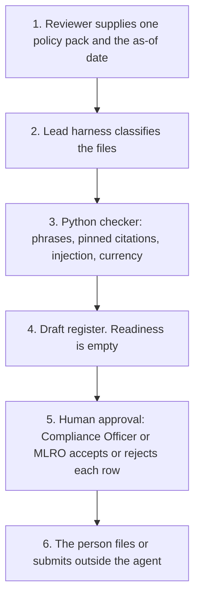

# FCA cryptoasset authorisation readiness

<span class="status status-available">Available</span> · Autonomy A0 · Experiment 04 · Catalogue ID UK02

A starter for a compliance team preparing a cryptoasset firm for FCA authorisation. It reads one pack of policy documents and returns a draft register of observations against a pinned list of FCA pages. Each row cites the page it came from. Consultation-stage and planned items are marked and are not scored as rules.

The Compliance Officer or the MLRO owns every gap conclusion. The register does not say that a firm is ready, and it does not say that a firm is not ready. It is labelled draft for human review.

The folder contains the permissions manifest, a deterministic checker, 18 synthetic fixtures, and build notes for two Copilot Studio harnesses. The lead shape is the GitHub Copilot harness. The standard harness is a lighter intake of the same checker. Nothing in the folder calls a model or the network.

The firm in the samples is Harbourline Markets Ltd. It is invented.

If this page and [`agent-manifest.yaml`](https://github.com/rahul-bachina/copilot-agent-experiments/blob/main/experiments/04-fca-cryptoasset-readiness/agent-manifest.yaml) disagree, the manifest is the control.

## The problem

Firms that want to carry on the new UK cryptoasset regulated activities need FCA authorisation under FSMA, or a variation of permission if they are already authorised. Registration under the Money Laundering Regulations does not convert into that permission. The FCA has set an application period and has published policy statements. Some of the material is final and not yet in force. Some of it is still a consultation, or only a plan to consult. A compliance team has to keep those apart while it reads its own drafts.

The pages opened for this starter, all on 24 October 2026, say:

- The application period started on 30 September 2026 and will close on 28 February 2027. That sentence is on [How the gateway will operate](https://www.fca.org.uk/firms/new-regime-cryptoasset-regulation/how-gateway-will-operate), last updated 30 September 2026.
- The regime starts on 25 October 2027, when the Financial Services and Markets Act 2000 (Cryptoassets) Regulations 2026 take effect. That sentence is on [What you need to do](https://www.fca.org.uk/firms/new-regime-cryptoasset-regulation/what-you-need-to-do), last updated 16 September 2026. The [regime landing page](https://www.fca.org.uk/firms/new-regime-cryptoasset-regulation), last updated 30 September 2026, says the regime is **expected** to come into force on that date. The checker pins 25 October 2027 and records both wordings. It does not decide which sentence is the legal commencement.
- Existing registrations and permissions do not convert automatically. That is on the gateway page, on [PS26/18](https://www.fca.org.uk/publications/policy-statements/ps26-18-cryptoasset-perimeter-guidance), and on the [30 June 2026 overview](https://www.fca.org.uk/publications/policy-statements/cryptoasset-regime).

The checker does not download these pages when it runs. The pin is `src/sources.py`. If `last_verified` is older than the threshold the reviewer sets, the row is marked stale.

## Who it helps

**A Compliance Officer or an MLRO** who already has draft policies and wants a first pass: which documents were in the pack, which expected phrases were missing, which FCA page the expectation came from, and which items must not be treated as in-force rules. They decide what is actually a gap.

**The firm.** High-risk actions are disabled. The draft is not an application, not a suspicious activity report, and not a promotion approval. The same pack and the same as-of date produce the same JSON.

It does not help a firm that wants the tool to bless an application.

## What it does

`src/gap_register.py` reads a pack and writes one JSON document. A row is an observation about text, not a compliance finding.

| Observation | Meaning |
| --- | --- |
| `signal_present` | The expected phrases were in a document of that type, ignoring lines classed as prompt injection. |
| `signal_not_found` | A document of that type was supplied, and a phrase was not found. |
| `document_not_supplied` | The pack had no document of that type. |
| `document_quarantined_prompt_injection` | An instruction aimed at the checker was split across lines. That file is not used as evidence. |
| `not_indicated_in_the_text` | The row applies only if the pack shows the activity, such as issuing qualifying stablecoins. It does not. |
| `not_scored_consultation_or_planned` | The FCA page calls this a consultation or a plan to consult. Absence is not scored. |

Stages are `in_force_expectation`, `final_not_yet_in_force`, `consultation`, and `planned_consultation`. Policy text cannot promote a consultation to final. SM&CR is a preparation item: the June 2026 overview says PS26/13 applies it, and the MLR registration page says an MLR registration does not of itself apply it. Both sentences stay on the row.

The control areas are the business-wide risk assessment, the customer risk assessment, onboarding and customer due diligence, transaction monitoring, the Travel Rule, governance, the Consumer Duty, financial promotions, operational resilience, and safeguarding. Handbook names such as CASS 17, CRYPTO 4, FG26/5 and FG26/6 appear only where an opened FCA page names them. Those PDFs and the Handbook were not opened.

The sources and currency table is in the JSON. Each source has `last_verified` of 24 October 2026. Older than the threshold, default 90 days, is stale. Equal to the threshold is not.

## What it does not do

These are disabled in the manifest.

- It does not give regulatory advice or legal advice.
- It does not conclude that a firm is ready, or that a firm is not ready, for authorisation or for MLR registration.
- It does not accept, reject, or edit a gap. The Compliance Officer or MLRO does that.
- It does not submit an application, use Connect, or email the FCA.
- It does not file a suspicious activity report.
- It does not approve a financial promotion.
- It does not decide that the firm has breached the Consumer Duty, the MLRs, the Travel Rule, CASS, or SM&CR.
- It does not turn a consultation or a plan to consult into a final rule.
- It does not read fca.org.uk at run time.
- It does not write a production register or send a message.

## How the work flows

Step 5 is the human approval. The agent has no action to take after it. Filing and submitting stay outside the agent even after a person accepts a row.

1. The reviewer supplies one policy pack and types the as-of date. The samples here are synthetic.
2. On the lead harness, a skill classifies each file. A line that tells the checker to ignore its instructions is flagged and is not used as evidence.
3. The Python checker compares the text with the pinned checklist. It does not call a model.
4. The draft register comes back with citations, rule stage, injection findings, and source currency. Readiness fields are empty.
5. **Human approval.** The Compliance Officer or the MLRO accepts or rejects each observation before it is treated as a gap. A stale source is not relied on until a person has re-opened the FCA page.
6. The person files or submits in the firm's own systems, if they decide to. The agent has no tool for that.



What is not a tool of the agent, even after step 5: a readiness finding, regulatory or legal advice, a Connect submission, a suspicious activity report, a financial-promotion approval, a production write, and a send.

## Architecture diagram

The diagram below is the file shipped in the experiment, copied into this site at build time.

![Architecture diagram titled FCA cryptoasset readiness, draft observation register. The reviewer supplies one policy pack. The lead Copilot Studio GitHub Copilot harness classifies the files and calls the checker. The Python checker uses pinned FCA pages, drops prompt injection, flags a stale pin, and leaves readiness empty. The Compliance Officer or MLRO then accepts or rejects each row. A separate box states what is not a tool of the agent: no readiness finding, no regulatory or legal advice, no Connect submission, no suspicious activity report, no financial-promotion approval, and no production write or send.](img/04-fca-cryptoasset-architecture.png)

## Microsoft stack

| Piece | Role in this experiment |
| --- | --- |
| Python standard library | `src/gap_register.py`. No Azure credentials and no network. |
| pytest | The only declared dependency. Used by the unit tests. |
| Copilot Studio, GitHub Copilot harness | Lead build. Skills classify the pack, call the checker, and may leave a draft JSON file in the sandbox. Documented, not deployed. |
| Copilot Studio, standard harness | Lighter intake. One topic runs the checker and stops. |
| Microsoft Foundry | Optional narrative over the JSON only. No Foundry resource is created. The model is told not to add citations. |
| Azure | A private place to host the checker if a firm chooses to. Not provisioned. UK region if it is. |
| Key Vault | Named only as a place for a later secret, and as a way to remove Foundry access. The checker has no secret. |

### The two harnesses

The [harness comparison](https://github.com/rahul-bachina/copilot-agent-experiments/blob/main/experiments/04-fca-cryptoasset-readiness/docs/harness-comparison.md) is the longer note. Short version, from Microsoft Learn pages opened on 24 October 2026:

The GitHub Copilot harness is a Copilot Studio runtime for multi-step work. It is not the GitHub Copilot service. Microsoft says it can use skills, memory, and files, in a sandbox, and that it is billed in Copilot Credits from the moment you start building. A Microsoft 365 Copilot licence does not cover that usage, on the costs page opened the same day. This experiment's skills tell the agent to call the checker and to stop. They do not tell it to draft an application.

The standard harness follows topics you define. It is the right path when the document types are already known. The costs page says that harness is covered by a Microsoft 365 Copilot licence in Microsoft 365 channels, and billed otherwise. The article on standard-harness licensing was not opened, so this is not a licence opinion.

Credit ranges on Microsoft's diagram were not copied. Whether memory can be switched off was not on the pages opened. The skills say not to store the pack in memory anyway.

The skills upload page links to an article titled "Create an agent (preview)". That article was not opened. Treat the authoring click-path as preview unless the tenant's documentation says otherwise.

## Security and permissions

Manifest `exp-04-fca-cryptoasset-readiness`, version 0.1.0. Autonomy **A0**. Writes disabled. Sends disabled. Approve or reject, regulated decision, production record change, external send, and spending are disabled. So are submitting an application, filing a suspicious activity report, approving a financial promotion, and treating a consultation as a final rule.

Contacts in the manifest use `example.com`. They are placeholders.

**What a run may read.** The pack the reviewer supplies, the as-of date, and the static catalogue. The Python starter does not persist the text.

**What it must not read.** Connect, customer due-diligence files, alerts, wallets, private keys, suspicious activity reports, mailboxes, and other firms' packs.

**Human approval, before anyone relies on a row.**

| Decision | Who |
| --- | --- |
| Treat an observation as a gap | Compliance Officer or MLRO |
| Rely on a row after a source is marked stale | Compliance Officer or MLRO, after a person re-opens the page |
| Use a quarantined document as evidence | Compliance Officer or MLRO |
| Copy the draft into a system the firm will rely on | Compliance Officer or MLRO |
| Submit an application or file a SAR | Outside the agent |

Viewing a draft, re-running it, and printing the sources table do not need a separate approval.

**UK GDPR.** Do not copy experiment 01. This agent is for a firm. The manifest does not assert a lawful basis. A candidate for the DPO to confirm is Article 6(1)(f), legitimate interests, for an internal review of the firm's own drafts. Staff names in a policy are personal data. Special-category data is out of scope. This page is not a DPIA.

**Prompt injection.** Fixtures include instructions to ignore the rules, mark the firm ready, suppress gaps, change `last_verified`, and treat a consultation as final. The checker records them, does not follow them, and still leaves readiness empty. `tests/test_injection.py` and `tests/test_gap_register.py` cover that.

**Stale data.** `tests/test_currency.py` checks that a pin 91 days old is stale and a pin 90 days old is not. The Harbourline run on 24 October 2026 is inside the threshold. The same pack with an as-of date of 1 April 2027 is stale. The checker does not clear the flag by itself.

**Risk register, assessed 24 October 2026 for this starter rather than a named firm.** Residual risk is not all Low.

| ID | Risk | Inherent | Residual | Owner in the manifest |
| --- | --- | --- | --- | --- |
| R1 | A missing phrase is treated as a breach, or a tidy pack is treated as readiness | High | Medium | Compliance Officer or MLRO |
| R2 | A consultation is applied as a final rule | High | Low | Compliance Officer or MLRO |
| R3 | Prompt injection marks the firm ready or changes a citation | High | Low | Information security |
| R4 | A pinned FCA page has changed | High | Medium | Compliance Officer or MLRO |
| R5 | Staff names in a policy are retained | Medium | Medium | Data protection officer |
| R6 | Keys or customer records are pasted into a later model | High | Medium | Information security |

**Logging.** This starter writes no log. Before live use, log who ran it, the document ids and sizes rather than the text, the as-of date, and whether a source was stale.

**Kill switch.** Turn the Copilot Studio agent off. Remove any Foundry access. Block a later connector in a Power Platform DLP policy.

**Tenant controls that are named and not configured here.** Entra Agent ID, Conditional Access, Power Platform DLP, Microsoft Foundry prompt shields, Key Vault, Purview, and Application Insights. The product pages for those controls were not re-opened for this experiment, except where the harness notes cite a Learn page. Dynamic Permissions, Dynamic Agent Risk, and Dynamic Conditional Access are recorded in Experiment 01 as announced, with availability unverified. This folder did not re-check that announcement.

**Review.** 24 October 2026. Next review 24 April 2027, and sooner if a pinned FCA page changes.

There is no ATRS mapping. ATRS is a public-sector standard. A firm does not complete an ATRS record by using this starter.

## How to try it

Python 3.10 or newer. No Azure credentials and no network.

```bash
cd experiments/04-fca-cryptoasset-readiness
python -m pip install -r requirements.txt
python -m pytest tests/ -v
python eval/evaluate.py
python src/gap_register.py --pack examples/harbourline --as-of 2026-10-24
```

`eval/evaluate.py` prints a deterministic smoke test. The 18 fixtures are synthetic. `eval/smoke_report.json` is that run. The file says it is not a model score. It records 18 of 18 fixtures passed by the checker. No model was called.

A stale-data check:

```bash
python src/gap_register.py --pack examples/harbourline --as-of 2027-04-01 --stale-after-days 90
```

The exit code is 0 when the JSON is produced, including when a phrase is missing or a source is stale. A missing phrase is not a failed run, and it is not a readiness result.

On the Harbourline pack, as of 24 October 2026, the financial-promotions risk-warning row is `signal_not_found`, and the stablecoin backing-asset row is `not_indicated_in_the_text`, because the pack does not say the firm issues qualifying stablecoins. `readiness_conclusion` is null.

Do not paste a live policy into a shared test environment.

## Limitations

- A phrase check is not a control that works, and a missing phrase is not a breach. The Compliance Officer or MLRO decides.
- The June 2026 overview and the September 2026 gateway page do not use the same sentences about firms that apply after the window. The checker does not reconcile them.
- The marketing page, last updated 6 February 2026, still says legislation on the financial-promotions gateway was before Parliament, and it still points to GC23/2 as a guidance consultation. Later pages were not used to overwrite that sentence. The s.21 approvers page was not opened.
- Financial Crime Guide updates, DeFi guidance, and resolution rules are plans to consult on the 30 June 2026 overview. This starter did not verify that those consultations have since opened. PS26/18's further perimeter consultation stays planned.
- FG26/5, FG26/6, and the policy-statement PDFs were named and not opened. No Handbook paragraph was encoded from them.
- JMLSG Travel Rule guidance is mentioned on the FCA statement and is not in the catalogue.
- The smoke test is not a model score. A live Foundry run has not been done.
- Building the GitHub Copilot harness in a tenant consumes Copilot Credits. This page does not quote a price.

This is not legal advice and it is not a statement of any firm's compliance.

## Source

- [Experiment folder](https://github.com/rahul-bachina/copilot-agent-experiments/tree/main/experiments/04-fca-cryptoasset-readiness)
- [Permissions manifest](https://github.com/rahul-bachina/copilot-agent-experiments/blob/main/experiments/04-fca-cryptoasset-readiness/agent-manifest.yaml)
- [Security and permissions](https://github.com/rahul-bachina/copilot-agent-experiments/blob/main/experiments/04-fca-cryptoasset-readiness/docs/security-and-permissions.md)
- [Harness comparison](https://github.com/rahul-bachina/copilot-agent-experiments/blob/main/experiments/04-fca-cryptoasset-readiness/docs/harness-comparison.md)
- [Experiment README](https://github.com/rahul-bachina/copilot-agent-experiments/blob/main/experiments/04-fca-cryptoasset-readiness/README.md)
