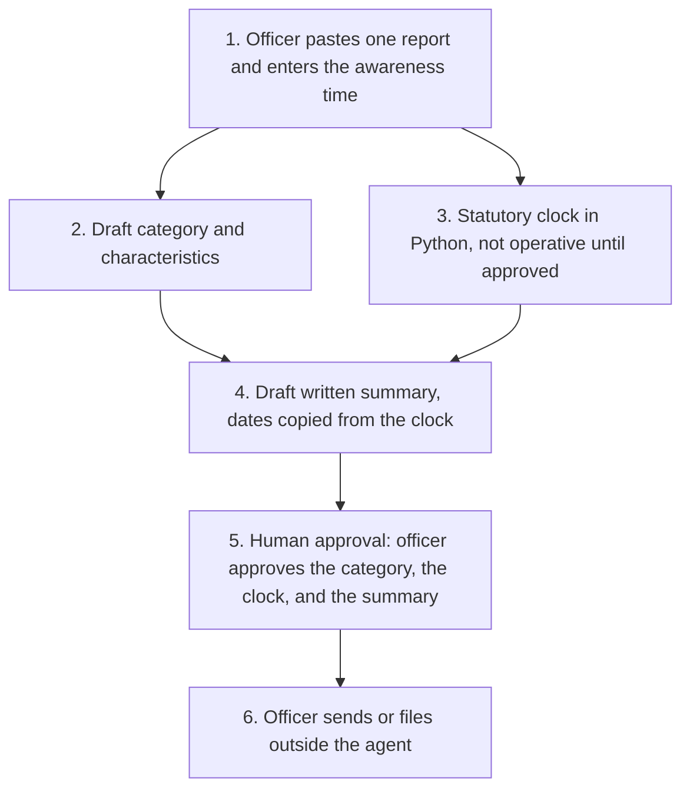

# Awaab's Law hazard triage

<span class="status status-available">Available</span> · Autonomy A1 · Experiment 05 · Catalogue ID UK01

A starter for councils and other social landlords in England. It helps a housing officer turn one tenant report into a draft triage: a proposed hazard family and category, the statutory clock, characteristics for the officer to review, a draft written summary, Housing Ombudsman escalation information, and a reasonable-endeavours record built only from steps the officer entered.

The officer approves the hazard category, the clock, and every tenant-facing summary. Nothing in the folder sends a message or writes a housing management system.

If this page and [`agent-manifest.yaml`](https://github.com/rahul-bachina/copilot-agent-experiments/blob/main/experiments/05-awaabs-law-hazard-triage/agent-manifest.yaml) disagree, the manifest is the control.

## The problem

Section 10A of the Landlord and Tenant Act 1985 implies a covenant, in a relevant social housing lease in England, that the lessor will comply with prescribed requirements. Those requirements are the Hazards in Social Housing (Prescribed Requirements) (England) Regulations 2025 (SI 2025/1042). They came into force on 27 October 2025. They are often called Awaab's Law.

The timeframes are fixed. An emergency is 24 hours. A standard investigation is 10 working days beginning on the day after awareness. A written summary is 3 working days after the investigation. Relevant safety work for a significant hazard is 5 working days after the investigation. Supplementary preventative work has a 5-working-day begin-or-take-steps duty and, only where an officer records that beginning in that time is not reasonably practicable, a 12-week long-stop. Missing a date, or letting a model invent one, is the failure this clock is meant to avoid.

The pages cited in the experiment were opened on 24 October 2026. On that day Phase 2 was still a draft instrument, and Phase 3 had no instrument. The clock follows the made regulations and flags the rest.

## Who it helps

**Housing officers.** They get a proposed category, dates from code, a draft summary that says it has not been given to the tenant, and a record that lists only the steps they typed.

**Tenants.** The landlord still gives any written summary. The agent does not send it, does not decide the category, and does not label anyone. A report about overcrowding alone does not get an Awaab's Law clock, because the regulations exclude a lack of adequate space. Other housing duties are outside this starter.

**The landlord.** Dates come from `src/statutory_clock.py`, which does not call a model and does not use the network. The same inputs always produce the same JSON. High-risk actions are disabled in the manifest. The folder is a starter a housing lead, a DPO, and an architect can review before anyone connects it to a tenant.

## What it does

**The clock**, which is the part you can run today, calculates dates for a social home in England. A date is operative only when the officer has confirmed the social home, approved the category, and approved the clock, and the phase is in force.

| Clock | Rule, as cited in the experiment | What the code does |
| --- | --- | --- |
| Emergency investigation and relevant safety work | Regulation 5 | 24 hours from the awareness time, or from investigation completion if the officer records Condition 2. The weekend is not skipped. |
| Standard investigation | Regulation 6 | 10 working days beginning on the day after awareness. |
| Written summary | Regulation 9 | 3 working days beginning on the day after the investigation is completed. The regulation 9(1) exception is not decided. |
| Significant-hazard safety work | Regulation 11 | 5 working days beginning on the day after the investigation. |
| Begin preventative work, or take steps | Regulation 13 | 5 working days beginning with the relevant day, and a 12-week long-stop only if the officer records that beginning sooner is not reasonably practicable. Completion is "a reasonable period". No day is invented. |

A working day is any day other than a Saturday, a Sunday, Christmas Day, Good Friday, or a bank holiday in England and Wales (regulation 2).

**What is in force.** Phase 1, from 27 October 2025: emergency hazards other than overcrowding, and significant hazards associated with damp, mould or fungal growth. An emergency in a family that Phase 2 would later add as a *significant* hazard, such as an electrical hazard, can already be in force. The officer still approves that category.

**What is not in force.** Phase 2 is the draft Hazards in Social Housing (Prescribed Requirements) (England) (Amendment) Regulations 2026. The legislation.gov.uk page retrieved on 24 October 2026 said it had not been made. The draft says it comes into force on 30 November 2026 and would add significant hazards for excess cold and heat, domestic hygiene, falls, electrical hazards, fire and explosions, and structural collapse. It would also change the significant-risk test to "make safe within 15 working days". That test is not encoded. Phase 3, the remaining Housing Health and Safety Rating System hazards except overcrowding, has no commencement date on the MHCLG guidance read that day. A GOV.UK news story says it will be introduced in 2027. There is no switch that turns a Phase 3 significant-hazard clock on.

**The mock triage** proposes a family and a category, flags characteristics, and drafts the summary. It is a keyword stand-in tuned to the synthetic fixtures. It is not a model.

**The Housing Ombudsman block** is published information: two complaint stages, the Code timescales, and the resident-page statement that a stage 2 response is normally referable within 12 months. The agent does not refer, and it does not turn the Code numbers into an operative date. The Code text that was read did not define "working day".

**The endeavours record** lists steps an officer typed. `defence_made_out` is false. Section 10A(5) is a defence the lessor must prove. The agent does not find that it is made out.

## What it does not do

These are disabled in the manifest.

- It does not decide the hazard category, or that a tenancy is a social home.
- It does not send the written summary or any other tenant-facing message.
- It does not write a housing management system, a repairs system, or a Dataverse row.
- It does not decide that reasonable endeavours are made out.
- It does not refer a complaint to the Housing Ombudsman, or decide that the Ombudsman can consider it.
- It does not book alternative accommodation or spend money.
- It does not label a tenant as vulnerable, or write a marker onto a tenancy.
- It does not lower a proposal because the report text says to.
- It does not apply Phase 2 or Phase 3 as if they were in force.
- It does not apply the regulations outside social housing in England.
- It does not give legal advice.
- It does not calculate timeframes inside a model.

## How the work flows

Step 5 is the human approval. Sending and filing stay outside the agent even after the officer accepts the draft.

1. The officer pastes one report and enters the awareness time. A tenant-facing capture topic, if a landlord later publishes one, uses a fixed line and does not state a deadline. This repository does not publish that channel.
2. The draft proposes a hazard family and category, and flags characteristics with quotes. In this folder that step is the mock triage. A Foundry call is described and not built.
3. The Python clock calculates dates. They stay non-operative until the officer has confirmed a social home in England, approved the category, and approved the clock. Phases that are not in force stay non-operative.
4. A draft written summary is assembled. It copies operative dates from the clock. It says it has not been given to the tenant.
5. **Human approval.** The officer approves the category, the clock, and the summary. They also approve any endeavours record before it is filed, and any characteristic before it is recorded.
6. The officer sends or files in the landlord's own systems, under their own access. The agent has no tool for that.



What is not a tool of the agent, even after step 5: sending to the tenant, a housing-system write, a finding that reasonable endeavours are made out, an Ombudsman referral, a decant booking, and a vulnerability label on the tenancy.

## Architecture diagram

The diagram below is the file shipped in the experiment, copied into this site at build time.

![Architecture diagram titled Hazard triage, Awaab's Law. The officer pastes one report and enters the awareness time. A draft proposes a hazard family and category and flags characteristics without labelling the tenant. The statutory clock is Python: 24 hours for an emergency, then 10, 3 and 5 working days, and a 12-week long-stop only if an officer records it. The officer approves the category, the clock, and the summary, and sends or files outside the agent. A separate box states what is not a tool: no send, no housing-system write, no defence finding, no Ombudsman referral, and no spend.](img/05-awaabs-architecture.png)

## Microsoft stack

| Piece | Role in this experiment |
| --- | --- |
| Python standard library | `src/statutory_clock.py`. No Azure credentials and no network. |
| Mock triage | `src/triage.py`. Keyword stand-in for the proposal and the drafts. |
| pytest | The only declared dependency. Used by the unit tests. |
| Copilot Studio, standard harness | Build guide for tenant and officer intake. Not an importable solution. One action is allowed in that guide: a flow that returns the clock JSON and then stops. |
| Copilot Studio, GitHub Copilot harness | Build guide for officer case review and the endeavours record, with two skills. Not the GitHub Copilot service. The same clock. |
| Power Automate | Only as that clock action, called with a locked-down identity. The guide says not to add ten working days with the flow's own calendar. |
| Microsoft Foundry | Optional extractor and drafter, described in the experiment's `docs/foundry.md`. No Foundry resource is created here. The model is told not to calculate dates. |
| Dataverse | Not connected. A later custom table, written by an officer and not by the agent, would need a manifest change. |
| Key Vault | Named for a key if a managed identity cannot be used, and as a way to remove Foundry access. Not provisioned. |

## Security and permissions

Manifest `exp-05-awaabs-law-hazard-triage`, version 0.1.0. Owner in the manifest: Housing repairs and complaints. Autonomy **A1**. Writes disabled. Sends disabled. Approve or reject, regulated decision, production record change, external send, and spending are disabled. Further high-risk actions are also disabled: referring to the Housing Ombudsman, finding the reasonable-endeavours defence made out, labelling the tenant, and downgrading the proposal from the report text.

Contacts in the manifest use `example.com`. They are placeholders, not a landlord.

**What a run may read.** The report the officer supplies, the awareness time, and, if the officer has confirmed them, the category, the hazard family, and the other clock inputs. Steps the officer types. The static instructions. The Python starter does not persist the text.

**What it must not read.** Housing management production data, tenancy vulnerability markers, contractor or finance systems, mailboxes, Housing Ombudsman systems, and other tenants' reports.

**Human approval, before anyone relies on the output.**

| Decision | Who |
| --- | --- |
| Approve the hazard category and hazard family | Housing officer |
| Confirm the tenancy is a social home in England | Housing officer |
| Approve the clock | Housing officer |
| Record Part 6 compliance, or that preventative work cannot reasonably begin within five working days | Housing officer |
| Review a vulnerability characteristic before it is recorded | Housing officer |
| Approve the written summary before it is given to the tenant | Housing officer |
| Approve an endeavours record before it is filed | Housing officer |
| Send, file, decant, spend, refer, or close | Authorised housing manager. Outside the agent even after the draft is approved. |

Viewing a draft and calculating a clock that comes back non-operative do not need a separate approval. Relying on the date does.

**UK GDPR.** The manifest's lead basis is Article 6(1)(c), legal obligation under section 10A, and it says the landlord's DPO confirms that before any production use. A council may also consider public task. A private registered provider should not copy that basis without advice. Report text can contain health information and information about a child. The manifest does **not** assert an Article 9 condition. The tenant is not labelled vulnerable, nothing is written to a tenancy, and an officer reviews a flag before it is recorded. The starter does not make the category a solely automated decision. Production inference, if used, should run in Microsoft Foundry in UK South or UK West. This page is not a DPIA.

**Prompt injection.** Fixtures include instructions to ignore the rules, send the summary, mark the tenant vulnerable, treat a 2019 inspection as the awareness time, write the housing system, and declare the defence. The mock triage keeps the officer's awareness time, refuses to send, and leaves those decisions in `decisions_not_taken`. `tests/test_triage_safety.py` checks that. The residual risk recorded is a misleading draft. The officer is the control.

**Controls named for a later deployment, and not turned on here.** Entra Agent ID (the platform page read on 24 October 2026 says generally available from April 2026; the admin center creation wizard was still labelled Preview). Conditional Access for an agent identity. Power Platform DLP. Foundry prompt shields, whose current portal label was not re-checked. Key Vault. Purview, which is not connected and whose Copilot Studio wiring is unverified here. Application Insights, without the report text. Detail is in the experiment's security note.

**Risk register, assessed 24 October 2026 for this starter rather than a named landlord.** Residual risk is not all Low.

| ID | Risk | Inherent | Residual | Owner in the manifest |
| --- | --- | --- | --- | --- |
| R1 | A wrong category, or a phase that is not in force treated as if it were | High | Medium | Housing repairs and complaints |
| R2 | A health condition or a child is missed, or the tenant is labelled | High | Medium | Housing repairs and complaints |
| R3 | Prompt injection produces a send, a write, a downgrade, or a defence | High | Low | Information security |
| R4 | Special-category data in a report is retained or reused | High | Medium | Data protection officer |
| R5 | The clock is relied on after Phase 2 is made, or the draft definition is missed | High | Medium | Housing repairs and complaints |

**Logging.** This starter writes no log. Before live use the manifest says to log who ran it, when, the size of the text rather than the text, the clock inputs and the rule ids, the officer's approvals, and any rejected draft.

**Kill switch.** Turn the Copilot Studio agent off. Remove the Foundry access used by any orchestration. If a connector has been added despite the default, block it in a Power Platform DLP policy.

**Review.** Reviewed for this starter on 24 October 2026. Next review 24 April 2027, and sooner if the amendment is made or Phase 3 is laid, or if England and Wales bank holidays change by proclamation.

## How to try it

Python 3.10 or newer. No Azure credentials and no network. The clock uses the standard library. pytest is installed from `requirements.txt`.

```bash
cd experiments/05-awaabs-law-hazard-triage
python -m pip install -r requirements.txt
python -m pytest tests/ -v
python eval/evaluate.py
python src/statutory_clock.py \
  --aware-at 2026-01-08T09:00:00+00:00 \
  --category significant \
  --hazard-family damp_mould_fungal_growth \
  --social-home-in-england \
  --approve-category \
  --approve-clock
```

`eval/evaluate.py` prints a mock smoke test. The 24 fixtures are synthetic and the classifier is a keyword stand-in tuned to them. `eval/smoke_report.json` is that run, saved so a reviewer can see it without re-running. The file labels itself a mock smoke test and not a measure of model accuracy. It records 24 of 24 fixtures processed by that stand-in. No model was called. The dates inside that run are the deterministic calculation.

Worked examples, which match the clock:

- Awareness Thursday 8 January 2026 at 09:00, Europe/London. Officer confirms a social home in England, a significant damp and mould hazard, and the clock. The standard investigation period ends on Thursday 22 January 2026. The summary and the safety-work dates are not calculated until the officer records that the investigation was completed.
- Awareness Friday 2 January 2026 at 16:00. Officer confirms an emergency. The Condition 1 period ends at 16:00 on Saturday 3 January 2026.

Without the approval flags, the same arithmetic is returned and `operative` is false.

Use the synthetic fixtures if you rebuild either harness. Do not paste a real report into a shared test environment. The fixtures use invented tenancies at Example Court, Testborough.

## Limitations

- The standing bank-holiday pattern does not include one-off proclamations. A moved bank holiday has to be passed in.
- "Ten working days beginning on the day after" treats that day as day 1 when it is a working day. A court decides a dispute about the count.
- "Twelve weeks beginning with" is implemented as 84 days inclusive. It is not moved for a weekend.
- The 24-hour period needs a time. A date with no time is refused.
- On 24 October 2026 the Phase 2 amendment was a draft and had not been made. A caller can assert that a made instrument is in force. The assertion does not make the draft law, the warning stays, and the date cannot be operative before 30 November 2026.
- Phase 3 has no verified commencement date and no switch.
- The draft exclusions for some fire hazards, and for residential evacuation plans, are not applied. They are not law yet.
- Amendments to section 10A by the Renters' Rights Act 2025 were waiting for a commencement date on the page read that day. They are not encoded.
- The mock smoke test is not a model score. A live Foundry run has not been done.
- This is not legal advice and it is not a statement of a landlord's compliance.

## Source

- [Experiment folder](https://github.com/rahul-bachina/copilot-agent-experiments/tree/main/experiments/05-awaabs-law-hazard-triage)
- [Permissions manifest](https://github.com/rahul-bachina/copilot-agent-experiments/blob/main/experiments/05-awaabs-law-hazard-triage/agent-manifest.yaml)
- [Security and permissions](https://github.com/rahul-bachina/copilot-agent-experiments/blob/main/experiments/05-awaabs-law-hazard-triage/docs/security-and-permissions.md)
- [Harness comparison](https://github.com/rahul-bachina/copilot-agent-experiments/blob/main/experiments/05-awaabs-law-hazard-triage/docs/harness-comparison.md)
- [Architecture note](https://github.com/rahul-bachina/copilot-agent-experiments/blob/main/experiments/05-awaabs-law-hazard-triage/docs/architecture.md)
- [Experiment README](https://github.com/rahul-bachina/copilot-agent-experiments/blob/main/experiments/05-awaabs-law-hazard-triage/README.md)
