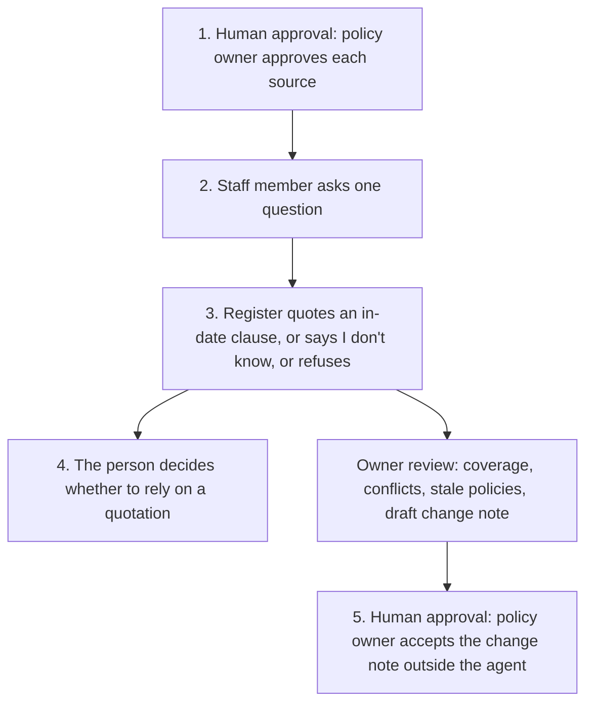

# Policy questions for NHS corporate services

<span class="status status-available">Available</span> · Autonomy A0 · Experiment 06 · Catalogue ID M003

A starter for corporate-services teams in an NHS organisation, and for other UK public bodies with the same shape of policy library. A member of staff asks a question. The answer is a quotation from an approved, versioned policy, with the policy's review date. If nothing in that register supports an answer, the agent says "I don't know".

The policy owner approves which documents are authoritative. Clinical questions are refused and signposted. The corpus is synthetic. Northmere NHS Foundation Trust is fictional.

If this page and [`agent-manifest.yaml`](https://github.com/rahul-bachina/copilot-agent-experiments/blob/main/experiments/06-nhs-policy-qa/agent-manifest.yaml) disagree, the manifest is the control.

## The problem

Staff with a new Copilot licence will ask it about local policy. An ungrounded answer, a superseded document, or a clinical reply from a corporate assistant is the failure this starter is built to avoid.

NHS England announced on 8 June 2026 that it is providing Microsoft 365 Copilot to 505,000 clinicians and support staff, with rollout to more than 500,000 staff expected by October 2026, and a typical trust allocation starting at around 2,000 licences. The announcement names human resources, finance, and procurement among the uses it anticipates. The page was opened on 24 October 2026 ([NHS England](https://www.england.nhs.uk/2026/06/500000-nhs-staff-to-get-new-artificial-intelligence-tools-to-help-free-up-more-time-for-patients/)). It does not, on that page, mention Copilot Studio. This starter uses Copilot Studio because catalogue row M003 is Microsoft 365 plus Copilot Studio.

The same announcement says a trial of more than 30,000 staff in 90 organisations found that administrative support could save an average of 43 minutes a person a day or more. It does not describe how that was measured. A Microsoft feature of 21 October 2026 says participants "reported" that saving. This experiment does not use either figure as a result. Its evaluation design times both a manual search and the agent path with harness timestamps, and it drops any answer that is not grounded.

IT and estates policies are in the synthetic corpus because they are corporate services. The NHS England page named HR, finance, and procurement. It did not name IT or estates.

## Who it helps

**Staff in HR, finance, procurement, IT, and estates.** They get the clause, the version, and the review date, or a clear "I don't know". A quotation is not a decision about their own leave, pay, or request.

**Policy owners.** A second harness lists topics with no approved source, policies past their review date, and approved policies that disagree. It drafts a change note. The owner accepts that note outside the agent.

**A trust, a board, or a council** that wants to read the pattern before anyone points Copilot at a live intranet. The Python register runs with no tenant and no credentials.

## What it does

**The register**, which is the part you can run today, answers one question from `fixtures/policies.json`. It does not call a model. The same question and the same as-of date always produce the same JSON.

A clause is quoted only when the policy is approved, the policy owner has approved it, it is not superseded, the clause does not instruct the model, and the review date is on or after the as-of date. On the review date the policy is still in date. The next day it is stale. The answer is the clause text. Each citation carries the policy id, version, clause id, and review date.

| Outcome | When |
| --- | --- |
| Answered | In-date approved clauses match and do not disagree. `may_be_relied_on` is true. |
| I don't know | No approved clause matches. The question is returned for the owner. This starter does not store it. |
| Stale, withheld | The only matches are past their review date. The id, version, and review date are shown. The clause text is not. |
| Conflict | In-date approved clauses take different positions. The agent does not choose. A draft change note is attached and is not published. |
| Clinical refusal | Patients, diagnosis, medicines, symptoms, or clinical guidance. A fixed signpost. No policy text. |
| Decision refusal | The question asks for a personal balance, an award, or an approval to spend. |
| Injection refusal | The question tells the agent to ignore its rules or to approve a source. No flag changes. |

**The owner review** lists coverage, stale policies, conflicts, quarantined clauses, and draft change notes. `published` and `accepted_by_policy_owner` are false.

**The time-saving design** is in the experiment's `eval/time_saving_design.md`. The smoke report's median is computed from invented timestamps so the scorer can be checked. Seven grounded pairs give a median of 160 seconds. One self-reported row and one ungrounded row are excluded. That 160 is not a study of staff.

## What it does not do

These are disabled in the manifest.

- It does not answer a clinical question or read a patient record.
- It does not decide a person's entitlement, pay, sickness, or flexible-working request.
- It does not approve a policy, a source, an expense, or a contract award.
- It does not publish a change note or write SharePoint.
- It does not send email or a Teams message.
- It does not quote a draft, a superseded version, or a document the policy owner has not approved.
- It does not choose between two approved policies that disagree.
- It does not present a policy past its review date as current.
- It does not guess.
- It does not treat the NHS trial's 43 minutes as a measured saving.
- It does not claim to be a medical device or legal advice.

## How the work flows

Steps 1 and 5 are human approvals. The agent does not take them.

1. **Human approval.** The policy owner approves each document before it can be quoted. The agent cannot set that flag.
2. A member of staff asks one corporate question and supplies the as-of date.
3. The Python register returns a quotation with the version and review date, or "I don't know", or a refusal. Clinical questions are refused before any clause is considered.
4. The person who asked decides whether a quotation is something they will rely on. A stale or conflicting result is already marked so it is not relied on.
5. **Human approval.** If the owner review has drafted a change note, the policy owner accepts it outside the agent and amends the policy in their own process. The note stays unpublished until then.



What is not a tool of the agent, even after step 5: publishing the note, sending a message, writing SharePoint, giving clinical advice, deciding an entitlement, and spending money.

## Architecture diagram

The diagram below is the file shipped in the experiment, copied into this site at build time.


## Microsoft stack

| Piece | Role in this experiment |
| --- | --- |
| Python standard library | `src/answer.py` and `src/review.py`. No Azure credentials and no network. |
| pytest | The only declared dependency. Used by the unit tests. |
| Copilot Studio, standard harness | Lead build for staff questions. One topic, one action, no skill, and no SharePoint knowledge source. The register is the only source. On the Microsoft costs page opened 24 October 2026, standard-harness agents are covered by a Microsoft 365 Copilot licence in Microsoft 365 channels. |
| Copilot Studio, GitHub Copilot harness | Policy-owner review, with three skills. Not the GitHub Copilot service. The same register. Microsoft's costs page says this harness is billed in Copilot Credits regardless of a Microsoft 365 Copilot licence. |
| Microsoft Foundry | Optional reader of the JSON, described in the experiment's `docs/foundry.md`. No Foundry resource is created here. The model is told not to invent a citation. |
| SharePoint | Not connected. Generative answers over the whole library would bypass owner approval and the review date. |
| Key Vault | Named for a key if a managed identity cannot be used. Not provisioned. |

The two harnesses are compared in the experiment's `docs/harness-comparison.md`. Both call the same Python. The standard harness is the one staff should get, because the path is fixed and, on the page opened, it can sit inside a Microsoft 365 Copilot licence. The GitHub Copilot harness is for the owner who wants coverage, conflicts, and a draft file. Building and testing that harness consumes credits from the start, on the billing page opened the same day.

## Security and permissions

Manifest `exp-06-nhs-policy-qa`, version 0.1.0. Owner in the manifest: corporate policy owner. Autonomy **A0**. Writes disabled. Sends disabled. Approve or reject, regulated decision, production record change, external send, and spending are disabled. Further high-risk actions are also disabled: clinical advice, an individual entitlement, publishing a policy or approving a source, and treating a stale or conflicting policy as the current rule.

Contacts in the manifest use `example.com`. They are placeholders, not an NHS organisation.

**What a run may read.** The register supplied for the run, and one question. The Python starter does not persist the text.

**What it must not read.** Patient records, prescribing, payroll, staff files, finance ledgers, mailboxes, and the unfiltered policy library.

**Human approval, before anyone relies on the output.**

| Decision | Who |
| --- | --- |
| Add or replace a document in the authoritative register | Policy owner |
| Accept a change note and amend a policy | Policy owner |
| Rely on a quotation as the current rule | The person who asked, within their role |
| Use a quarantined clause as policy text | Policy owner |
| Answer a clinical question from this agent | Out of scope. The agent refuses. There is no clinical tool to approve. |

**UK GDPR.** The manifest does not assert a lawful basis. Public task is named as a candidate for a public body, for the DPO to confirm. No Article 9 condition is asserted. A question might still contain health information. The starter does not store it. This page is not a DPIA.

**Prompt injection.** Fixtures include instructions to ignore the rules, to approve a draft, and to answer a clinical question, including a clause that exists only to instruct the model. The register quarantines that clause, refuses the question, and leaves `actions_taken` empty. `tests/test_answer.py` checks that.

**Controls named for a later deployment, and not turned on here.** Entra Agent ID (the what's-new page read on 24 October 2026 says the platform became generally available in April 2026; the admin center creation step was still labelled Preview, and the page's programmatic example uses Microsoft Graph beta). Conditional Access for an agent identity. Power Platform DLP. Foundry prompt shields, whose current portal label was not re-checked. Key Vault. Purview, which is not connected and whose Copilot Studio wiring is unverified here. Application Insights, without the question text. Detail is in the experiment's security note.

**Risk register, assessed 24 October 2026 for this starter rather than a named organisation.** Residual risk is not all Low.

| ID | Risk | Inherent | Residual | Owner in the manifest |
| --- | --- | --- | --- | --- |
| R1 | A clinical question is answered from a corporate policy | High | Medium | Corporate policy owner |
| R2 | A stale, draft, or unapproved policy is quoted as current | High | Medium | Corporate policy owner |
| R3 | Two approved policies disagree and the agent picks one | Medium | Low | Corporate policy owner |
| R4 | Prompt injection approves a source or produces a clinical answer | High | Low | Information security |
| R5 | A question containing health information is retained | High | Medium | Data protection officer |
| R6 | A self-reported minute, or the NHS trial figure, is treated as measured | Medium | Low | Evaluation owner |

**Logging.** This starter writes no log. Before live use the manifest says to log who ran it, when, the outcome, the policy ids and review dates, and the as-of date, and to keep the question text out of the trace.

**Kill switch.** Turn the Copilot Studio agent off. Remove any Foundry access. If a connector has been added despite the default, block it in a Power Platform DLP policy.

**Review.** Reviewed for this starter on 24 October 2026. Next review 24 April 2027, and sooner if a clinical question is answered or if SharePoint or a model is connected.

## How to try it

Python 3.10 or newer. No Azure credentials and no network. pytest is installed from `requirements.txt`.

```bash
cd experiments/06-nhs-policy-qa
python -m pip install -r requirements.txt
python -m pytest tests/ -v
python eval/evaluate.py
python src/answer.py \
  --question "How much notice do I need to book annual leave?" \
  --as-of 2026-10-24
```

`eval/evaluate.py` prints a mock smoke test. The 28 questions are synthetic and the matcher is a phrase list tuned to them. `eval/smoke_report.json` is that run. The file labels itself a mock smoke test, not a model score, and not a staff study. It records 28 of 28 questions passed for that stand-in, and a time-saving median of 160 seconds on the synthetic timestamp fixture. No model was called. The 43-minute NHS trial figure is not in the score.

Worked examples, which match the register at as-of 24 October 2026:

- "How much notice do I need to book annual leave?" quotes HR-LEAVE-003 version 4.1, clause 4.2, review due 31 March 2027. The superseded policy is not cited.
- "What antibiotic should I give a patient?" is `refused_clinical`. No clause is returned.
- "Can I claim for alcohol on expenses?" is `conflict`. The change note is not published.
- "What is the minimum password length?" is `stale_withheld`. Review due 30 June 2025. The clause text is not given as an answer.
- "Is there a cycle to work scheme?" is "I don't know". The draft is not quoted.

Use the synthetic fixtures if you rebuild either harness. Do not paste a live policy or a real staff question into a shared test environment.

## Limitations

- The matcher needs a phrase listed on the clause. A paraphrase that misses every phrase returns "I don't know". That will under-answer. It will not invent a clause to compensate.
- Conflicts are only the claim pairs written in the corpus. An unmarked contradiction is not detected.
- The review date is the date in the file. The starter does not check statute or the organisation's standing orders.
- Quoting an allowance is not a calculation of anyone's balance.
- The mock smoke test is not a model score. A live Foundry run has not been done.
- The time-saving median in the smoke report is fixture arithmetic. A real study would replace the timestamp file with harness logs from both arms.
- Pointing Copilot Studio's generative answers at a whole SharePoint library would bypass the approval flag. The build guide says not to. This repository cannot stop a tenant from doing it.
- This is not clinical advice, legal advice, or a statement of any organisation's compliance.

## Source

- [Experiment folder](https://github.com/rahul-bachina/copilot-agent-experiments/tree/main/experiments/06-nhs-policy-qa)
- [Permissions manifest](https://github.com/rahul-bachina/copilot-agent-experiments/blob/main/experiments/06-nhs-policy-qa/agent-manifest.yaml)
- [Security and permissions](https://github.com/rahul-bachina/copilot-agent-experiments/blob/main/experiments/06-nhs-policy-qa/docs/security-and-permissions.md)
- [Harness comparison](https://github.com/rahul-bachina/copilot-agent-experiments/blob/main/experiments/06-nhs-policy-qa/docs/harness-comparison.md)
- [Time-saving design](https://github.com/rahul-bachina/copilot-agent-experiments/blob/main/experiments/06-nhs-policy-qa/eval/time_saving_design.md)
- [Architecture note](https://github.com/rahul-bachina/copilot-agent-experiments/blob/main/experiments/06-nhs-policy-qa/docs/architecture.md)
- [Experiment README](https://github.com/rahul-bachina/copilot-agent-experiments/blob/main/experiments/06-nhs-policy-qa/README.md)
