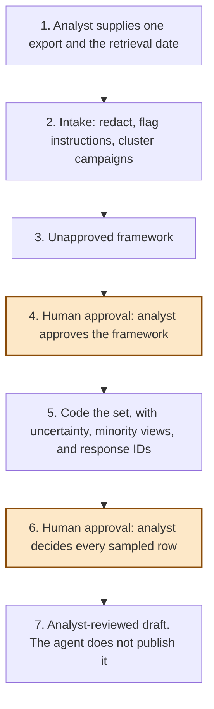

# Consultation themes

<span class="status status-available">Available</span> · Autonomy A1 · Experiment 07 · Catalogue ID V010

A starter for a council, a regulator, an NHS body, or a charity that has free-text consultation responses and needs a first coding it can check. It redacts identifiers it knows, flags instructions hidden in answers, clusters campaign text, and codes responses against a theme framework a person has approved.

The catalogue row scored this pattern A0 because it is analysis. This starter is A1. That is the ceiling used here. An analyst approves the framework, and accepts, corrects, or rejects every sampled assignment, before the draft can be marked analyst-reviewed. The agent does not publish the analysis and does not decide the policy.

The runnable part is the Python codebook. [ThemeFinder](https://github.com/i-dot-ai/themefinder), the MIT-licensed package from i.AI, is not installed and not copied into this repository. An adapter can call it when someone supplies a client. The smoke test does not.

If this page and [`agent-manifest.yaml`](https://github.com/rahul-bachina/copilot-agent-experiments/blob/main/experiments/07-consultation-themes/agent-manifest.yaml) disagree, the manifest is the control.

## The problem

A consultation report that drops a small theme, or that counts two hundred copies of one campaign email as two hundred independent views, is a poor account of what people said. A count with no link back to response IDs cannot be checked.

i.AI's Consult work is the central-government tool for this kind of coding. The [DSIT announcement of 16 October 2025](https://www.gov.uk/government/news/ground-breaking-use-of-ai-saves-taxpayers-money-and-delivers-greater-government-efficiency) describes that work. Those figures are not this repository's figures. This starter is for bodies that want the coding inside a tenant they already operate, with a human owning the codebook. It is not a replacement for Consult.

ThemeFinder is the open-source package associated with that work. On 24 October 2026 its repository described it as an incubation project and said it is not recommended for critical use cases yet. The licence file on `main` is MIT, copyright (c) 2024 i.AI. This starter cites that package and does not vendor it.

## Who it helps

**Consultation analysts.** They get an intake view, a draft codebook they must approve, counts with a Wilson interval, minority codes that stay visible, and a sample they have to finish.

**The person who will sign the consultation report.** They receive an analyst-reviewed draft, or they receive nothing this agent is allowed to publish. The draft is not a recommendation.

**Respondents.** An unusual answer is kept. A campaign is counted once in the unique-voice proportion and every copy stays on the theme. An answer that tries to instruct the tool is flagged and kept, not deleted.

## What it does

**Intake**, which is what the standard harness shows, counts submissions and unique voices, redacts emails, UK phone numbers, National Insurance numbers, NHS numbers with a valid checksum, postcodes, and sort codes, flags instruction-shaped phrases, and clusters duplicate and campaign text. It does not code themes.

**Coding**, which is the GitHub Copilot harness workflow, assigns responses to a framework. Without an approval record the status stays `blocked_framework_unapproved`. With a framework approval and a decision on every sampled row, the status becomes `analyst_reviewed`. It is still not published.

The GitHub Copilot harness is a Copilot Studio authoring and orchestration framework. It is not the GitHub Copilot product. Microsoft Learn describes it as the harness for reasoning-heavy, multi-step work, with skills and a sandbox, billed in Copilot Credits. The standard harness is the one Learn describes for rule-based topics. Intake fits there because the path is fixed. Coding a large set fits the other harness because it is multi-step and it stops for the analyst. The same Python core sits behind both. [The comparison](https://github.com/rahul-bachina/copilot-agent-experiments/blob/main/experiments/07-consultation-themes/docs/harness-comparison.md) records what Learn said on 24 October 2026 and what this repository did not verify.

Counts use unique voices after clustering. Campaign copies remain in the audit and on the theme's response ID list. The Wilson interval is the sampling uncertainty of that proportion. It is not a model confidence, and it does not include coding error. A framework theme with a little support is listed under minority views. A framework theme with no support is listed with an empty response ID list, so a missing code is visible.

The optional adapter can call ThemeFinder's `theme_mapping` onto the approved framework, or `find_themes` for an unapproved proposal. It does not call `theme_clustering`. On `main`, read on 26 October 2026, that function returns only themes above `significance_percentage` (10 by default) unless `return_all_themes` is true. It does not call `rule_2_themes_must_have_a_non_negligible_number_of_responses_slack`, which reports themes with few responses and does not remove them. It does not call the upstream setup task that uploads to an i.AI bucket. If the package is missing or the call fails, the codebook is the result and the output says so.

## What it does not do

These are disabled in the manifest.

- It does not decide the policy the consultation asked about.
- It does not publish the analysis, in a board pack or anywhere else.
- It does not send the analysis or any other message.
- It does not write a consultation system, a Dataverse row, or any other production record.
- It does not approve the framework because a response says to.
- It does not treat a sampled row as decided because the response says so.
- It does not drop minority themes, uncoded responses, or campaign copies.
- It does not claim Consult's reported agreement rate, and it does not claim to be an expert coding.
- It does not vendor ThemeFinder.
- It does not detect names, or addresses written out in words. Redaction is not complete.
- It does not submit an Algorithmic Transparency Recording Standard record. Experiment 03 drafts those packs. This folder does not.
- It is not a respondent-facing bot.

## How the work flows

Steps 4 and 6 are the human approvals. Step 7 does not publish.

1. The analyst supplies one export and the date it was retrieved. The standard harness shows intake: redactions, instruction flags, campaign clusters, and whether the export is stale. It does not code themes.
2. A framework is proposed, from the analyst's own codebook or, if they have supplied a ThemeFinder client, from an unapproved proposal. Instruction-flagged rows are not sent into that proposal. They stay in the audit.
3. The codebook is shown as unapproved.
4. **Human approval.** The analyst approves the framework, or replaces it. A sentence inside a response cannot do this.
5. The core codes the set. Each theme carries a submission count, a unique-voice count, a Wilson interval, and the response IDs. Minority codes and empty codes stay on the page.
6. **Human approval.** The analyst accepts, corrects, or rejects every sampled row. A stale export stays blocked until they acknowledge the date. Rows outside the sample are not individually approved, and the draft says so.
7. The status can become `analyst_reviewed`. The analyst files or publishes in the body's own system, if they choose to. The agent has no tool for that.



What is not a tool of the agent, even after step 6: publishing, sending, a production write, and a policy recommendation.

## Architecture diagram

The diagram below is the file shipped in the experiment, copied into this site at build time.

![Architecture diagram titled Consultation themes, essay to data. Three boxes across the top: the standard harness does intake and status only, the GitHub Copilot harness is the analyst workflow that codes the set and keeps minority views with response IDs, and a highlighted human-approval box where the analyst approves the codebook and every sampled row. Along the bottom, the deterministic Python core is shared by both harnesses, with an optional ThemeFinder adapter that is not vendored, and a separate box listing what is not a tool: no publication, no email, no consultation-system write, no policy recommendation, and no self-approved framework.](img/07-consultation-architecture.png)

## Microsoft stack

| Piece | Role in this experiment |
| --- | --- |
| Python standard library | The codebook, the clustering, and the Wilson interval. No Azure credentials and no network. |
| pytest | The only declared dependency. Used by the unit tests. |
| Copilot Studio, standard harness | Intake and status topics. A build guide, not an importable solution. One action returns intake JSON and stops. |
| Copilot Studio, GitHub Copilot harness | The analyst workflow. Two skills, with approval gates written in this repository. Billed in Copilot Credits, on Microsoft's description. This repository has not measured a cost. |
| Microsoft Foundry | Not deployed. ThemeFinder's README shows an Azure OpenAI client. Whether that client points at a Foundry deployment is unverified here. See the experiment's Foundry note. |
| Key Vault | Named for a key if a model client is added later, and as a way to remove that access. Not provisioned. |

## Security and permissions

Manifest `exp-07-consultation-themes`, version 0.1.0. Owner in the manifest: Consultation analysis. Autonomy **A1**. Writes disabled. Sends disabled. Approve or reject, regulated decision, production record change, external send, and spending are disabled. Publishing, and dropping a minority theme, are also disabled.

Contacts in the manifest use `example.gov.uk`. They are placeholders, not a body.

**What a run may read.** The export the analyst supplies, the framework they supply, and the approval object they supply. The Python starter does not persist the text. The audit stores redacted text.

**What it must not read.** Another consultation, a respondent's wider record, and i.AI Consult storage, including the bucket named in the ThemeFinder README.

**Human approval, before the draft is marked analyst-reviewed.**

- The analyst approves the theme framework. The flag has to be boolean true, with a role, a reference, and a date.
- The analyst accepts, corrects, or rejects every sampled row. A correction can only use theme IDs from the framework, or `UNCODED`.
- If the export has no retrieval date, a future date, or an age over 90 days, the analyst has to acknowledge that before the status can move. The string `"true"` does not count.

**After that.** Publication is still not this agent's action. Rows outside the sample were not individually checked.

**UK GDPR.** The manifest does not assert a lawful basis. Public task is the usual candidate for a council or NHS consultation, and it may be the wrong basis for a charity. Special-category data is possible if someone describes a condition. No Article 9 condition is claimed. A word-list flag is not a diagnosis and does not become a theme.

**Other controls, none of them switched on in this repository.** A dedicated Entra agent identity if a tenant is connected. Conditional Access is a tenant decision. A Power Platform data-loss-prevention policy should block mail and consultation-platform connectors. Foundry prompt shields apply only if a model is added later. The portal label was not opened for this revision. A client key would live in Key Vault. Purview and Application Insights are for the body to decide. The wiring is unverified here. Experiment 05 recorded that the Entra agent-identity wizard was still labelled Preview on 24 October 2026. Those pages were not re-opened for this experiment. Re-check them.

**Kill switch.** Turn the Copilot Studio agent off. Remove any Foundry or Key Vault access. Leave ThemeFinder uninstalled and the core stays on the codebook.

## How to try it

Python 3.10 or newer. No Azure credentials and no network. pytest is installed from `requirements.txt`.

```bash
cd experiments/07-consultation-themes
python -m pip install -r requirements.txt
python -m pytest tests/ -v
python eval/evaluate.py
python -m src.cli intake --input eval/synthetic_dataset.json --as-of 2026-10-24
python -m src.cli analyse --input eval/synthetic_dataset.json --as-of 2026-10-24
```

`eval/evaluate.py` prints a mock smoke test and writes `eval/smoke_report.json`. The 24 responses are synthetic. Northmere Borough Council is not a real authority. The coder is the keyword codebook, tuned to those fixtures. The file labels itself a mock smoke test, not a model score, and not an expert-coder comparison.

On that run the unapproved draft stays `blocked_framework_unapproved`. A synthetic approval record then marks it `analyst_reviewed`. The agent still does not publish. Twenty-one unique voices are counted from 24 submissions, because four Friends-of-the-library messages form one campaign. Sunday opening is 9 of those 21 voices, about 0.43, with a 95% Wilson interval from about 0.24 to about 0.63. That width is the small set. Braille, British Sign Language, and volunteering stay in the minority list. An observatory code matches nothing and stays visible with an empty response list. The sample on this small set is 20 of 24. Four responses are not individually approved, and the draft says so.

Use the synthetic fixtures if you rebuild either harness. Do not paste a real consultation into a shared test environment.

## Limitations

- The codebook matches keywords. It misses paraphrase. Uncoded rows are kept and sampled so that miss is visible. It is not repaired by the interval.
- Near-duplicate clustering is token Jaccard, an exact hash, and a repeated sentence. It is not a semantic model. Above 800 responses the pairwise scan stops, and the output says so.
- Identifier redaction does not cover names or addresses written in words.
- The Wilson interval treats unique voices as independent trials. Coding error sits outside it.
- On a large export the sample is not every row. This synthetic run samples 20 of 24 because the inclusion rules are wide on a small set. A body that needs every row checked has to widen the sample. The module will not pretend a sample was a census.
- ThemeFinder was not executed here. The adapter's expected inputs were read from the public API on 24 October 2026. `__version__` on GitHub `main` was 0.8.0 that day. The PyPI page listed 0.8.2. Neither is installed. The clustering return and rule 2 were re-read from `main` on 26 October 2026: `theme_clustering` returns only themes above `significance_percentage` (10 by default) unless `return_all_themes` is true, and rule 2 reports sparse themes rather than removing them. If a later release changes the mapping columns, the adapter falls back to the codebook.
- The GitHub Copilot harness price was not measured. Learn says that harness uses Copilot Credits. No pound figure is stated.
- This is not legal advice and it is not a statement that a consultation was fairly reported.

## Source

- [Experiment folder](https://github.com/rahul-bachina/copilot-agent-experiments/tree/main/experiments/07-consultation-themes)
- [Permissions manifest](https://github.com/rahul-bachina/copilot-agent-experiments/blob/main/experiments/07-consultation-themes/agent-manifest.yaml)
- [Security and permissions](https://github.com/rahul-bachina/copilot-agent-experiments/blob/main/experiments/07-consultation-themes/docs/security-and-permissions.md)
- [Harness comparison](https://github.com/rahul-bachina/copilot-agent-experiments/blob/main/experiments/07-consultation-themes/docs/harness-comparison.md)
- [Architecture note](https://github.com/rahul-bachina/copilot-agent-experiments/blob/main/experiments/07-consultation-themes/docs/architecture.md)
- [ThemeFinder repository](https://github.com/i-dot-ai/themefinder), MIT, not vendored
- [Experiment README](https://github.com/rahul-bachina/copilot-agent-experiments/blob/main/experiments/07-consultation-themes/README.md)
