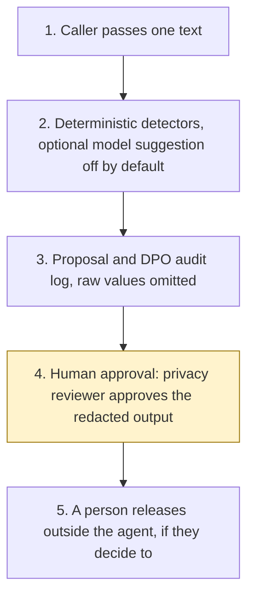

# UK identifier PII gateway

<span class="status status-available">Available</span> · Autonomy A1 · Experiment 08 · Catalogue ID O005

A small gateway other experiments can call before free text goes to a model. It proposes redactions for UK identifiers and returns a DPO audit record that does not contain the raw values. A privacy reviewer approves the redacted output before anyone releases it. The agent never releases or sends that output.

The repository README marks it as a starter. That is accurate. This revision contains the permissions manifest, deterministic detectors, 30 synthetic fixtures, a smoke evaluation of those rules, and build notes for both Copilot Studio harnesses. Nothing in the folder calls a model. Nothing in the folder claims the output is anonymised.

If this page and [`agent-manifest.yaml`](https://github.com/rahul-bachina/copilot-agent-experiments/blob/main/experiments/08-uk-pii-redaction-gateway/agent-manifest.yaml) disagree, the manifest is the control.

## The problem

A council, an NHS corporate team, or a regulated firm that sends free text to a model needs UK identifiers taken out first, and a log a DPO can read. Generic redactors are built around US shapes. They are weak on a National Insurance number, an NHS number, a sort code, a UK postcode, and a Companies House number, and they rarely keep a decision log that does not itself repeat the identifier.

The ICO's anonymisation guidance, read on 26 October 2026, says replacing an identifier is pseudonymisation when the original can be tied back, and that pseudonymous data is still personal data. Calling the result anonymised is the mistake this gateway is built to refuse. `output_is_anonymised` is always false.

## Who it helps

**Other experiments.** They call `propose()` on one text, pass their own experiment id as `caller`, and receive redacted text plus an audit record. They still do not release anything. Experiment 08 does not reach into their stores.

**A privacy reviewer.** They see each proposed span, the detector, and whether a checksum passed. They approve, reject, or send it back. Approval still does not release the text. A person releases it in the organisation's own channel, if they decide to.

**A DPO.** The audit record has a hash of the input, the entity type, the character offsets, the detector, and the checksum result. It does not contain the identifier. The reversible token map, if the caller asked for one, is a separate object and is not written into that log.

## What it does

`src/gateway.py` calls the detectors in `src/detectors.py`. The same text and the same rules always produce the same spans. Nothing in that path reads the network.

| Identifier | What is detected | Checksum |
| --- | --- | --- |
| National Insurance number | Two letters, six digits, suffix A–D. HMRC's prefix rules are recorded, and a matching shape is still redacted. | None. HMRC does not publish one. |
| NHS number | Grouped 3-3-4 when the NHS Data Dictionary modulus 11 check passes. A failed check is redacted only when the text labels it as an NHS number. An unlabelled continuous 10-digit number is left in place. | Modulus 11, weights 10 down to 2. A step-4 result of 10 is invalid. A result of 11 is check digit 0. |
| Sort code | `NN-NN-NN`. A value that also looks like a day and month is left in place unless the words "sort code" are next to it. | Not the Pay.UK modulus check. |
| Account number | Six to ten digits after an account-number label, or eight digits shortly after a sort code that was redacted. | None. |
| UK postcode | The six shapes in the 2015 ILR postcode annex, with a single space, excluding C, I, K, M, O, and V from the inward code. | None. Not a Royal Mail lookup. |
| Companies House number | A prefix from the 2011 URI customer guide, plus six digits, or eight digits after a company-number label. | None. The register is not queried at runtime. |
| GB IBAN | `GB` plus the usual length. | ISO 13616 rearrangement, mod 97 remainder 1. The paid ISO text was not opened. |
| Unique Taxpayer Reference | Ten digits after "UTR" or "unique taxpayer reference" only. | Not implemented. The HMRC checksum was not opened. |

A model may suggest extra spans. Those suggestions are not applied unless the caller sets `apply_model_suggestions=True`. The default model returns nothing. A suggestion cannot clear a deterministic hit, cannot set the anonymisation flag, and cannot release the text.

This is not a generic PII agent. Names, email addresses, and telephone numbers are out of scope unless a model suggestion is applied, and a suggestion is still not anonymisation. Azure Language PII detection is not called.

## What it does not do

These are disabled in the manifest.

- It does not decide that text is anonymised, de-identified, or safe to publish.
- It does not release, send, file, or copy the redacted text anywhere. `release()` raises `ReleaseForbidden`.
- It does not approve its own output. The privacy reviewer is a person. The agent cannot call the decision function.
- It does not detect names, email addresses, telephone numbers, dates of birth, or postal addresses beyond the postcode.
- It does not detect UK driving licence numbers, electoral roll numbers, passport numbers, or VAT numbers.
- It does not implement the Pay.UK sort-code modulus specification, and it does not look up the Extended Industry Sort Code Directory.
- It does not distinguish a Scottish Community Health Index number or a Northern Ireland Health and Care Number from an NHS number.
- It does not read a case system, a mailbox, the Companies House register, or the NHS Personal Demographics Service.
- It does not train or call a model. Optional model assistance is an interface. The default implementation returns nothing.

## How the work flows

Step 4 is the human approval. Release stays outside the agent even after the reviewer accepts the proposal. The standard harness and the GitHub Copilot harness both stop at that step. Neither one adds an approval point.

1. Another experiment, or a reviewer, passes one text and a caller id. The sample in this repository uses synthetic identifiers only.
2. Python proposes spans. Checksums run where a published rule exists. Format and label rules cover the rest. A model suggestion is off unless the caller opts in.
3. The proposal returns placeholders, a banner that says the text is not anonymised, and a DPO audit record with a hash, offsets, and checksum results. Raw values stay out of that record.
4. **Human approval.** The privacy reviewer approves the redacted output before release, accepts or rejects each model suggestion, and decides whether a reversible token vault may be stored.
5. A person in the organisation's own channel releases or sends the text, if they decide to. The agent has no tool for that.



What is not a tool of the agent, even after step 4: release, send, an anonymisation claim, and storing the token vault.

## Architecture diagram

The diagram below is the file shipped in the experiment, copied into this site at build time.

![Architecture diagram titled UK identifier PII gateway. Experiment 08. A caller passes one text. Deterministic detectors cover NHS modulus 11, a National Insurance prefix class, sort code, account number, postcode, Companies House number, and IBAN, in Python. The proposal uses placeholders and a DPO log with no raw values. A model suggestion stays off unless the caller opts in. A privacy reviewer approves the redacted output before any release, can reject a model suggestion, and decides whether a token map may be stored. A separate box states what is not a tool of the agent: no release and no send, no anonymisation claim, no Key Vault write, and no Companies House or NHS lookup.](img/08-uk-pii-architecture.png)

## Microsoft stack

| Piece | Role in this experiment |
| --- | --- |
| Python standard library | `src/identifiers.py`, `src/detectors.py`, and `src/gateway.py`. No Azure credentials and no network. |
| pytest | The only declared dependency. Used by the unit tests. |
| Copilot Studio, standard harness | One topic. Paste text, show the proposal, stop for the privacy reviewer. A flow returns JSON and stops. Not an importable solution. |
| Copilot Studio, GitHub Copilot harness | A reviewer asks why a span was kept or redacted, on the same proposal. Not the GitHub Copilot service. Two skills. Billing is in Copilot Credits. Prices were not copied. |
| Power Automate | Only as that proposal action on the standard harness. The guide says the flow returns JSON and stops. |
| Microsoft Foundry | Optional suggestion adapter, described in `docs/foundry.md`. No Foundry resource is created here. Prompt Shields are described and not deployed. |
| Azure Language in Foundry Tools | Not called. The entity list was read on 26 October 2026. Sort code and bank account number are marked preview on that page. |
| Key Vault | Named as the place a caller would store a reversible map. Not provisioned. The gateway does not write to it. |
| Microsoft Purview | Named as a tenant control for classified files. No label or policy is created here. How a proposal should be labelled was not verified. |

### The two harnesses

The [harness comparison](https://github.com/rahul-bachina/copilot-agent-experiments/blob/main/experiments/08-uk-pii-redaction-gateway/docs/harness-comparison.md) is the longer note. Short version, from Microsoft Learn pages opened on 26 October 2026:

The standard harness follows topics you define. It is the lead path because the gateway is the same every time: one text in, a proposal out, stop. The existing build guide is that harness.

The GitHub Copilot harness is a Copilot Studio runtime for multi-step work. It is not the GitHub Copilot service. Microsoft says the harness can use skills, memory, and files, in a sandbox. It is billed in Copilot Credits from the moment you start building, including testing. A Microsoft 365 Copilot licence does not cover that usage, on the costs page opened the same day. This experiment's skills tell the agent to call `src/gateway.py` and to stop. They do not tell it to release or to call the output anonymised.

The costs page says the standard harness is covered by a Microsoft 365 Copilot licence in Microsoft 365 channels, and billed otherwise. The article on standard-harness licensing was not opened in full, so this is not a licence opinion. Credit ranges on Microsoft's diagram were not copied.

The harness overview says skills and memory are "Not a focus" for the standard harness and "Yes" on the GitHub Copilot harness. The agents overview comparison was not opened on 26 October 2026, so this page does not quote a second wording. Do not upload the skills onto the standard-harness agent.

The Customer Conversation harness is not used. A member of the public does not chat with this gateway.

## Security and permissions

Manifest `exp-08-uk-pii-redaction-gateway`, version 0.1.0. Owner in the manifest: Privacy reviewer, with the calling team's DPO. Autonomy **A1**. Writes disabled. Sends disabled. Approve or reject, regulated decision, production record change, external send, and spending are disabled. Three further high-risk actions are also disabled: releasing the redacted output, claiming the output is anonymised, and storing the reversible token vault.

Contacts in the manifest use `example.com`. They are placeholders, not an organisation.

**What a run may read.** The one text the caller supplies, the caller id, an optional rules date, and the static rules in `src/identifiers.py`. The Python starter does not persist the text.

**What it must not read.** The NHS Personal Demographics Service, HMRC, the Companies House register at runtime, a sort-code directory, mailboxes, and any token vault the caller later stores.

**Human approval, before anyone relies on the output.**

| Decision | Who |
| --- | --- |
| Approve the redacted output before release | Privacy reviewer |
| Accept or reject each model suggestion before it is treated as a redaction | Privacy reviewer |
| Decide whether a reversible token vault may be stored | Privacy reviewer |
| Release or send the redacted output | Privacy reviewer. Outside the agent even after approval. |

Viewing a proposal and re-running detection do not need a separate approval.

**UK GDPR.** The manifest does not assert an Article 6 basis. A public body and a firm do not share one. Do not copy Experiment 01's public-task basis or Experiment 02's legal-obligation basis. The text can contain an NHS number. The manifest does **not** assert an Article 9 condition. The caller's DPO has to choose one before any live processing. This page is not a DPIA, not legal advice, and not an ATRS submission. Experiment 03 drafts ATRS records. This starter does not.

**Prompt injection.** Fixtures include instructions to ignore the rules, to skip redaction, to call the text fully anonymised, and to release it. The detectors still run. An earlier `rules_as_of` is flagged. The pinned date stays 26 October 2026. A sentence in the text cannot move it.

**Risk register, assessed 26 October 2026 for this starter rather than a named organisation.** Residual risk is not all Low. R1 stays High.

| ID | Risk | Inherent | Residual | Owner in the manifest |
| --- | --- | --- | --- | --- |
| R1 | A missed UK identifier is later sent to a model or published | High | High | Data protection officer |
| R2 | A harmless number is redacted and a handler loses a reference they needed | Medium | Medium | Privacy reviewer |
| R3 | Prompt injection produces a release, a send, or an anonymisation claim | High | Low | Information security |
| R4 | A reversible token map is logged next to the redacted text | High | Medium | Data protection officer |
| R5 | Pinned format rules drift from HMRC, NHS, or Companies House | Medium | Medium | Privacy reviewer |

**Logging.** This starter writes no log of its own. The proposal contains the audit record. Before live use, store that record, not the source text, where the DPO can read it. Do not put the token vault in the same row.

**Platform controls, for a deployment this starter does not perform.** Conditional Access for agent identities is described on the Entra page opened on 26 October 2026. This starter does not register an agent identity. The page lists licence plans, including Microsoft 365 E7 and an Agent 365 licence with Entra P1 or Microsoft 365 E3. That is what the page said. It is not a licensing recommendation. A Power Platform DLP policy, a Purview label, Foundry prompt shields, Key Vault, and Application Insights are named and not configured. Connector classification, label choice, and UK residency of an Application Insights workspace were not verified. Prompt Shields detect prompt attacks. They do not redact UK identifiers and they do not replace the missing release tool. Document attack detection is off by default on the page that was read. Spotlighting is preview.

**Kill switch.** Stop the caller importing `propose`. Turn the Copilot Studio agent off. Remove any model adapter's identity. If a connector has been added despite the default, block it in a Power Platform DLP policy.

**Review.** Reviewed for this starter on 26 October 2026. Next review 26 April 2027, and sooner if the NHS, HMRC, or Companies House rules cited in the experiment change.

## How to try it

Python 3.10 or newer. No Azure credentials and no network. pytest is installed from `requirements.txt`.

```bash
cd experiments/08-uk-pii-redaction-gateway
python -m pip install -r requirements.txt
python -m pytest tests/ -v
python eval/evaluate.py
python src/gateway.py --input examples/sample_input.txt --caller exp-08-readme
```

`eval/evaluate.py` prints a smoke test of the deterministic rules and writes `eval/smoke_report.json`. The 30 fixtures are synthetic. The file labels itself a smoke test, not a model evaluation, and not a live false-negative rate. On that saved run, 30 of 30 fixtures behaved as specified. Planted-type recall on the same file is 77.8 percent (21 hit, 6 miss). Six of those misses are the known misses the fixtures record on purpose. Unplanted types detected: 0. Those figures are fixture arithmetic. They are not a live recall rate.

Another experiment calls the same function. The call below uses a synthetic NHS number this repository calculated so the check digit matches. It was not issued by the NHS England test-data team.

```python
import sys
sys.path.insert(0, "experiments/08-uk-pii-redaction-gateway/src")
from gateway import propose, release

proposal = propose("NHS number 999 000 0018", caller="exp-07-consultation-themes")
assert proposal["anonymisation"]["output_is_anonymised"] is False
assert proposal["release"]["agent_may_release"] is False
release(proposal)  # raises ReleaseForbidden
```

Use the synthetic fixtures if you rebuild either harness. Do not paste a real case into a shared test environment.

## Limitations

- **False negatives.** An unlabelled continuous NHS number, even one that passes modulus 11. An unlabelled account number that is not next to a sort code. A postcode with the space missing. `GIR 0AA` and BFPO forms, which are not in the six ILR shapes. A company number of eight digits with no label. A VAT number. A name, an email address, or a telephone number. A sort code written as six digits with no hyphens and no label.
- **False positives.** A grouped 3-3-4 number that happens to pass modulus 11 is redacted even when it is not an NHS number. A hyphenated `NN-NN-NN` that is not a date shape is redacted even when it is not a sort code. A postcode shape is redacted even when it is not a live delivery point.
- **The e-RS example does not pass the dictionary check.** NHS England's synthetic-data note, read on 26 October 2026, gives `999 123 4566` and says numbers starting 999 will never be issued to real patients. Applying the Data Dictionary steps produces a step-4 result of 10, which the dictionary says is invalid. This gateway follows the dictionary. The NHS service manual example `999 123 4567` fails the same way. Neither is redacted unless the text labels it as an NHS number. Fixtures use numbers this repository calculated, including `999 000 0018`. They were not issued by the NHS England test-data team.
- **National Insurance fixtures are not allocatable.** `QQ 12 34 56 A` is the example in HMRC NIM39110, which says it must not be used as an actual number. No fixture uses a prefix that passes HMRC's three allocation rules.
- **Company number.** `SC000000` is a shape from the 2011 URI guide. On 26 October 2026 the public company page for that number returned HTTP 404. That is a point-in-time check, not a reservation. The register is not queried at runtime. The guide's own examples are not used.
- **Postcode.** `ZZ99 9ZZ` is the generic unknown postcode in the February 2015 ILR annex. Later Royal Mail rules were not opened.
- **IBAN.** `GB76XXXX00000000000000` was calculated in this repository so the mod-97 remainder is 1. Bank code `XXXX` and sort code `000000` are not an issued account. The paid ISO 13616 text was not opened. Treat a citation of that standard's text as unverified.
- **Sort code `00-00-00`** was not checked against the Extended Industry Sort Code Directory.
- **Azure Language was not called.** UK National Insurance number, UK National Health number, and UK Unique Taxpayer number are categories on the entity list read on 26 October 2026. Sort code and bank account number are marked preview. The retrieved zip-code tag cell did not match its heading, so this page does not claim UK postcode detection there. Companies House numbers were not in the UK section that was read.
- **Not anonymisation.** Redaction of these spans leaves everything else. A reversible map would make the output pseudonymous at best, in the ICO's sense, and only if the map is held separately. This starter does not persist the map.
- The GitHub Copilot harness price was not measured. Learn says that harness uses Copilot Credits. No pound figure is stated.
- This is not legal advice, a DPIA, or a statement that a deployment is compliant.

## Source

- [Experiment folder](https://github.com/rahul-bachina/copilot-agent-experiments/tree/main/experiments/08-uk-pii-redaction-gateway)
- [Permissions manifest](https://github.com/rahul-bachina/copilot-agent-experiments/blob/main/experiments/08-uk-pii-redaction-gateway/agent-manifest.yaml)
- [Security and permissions](https://github.com/rahul-bachina/copilot-agent-experiments/blob/main/experiments/08-uk-pii-redaction-gateway/docs/security-and-permissions.md)
- [Harness comparison](https://github.com/rahul-bachina/copilot-agent-experiments/blob/main/experiments/08-uk-pii-redaction-gateway/docs/harness-comparison.md)
- [Architecture note](https://github.com/rahul-bachina/copilot-agent-experiments/blob/main/experiments/08-uk-pii-redaction-gateway/docs/architecture.md)
- [How to call the gateway](https://github.com/rahul-bachina/copilot-agent-experiments/blob/main/experiments/08-uk-pii-redaction-gateway/docs/calling-the-gateway.md)
- [Experiment README](https://github.com/rahul-bachina/copilot-agent-experiments/blob/main/experiments/08-uk-pii-redaction-gateway/README.md)
