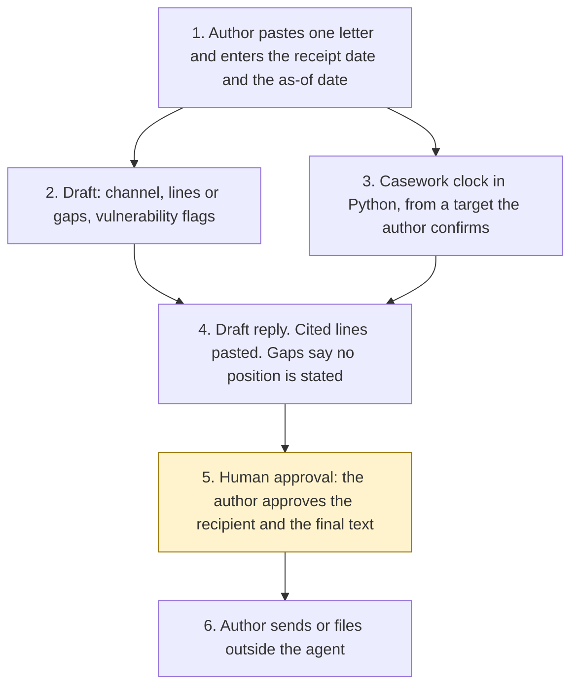

# Correspondence draft

<span class="status status-available">Available</span> · Autonomy A1 · Experiment 09 · Catalogue ID O008

A starter for a correspondence unit in a government department, an agency, or a council. It helps an author turn one inbound letter into a draft reply: a proposed channel, a casework clock, vulnerability flags for a person to review, and text that cites the supplied lines to take or says there is a gap.

The repository README marks it as a starter. That is accurate. This revision contains the permissions manifest, a deterministic clock, a synthetic lines library, 22 synthetic fixtures, a mock drafter used only as a smoke test, and build notes for both Copilot Studio harnesses, Microsoft Foundry, and a Microsoft 365 lines library. Nothing in the folder calls a model.

The people, the constituency of Greentown South, and the Department for Civic Spaces are invented. Do not paste a live letter into this repository.

If this page and [`agent-manifest.yaml`](https://github.com/rahul-bachina/copilot-agent-experiments/blob/main/experiments/09-casework-correspondence-draft/agent-manifest.yaml) disagree, the manifest is the control.

## The problem

Departments answer letters from MPs, peers, and members of the public against lines to take, and they track a reply deadline. A draft that states a position the lines do not contain, or that picks an address and sends, is the failure this starter is built to refuse.

The Cabinet Office [Guide to Handling Correspondence](https://assets.publishing.service.gov.uk/media/66d99762608fb761b681111d/Guide_to_Handling_Correspondence_-_September_2024__1_.pdf) (September 2024, PDF retrieved 26 October 2026) says departments and agencies should set a deadline, with ministerial agreement, and that the deadline should not exceed 20 working days. The clock starts the day after receipt (paragraph 9). A holding reply does not clear the case (paragraph 20). FOI performance is recorded separately (paragraph 40). The [Government Correspondence Hub](https://www.gov.uk/guidance/government-correspondence-hub), retrieved the same day and last updated on 25 September 2026, says departments will aim to respond within 20 working days, and that correspondence is separate from FOI, subject access, and complaints.

Those two sentences are both reported. They are not the same instruction. The code enforces the ceiling for a department or agency, and it still requires the author to confirm the department's own target.

The Guide is for government departments and agencies. A council's published target is operative only as the number the author confirms. The 20-working-day ceiling is not applied as a council rule, and a missing council target does not borrow 20 days.

Two published ATRS records were opened on 26 October 2026. They describe those departments' tools. They are not a description of this starter.

- [DfE: Correspondence Drafter](https://www.gov.uk/algorithmic-transparency-records/dfe-correspondence-drafter). The record says staff review and edit the draft, then copy it into an email and check the address. The phase on the record is Beta/Pilot.
- [FCDO: Correspondence Triage](https://www.gov.uk/algorithmic-transparency-records/fcdo-correspondence-triage). The record says that tool does not write responses. Staff prepare, sign off, and release them. It may log a case. This starter does not.

A DWP correspondence-drafting record was not opened, so none is cited. The catalogue's mention of DWP is unverified for this experiment.

## Who it helps

**Correspondence authors.** They get a proposed channel, a date from code, lines pasted with their ids, a gap where the library has no current line, and vulnerability wording quoted for them to review. The recipient and the final text stay with the author.

**The person who will sign the letter.** They receive a draft marked `DRAFT — NOT SENT`. A ministerial signature is proposed for an MP or peer letter and stays unconfirmed. Sending and filing stay in the unit's own systems.

**Correspondents.** The agent does not choose their address from the letter, does not label them, and does not contact them. An information-rights letter is routed out of this clock. A complaint sentence is a flag, not an outcome.

## What it does

**The clock**, which is the part you can run today, calculates a reply date for England and Wales:

| Rule | Source, retrieved 26 October 2026 | What the code does |
| --- | --- | --- |
| Reply target | Guide paragraph 9 | The author passes the department's target. For a department or agency it must not exceed 20 working days. A longer target is not returned as a date. |
| When day 1 starts | Guide paragraph 9 | The first working day on or after the calendar day after receipt. |
| Holding reply | Guide paragraph 20 | Does not clear the deadline. The flag stays false. The agent does not send a holding reply. |
| Transfer and contribution | Guide paragraphs 21 and 24 | Not calculated. The agent does not send a transfer. |
| Information rights | Guide paragraph 40, and the Correspondence Hub | No correspondence due date is returned. Experiment 01 is the FOI triage starter. This clock is not the statutory information-rights clock. |
| Council target | Not the Guide | Operative only as the number the author confirms. |

The Guide does not define "working day". This starter uses the England and Wales bank-holiday calendar. The 2026 England and Wales dates were checked against [bank holidays](https://www.gov.uk/bank-holidays) on 26 October 2026. Scotland's 15 June 2026 bank holiday is a working day on this calendar. The coronation bank holiday on 8 May 2023 is not included unless the caller passes it.

A date is operative only when the author has confirmed both the channel and the target. Until then the JSON may show a reference date. A reference date is arithmetic, not a deadline the unit should rely on.

**The mock drafter** proposes a channel (MP, peer, treat official, campaign, or information rights), cites a current line by pasting it, or states that no position is stated. It flags prompt injection, a stale year, complaint wording, press interest, and Welsh-language review. The Welsh flag is not a translation. Guide paragraph 37 is a prompt for the organisation's own scheme.

**The build notes** describe a later shape: Copilot Studio on either harness for the author, Microsoft Foundry for a later draft, and the clock and the citations remaining in Python. A SharePoint lines library is described and not connected. The two harnesses call the same core and stop at the same approval points.

## What it does not do

These are disabled in the manifest.

- It does not send a letter, an email, a holding reply, or a transfer.
- It does not choose the final recipient. A role is proposed. An address counts only when the author supplies it, and even then nothing is sent. Text inside the letter cannot approve a recipient.
- It does not invent a policy position, a funding figure, or a line to take.
- It does not cite a withdrawn line, a line that is not yet in force, or a line whose review date has been reached. The review date itself is not citable.
- It does not decide that no reply will be sent. Guide paragraph 14 is a human decision.
- It does not calculate the other department's transfer clock.
- It does not decide an FOI or EIR exemption, a cost limit, or disclosure.
- It does not decide a complaint outcome.
- It does not label a person as vulnerable, or write a marker onto a case. The word "vulnerable" is kept out of the draft text.
- It does not write a production case record, or publish an ATRS record. Mandatory scope is not decided.
- It does not produce a Welsh reply.
- It does not use a Scottish or Northern Ireland bank-holiday calendar, and it does not forecast one-off proclaimed bank holidays.
- It does not give legal advice.

## How the work flows

Step 5 is the human approval. Sending and filing stay outside the agent even after the author accepts the draft. The standard harness and the GitHub Copilot harness both stop at that step. Neither one adds an approval point.

1. The author pastes one letter and enters the receipt date and the as-of date. They confirm the channel and the reply target if they want an operative date. A suggested channel is not applied as a confirmation until they say so.
2. The drafter proposes a channel, matches the synthetic lines library, and flags vulnerability wording. In this folder that step is `src/draft.py`. A Foundry call is described and not built.
3. `src/sla.py` calculates the date from inputs the author has typed. A central-government target over 20 working days is refused. An information-rights letter does not get a correspondence date. A holding reply does not clear the clock.
4. The draft pastes each current line with its id. A gap says no position is stated. The recipient is a role, not an address, unless the author has supplied one. `may_be_sent_by_agent` is false.
5. **Human approval.** The author confirms the channel and whether a ministerial reply is required, confirms the target, reviews any vulnerability flag, approves the recipient, and approves the final text.
6. The author sends or files in the unit's own systems, under their own security role. The agent has no tool for that.



What is not a tool of the agent, even after step 5: sending, a case-system write, choosing the address from the letter, inventing a position, an FOI decision, a complaint outcome, a vulnerability label, and publishing the ATRS note.

## Architecture diagram

The diagram below is the file shipped in the experiment, copied into this site at build time.

![Architecture diagram titled Correspondence draft, ministerial, MP, and resident casework. Experiment 09. The author approves the recipient and the text, and nothing is sent. Three boxes across the top: the author pastes one letter and confirms the channel and the reply target; the draft proposes a channel, cites a current line or states a gap, and flags vulnerability wording for a person; the casework clock is Python, with day 1 the day after receipt and a 20-working-day ceiling for a department, and it is not an FOI clock. Along the bottom, a highlighted box where the author approves the recipient and the final text, reviews any vulnerability flag, and sends or files in the unit's own systems, and a separate box listing what is not a tool of the agent: no send, no case-system write, no invented policy line, no final recipient taken from the letter, and no ATRS submission.](img/09-casework-architecture.png)

## Microsoft stack

| Piece | Role in this experiment |
| --- | --- |
| Python standard library | `src/sla.py` and `src/working_days.py`. No Azure credentials and no network. |
| Mock drafter | `src/draft.py` and `src/lines.py`. Keyword stand-in for the channel, the citations, and the draft. |
| pytest | The only declared dependency. Used by the unit tests. |
| Copilot Studio, standard harness | Lead path for one letter. Build guide, not an importable solution. One action is allowed in that guide: a flow that returns the clock JSON and then stops. |
| Copilot Studio, GitHub Copilot harness | Author follow-up on the same draft, with two skills. Not the GitHub Copilot service. The same clock and the same drafter. Billing is in Copilot Credits. Prices were not copied. |
| Power Automate | Only as that clock action on the standard harness, called with a locked-down identity. The guide says not to add 20 working days with the flow's own calendar. |
| Microsoft Foundry | Optional later drafter, described in the experiment's `docs/foundry.md`. No Foundry resource is created here. The model is told not to calculate dates and not to invent a line. |
| Microsoft 365 | A SharePoint lines library is described and not connected. Citations stay in the Python matcher. |
| Key Vault | Named for a key if a managed identity cannot be used, and as a way to remove Foundry access. Not provisioned. |

### The two harnesses

The [harness comparison](https://github.com/rahul-bachina/copilot-agent-experiments/blob/main/experiments/09-casework-correspondence-draft/docs/harness-comparison.md) is the longer note. Short version, from Microsoft Learn pages opened on 26 October 2026:

The standard harness follows topics you define. It is the lead path because the work is the same every time: paste one letter, enter the receipt date, run the clock from inputs the author typed, show the draft, stop.

The GitHub Copilot harness is a Copilot Studio runtime for multi-step work. It is not the GitHub Copilot service. Microsoft says customer data is not sent to the GitHub Copilot service when the agent runs in Copilot Studio, and that the harness can use skills, memory, and files, in a sandbox. It is billed in Copilot Credits from the moment you start building, including testing. A Microsoft 365 Copilot licence does not cover that usage, on the costs page opened the same day. This experiment's skills tell the agent to call `src/draft.py` and `src/sla.py` and to stop. They do not tell it to send, choose an address, or invent a line.

The costs page says the standard harness is covered by a Microsoft 365 Copilot licence in Microsoft 365 channels, and billed otherwise. The article on standard-harness licensing was not opened, so this is not a licence opinion. Credit ranges were not copied. The costs page also says developer and trial environments move to usage-based billing on 1 September 2026, which is before this retrieval. Confirm the tenant.

The harness overview says skills and memory are "Not a focus" for the standard harness. A second Microsoft table, on the agents overview, says they are "Not supported" there and "Supported" on the GitHub Copilot harness. Those two cells are not reconciled here. Do not upload the skills onto the standard-harness agent. An agent cannot be transferred from one harness to the other.

The agents page says Azure AI Search is not supported on the GitHub Copilot harness. Do not design that harness around a search index of the lines. SharePoint knowledge is listed as supported on both harnesses. A knowledge source is not a substitute for the matcher, which pastes a current line or states a gap.

Describing an agent in natural language, agent instructions, Memory, and triggers are marked preview on the agents page. The harness overview itself did not label the harness as preview. Whether memory can be switched off was not on the pages opened. The skills say not to store the letter anyway.

The Customer Conversation harness is not used. A correspondent chatting with this agent would be a different product.

## Security and permissions

Manifest `exp-09-casework-correspondence-draft`, version 0.1.0. Owner in the manifest: Correspondence unit (fictional Department for Civic Spaces). Autonomy **A1**. Writes disabled. Sends disabled. Approve or reject, regulated decision, production record change, external send, and spending are disabled. Four further high-risk actions are also disabled: choosing the final recipient, inventing a policy position, publishing an ATRS record, and labelling the correspondent.

Contacts in the manifest use `example.gov.uk`. They are placeholders, not a department.

**What a run may read.** The letter text the author supplies, the receipt date, the as-of date, and, if the author has confirmed them, the regime, the target, and any extra closed days. Plus the synthetic lines library and the static instructions. The Python starter does not persist the text.

**What it must not read.** Correspondence mailboxes, case-management systems, MP or constituent directories, other cases, ATRS publication systems, and email or SMS gateways. The FCDO ATRS record describes a tool that can log a case. This starter does not.

**Human approval, before anyone relies on the output.**

| Decision | Who |
| --- | --- |
| Confirm the channel and whether a ministerial reply is required | Correspondence author |
| Confirm the reply target before the due date is treated as operative | Correspondence author |
| Review a vulnerability or immediate-review flag before it is recorded | Correspondence author |
| Approve the recipient | Correspondence author |
| Approve the final text | Correspondence author |
| Send the letter | Correspondence author. Outside the agent even after the draft is approved. |
| Decide no-reply, a transfer, an information-rights outcome, or a complaint outcome | Authorised casework decision-maker. Outside the agent. |

Viewing a draft, re-running it, and calculating a reference clock from a target the author has typed do not need a separate approval. Relying on the date does.

**UK GDPR.** The manifest's lead basis for ordinary correspondence is Article 6(1)(e), public task, which is the basis Guide paragraph 45 says public bodies should consider. The DPO confirms that before any production use. FOI, EIR, and subject-access letters are routed out. Paragraph 46's legal-obligation basis is described and not applied, because this agent does not answer those requests. Letter text can contain health or other special-category information. The manifest does **not** assert an Article 9 condition. The organisation has to choose one before any live processing of special-category data. The correspondent is not labelled, nothing is written to a case, and an author reviews a flag before it is recorded. Production inference, if used, should run in Microsoft Foundry in a UK region. Confirm the data-use terms at deployment. This page is not a DPIA.

**Prompt injection.** Fixtures include instructions to ignore the rules, send the letter, approve a recipient, revive a withdrawn line, publish the ATRS note, and close the case. The security note says the drafter records those instructions and does not follow them. `tests/test_draft_safety.py` checks that. The residual risk recorded is a misleading draft around the cited lines. The author is the control. There is no autonomous action behind a bad draft.

**Risk register, assessed 26 October 2026 for this starter rather than a named department.** Residual risk is not all Low. Do not read the table as a finished departmental assessment.

| ID | Risk | Inherent | Residual | Owner in the manifest |
| --- | --- | --- | --- | --- |
| R1 | A wrong channel or an unconfirmed target makes an author miss a reply deadline | High | Medium | Correspondence unit |
| R2 | The draft states a position that is not in the lines, or cites a stale line | High | Medium | Correspondence unit |
| R3 | Prompt injection produces a send, a recipient, or an invented closure | High | Low | Information security |
| R4 | An immediate-risk or special-category detail is missed, labelled, or retained | High | Medium | Data protection officer |
| R5 | A reader treats the DfE or FCDO record as this starter, or treats the draft note as submitted | Medium | Low | Correspondence unit |

**Other controls, none of them switched on in this repository.** Microsoft Entra Agent ID is described on the overview retrieved 26 October 2026 as the identity framework for agents, available for all Entra customers, with a link to Conditional Access for agents. That Conditional Access page was not opened. The same overview says extending Entra security features to agents requires Microsoft Agent 365. This starter does not register an identity. The page on creating an agent identity, including any Preview label on the wizard, was not opened. Do not treat a wizard label as verified here.

A Power Platform data-loss-prevention policy should block mail and case-system connectors. Foundry prompt shields apply only if a model is added later. The product page was not opened, so the portal label is unverified. A client key would live in Key Vault. Purview and Application Insights are for the organisation to decide. The wiring is unverified here. The agents page's Monitor tab is not the same statement as an Application Insights workspace.

**Logging.** This starter writes no log. Before live use the manifest says to log who ran it, when, the size of the text rather than the text, the library id, the clock inputs and the reason code, the line ids cited, and the author's approval of the recipient and the text. Do not log the letter in an application trace. The letter belongs on the case file.

**Kill switch.** Turn the Copilot Studio agent off. Remove the Foundry access used by any orchestration. If a connector has been added despite the default, block it in a Power Platform DLP policy.

**Review.** Reviewed for this starter on 26 October 2026. Next review 26 April 2027, and sooner if the correspondence guide changes or England and Wales bank holidays change by proclamation.

**Assumptions the organisation must confirm.** England and Wales calendar, and a departmental target that does not exceed 20 working days. Article 6(1)(e) as the lead basis, and an Article 9 condition before live special-category processing. UK-region Foundry, not trained on the organisation's correspondence. No mailbox or case connector without a manifest change. A real lines library before production. Placeholder contacts.

The ATRS block in the output is a draft note. `not_submitted` stays true. Mandatory scope is not decided. The [scope policy landing page](https://www.gov.uk/government/publications/algorithmic-transparency-recording-standard-mandatory-scope-and-exemptions-policy) was opened. The scope decision is not made here.

## How to try it

Python 3.10 or newer. No Azure credentials and no network. The clock uses the standard library. pytest is installed from `requirements.txt`.

```bash
cd experiments/09-casework-correspondence-draft
python -m pip install -r requirements.txt
python -m pytest tests/ -v
python eval/evaluate.py
python src/draft.py --received 2026-01-02 --as-of 2026-10-26 \
  --input examples/sample_letter.txt --confirm-target --confirm-channel
```

`eval/evaluate.py` prints a mock smoke test. The 22 fixtures are synthetic and the drafter is a keyword stand-in tuned to them. `eval/smoke_report.json` is that run, saved so a reviewer can see it without re-running. The file labels itself a mock smoke test and not a measure of model accuracy. It records 22 of 22 fixtures processed by that stand-in. No model was called. The dates inside that run are the deterministic calculation.

The sample is a fictional MP's letter about park hours, received Friday 2 January 2026. With both confirmations, the operative due date is Friday 30 January 2026. The current line `LTT-PARKS-01` is cited. The withdrawn line is not pasted in. The recipient is not approved. Nothing is sent.

A council target of 10 working days, which is not the Cabinet Office ceiling:

```bash
python src/draft.py --received 2026-01-02 --as-of 2026-10-26 \
  --regime council --target-working-days 10 \
  --input examples/sample_letter.txt --confirm-target --confirm-channel
```

That date is operative only as the council target the author confirmed. The command still uses the fictional department's lines. A council would supply its own library.

Use the synthetic fixtures if you rebuild either harness. Do not paste a real letter into a shared test environment.

## Limitations

- The Guide does not define "working day". England and Wales bank holidays are a reading, checked for the 2026 dates on the GOV.UK list retrieved 26 October 2026. Scotland and Northern Ireland are not encoded. One-off proclamations are not forecast.
- "Should not exceed 20 working days" and "will aim to respond within 20 working days" are both reported. The code enforces the ceiling for `central_government` and still requires the author to confirm the target.
- Paragraph 9's "day after" is implemented as: day 1 is the first working day on or after the calendar day after receipt. A department that counts differently should check this reading before relying on the date.
- The September 2024 PDF is the edition retrieved. A later edition was not compared line by line with the hub page.
- The drafter is a keyword stand-in. It will miss a paraphrase and it can miss a topic that is not in the fixture list. That is why a gap says no position is stated, and why a person approves the text.
- Lines live in `fixtures/lines_to_take.json`. They are synthetic. A real unit's lines are not in this repository.
- Information-rights deadlines are not calculated. A blank correspondence date is not an FOI deadline.
- The DfE and FCDO records are precedents that were opened. They are not this tool. A DWP correspondence-drafting record was not opened.
- The GitHub Copilot harness price was not measured. Learn says that harness uses Copilot Credits. No pound figure is stated.
- This is not legal advice, a DPIA, or an ATRS submission.

## Source

- [Experiment folder](https://github.com/rahul-bachina/copilot-agent-experiments/tree/main/experiments/09-casework-correspondence-draft)
- [Permissions manifest](https://github.com/rahul-bachina/copilot-agent-experiments/blob/main/experiments/09-casework-correspondence-draft/agent-manifest.yaml)
- [Security and permissions](https://github.com/rahul-bachina/copilot-agent-experiments/blob/main/experiments/09-casework-correspondence-draft/docs/security-and-permissions.md)
- [Harness comparison](https://github.com/rahul-bachina/copilot-agent-experiments/blob/main/experiments/09-casework-correspondence-draft/docs/harness-comparison.md)
- [Architecture note](https://github.com/rahul-bachina/copilot-agent-experiments/blob/main/experiments/09-casework-correspondence-draft/docs/architecture.md)
- [Experiment README](https://github.com/rahul-bachina/copilot-agent-experiments/blob/main/experiments/09-casework-correspondence-draft/README.md)
- [Guide to Handling Correspondence, September 2024 (PDF)](https://assets.publishing.service.gov.uk/media/66d99762608fb761b681111d/Guide_to_Handling_Correspondence_-_September_2024__1_.pdf)
- [Government Correspondence Hub](https://www.gov.uk/guidance/government-correspondence-hub)
