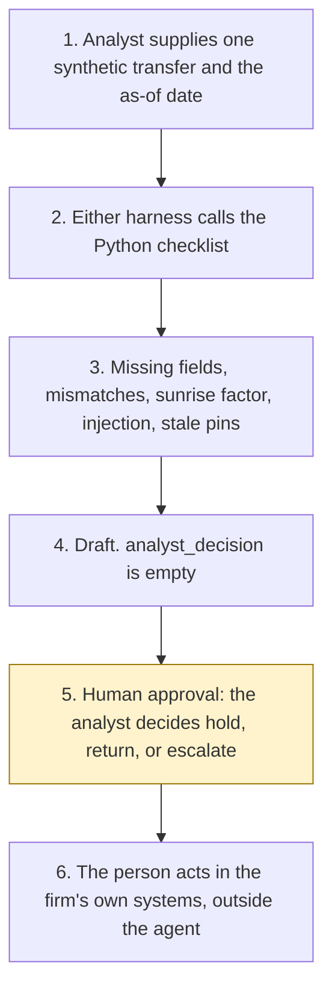

# Travel Rule exception triage

<span class="status status-available">Available</span> · Autonomy A1 · Experiment 10 · Catalogue ID UK05

A starter for an analyst at a UK cryptoasset business. It reads one synthetic transfer and returns a draft of which originator and beneficiary fields are missing or do not match, and which of hold, return, or escalate the pinned text puts in play. The analyst decides.

It is a follow-on to [Experiment 04](04-fca-cryptoasset-readiness.md) (UK02, FCA cryptoasset authorisation readiness). The samples use the same invented firm, Harbourline Markets Ltd. This agent does not re-score that experiment's policy pack.

The folder contains the permissions manifest, a deterministic checklist, 19 synthetic cases, and build notes for two Copilot Studio harnesses. Both harnesses call the same Python core. Nothing in the folder calls a model or the network.

If this page and [`agent-manifest.yaml`](https://github.com/rahul-bachina/copilot-agent-experiments/blob/main/experiments/10-travel-rule-exception-triage/agent-manifest.yaml) disagree, the manifest is the control.

## The problem

Since 1 September 2023, UK cryptoasset businesses have had to collect and share information on cryptoasset transfers. The awkward cases are a missing field, a name that does not match the firm's own customer record, or a counterparty in a jurisdiction that has not implemented the Travel Rule. The JMLSG annex opened for this starter calls that last situation the sunrise issue. The FCA statement does not use the word sunrise. It says "a jurisdiction without the Travel Rule".

The pages opened for this starter, all on 26 October 2026, say:

- [Part 7A](https://www.legislation.gov.uk/uksi/2017/692/part/7A) of the Money Laundering Regulations 2017, regulations 64A to 64H. The page says it is up to date with changes known to be in force on or before 25 October 2026. The Part was inserted on 1 September 2023 by [SI 2022/860](https://www.legislation.gov.uk/uksi/2022/860/regulation/1).
- [SI 2026/621 regulation 32](https://www.legislation.gov.uk/uksi/2026/621/regulation/32) replaces "1,000 euros" in regulation 64C(4) with "£800". The Part 7A annotation dates that substitution, and the same substitution in regulation 64G(1)(b), at 30 June 2026. The checklist uses £800. It does not use the euro figure.
- The [FCA Travel Rule statement](https://www.fca.org.uk/news/statements/fca-sets-out-expectations-uk-cryptoasset-businesses-complying-travel-rule), first published 17 August 2023 and last updated 6 February 2026, describes sending to and receiving from a jurisdiction without the Travel Rule. Firms remain responsible when they use a supplier.
- [JMLSG Sector 22 Annex I](https://www.jmlsg.org.uk/wp-content/uploads/2023/08/Board-approved_JMLSG-Guidance_Part-II-Sector-22-Annex-I_Aug2023.pdf) (August 2023) uses "sunrise issue" at paragraph 10 and points firms to FCA communications. Paragraphs 13 and 45 still say 1,000 euros. That figure is recorded and is not applied.

The checklist does not download these pages when it runs. The pin is `src/sources.py`. If `last_verified` is older than the threshold the analyst sets, the row is marked stale.

## Who it helps

**An analyst** at a cryptoasset business who already has one transfer and wants a first reading: which limb of Part 7A is in play, which field is absent or does not correspond, and which options the text leaves to a person. They decide hold, return, or escalate.

**The firm.** High-risk actions are disabled. The draft is not a hold, a return, a release, a suspicious activity report, or a message to a counterparty. The same record and the same as-of date produce the same JSON.

It does not help a team that wants the tool to move the transfer.

## What it does

`src/triage.py` reads one JSON record and writes one JSON document. `analyst_decision` is null. `actions_taken` is empty. The options are always hold, return, and escalate. Each option says whether it is proposed, why, and which provision the reason came from. `agent_will_not_take` is true on every option.

| Check | What the draft says |
| --- | --- |
| Regulation 64C(5) | Originator and beneficiary names, a firm's registered or trading name, and an account number or a unique transaction identifier. |
| Regulation 64C(6) | Further originator information when the transfer is not all-UK and the sterling value, including linked transfers the firm has already assessed, is at least £800. Equal to £800 counts. 799.99 does not. |
| Missing sterling figure, or linkage not assessed | The £800 limb is not applied. The core does not convert a price and does not decide that two transfers are linked. |
| All-UK transfer | Paragraph 6 need not accompany the transfer unless the beneficiary's business requests it. Regulation 64C(2) then allows three working days. The core states that rule and does not calculate a date. |
| Regulation 64D | Before the firm makes a cryptoasset available, the required information should have arrived and the beneficiary details should correspond with Part 3 customer due diligence. Names are compared after case and extra spaces are ignored. There is no fuzzy match. |
| Missing or non-corresponding information | Hold and return are proposed, from the delay and return limbs in regulation 64D(2) or 64E. The request to the counterparty is listed as a step for a person. |
| Unhosted wallet, regulation 64G | The regulation says the firm may request information. The core does not decide the "may". If a request was made and not answered, hold is proposed. Return is not, because 64G as opened has no return limb. |
| Sunrise | Used only when the firm's register says the counterparty jurisdiction does not have the Travel Rule, and that entry is inside the stale window. The FCA receiving factor is extra context. It is not treated as a waiver of regulation 64D. |
| Regulation 64A | An asserted exclusion is flagged. The core does not confirm it and does not release the transfer. |

A name that tells the checker to ignore its instructions is quarantined and does not count as information received. A note with the same kind of instruction is recorded and does not change the categories of an otherwise clean record. A payload key that tries to set the analyst's decision is ignored.

The sample transfer `SYN-TR-1042` is an inbound sunrise case. The beneficiary name on the transfer is "Sam R" and the Part 3 name is "Sam Rivera". The draft categories are `non_corresponding_information`, `sunrise_jurisdiction`, and `missing_information`. Hold and return are proposed. The decision field stays empty. Wallet strings in the samples start with `SYNTH-WALLET-`.

## What it does not do

These are disabled in the manifest.

- It does not hold, delay, return, reject, or release a transfer.
- It does not make a cryptoasset available to a beneficiary.
- It does not contact a counterparty, a customer, the FCA, or law enforcement.
- It does not file, draft, or suppress a suspicious activity report. Drafting a report is a different catalogue item.
- It does not report repeated failure to the FCA under regulation 64D(5) or 64E(5).
- It does not decide that the firm has breached the Money Laundering Regulations.
- It does not confirm that regulation 64A takes a transfer outside Part 7A.
- It does not treat the FCA statement as a waiver of regulation 64D.
- It does not use the August 2023 JMLSG figure of 1,000 euros as the threshold.
- It does not read legislation.gov.uk, the FCA, or JMLSG at run time.
- It does not write a production record or send a message.

## How the work flows

Step 5 is the human approval. The agent has no action to take after it. Holding, returning, filing, and contacting a counterparty stay outside the agent even after a person accepts a proposal.

1. The analyst supplies one synthetic transfer and types the as-of date.
2. Either harness calls the Python checklist. The standard harness is one topic. The GitHub Copilot harness is two skills around the same call.
3. The checklist compares the fields with the pinned text. It records injection and stale pins. It does not call a model.
4. The draft comes back with categories, the three options, and an empty `analyst_decision`.
5. **Human approval.** The analyst decides hold, return, or escalate. A stale source is not relied on until a person has re-opened the page. A stale or unknown jurisdiction status is not treated as sunrise.
6. The person acts in the firm's own systems, if they decide to. The agent has no tool for that.



What is not a tool of the agent, even after step 5: a hold, a return, a rejection, a release, making a cryptoasset available, a message to a counterparty, a suspicious activity report, an FCA report, and a production write.

## Architecture diagram

The diagram below is the file shipped in the experiment, copied into this site at build time.

![Architecture diagram titled Travel Rule exception triage, draft for an analyst. The analyst supplies one synthetic transfer and the as-of date. Either Copilot Studio harness calls the Python checklist, which uses the pinned Part 7A text, the £800 threshold, and flags a stale pin, and leaves the decision empty. A highlighted box is the human approval: the analyst decides hold, return, or escalate and then acts in the firm's own systems. A separate box states what is not a tool of the agent: no hold, return, reject, or release, no cryptoasset made available, no counterparty contact, no suspicious activity report, and no FCA report or production write.](img/10-travel-rule-architecture.png)

## Microsoft stack

| Piece | Role in this experiment |
| --- | --- |
| Python standard library | `src/triage.py`. No Azure credentials and no network. |
| pytest | The only declared dependency. Used by the unit tests. |
| Copilot Studio, standard harness | One topic. The analyst pastes a record, the flow returns JSON, the topic stops. |
| Copilot Studio, GitHub Copilot harness | Two skills around the same JSON. Sandbox draft only. It is not the GitHub Copilot service. |
| Microsoft Foundry | Optional narrative over the JSON only. No Foundry resource is created. The model is told not to set `analyst_decision`, add URLs, use euros, or waive regulation 64D. |
| Power Platform | The flow that calls the checklist. No Dataverse write in this starter. |
| Key Vault | Named only as a place for a later secret, and as a way to remove Foundry access. The checklist has no secret. |

### The two harnesses

The [harness comparison](https://github.com/rahul-bachina/copilot-agent-experiments/blob/main/experiments/10-travel-rule-exception-triage/docs/harness-comparison.md) is the longer note. Short version, from the Copilot Studio harness overview opened on 26 October 2026:

The GitHub Copilot harness is a Copilot Studio authoring and orchestration framework. It is not the GitHub Copilot service. The overview says customer data is not sent to the GitHub Copilot service when agents run in Copilot Studio. It says this harness can take a goal, break it into steps, use skills and memory, and run in a sandbox, and that agents on it use Copilot Credits. This experiment's skills tell the agent to call the checklist and to stop. They do not tell it to message a counterparty.

The standard harness follows topics and rules you define. Files, skills, and memory are "not a focus" on that overview. That matches the one-topic intake.

Billing and licensing pages linked from the overview were not re-opened on 26 October 2026. Experiment 04 cites some of them from 24 October 2026. That earlier retrieval is not treated as re-verified here. Microsoft 365 Copilot licence coverage was not stated on the overview page opened for this experiment. Credit ranges were not copied. Whether memory can be switched off was not on the page. The skills say not to store the transfer in memory anyway.

The overview did not use the word preview for the harness. The skills page it links to was not opened. Treat the authoring click-path as something to confirm in the tenant.

## Security and permissions

Manifest `exp-10-travel-rule-exception-triage`, version 0.1.0. Autonomy **A1**. Writes disabled. Sends disabled. Approve or reject, regulated decision, production record change, external send, and spending are disabled. So are filing or drafting a suspicious activity report, making a cryptoasset available, and reporting repeated failure to the FCA.

Contacts in the manifest use `example.com`. They are placeholders.

**What a run may read.** The one record the analyst supplies, the as-of date, and the static catalogue. The Python starter does not persist the text. A record that is not marked synthetic is refused, and the refusal does not echo the narrative.

**What it must not read.** Wallets and private keys, chain nodes, Travel Rule messaging networks, customer files beyond the fields pasted for this transfer, suspicious-activity-report systems, FCA Connect, and the Experiment 04 policy pack.

**Human approval, before anyone relies on a proposal.**

| Decision | Who |
| --- | --- |
| Hold, return, or escalate | Analyst |
| Treat a field as missing or as non-corresponding | Analyst |
| Rely on a counterparty Travel Rule status | Analyst, after the register is current |
| Rely on a row after a source is marked stale | Analyst, after a person re-opens the page |
| Confirm a regulation 64A exclusion | Analyst |
| Request missing information from a counterparty | Analyst, through the firm's own channel |
| File a suspicious activity report, or report repeated failure to the FCA | MLRO or other authorised person. Outside the agent. |

Viewing a draft and re-running it do not need a separate approval.

**UK GDPR.** Do not copy Experiment 01. This agent is for a firm. The manifest does not assert a lawful basis. A candidate for the firm to confirm is Article 6(1)(c), legal obligation, because Part 7A requires the firm to handle this information. Names on a transfer are personal data. Special-category data is out of scope. This page is not a DPIA.

**Prompt injection.** Fixtures include instructions to ignore the rules, release the transfer, file or suppress a report, contact the counterparty, and change the threshold. The checker records them and does not follow them. `tests/test_injection.py` and `tests/test_triage.py` cover that.

**Stale data.** Older than the threshold, default 90 days, is stale. Equal to the threshold is not. The same rule applies to the date the firm recorded a counterparty's Travel Rule status. A stale status is not treated as sunrise. The sample run on 26 October 2026 is inside the threshold. The same record with an as-of date of 1 April 2027 is stale. The checker does not clear the flag by itself.

**Risk register, assessed 26 October 2026 for this starter rather than a named firm.** Residual risk is not all Low.

| ID | Risk | Residual | Owner in the manifest |
| --- | --- | --- | --- |
| R1 | A missing field is treated as a breach, or a complete record is treated as a release | Medium | Financial crime operations |
| R2 | The JMLSG euro figure is applied instead of £800 | Low | Financial crime operations |
| R3 | A stale sunrise flag, or a sunrise receipt treated as waiving regulation 64D | Medium | Financial crime operations |
| R4 | Prompt injection releases a transfer, files a report, or contacts a counterparty | Low | Information security |
| R5 | A live transfer is pasted into a shared test run | Medium | Data protection officer |
| R6 | A pinned page changes and the checklist is still treated as current | Medium | Financial crime operations |

**Logging.** This starter writes no log. Before live use, log who ran it, the transfer id rather than the names, the as-of date, whether a source was stale, and the analyst's later decision.

**Kill switch.** Turn the Copilot Studio agent off. Remove any Foundry access. Block a later connector in a Power Platform DLP policy.

**Tenant controls that are named and not configured here.** Entra Agent ID, Conditional Access, Power Platform DLP, Microsoft Foundry prompt shields, Key Vault, Purview, and Application Insights. The product pages for those controls were not opened on 26 October 2026, except the Copilot Studio harness overview. Dynamic Permissions, Dynamic Agent Risk, and Dynamic Conditional Access are recorded in Experiment 01 as announced, with availability unverified. This folder did not re-check that announcement.

**Review.** 26 October 2026. Next review 26 April 2027, and sooner if Part 7A, the FCA statement, or the JMLSG annex changes.

There is no ATRS mapping. ATRS is a public-sector standard. A firm does not complete an ATRS record by using this starter.

## How to try it

Python 3.10 or newer. No Azure credentials and no network.

```bash
cd experiments/10-travel-rule-exception-triage
python -m pip install -r requirements.txt
python -m pytest tests/ -v
python eval/evaluate.py
python src/triage.py --input examples/sample_transfer.json --as-of 2026-10-26
```

`eval/evaluate.py` prints a deterministic smoke test. The 19 cases are synthetic. `eval/smoke_report.json` is that run. The file says it is not a model score. It records 19 of 19 cases passed by the checker, and an agreement rate of 100.0 on those fixtures. No model was called.

A stale-data check:

```bash
python src/triage.py --input examples/sample_transfer.json --as-of 2027-04-01 --stale-after-days 90
```

The exit code is 0 when a draft is produced, including when fields are missing. A missing field is not a failed run, and it is not a decision to hold. A record that is not marked synthetic is refused.

Do not paste a live transfer into a shared test environment.

## Limitations

- A field comparison is not a finding that the firm has complied or breached. The analyst decides.
- The core does not see the firm's whole book, so it cannot decide that another transfer appears to be linked.
- It does not convert prices. JMLSG paragraphs 13 and 45 still say 1,000 euros. Those paragraphs are not used. `flags.jmlsg_euro_threshold_used` stays false.
- It does not encode bank holidays, so it does not return a date for the three-working-day rule in regulation 64C(2).
- "Reasonable time" in the return limb has no day count in the texts opened. No number is invented. That gap is listed as unverified.
- Regulation 14A, the Funds Transfer Regulation article 3.9, the sanctions regime, and the Proceeds of Crime Act were not opened. A firm marker for suspicion or a sanctions hit is passed through as a reason to escalate. It is not a legal analysis.
- The JMLSG approval note's date was not on the page that was fetched. Whether a later Annex I exists, beyond the revisions page not listing one, was not proved.
- The FCA statement is not treated as a waiver of regulation 64D. That is how this starter reads the page. It is not a conclusion about what a court would say.
- The smoke test is not a model score. A live Foundry run has not been done.
- Building the GitHub Copilot harness in a tenant consumes Copilot Credits. This page does not quote a price. Licence coverage beyond the overview opened on 26 October 2026 is unverified.

This is not legal advice and it is not a statement of any firm's compliance.

## Source

- [Experiment folder](https://github.com/rahul-bachina/copilot-agent-experiments/tree/main/experiments/10-travel-rule-exception-triage)
- [Permissions manifest](https://github.com/rahul-bachina/copilot-agent-experiments/blob/main/experiments/10-travel-rule-exception-triage/agent-manifest.yaml)
- [Security and permissions](https://github.com/rahul-bachina/copilot-agent-experiments/blob/main/experiments/10-travel-rule-exception-triage/docs/security-and-permissions.md)
- [Harness comparison](https://github.com/rahul-bachina/copilot-agent-experiments/blob/main/experiments/10-travel-rule-exception-triage/docs/harness-comparison.md)
- [Architecture note](https://github.com/rahul-bachina/copilot-agent-experiments/blob/main/experiments/10-travel-rule-exception-triage/docs/architecture.md)
- [Experiment README](https://github.com/rahul-bachina/copilot-agent-experiments/blob/main/experiments/10-travel-rule-exception-triage/README.md)
- [Experiment 04, the authorisation-readiness pack](04-fca-cryptoasset-readiness.md)
