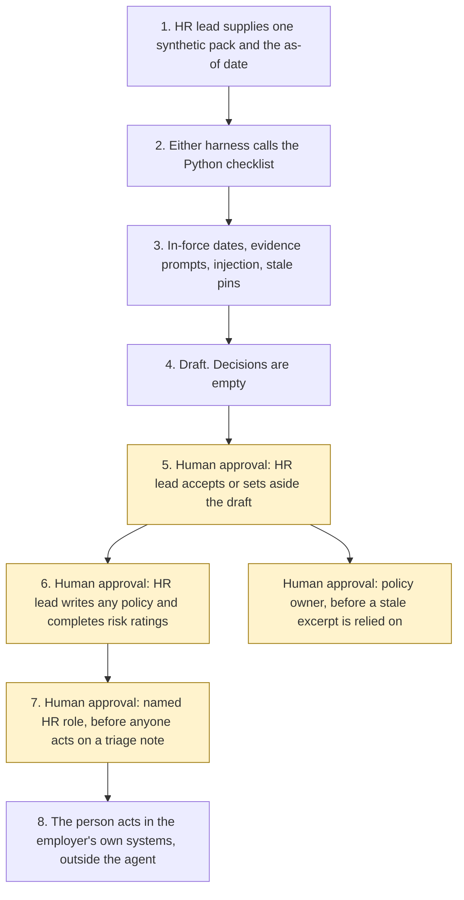

# Employment Rights Act 2025 HR assistant

<span class="status status-available">Available</span> · Autonomy A1 · Experiment 11 · Catalogue ID UK03

A starter for an HR lead at a UK employer. It reads one synthetic pack and returns a draft of which pinned duties are in force on the as-of date, which evidence the pack records, and a policy skeleton with blank headings. The HR lead decides.

It is for small employers, charities, multi-site organisations, and HR consultancies that already use Microsoft 365. It is not a worker-facing bot. The samples use an invented organisation, Northwharf Community Kitchen CIC. Workers are role labels. There are no real people.

The folder contains the permissions manifest, a deterministic checklist, 21 synthetic cases, and build notes for two Copilot Studio harnesses. Both harnesses call the same Python core. Nothing in the folder calls a model or the network.

If this page and [`agent-manifest.yaml`](https://github.com/rahul-bachina/copilot-agent-experiments/blob/main/experiments/11-era-2025-hr-assistant/agent-manifest.yaml) disagree, the manifest is the control.

## The problem

Employers in England, Wales, and Scotland already have a duty to take reasonable steps to prevent sexual harassment of employees. A stronger wording, and a third-party harassment obligation, are appointed for 30 October 2026. Small teams have to show what they considered. They also have to avoid treating a draft as a finding that they complied, and avoid letting software take a disciplinary step.

The pages opened for this starter, all on 27 October 2026, say:

- [Equality Act 2010 section 40A](https://www.legislation.gov.uk/ukpga/2010/15/section/40A) was inserted on 26 October 2024. Subsection (1) requires reasonable steps. The changes list shows the 2025 amendment as not yet applied to the text.
- [Employment Rights Act 2025 section 20](https://www.legislation.gov.uk/ukpga/2025/36/section/20) inserts "all" before "reasonable steps". The page was marked prospective. [SI 2026/1065 regulation 3(a)](https://www.legislation.gov.uk/uksi/2026/1065/regulation/3/made) appoints it for 30 October 2026.
- [Section 21](https://www.legislation.gov.uk/ukpga/2025/36/section/21) inserts a duty not to permit third-party harassment, and only where the employer failed to take all reasonable steps. Prospective. The same instrument, regulation 3(b), appoints 30 October 2026. Extent: England and Wales and Scotland.
- [Section 22](https://www.legislation.gov.uk/ukpga/2025/36/section/22) is a power to specify steps by regulations. Prospective. Regulation 3(c) appoints 30 October 2026. No specifying regulations were opened. The power is not a list.
- [Section 23](https://www.legislation.gov.uk/ukpga/2025/36/section/23) adds sexual harassment to protected disclosures. The page says it is in force on 6 April 2026 by SI 2026/323 regulation 3. That SI was not opened as its own page.
- [Section 25](https://www.legislation.gov.uk/ukpga/2025/36/section/25) substitutes "six months" for "two years" in the unfair-dismissal qualifying period and omits the compensatory-award cap. [SI 2026/559 regulation 3](https://www.legislation.gov.uk/uksi/2026/559/regulation/3/made) appoints the remainder for 1 January 2027, subject to regulation 4. This starter does not apply regulation 4 to a person and does not state a compensation figure.
- [Section 152](https://www.legislation.gov.uk/ukpga/2025/36/section/152) and Schedule 12 extend tribunal time limits from three months to six months. In force on 1 October 2026 by [SI 2026/954](https://www.legislation.gov.uk/uksi/2026/954/body/made) regulation 3, subject to regulation 4. The checklist does not count the months and does not identify the relevant date.
- The [GOV.UK timeline](https://www.gov.uk/government/publications/implementing-the-plan-to-make-work-pay-and-employment-rights-act/plan-to-make-work-pay-and-employment-rights-act-timeline-update), updated 22 October 2026, confirms those dates. It says breach-of-contract claims in Scotland change on 9 November 2026. That instrument was not opened, so the checklist does not apply the date. It says future dates remain subject to parliamentary processes.
- [Acas](https://www.acas.org.uk/employment-rights-act-2025/harassment-law-changes/sexual-harassment), last updated 26 August 2026, lists preparation examples. They are not regulations under section 40B. The page's worked examples are not applied to any pack.

On 27 October 2026 the sample draft says the preventative duty is "reasonable steps". It does not say "all reasonable steps" until the as-of date is 30 October 2026 or later. Even then, `compliance_conclusion` stays empty.

## Who it helps

**An HR lead** at an employer who already has a handbook, a note of what training was recorded, and a question about what changes on a given day. They get a first reading: which section is in force, which evidence flag is missing, and which decisions stay with a person. They decide whether the draft is the employer's assessment.

**A small employer, a charity, or a multi-site organisation** that does not have a large employee-relations team. The checklist runs without a tenant. The same JSON is what both Copilot Studio harnesses would show. High-risk actions are disabled, so a draft cannot publish a policy or email a worker.

**An HR consultancy** preparing a client pack, using synthetic or client-supplied evidence the client has typed. The starter does not look up a personnel file.

It does not help a team that wants the tool to decide a grievance, dismiss someone, or tell them they have complied.

## What it does

`src/review.py` reads one JSON pack and writes one JSON document. `hr_decision` is null. `compliance_conclusion` is null. `disciplinary_decision` is null. `actions_taken` is empty.

| Check | What the draft says |
| --- | --- |
| Section 40A, before 30 October 2026 | The duty is in force, from 26 October 2024, in the words "reasonable steps". |
| Sections 20 and 21, from 30 October 2026 | The wording is "all reasonable steps", and the third-party obligation is in force. Neither limb of "permits" is decided. |
| Section 22 | The power to specify steps is in force from the same day. `specified_steps_regulations_made` stays false. |
| Acas prompts | Evidenced, not evidenced, or not supplied, as the pack says. `legal_breach` is false on every row. A full set of "evidenced" is still not a compliance conclusion. |
| Policy review date | Older than 365 days is stale. Equal to 365 is not. A stale policy is not a breach. |
| Handbook question | A claim, a disciplinary question, or a time limit is refused. Otherwise an approved excerpt is quoted, or the draft says the topic is not in the pack. |
| Anonymised report | The route is HR review. The note is not closed. A language flag is not a finding. A report that is not marked anonymised is refused, and the refusal does not echo it. |
| Section 25 | In force from 1 January 2027. Not applied to a person. No compensation figure. |
| Section 152 | In force from 1 October 2026. No deadline is calculated. |
| Northern Ireland | The Great Britain duties are not applied. Northern Ireland law is not stated. |
| Stale pin | Older than 90 days, `rules_current` is false. The in-force flag is still shown, and `relied_on` is false. The core does not download the page. |

A name or a narrative that tells the checker to ignore its instructions is recorded and does not change the decision fields, which stay empty. A payload key that tries to set the HR decision is ignored.

The sample pack `SYN-PACK-001` is dated 27 October 2026. Training is recorded. A policy review and a second reporting route are not. The handbook question on reporting is quoted from excerpt P1. The anonymised note is about a visitor's comment. The decision fields stay empty.

## What it does not do

These are disabled in the manifest.

- It does not decide that the employer took, or failed to take, reasonable steps or all reasonable steps.
- It does not decide that harassment occurred, or that a third party was permitted to harass an employee.
- It does not warn, suspend, or dismiss, and it does not decide that a dismissal was fair.
- It does not decide that a disclosure was protected.
- It does not calculate a tribunal time limit or identify the relevant date in SI 2026/954 regulation 4.
- It does not apply the six-month qualifying period to a named person, and it does not state a compensation figure.
- It does not publish a policy or write a handbook. The skeleton is headings with empty bodies.
- It does not change a personnel, grievance, or case record, and it does not record a training attestation.
- It does not message a worker, Acas, a tribunal, a union, or anyone else.
- It does not treat Acas examples as section 40B regulations.
- It does not decide which steps are reasonable for an organisation of a particular size. `worker_count` is recorded and is not used to lower a duty.
- It does not cover Northern Ireland, or the rest of the 2025 Act. Fire and rehire, zero-hours contracts, flexible working, bereavement leave, and non-disclosure agreements are timetable items that were not opened as instruments. The non-disclosure-agreement line is recorded and not scored.
- It does not read legislation.gov.uk, GOV.UK, or Acas at run time.

## How the work flows

Steps 5, 6, and 7 are the human approvals. The agent has no action to take after them. Publishing, writing a record, replying to a worker, and any disciplinary step stay outside the agent even after a person accepts the draft.

1. The HR lead supplies one synthetic pack and types the as-of date.
2. Either harness calls the Python checklist. The standard harness is one topic. The GitHub Copilot harness is three skills around the same call.
3. The checklist compares the date with the pinned instruments. It records injection and stale pins. It does not call a model.
4. The draft comes back with duties, prompts, and empty `hr_decision`, `compliance_conclusion`, and `disciplinary_decision`.
5. **Human approval.** The HR lead decides whether the draft is the employer's assessment. A stale source is not relied on until a person has re-opened the page. A stale excerpt is not relied on until the policy owner says so.
6. **Human approval.** The HR lead writes any policy change and completes the risk-assessment ratings. The skeleton has no policy text. The ratings are null.
7. **Human approval.** A named HR role decides what to do with an anonymised triage note. The route in the draft is HR review. The agent does not close it.
8. The person acts in the employer's own systems, if they decide to. The agent has no tool for that.



What is not a tool of the agent, even after step 7: a compliance conclusion, a disciplinary decision, a dismissal, a published policy, a personnel-record change, a message to a worker, and a call to Acas.

## Architecture diagram

The diagram below is the file shipped in the experiment, copied into this site at build time.

![Architecture diagram titled Employment Rights Act 2025 HR assistant, draft for an HR lead. The HR lead supplies one synthetic pack and the as-of date. Either Copilot Studio harness calls the Python checklist, which uses the pinned commencement dates, treats Acas prompts as not section 40B, flags a stale pin, and leaves the decision empty. A highlighted box is the human approval: the HR lead decides whether the draft is the employer's assessment, writes any policy, completes the risk ratings, and then acts in the employer's own systems. A separate box states what is not a tool of the agent: no compliance conclusion, no discipline or dismissal, no policy published, no personnel record changed, and no message to a worker or to Acas.](img/11-era-hr-architecture.png)

## Microsoft stack

| Piece | Role in this experiment |
| --- | --- |
| Python standard library | `src/review.py`. No Azure credentials and no network. |
| pytest | The only declared dependency. Used by the unit tests. |
| Copilot Studio, standard harness | One topic. The HR lead pastes a pack, the flow returns JSON, the topic stops. |
| Copilot Studio, GitHub Copilot harness | Three skills around the same JSON. Sandbox draft only. It is not the GitHub Copilot service. |
| Microsoft Foundry | Optional narrative over the JSON only. No Foundry resource is created. The model is told not to set a decision, add URLs, or say the employer complied. |
| Power Platform | The flow that calls the checklist. No Dataverse write in this starter. Training attestations are not recorded. |
| Microsoft 365 | Teams is where an HR lead might open the agent. The agent is not posted to a worker channel. SharePoint is not connected. |
| Key Vault | Named only as a place for a later secret, and as a way to remove Foundry access. The checklist has no secret. |

### The two harnesses

The [harness comparison](https://github.com/rahul-bachina/copilot-agent-experiments/blob/main/experiments/11-era-2025-hr-assistant/docs/harness-comparison.md) is the longer note. Short version, from the Copilot Studio harness overview opened on 27 October 2026:

The GitHub Copilot harness is a Copilot Studio authoring and orchestration framework. It is not the GitHub Copilot service. The overview says customer data is not sent to or processed by the GitHub Copilot service when agents run in Copilot Studio. It says this harness can take a goal, break it into steps, use skills and memory, and run in a sandbox, and that agents on it use Copilot Credits. This experiment's skills tell the agent to call the checklist and to stop. They do not tell it to email a worker.

The standard harness follows topics and rules you define. In the comparison table, files are "Not a focus" and skills and memory are "Not a focus". That matches the one-topic intake.

Billing and licensing pages linked from the overview were not opened on 27 October 2026. Microsoft 365 Copilot licence coverage was not stated on the overview page. Credit ranges were not copied. Whether memory can be switched off was not on the page. The skills say not to store the pack in memory anyway.

The overview did not use the word preview for the harness. The skills page it links to was not opened. Treat the authoring click-path as something to confirm in the tenant.

## Security and permissions

Manifest `exp-11-era-2025-hr-assistant`, version 0.1.0. Autonomy **A1**. Writes disabled. Sends disabled. Approve or reject, regulated decision, production record change, external send, and spending are disabled. So are publishing a policy, making a disciplinary decision, and concluding that all reasonable steps were taken.

Contacts in the manifest use `example.com`. They are placeholders.

**What a run may read.** The one pack the HR lead supplies, the as-of date, and the static catalogue. The Python starter does not persist the text. A pack that is not marked synthetic is refused, and the refusal does not echo the narrative.

**What it must not read.** The HR system, payroll, personnel files, grievance and disciplinary systems, mailboxes, the Acas helpline, and a named worker's start date.

**Human approval, before anyone relies on the draft.**

| Decision | Who |
| --- | --- |
| Treat the draft as the employer's assessment | HR lead |
| Publish or change a policy | HR lead |
| Complete the risk-assessment ratings | HR lead |
| Act on a confidential triage summary | Named HR role |
| Reply to a worker | HR lead or the policy owner |
| Rely on a row after a source is marked stale | HR lead, after a person re-opens the page |
| Rely on a stale policy excerpt | Policy owner |
| Discipline, suspend, or dismiss | A person under the employer's own process. Outside the agent. |
| Contact Acas, a tribunal, a union, or the worker | HR lead. Outside the agent. |

Viewing a draft and re-running it do not need a separate approval.

**UK GDPR.** Do not copy Experiment 01. This agent is for an employer. The manifest does not assert a lawful basis. A candidate for the employer to confirm is Article 6(1)(c), legal obligation, or Article 6(1)(f) for an internal draft. Article 9 is not asserted. A live sexual-harassment report may be special-category data and must not be pasted into this repository. This page is not a DPIA.

**Prompt injection.** Fixtures include instructions to ignore the rules, dismiss a worker, email the complainant, update a personnel record, and mark the employer compliant. The checker records them and does not follow them. `tests/test_injection.py` covers that.

**Stale data.** Older than the threshold, default 90 days, is stale. Equal to the threshold is not. The sample run on 27 October 2026 is inside the threshold. The same pack with an as-of date of 26 January 2027 is stale. The checker does not clear the flag by itself. A policy review date has its own 365-day threshold. A stale policy is not a breach.

**Risk register, assessed 27 October 2026 for this starter rather than a named employer.** Residual risk is not all Low.

| ID | Risk | Residual | Owner in the manifest |
| --- | --- | --- | --- |
| R1 | Missing evidence is treated as a breach, or a complete pack is treated as proof of all reasonable steps | Medium | People and culture |
| R2 | Sections 20 to 22 are described as in force before 30 October 2026, or a timetable date is treated as commenced | Low | People and culture |
| R3 | The draft is used as a disciplinary decision or a dismissal | Low | People and culture |
| R4 | Prompt injection publishes a policy, writes a record, or emails a worker or Acas | Low | Information security |
| R5 | A live harassment report is pasted into a shared test run | Medium | Data protection officer |
| R6 | A pinned page changes and the checklist is still treated as current | Medium | People and culture |

**Logging.** This starter writes no log. Before live use, log who ran it, the pack reference rather than the narrative, the as-of date, whether a source was stale, and the HR lead's later decision.

**Kill switch.** Turn the Copilot Studio agent off. Remove any Foundry access. Block a later connector in a Power Platform DLP policy.

**Tenant controls that are named and not configured here.** Entra Agent ID, Conditional Access, Power Platform DLP, Microsoft Foundry prompt shields, Key Vault, Purview, and Application Insights. The product pages for those controls were not opened on 27 October 2026, except the Copilot Studio harness overview. Dynamic Permissions, Dynamic Agent Risk, and Dynamic Conditional Access are recorded in Experiment 01 as announced, with availability unverified. This folder did not re-check that announcement.

**Review.** 27 October 2026. Next review 27 April 2027, and sooner if a commencement instrument, a section 40B regulation, or the Acas page used here changes.

There is no ATRS mapping. ATRS is a public-sector standard. An employer does not complete an ATRS record by using this starter. A public body that employs staff would make its own decision about ATRS. This folder does not make it.

## How to try it

Python 3.10 or newer. No Azure credentials and no network.

```bash
cd experiments/11-era-2025-hr-assistant
python -m pip install -r requirements.txt
python -m pytest tests/ -v
python eval/evaluate.py
python src/review.py --input examples/sample_pack.json --as-of 2026-10-27
```

`eval/evaluate.py` prints a deterministic smoke test. The 21 cases are synthetic. `eval/smoke_report.json` is that run. The file says it is not a model score. It records 21 of 21 cases passed by the checker, and an agreement rate of 100.0 on those fixtures. No model was called.

On that sample date the preventative duty is still "reasonable steps". Sections 20 to 22 are not described as in force.

A stale-data check:

```bash
python src/review.py --input examples/sample_pack.json --as-of 2027-01-26
```

The exit code is 0 when a draft is produced, including when evidence is missing. Missing evidence is not a failed run, and it is not a finding of breach. A pack that is not marked synthetic is refused. The exit code is then 2.

Do not paste a live harassment report into a shared test environment.

## Limitations

- A date comparison is not a finding that the employer has complied or breached. The HR lead decides.
- On 27 October 2026, sections 20 to 22 were still marked prospective on legislation.gov.uk. The commencement instrument appoints 30 October 2026. Describing the strengthened duty as already in force on the sample date would be wrong.
- The Scottish contract-claim date of 9 November 2026 is a sentence on the GOV.UK timeline. The instrument was not opened. The core does not apply it.
- SI 2026/323 was not opened as its own page. The commencement line on section 23 was.
- The monetary amount of the compensatory-award cap was not opened. The core says section 124 is omitted from 1 January 2027, and it does not state a figure.
- Acas illustrations are not applied to a pack. They are not the statute.
- The core does not decide which steps are reasonable for a workforce of a given size.
- The rest of the Act is outside this starter. Timetable dates that were not opened as instruments are not scored.
- Sexual harassment material can be special-category data. This starter does not assert an Article 9 basis.
- The smoke test is not a model score. A live Foundry run has not been done.
- Building the GitHub Copilot harness in a tenant consumes Copilot Credits. This page does not quote a price. Licence coverage beyond the overview opened on 27 October 2026 is unverified.

This is not legal advice and it is not a statement of any employer's compliance.

## Source

- [Experiment folder](https://github.com/rahul-bachina/copilot-agent-experiments/tree/main/experiments/11-era-2025-hr-assistant)
- [Permissions manifest](https://github.com/rahul-bachina/copilot-agent-experiments/blob/main/experiments/11-era-2025-hr-assistant/agent-manifest.yaml)
- [Security and permissions](https://github.com/rahul-bachina/copilot-agent-experiments/blob/main/experiments/11-era-2025-hr-assistant/docs/security-and-permissions.md)
- [Harness comparison](https://github.com/rahul-bachina/copilot-agent-experiments/blob/main/experiments/11-era-2025-hr-assistant/docs/harness-comparison.md)
- [Architecture note](https://github.com/rahul-bachina/copilot-agent-experiments/blob/main/experiments/11-era-2025-hr-assistant/docs/architecture.md)
- [Experiment README](https://github.com/rahul-bachina/copilot-agent-experiments/blob/main/experiments/11-era-2025-hr-assistant/README.md)
