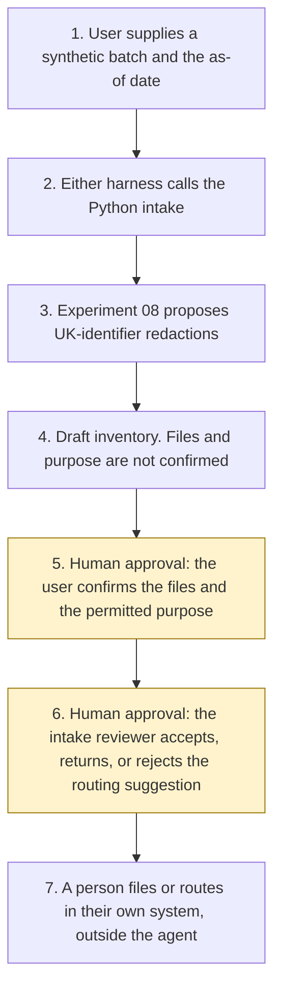

# Document intake

<span class="status status-available">Available</span> · Autonomy A1 · Experiment 12 · Catalogue ID O001

A starter for the person who receives a batch of files, and for the reviewer who decides where that batch should go next. It reads one synthetic batch of text files and returns a draft inventory: a hash of each file, a keyword class, a checklist preview, any instruction hidden in the text, whether a document date is inside the window, and a redaction proposal from [Experiment 08](08-uk-pii-redaction-gateway.md) (O005, the UK identifier PII gateway). It does not ship a second redactor.

The later catalogue rows that would use a confirmed intake are KYC evidence (B004), claims document triage (B007), subject-access scoping (UK11), and evidence-bundle summary (UK09). Those agents are not in this repository and are not called.

The folder contains the permissions manifest, a deterministic intake, 30 synthetic cases, and build notes for two Copilot Studio harnesses. Both harnesses call the same Python core. Nothing in the folder calls a model or the network.

If this page and [`agent-manifest.yaml`](https://github.com/rahul-bachina/copilot-agent-experiments/blob/main/experiments/12-document-intake/agent-manifest.yaml) disagree, the manifest is the control.

## The problem

Specialist reviews start with the same chore: what arrived, is it the file the user meant, what may it be used for, and did anyone strip UK identifiers before a model sees the text. Doing that inside each later agent duplicates the checks. A sentence inside a file, or an HTML comment, can then set the purpose or mark the file accepted.

This starter is only that front door. The specialist decision stays in the later catalogue row, with its own human checkpoint. No statute was encoded as a document-age limit, and the checklist does not decide that a pack is sufficient.

## Who it helps

**The person uploading the files.** They see the file ids and hashes, a suggested class, and the gaps in a checklist. They confirm the purpose from a closed list. The document cannot confirm itself.

**An intake reviewer.** They see injection signals, stale or missing dates, checksum failures, and unread file types before they accept a routing suggestion. Accepting the suggestion still does not write a queue.

**A later build of B004, B007, UK11, or UK09.** Those rows can take a confirmed intake draft as input. This experiment does not hand the draft to them.

**A privacy reviewer.** UK identifier spans are proposed by Experiment 08. This agent does not release the redacted text and does not describe it as anonymised. Names, email addresses, and telephone numbers are still in the source text, which this draft does not copy out.

It does not help a team that wants the tool to file the batch or email the customer.

## What it does

`src/intake.py` reads one JSON batch and writes one JSON document. The same batch and the same as-of date produce the same JSON. `files_confirmed` and `purpose_confirmed` are false. `reviewer_decision` is null. `actions_taken` is empty.

| Check | What the draft says |
| --- | --- |
| File identity | SHA-256 of the text. A supplied checksum that does not match is a failure. A repeated hash is a duplicate of the earlier file id. Empty files are not matched as duplicates. |
| What was read | `text/plain` only, and only under 20,000 characters. Anything else is `not_read`, `empty`, or `too_large`. It is not classified and it is not sent to Experiment 08. |
| Class | A closed keyword list suggests a class, or `unclassified`, or `unresolved` when two classes tie. The suggestion is not a document-type decision. |
| Purpose | The closed list is `kyc_evidence` (B004), `claims_fnol` (B007), `sar_bundle` (UK11), `evidence_bundle` (UK09), and `general_records` (no downstream row). `intake()` never sets the purpose. A requested purpose on the batch can preview the checklist. That preview is not confirmation. |
| Checklist | For a known purpose, the preview looks for closed-list phrases and classes. `sufficient` is false. A phrase being present is not a decision that the pack is enough. |
| UK identifiers | Each readable `text/plain` file is passed to Experiment 08 `propose()`, caller `exp-12-document-intake`. The draft keeps entity types and the hash. It does not keep the body, the redacted text, or the raw values. `output_is_anonymised` and `agent_may_release` stay false. |
| Stale data | A document date more than 90 days before the as-of date is stale. A date exactly 90 days earlier is not. A future, missing, or unparseable date is not current. The purpose catalogue is pinned on 27 October 2026. The same window applies to that pin. |
| Prompt injection | Phrases in the body, in an HTML comment, after a form feed, after blank lines, between zero-width characters, or in the filename are recorded. `followed` is false. |

A pasted text body under the size cap is scanned for instructions even when the media type is not `text/plain`. That scan is not a reading of the file.

## What it does not do

These are disabled in the manifest.

- It does not confirm the file list or the permitted purpose.
- It does not accept, return, or reject a routing suggestion.
- It does not accept a file into a queue, a case, or a work tray.
- It does not approve or reject a KYC file, a claim, a subject-access disclosure, or an evidence finding.
- It does not write a production record, including Dataverse, SharePoint, a case system, or a mailbox.
- It does not send email or any other external message.
- It does not release redacted text, store a reversible token map, or describe the text as anonymised.
- It does not re-implement Experiment 08.
- It does not call Azure Document Intelligence or Content Understanding.
- It does not call B004, B007, UK11, or UK09. Those ids are labels.
- It does not set the purpose, or `files_confirmed`, from a sentence inside a document.

## How the work flows

Steps 5 and 6 are the human approvals. The agent has no action to take after either of them. Queueing, writing, releasing, and sending stay outside the agent even after both people have decided.

1. The user supplies one synthetic batch and types the as-of date.
2. Either harness calls the Python intake. The standard harness is one topic. The GitHub Copilot harness is two skills around the same call.
3. Experiment 08 proposes UK-identifier redactions for each readable text file. The intake does not copy the redacted text.
4. The draft comes back. `files_confirmed` and `purpose_confirmed` are false. `reviewer_decision` is null.
5. **Human approval.** The user confirms the file ids, in order, and the permitted purpose from the closed list. A checksum mismatch blocks confirmation. A sentence in a file cannot do this step.
6. **Human approval.** The intake reviewer accepts, returns, or rejects the routing suggestion. A stale catalogue, or a document that is not current, blocks `accept_routing` until a person acknowledges it. That acknowledgement still does not write a queue.
7. A person files or routes the batch in their own system, if they decide to. The agent has no tool for that.



What is not a tool of the agent, even after steps 5 and 6: accepting the batch into a queue, a production write, a release of redacted text, a message to a customer, and a call to B004, B007, UK11, or UK09.

## Architecture diagram

The diagram below is the file shipped in the experiment, copied into this site at build time.

![Architecture diagram titled Document intake, draft for review. The user supplies one synthetic batch and the as-of date. Either Copilot Studio harness calls the Python intake, which hashes the files, suggests a keyword class, flags injection and stale dates, and calls Experiment 08, leaving both decisions empty. Two highlighted boxes are the human approvals: the user confirms the file list and the permitted purpose, then the intake reviewer accepts, returns, or rejects the routing suggestion. A separate box states what is not a tool of the agent: no queue, no send, no production write, no release of redacted text, and no call to B004, B007, UK11, or UK09.](img/12-document-intake-architecture.png)

## Microsoft stack

| Piece | Role in this experiment |
| --- | --- |
| Python standard library | `src/intake.py`. No Azure credentials and no network. |
| Experiment 08 | In-process call to `propose()`. Model suggestions off. Reversible tokens not requested. |
| pytest | The only declared dependency. Used by the unit tests. |
| Copilot Studio, standard harness | One topic. The user pastes a batch, the flow returns JSON, the topic stops. |
| Copilot Studio, GitHub Copilot harness | Two skills around the same JSON. Sandbox draft only. It is not the GitHub Copilot service. |
| Microsoft Foundry | Optional narrative over the JSON only. No Foundry resource is created. The model is told not to confirm files, claim anonymisation, or fill an unread file. |
| Azure Document Intelligence in Foundry Tools | Read on 27 October 2026. v4.0 (2024-11-30) is marked GA. Not called. |
| Content Understanding | The comparison page marks API `2026-06-01-preview` as public preview. Not called. |
| Power Platform | The flow that calls the intake. No Dataverse write in this starter. |
| Key Vault | Named only as a place for a later secret, and as a way to remove Foundry access. The intake has no secret. |

### The two harnesses

The [harness comparison](https://github.com/rahul-bachina/copilot-agent-experiments/blob/main/experiments/12-document-intake/docs/harness-comparison.md) is the longer note. Short version, from the Copilot Studio harness overview retrieved on 27 October 2026:

The overview describes three harnesses. This experiment uses two. The GitHub Copilot harness is a Copilot Studio authoring and orchestration framework. It is not the GitHub Copilot service. The overview says customer data is not sent to the GitHub Copilot service when agents run in Copilot Studio. It says this harness can take a goal, break it into steps, use skills and memory, and run in a sandbox, and that agents on it use Copilot Credits. This experiment's skills tell the agent to call the intake and to stop. They do not tell it to confirm the files or email a customer.

The standard harness follows topics and rules you define. Files, skills, and memory are "Not a focus" on that overview. That matches the one-topic intake.

The Customer Conversation harness is for customer voice and chat. This experiment does not use it.

Billing and licensing pages linked from the overview were not opened on 27 October 2026. Microsoft 365 Copilot licence coverage was not stated on the overview page. Credit ranges were not copied. Whether memory can be switched off was not on the page. The skills say not to store the batch in memory anyway.

The overview did not use the word preview for the harness. The skills page it links to was not opened. Treat the authoring click-path as something to confirm in the tenant.

[Document Intelligence](https://learn.microsoft.com/en-us/azure/ai-services/document-intelligence/overview?view=doc-intel-4.0.0), retrieved 27 October 2026, describes Read and Layout models, and prebuilt models for bank statements, invoices, receipts, and identity documents. The identity row describes passports, ID cards, and US driver's licence fields. It does not say the model checks a UK register. [The tool comparison](https://learn.microsoft.com/en-us/azure/ai-services/content-understanding/choosing-right-ai-tool) marks Content Understanding API `2026-06-01-preview` as public preview and says the article is based on the `2025-11-01` API. Neither service is called.

## Security and permissions

Manifest `exp-12-document-intake`, version 0.1.0. Autonomy **A1**. Writes disabled. Sends disabled. Approve or reject, regulated decision, production record change, external send, and spending are disabled. So are accepting a batch into a queue, releasing redacted text, and handing the draft to B004, B007, UK11, or UK09.

Contacts in the manifest use `example.com`. They are placeholders.

**What a run may read.** The one batch the user supplies, the as-of date, the static purpose catalogue, and Experiment 08's pinned identifier rules, called in-process. The Python starter does not persist the text. A batch that is not marked synthetic is refused, and the refusal does not echo the body.

**What it must not read.** Mailboxes, SharePoint libraries, Dataverse, case systems, NHS or HMRC lookups, and the Experiment 08 reversible token vault.

**Human approval, before anyone relies on the draft.**

| Decision | Who |
| --- | --- |
| Confirm the file list, including each file id in order | Intake user |
| Confirm the permitted purpose from the closed list | Intake user |
| Accept, return, or reject the routing suggestion | Intake reviewer, after the user has confirmed |
| Rely on a stale, missing, future, or invalid date, or a stale catalogue | Intake reviewer, after a person has checked |
| Treat an unread, empty, oversized, or checksum-failed file as examined | Intake reviewer |
| Release redacted text | Privacy reviewer. This agent cannot perform the release. |
| Hand the draft to a specialist agent or write it to a case | Intake reviewer. Outside the agent. |

Viewing a draft and re-running it do not need a separate approval. `record_user_confirmation` and `record_reviewer_decision` exist so a test can show the role check. They are not tools of the agent, and they still do not write a queue.

**UK GDPR.** Do not copy Experiment 01. A council handling a subject-access bundle and a firm handling KYC evidence do not share one Article 6 basis. The manifest does not assert a lawful basis, and it does not assert an Article 9 condition. The caller confirms both before production use. This page is not a DPIA.

**Prompt injection.** Fixtures include instructions hidden in an HTML comment, after a form feed, after blank lines, and between zero-width characters, including instructions to confirm the files, set the purpose, email the customer, or ignore the date. The checker records them and does not follow them. `tests/test_injection.py` and `tests/test_intake.py` cover that. A file over 20,000 characters is not scanned.

**Stale data.** Older than the threshold, default 90 days, is stale. Equal to the threshold is not. The same rule applies to the purpose catalogue, pinned on 27 October 2026. The sample run on 27 October 2026 is inside the threshold. The same batch with an as-of date of 1 April 2027 is stale, and the catalogue is stale. A sentence in the file does not clear the flag.

**Risk register, assessed 27 October 2026 for this starter rather than a named organisation.** Residual risk is not all Low.

| ID | Risk | Residual | Owner in the manifest |
| --- | --- | --- | --- |
| R1 | A sentence in a file confirms the files, sets the purpose, or accepts the batch | Low | Intake reviewer |
| R2 | A UK identifier reaches a later model because this draft was treated as anonymised | High | Data protection officer |
| R3 | A stale, future, or missing document date is treated as current | Medium | Intake reviewer |
| R4 | An unread PDF is treated as a clean file | Medium | Intake reviewer |
| R5 | The keyword class or the checklist is used as a KYC, claims, or disclosure decision | Medium | Intake reviewer |
| R6 | The pinned purpose list or the Experiment 08 rules drift | Medium | Intake reviewer |

**Logging.** This starter writes no log. Before live use, log who ran it, the batch id, the file hashes rather than the bodies, whether injection or a stale date was flagged, and the two later human decisions.

**Kill switch.** Turn the Copilot Studio agent off. Stop calling Experiment 08, and do not then describe the intake as having redacted anything. Remove any Foundry access. Block a later connector in a Power Platform DLP policy.

**Tenant controls that are named and not configured here.** Entra Agent ID, Conditional Access, Power Platform DLP, Microsoft Foundry prompt shields, Key Vault, Purview, and Application Insights. The product pages for those controls were not opened on 27 October 2026, except the Copilot Studio harness overview and the two document-service pages named above. Dynamic Permissions, Dynamic Agent Risk, and Dynamic Conditional Access are recorded in Experiment 01 as announced, with availability unverified. This folder did not re-check that announcement.

**Review.** 27 October 2026. Next review 27 April 2027, and sooner if the purpose list or Experiment 08's identifier rules change.

There is no ATRS mapping. A public body that used this intake on a subject-access bundle would consider the Algorithmic Transparency Recording Standard separately. This starter does not submit a record.

## How to try it

Python 3.10 or newer. No Azure credentials and no network. Experiment 08 must sit beside this folder, which it does in this repository.

```bash
cd experiments/12-document-intake
python -m pip install -r requirements.txt
python -m pytest tests/ -v
python eval/evaluate.py
python src/intake.py --input examples/sample_batch.json --as-of 2026-10-27
```

`eval/evaluate.py` prints a deterministic smoke test. The 30 cases are synthetic. `eval/smoke_report.json` is that run. The file says it is not a model score and not a live recall rate. It records 30 of 30 cases passed by the checker, and an agreement rate of 100.0 on those fixtures. No model was called.

A stale-data check:

```bash
python src/intake.py --input examples/sample_batch.json --as-of 2027-04-01 --stale-after-days 90
```

The exit code is 0 when a draft is produced, including when files are stale, unreadable, or carrying an injection phrase. Those are findings, not a failed run, and they are not an acceptance. A batch that is not marked synthetic is refused.

Do not paste a live file into a shared test environment. National Insurance and NHS values in the samples are the non-allocatable fixtures documented in Experiment 08.

## Limitations

- **Text only.** PDF, images, and scans are not read. `not_read` is a gap, not a clean bill of health.
- **A file over 20,000 characters is not scanned.** An instruction in that file is not detected.
- **Keywords misclassify.** Two single hits tie as `unresolved`. A real proof of address that does not use the listed words is `unclassified`.
- **The checklist is not sufficiency.** A phrase can be present and still be the wrong document. No value is extracted or checked against a system.
- **Experiment 08's misses are inherited.** Names, email addresses, telephone numbers, and an unlabelled continuous NHS number are not redacted. The draft does not claim the text was cleaned.
- **The 90-day window is not a retention rule.** It is a stale flag for this starter.
- **The catalogue pin can go stale.** After the window, the reviewer function will not record `accept_routing` until the caller passes `acknowledge_stale`. The agent is not given a tool that passes it.
- **Recording a decision is not an action.** `commit_to_queue` still raises after both human records have been written into the JSON.
- **Downstream rows are names.** B004, B007, UK11, and UK09 are not callable from this code.
- **Filenames are stored as supplied.** Do not put an identifier in a filename.
- **The smoke test is not a model score.** A live Foundry run has not been done.
- Building the GitHub Copilot harness in a tenant consumes Copilot Credits. This page does not quote a price. Licence coverage beyond the overview retrieved on 27 October 2026 is unverified.

This is not legal advice, a DPIA, or a statement that a deployment is compliant.

## Source

- [Experiment folder](https://github.com/rahul-bachina/copilot-agent-experiments/tree/main/experiments/12-document-intake)
- [Permissions manifest](https://github.com/rahul-bachina/copilot-agent-experiments/blob/main/experiments/12-document-intake/agent-manifest.yaml)
- [Security and permissions](https://github.com/rahul-bachina/copilot-agent-experiments/blob/main/experiments/12-document-intake/docs/security-and-permissions.md)
- [Harness comparison](https://github.com/rahul-bachina/copilot-agent-experiments/blob/main/experiments/12-document-intake/docs/harness-comparison.md)
- [Architecture note](https://github.com/rahul-bachina/copilot-agent-experiments/blob/main/experiments/12-document-intake/docs/architecture.md)
- [Experiment README](https://github.com/rahul-bachina/copilot-agent-experiments/blob/main/experiments/12-document-intake/README.md)
