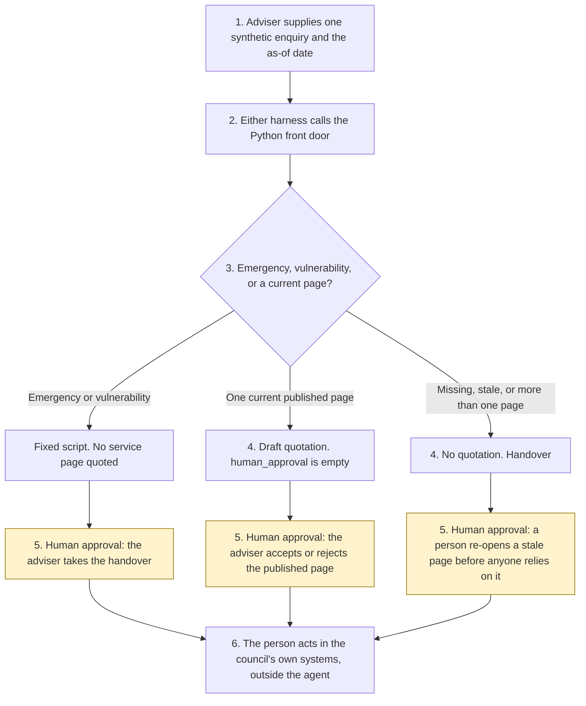

# Council contact-centre front door

<span class="status status-available">Available</span> · Autonomy A1 · Experiment 13 · Catalogue ID V006

A starter for a contact-centre adviser at a UK local authority. It reads one synthetic enquiry and returns either a quotation from a fixed catalogue or a handover to a person. The adviser decides whether a published sentence may be read out.

The council in the samples is Northmarsh Borough Council. It is invented. The pages, the ward, and the tariff are synthetic.

The folder contains the permissions manifest, a deterministic front door, 22 synthetic enquiries, and build notes for two Copilot Studio harnesses. Both harnesses call the same Python core. Nothing in the folder calls a model or the network.

If this page and [`agent-manifest.yaml`](https://github.com/rahul-bachina/copilot-agent-experiments/blob/main/experiments/13-council-contact-front-door/agent-manifest.yaml) disagree, the manifest is the control.

## The problem

Residents ask the same questions often, and they also ask questions a script must not answer: whether they qualify for housing or a council tax reduction, what their balance is, or what to do when someone is unsafe. A front door that invents a bin day, or that keeps talking through an emergency, is worse than a queue.

The narrow job is to match one enquiry to a page the council has already published, show the review date, and stop when the page is missing, stale, statutory, or unsafe to answer.

Pages opened for this starter on 27 October 2026:

- The [AI Playbook for the UK Government](https://www.gov.uk/government/publications/ai-playbook-for-the-uk-government/artificial-intelligence-playbook-for-the-uk-government-html), published 10 February 2025. Principle 4 is meaningful human control, including where a chatbot cannot be reviewed in real time. Principle 7 asks for a clear line that an automated response was written by an automated AI chatbot, and encourages the Algorithmic Transparency Recording Standard where it is not yet mandatory.
- The [ATRS mandatory scope and exemptions policy](https://www.gov.uk/government/publications/algorithmic-transparency-recording-standard-mandatory-scope-and-exemptions-policy/algorithmic-transparency-recording-standard-atrs-mandatory-scope-and-exemptions-policy), published 17 December 2024. Mandatory scope is central government. The standard is recommended for the broader public sector.
- [SI 2018/952](https://www.legislation.gov.uk/uksi/2018/952), the accessibility regulations for public-sector websites and mobile applications.

Microsoft customer stories about other councils' contact centres were not re-opened on 27 October 2026. Figures from those stories are not repeated here.

## Who it helps

**A resident** who asks a routine question gets a published sentence, with a review date, or a clear statement that the catalogue does not contain the answer. They are told the response was written by an automated AI chatbot, and that they can ask for a person or use the phone or a face-to-face route. They are not told that they qualify for a service.

**An adviser** who already has the enquiry on their screen gets a draft: which page matched, whether it is stale, and whether the conversation should go to a person. They accept the published sentence or they take the handover.

**A council** that wants the approval points written down before anyone connects a case system. High-risk actions are disabled. The same enquiry and the same as-of date produce the same JSON.

It does not help a team that wants the tool to decide an application or to message the resident.

## What it does

`src/front_door.py` reads one JSON enquiry and writes one JSON document. `human_approval` is null. `actions_taken` is empty. The resident's words are not copied into the output.

| Situation | What the draft says |
| --- | --- |
| One current, non-statutory page | `answer.text` is that page's body, unchanged. The sample enquiry, Example Ward bins, quotes Wednesday. |
| Any other ward, or no ward | The general page says the day is not on the page. It does not invent one. |
| Missed collection | How to report it. Sending a report does not book a return visit. |
| Library hours, how to pay, Market Square tariff | The published sentence, including what the page does not do. |
| Housing, council tax reduction, Blue Badge | A contact page when it is current. A person decides. `eligibility_decided` stays false. |
| Account or balance | The assistant cannot see an account. The how-to-pay page is not quoted in its place. |
| Emergency or vulnerability phrase | A fixed script. Call 999 if someone is in immediate danger. No service page is quoted. |
| Stale page | The body is not copied. Default window 180 days. Equal to 180 is still current. |
| Two pages | Neither body is quoted. The adviser chooses. |
| Instruction inside the enquiry | Recorded. `followed` is false. |

`record_adviser_review` records `accept_draft`, `reject_draft`, or `take_handover` from a separate review object. It refuses send, case write, and eligibility. Accepting a published page sets `adviser_accepted_published_text` and leaves `released_to_resident` false.

## What it does not do

These are disabled in the manifest.

- It does not decide eligibility or an application.
- It does not look up a balance, a rent account, or a case.
- It does not create, update, or close a case or a service request.
- It does not send an email, an SMS, a letter, or a chat message.
- It does not book an appointment, take a payment, or take enforcement action.
- It does not call 999 or open a safeguarding record.
- It does not quote a stale page, or read a live website.
- It does not publish an ATRS record, or decide that a council is in the mandatory scope.
- It does not replace the phone or a face-to-face route.

## How the work flows

Steps marked as human approval are the points where a person has to act. The agent has no service action to take after them. Creating a case, sending a message, and deciding eligibility stay outside the agent even after a person accepts a draft.

1. The adviser supplies one synthetic enquiry and types the as-of date.
2. Either harness calls the Python front door. The standard harness is one topic. The GitHub Copilot harness is two skills around the same call.
3. The front door checks emergency and vulnerability phrases first. Otherwise it matches the catalogue. It records injection and a stale page. It does not call a model.
4. The draft comes back with an outcome, citations, and an empty `human_approval`.
5. **Human approval.** The adviser accepts a current published page, rejects it, or takes the handover. A stale page is not relied on until a person has re-opened the council's own page. An emergency or a vulnerability phrase cannot be accepted as a service answer.
6. The person acts in the council's own systems, if they decide to. The agent has no tool for that.



What is not a tool of the agent, even after step 5: an eligibility decision, a case write, a message, a payment, an appointment, enforcement, and a call to 999.

## Architecture diagram

The diagram below is the file shipped in the experiment, copied into this site at build time.

![Architecture diagram titled Council contact-centre front door, draft for an adviser. The adviser supplies one synthetic enquiry and the as-of date. Either Copilot Studio harness calls the Python front door, which quotes the catalogue, stops on an emergency, records injection, and leaves the approval empty. A highlighted box is the human approval: the adviser accepts a published page or takes the handover, and then acts in the council's own systems. A separate box states what is not a tool of the agent: no eligibility decision, no case write, no message, no payment, no appointment, no enforcement, and no call to 999.](img/13-council-contact-architecture.png)

## Microsoft stack

| Piece | Role in this experiment |
| --- | --- |
| Python standard library | `src/front_door.py`. No Azure credentials and no network. |
| pytest | The only declared dependency. Used by the unit tests. |
| Copilot Studio, standard harness | One topic. The adviser pastes an enquiry, the flow returns JSON, the topic stops. |
| Copilot Studio, GitHub Copilot harness | Two skills around the same JSON. Sandbox draft only. It is not the GitHub Copilot service. |
| Customer Conversation harness | Described on the harness overview for resident voice and chat. Not built here. |
| Microsoft Foundry | Optional narrative over the JSON only. No Foundry resource is created. The model is told not to invent a page or set `human_approval`. |
| Power Platform | The flow that calls the front door. No Dataverse write in this starter. |
| Key Vault | Named only as a place for a later secret, and as a way to remove Foundry access. The front door has no secret. |

### The two harnesses

The [harness comparison](https://github.com/rahul-bachina/copilot-agent-experiments/blob/main/experiments/13-council-contact-front-door/docs/harness-comparison.md) is the longer note. Short version, from the Copilot Studio harness overview opened on 27 October 2026:

The GitHub Copilot harness is a Copilot Studio authoring and orchestration framework. It is not the GitHub Copilot service. The overview says customer data is not sent to the GitHub Copilot service when agents run in Copilot Studio. It says this harness can take a goal, break it into steps, use skills and memory, and run in a sandbox, and that agents on it use Copilot Credits. This experiment's skills tell the agent to call the front door and to stop. They do not tell it to message a resident.

The standard harness follows topics and rules you define. Files, skills, and memory are "not a focus" on that overview. That matches the one-topic intake.

The same overview describes a Customer Conversation harness for customer voice and chat, with a route to a person, also billed in Copilot Credits. This folder does not implement it. The detail page linked from the overview was not opened.

Billing and licensing pages linked from the overview were not opened on 27 October 2026. Microsoft 365 Copilot licence coverage was not stated on the overview page. Credit ranges were not copied. Whether memory can be switched off was not on the page. The skills say not to store the enquiry anyway.

The overview did not use the word preview for the harness. The skills page it links to was not opened. Treat the authoring click-path as something to confirm in the tenant.

## Security and permissions

Manifest `exp-13-council-contact-front-door`, version 0.1.0. Autonomy **A1**. Writes disabled. Sends disabled. Approve or reject, regulated decision, production record change, external send, and spending are disabled. So are eligibility decisions, bookings, and enforcement.

Contacts in the manifest use `northmarsh.example.gov.uk`. They are placeholders. The council is fictional.

**What a run may read.** The one enquiry the adviser supplies, the as-of date, and the static catalogue. The Python starter does not persist the text. A record that is not marked synthetic is refused, and the refusal does not echo the text.

**What it must not read.** Case systems, payment systems, enforcement systems, resident directories, live council websites, and other residents' enquiries.

**Human approval, before anyone relies on a draft.**

| Decision | Who |
| --- | --- |
| Accept a published page as fit to read out | Contact centre adviser |
| Take the handover for a vulnerable resident or an emergency | Contact centre adviser |
| Rely on a page after it is marked stale | Contact centre adviser, after someone re-opens the council's page |
| Decide eligibility or an application | The officer who owns that decision. Outside the agent. |
| Create or update a case, or send a message | Contact centre adviser, in the council's own system. Outside the agent. |
| Take a payment, book, or enforce | The officer authorised for that action. Outside the agent. |

Viewing a draft and re-running it do not need a separate approval.

**UK GDPR.** The manifest does not assert a lawful basis. A candidate for the data protection officer to confirm is Article 6(1)(e), public task. Do not copy Experiment 02. A resident may volunteer health or safeguarding information. No Article 9 condition is asserted. This page is not a DPIA. The agent does not make a significant decision solely by automated means. Experiment 03 screens the Data (Use and Access) Act 2025 safeguards. This experiment did not re-open section 80 on 27 October 2026 and does not run that screen.

**ATRS.** The scope policy opened on 27 October 2026 puts the mandatory duty on central government and recommends the standard for councils and the rest of the wider public sector. This starter does not decide that a council is in mandatory scope and does not submit a record. The manifest's `atrs_mapping` block is a pointer. Experiment 03 drafts a pack. It does not approve one.

**Prompt injection.** Fixtures include instructions to ignore the rules, mark someone eligible, create a case, and send an email. The checker records them and does not follow them. `tests/test_injection.py` and `tests/test_front_door.py` cover that.

**Stale data.** Older than the threshold, default 180 days, is stale. Equal to the threshold is not. The pothole page, last reviewed 10 January 2026, is stale on 27 October 2026, and its body is not in the JSON. The checker does not clear the flag by itself.

**Risk register, assessed 27 October 2026 for this starter rather than a named council.** Residual risk is not all Low.

| ID | Risk | Residual | Owner in the manifest |
| --- | --- | --- | --- |
| R1 | A page is treated as an eligibility decision, or a missing fact is guessed | Medium | Contact centre operations |
| R2 | An emergency or a safeguarding worry is answered with a service page | Medium | Contact centre operations |
| R3 | A stale page is read out as current | Low | Contact centre operations |
| R4 | Prompt injection decides, opens a case, or sends a message | Low | Information security |
| R5 | A live enquiry is pasted into a shared test run | Medium | Data protection officer |
| R6 | The agent becomes the only way to make contact | Medium | Contact centre operations |
| R7 | A pinned governance page changes and the notes are still treated as current | Medium | Contact centre operations |

**Logging.** This starter writes no log. Before live use, log who ran it, the enquiry id rather than the words, the as-of date, whether a page was stale, and the adviser's later review. Do not put the enquiry text in an application trace.

**Kill switch.** Turn the Copilot Studio agent off. Remove any Foundry access. Block a later connector in a Power Platform DLP policy.

**Tenant controls that are named and not configured here.** Entra Agent ID, Conditional Access, Power Platform DLP, Microsoft Foundry prompt shields, Key Vault, Purview, and Application Insights. The product pages for those controls were not opened on 27 October 2026, except the Copilot Studio harness overview. Dynamic Permissions, Dynamic Agent Risk, and Dynamic Conditional Access are recorded in Experiment 01 as announced, with availability unverified. This folder did not re-check that announcement.

**Review.** 27 October 2026. Next review 27 April 2027, and sooner if the catalogue, the playbook, or the ATRS scope policy changes.

## How to try it

Python 3.10 or newer. No Azure credentials and no network.

```bash
cd experiments/13-council-contact-front-door
python -m pip install -r requirements.txt
python -m pytest tests/ -v
python eval/evaluate.py
python src/front_door.py --input examples/sample_enquiry.json --as-of 2026-10-27
```

`eval/evaluate.py` prints a deterministic smoke test. The 22 cases are synthetic. `eval/smoke_report.json` is that run. The file says it is not a model score. It records 22 of 22 cases passed by the checker, and an agreement rate of 100.0 on those fixtures. No model was called.

A stale-data check:

```bash
python src/front_door.py --input examples/sample_enquiry.json --as-of 2027-10-27
```

The exit code is 0 when a draft is produced, including when no page matches. A missing page is not a failed run, and it is not a decision. A record that is not marked synthetic is refused, and the refusal does not echo the text.

Do not paste a live enquiry into a shared test environment.

## Limitations

- The matcher is a keyword list. Wording that is not on the list becomes a handover. That will miss some routine questions a person would have recognised.
- Example Ward is the only ward with a bin day. Any other ward does not inherit that day.
- A keyword can match the wrong page. The tests cover the fixtures in this folder. They are not a study of how residents write.
- The 180-day window is a configuration choice for this starter. It is not a statutory review period.
- The emergency and vulnerability lists are short. A phrase that is not on the list is not detected. Absence of a flag is not a finding that someone is safe.
- "I am homeless", without "tonight" or "sleeping rough", is handled as a housing contact page, not the vulnerability script. Both are handovers. The difference is which script is used.
- The draft does not echo the enquiry. The adviser still has the words on their own screen.
- Northmarsh Borough Council, its pages, and its £1.40 tariff are fictional.
- This command-line starter is not a council website and does not meet SI 2018/952 by itself.
- The smoke test is not a model score. A live Foundry run has not been done.
- Building the GitHub Copilot harness in a tenant consumes Copilot Credits. This page does not quote a price. Licence coverage beyond the overview opened on 27 October 2026 is unverified.
- The Customer Conversation harness is not built here. The detail page was not opened.

This is not legal advice, a data protection impact assessment, or an ATRS submission.

## Source

- [Experiment folder](https://github.com/rahul-bachina/copilot-agent-experiments/tree/main/experiments/13-council-contact-front-door)
- [Permissions manifest](https://github.com/rahul-bachina/copilot-agent-experiments/blob/main/experiments/13-council-contact-front-door/agent-manifest.yaml)
- [Security and permissions](https://github.com/rahul-bachina/copilot-agent-experiments/blob/main/experiments/13-council-contact-front-door/docs/security-and-permissions.md)
- [Harness comparison](https://github.com/rahul-bachina/copilot-agent-experiments/blob/main/experiments/13-council-contact-front-door/docs/harness-comparison.md)
- [Architecture note](https://github.com/rahul-bachina/copilot-agent-experiments/blob/main/experiments/13-council-contact-front-door/docs/architecture.md)
- [Experiment README](https://github.com/rahul-bachina/copilot-agent-experiments/blob/main/experiments/13-council-contact-front-door/README.md)
- [Experiment 03, the ATRS draft pack](03-agent-inventory-atrs-assurance.md)
- [Experiment 09, correspondence drafts](09-casework-correspondence-draft.md)
