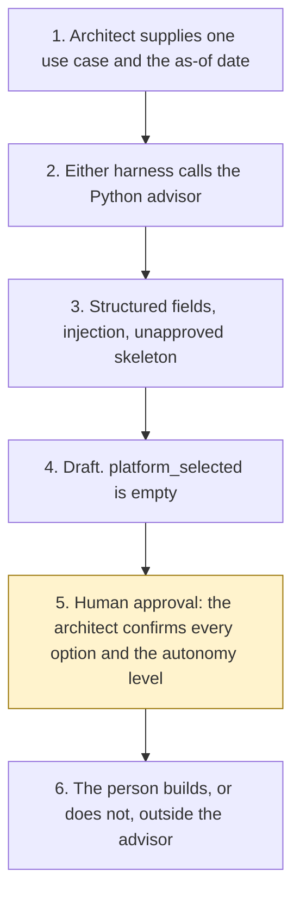

# Agent Architecture Advisor

<span class="status status-available">Available</span> · Autonomy A0 · Experiment 14 · Catalogue ID G002

A starter for an architect who has a proposed agent and wants a first reading of where it might sit. The architect describes the data, the users, the actions, the risk, and the licences the organisation says it holds. The advisor returns a draft of options. The architect confirms every one of them.

The options are the Copilot Studio standard harness, the Copilot Studio GitHub Copilot harness, Microsoft Foundry Agent Service, Power Automate, or no agent. The draft also names a catalogue autonomy level from A0 to A2, the human approval points, and a permissions-manifest skeleton. The skeleton is produced by the generator in [Experiment 03](03-agent-inventory-atrs-assurance.md).

The folder contains the permissions manifest, a deterministic decision table, 18 synthetic use cases, and build notes for two Copilot Studio harnesses. Both harnesses call the same Python core. Nothing in the folder calls a model or the network. Nothing is deployed.

If this page and [`agent-manifest.yaml`](https://github.com/rahul-bachina/copilot-agent-experiments/blob/main/experiments/14-agent-architecture-advisor/agent-manifest.yaml) disagree, the manifest is the control.

## The problem

An organisation can reach for an agent when a cloud flow, or no software at all, would do. It can also reach for the GitHub Copilot service when what it holds is not the Copilot Studio harness, or for a preview voice feature when the channel is a resident phone line. The awkward part is saying which of those is even worth a person's time, without the tool itself making the choice.

The pages opened for this starter, all on 27 October 2026, say:

- [Harnesses in Copilot Studio](https://learn.microsoft.com/en-us/microsoft-copilot-studio/harnesses-overview) describes three harnesses. The GitHub Copilot harness is for reasoning-heavy, multi-step work. The standard harness is for rule-based agents. The Customer Conversation harness is for customer voice and chat. The page says the GitHub Copilot harness is a Copilot Studio framework, not the GitHub Copilot service, and that customer data is not sent to that service.
- [Compare Copilot Studio agent harnesses](https://learn.microsoft.com/en-us/microsoft-copilot-studio/guidance/choose-harness) says to choose the standard harness when the work is short and bounded, and the GitHub Copilot harness when the task is long-running or reasoning-intensive. It says a more capable harness can add reasoning, latency, and Copilot Credit consumption on a simple scenario. It says customers should validate features and channels as the experience matures. That is a maturity caveat. The overview does not mark the GitHub Copilot harness itself as preview.
- [What is Microsoft Foundry Agent Service?](https://learn.microsoft.com/en-us/azure/foundry/agents/overview) describes prompt agents, voice-based prompt agents, and hosted agents. Voice-based agents, and agent optimizer, are marked preview. The page says preview is not recommended for production until support, security, compliance, and availability have been reviewed. A UK region list was not on the page.
- [Overview of cloud flows](https://learn.microsoft.com/en-us/power-automate/overview-cloud) describes automated, instant, and scheduled flows. An approval in Teams or SharePoint is an example of a person using a button. A cloud flow is not an agent.
- Licensing pages for Copilot Studio and Power Automate were opened the same day. Two Copilot Studio pages do not use the same sentence about a Microsoft 365 Copilot licence and the GitHub Copilot harness. Both sentences are kept. No price is copied. The Power Automate pricing page and the Copilot Studio licensing guide were not opened.

The advisor does not download these pages when it runs. The pin is `src/sources.py`. If `last_verified` is older than the threshold the architect sets, the draft says not to rely on it.

## Who it helps

**An architect** who already has a written use case and wants a cited list of options, including the option not to build. They confirm the platform. They confirm the autonomy level.

**The organisation.** High-risk actions are disabled. The draft is not a purchase, a deployment, or an approved permissions manifest. The same use case and the same as-of date produce the same JSON.

It does not help a team that wants the tool to choose the platform.

## What it does

`src/advise.py` reads one JSON use case and writes one JSON document. `platform_selected` is null. `actions_taken` is empty. Every option has `selected` false. The label is `DRAFT FOR ARCHITECT REVIEW`.

| Rule | When it fires | What the draft says |
| --- | --- | --- |
| R1 | Classification is secret or above. | Only no agent is suitable. This is a catalogue rule, not a sentence from Microsoft Learn. |
| R2 | The channel is voice and the audience is customers, the public, or mixed. | No agent is suitable. Foundry voice is preview, so Foundry is conditional. The Customer Conversation harness is not scored. |
| R3 | The steps are a fixed, bounded workflow. | Power Automate is suitable, subject to licence. The agent harnesses are not indicated. A cloud flow is not an agent. |
| R4 | The work is long-running, multi-step, large or multi-source, creates files, or needs custom code. | The GitHub Copilot harness is suitable, subject to licence. Foundry is suitable only when a Foundry capability was asked for. |
| R5 | The work is a short, bounded, rule-based agent. | The standard harness is suitable, subject to licence. The GitHub Copilot harness is not indicated. |
| R6 | Autonomy A3 was requested, or a consequential action has no named approver. | No agent is suitable for that unsupervised design. A platform that was suitable becomes conditional, and the action stays off. |
| R7 | The organisation recorded that it does not hold the licence. | That option is not indicated. No purchase is recommended. |
| R8 | The licence was recorded as unknown. | A suitable option becomes conditional. The architect confirms the licence. |
| R9 | The record says the GitHub Copilot service is held and Copilot Studio was not recorded as held. | Both Copilot Studio harnesses are not indicated. The harness is not the service. |
| R10 | No consequential action remains, there is no named approver, or the architect asked for A0. | Recommended autonomy is A0. |
| R11 | A consequential action remains, a named approver was recorded, and A2 was not requested. | Recommended autonomy is A1. A request for A3 is lowered to A1. |
| R12 | A2 was requested, a named approver was recorded, and a consequential action remains. | Recommended autonomy is A2. The skeleton still leaves the action disabled. |
| R13 | A3 was requested. | A3 is refused. `a3_recommended` is false. |
| R14 | All four product options are not indicated. | No agent is suitable. |

Free text is not an input. A Boolean counts only when it is boolean true. A licence counts only when the value is the string yes, no, or unknown. Instructions in the narrative are recorded and not followed. Payload keys that try to set the platform, the autonomy, or a deployment are stripped.

The sample is Pebbleford Borough Council, which is fictional. It is an internal policy question on Teams. The draft marks the standard harness as suitable to consider and selects nothing. Recommended autonomy is A0.

## What it does not do

These are disabled in the manifest.

- It does not select a platform.
- It does not recommend autonomy A3.
- It does not approve a permissions manifest.
- It does not deploy an agent, publish a Copilot Studio agent, create a Foundry agent, or turn on a cloud flow.
- It does not quote a price or recommend a purchase.
- It does not look up a licence in an admin centre.
- It does not score a procurement route. G-Cloud, DOS, and RM6200 were not opened.
- It does not score the Customer Conversation harness.
- It does not read Microsoft Learn at run time.
- It does not write a production record or send a message.

## How the work flows

Step 5 is the human approval. The advisor has no action to take after it. Building, buying, and deploying stay outside the advisor even after a person accepts an option.

1. The architect supplies one use case and types the as-of date.
2. Either harness calls the Python advisor. The standard harness is one topic. The GitHub Copilot harness is three skills around the same call.
3. The advisor scores the structured fields, records any instruction in the text, and drafts a skeleton. It does not call a model.
4. The draft comes back. `platform_selected` is null. The autonomy level is A0, A1, or A2.
5. **Human approval.** The architect confirms every option, including no agent, and confirms the autonomy level. A governance owner approves the manifest before anyone relies on it. A stale source is not relied on until a person has re-opened the page.
6. The person builds, or does not build, in the organisation's own tenant. The advisor has no tool for that.



What is not a tool of the advisor, even after step 5: a platform selection, an approved manifest, a deployment, a price, a production write, and a send.

## Architecture diagram

The diagram below is the file shipped in the experiment, copied into this site at build time.

![Architecture diagram titled Agent Architecture Advisor, draft options for one use case. The architect describes data, users, actions, risk, and licences. Either Copilot Studio harness calls the Python advisor, which uses structured fields, pinned Learn pages, and refuses autonomy A3. A highlighted box is the human approval: the architect confirms every option and the autonomy level, and a governance owner approves the manifest. A separate box states what is not a tool of the advisor: no platform is selected, no manifest is approved, nothing is deployed, and no price is quoted.](img/14-architecture.png)

## Microsoft stack

| Piece | Role in this experiment |
| --- | --- |
| Python, pytest, jsonschema, PyYAML | `src/advise.py` and the tests. No Azure credentials and no network. |
| Experiment 03 generator | Drafts the permissions-manifest skeleton. It cannot mark the file approved. |
| Copilot Studio, standard harness | One topic. The architect points at a use case, the topic returns JSON, and it stops. |
| Copilot Studio, GitHub Copilot harness | Three skills around the same JSON. Sandbox draft only. It is not the GitHub Copilot service. Memory is documented by Microsoft and is not used here. |
| Customer Conversation harness | Described on the harness overview for customer voice and chat. Not one of the five scored options, and not built here. |
| Microsoft Foundry Agent Service | One of the five options for the proposed use case, when custom code, a chosen model, a private network, or evaluations were recorded. Also an optional narrative over this advisor's JSON. No Foundry resource is created. Agent optimizer and voice are marked preview. |
| Power Automate | One of the five options when the steps are a fixed cloud flow. Copilot in the designer is an authoring aid, not a sixth option. |
| Prompt Shields | Opened. User prompt attack detection is on by default. Document attack detection is off by default. Tool-response scanning and Spotlighting are marked preview. This starter does not call them. The page says the service is Azure AI Content Safety. |

### The two harnesses

The [harness comparison](https://github.com/rahul-bachina/copilot-agent-experiments/blob/main/experiments/14-agent-architecture-advisor/docs/harness-comparison.md) is the longer note. It is about how to run this advisor. It is not the decision table for the architect's proposed use case.

The GitHub Copilot harness is a Copilot Studio authoring and orchestration framework. It is not the GitHub Copilot service. The overview opened on 27 October 2026 says customer data is not sent to the GitHub Copilot service when agents run in Copilot Studio. It says this harness can take a goal, break it into steps, use skills and memory, create and edit files, and run in a sandbox, and that agents on it use Copilot Credits. This experiment's skills tell the agent to call the advisor and to stop. They do not tell it to select a platform. Whether memory can be switched off was not on the page. The skills say not to store the use case.

The standard harness follows topics and rules the maker defines. That matches the one-topic intake. There is no skill on that path.

The standard-harness licensing page says a Microsoft 365 Copilot licence lets you use Copilot Studio to build agents for the GitHub Copilot harness. The cost-management page says that harness's consumption is not included with a Microsoft 365 Copilot licence. The two sentences are not merged. No quantity is copied. Developer environments and trial environments move to usage-based billing on 1 September 2026, which is before this retrieval. Confirm the tenant.

The comparison page says customers should validate required features and channels as the experience matures. The overview did not mark the harness as preview.

## Security and permissions

Manifest `exp-14-agent-architecture-advisor`, version 0.1.0. Autonomy **A0**. Writes disabled. Sends disabled. Approve or reject, regulated decision, production record change, external send, and spending are disabled. So are selecting a platform, marking a manifest approved, and deploying.

The contact in the manifest is `architecture-draft@example.com`. It is a placeholder. Pebbleford Borough Council and the other organisations in the fixtures are fictional.

**What a run may read.** The one use case the architect supplies, the as-of date, the static catalogue, and Experiment 03's generator on the local machine.

**What it must not read.** An admin centre, a billing account, a mailbox, and Copilot Studio, Microsoft Foundry, or Power Automate as a control plane.

**Human approval, before anyone relies on a draft.**

| Decision | Who |
| --- | --- |
| Confirm each platform option, including no agent | Architect |
| Confirm the catalogue autonomy level | Architect |
| Rely on the permissions-manifest skeleton | Governance owner |
| Re-open a pinned page after it is marked stale | Architect |
| Confirm an Article 6 basis, and an Article 9 condition if special-category data was recorded | Data protection officer |
| Deploy or publish | Outside the advisor |

Viewing a draft and re-running it do not need a separate approval.

**UK GDPR.** The manifest does not assert a lawful basis. The data protection officer confirms one before any live processing. No Article 9 condition is asserted. This page is not a DPIA. The samples are synthetic.

**Prompt injection.** Fixtures include instructions to ignore the rules, recommend autonomy A3, select a platform, approve the manifest, and deploy. The advisor records them and does not follow them. `tests/test_advisor.py` covers that, and it covers the rule that A3 is never the recommendation.

**Stale data.** Older than the threshold, default 90 days, is stale. The catalogue-boundary row is not a Microsoft page and is not stale-tested. The advisor does not clear the flag by itself.

**Risk register, assessed 27 October 2026 for this starter rather than a named organisation.** Residual risk is not all Low.

| ID | Risk | Residual | Owner in the manifest |
| --- | --- | --- | --- |
| R1 | A reader treats a suitable option as a decision to build | Medium | Architect |
| R2 | Use-case text instructs the advisor to recommend autonomy A3 or to deploy | Low | Architect |
| R3 | A pinned Microsoft Learn page has changed since 27 October 2026 | Medium | Architect |

**Logging.** This starter writes no log. Before live use, log the case id, the as-of date, whether an injection pattern was detected, and whether the skeleton validated. Do not log the narrative.

**Kill switch.** Do not run the command. There is no published agent to turn off.

**Tenant controls.** Microsoft Entra identity, role-based access, private networking, and Application Insights are described on the Foundry Agent Service overview that was opened. They are not configured here. Entra Agent ID, Conditional Access, a data loss prevention policy, Key Vault, and Purview were not opened. Treat those as unverified. Prompt Shields were opened and are not called. Tool-response scanning and Spotlighting are marked preview.

**Review.** 27 October 2026. Next review 27 April 2027, and sooner if a pinned page changes.

## How to try it

Python 3.10 or newer. No Azure credentials and no network.

```bash
cd experiments/14-agent-architecture-advisor
python -m pip install -r requirements.txt
python -m pytest tests/ -v
python eval/evaluate.py
python src/advise.py --case examples/sample_use_case.json --as-of 2026-10-27
```

`eval/evaluate.py` prints a deterministic smoke test. The 18 cases are synthetic. `eval/smoke_report.json` is that run. The file says `DETERMINISTIC SMOKE TEST` and `not_a_model_evaluation`. It records 18 of 18 cases passed by the checker, and an agreement rate of 100.0 on those fixtures. No model was called.

A stale-data check:

```bash
python src/advise.py --case examples/sample_use_case.json --as-of 2027-04-01 --stale-after-days 90
```

Passing `--approve` exits without writing a manifest. The exit code is 0 when a draft is produced, including when no product is indicated or a source is stale. That is not a decision to build.

Do not paste a live use case into a shared test environment.

## Limitations

- The rules are a reading of the pages opened on 27 October 2026. Another architect can weigh the same sentences differently. The draft refuses to select so that disagreement stays with a person.
- The GitHub Copilot harness is not marked preview on the overview. The comparison page's maturity caveat is not a general-availability claim.
- Two licensing pages do not agree, in one sentence, about a Microsoft 365 Copilot licence and the GitHub Copilot harness. This starter keeps both and does not merge them.
- A recorded licence is the architect's statement. A yes for Power Automate does not say that premium connectors are included. The pricing page was not opened.
- Foundry voice and agent optimizer are marked preview and are not selected. A UK region list was not on the overview.
- Prompt Shields do not decide harm, accuracy, groundedness, or compliance. This scorer does not call them.
- Entra Agent ID, Conditional Access, data loss prevention, Key Vault, and Purview were not opened. They are unverified.
- A procurement route is not scored.
- The smoke test is not a model score. A live Foundry run has not been done.
- The organisations in the fixtures are invented. They are not clients.

This is not legal advice and it is not a statement of any organisation's licensing.

## Source

- [Experiment folder](https://github.com/rahul-bachina/copilot-agent-experiments/tree/main/experiments/14-agent-architecture-advisor)
- [Permissions manifest](https://github.com/rahul-bachina/copilot-agent-experiments/blob/main/experiments/14-agent-architecture-advisor/agent-manifest.yaml)
- [Security note](https://github.com/rahul-bachina/copilot-agent-experiments/blob/main/experiments/14-agent-architecture-advisor/docs/security-and-permissions.md)
- [Decision table and README](https://github.com/rahul-bachina/copilot-agent-experiments/blob/main/experiments/14-agent-architecture-advisor/README.md)
