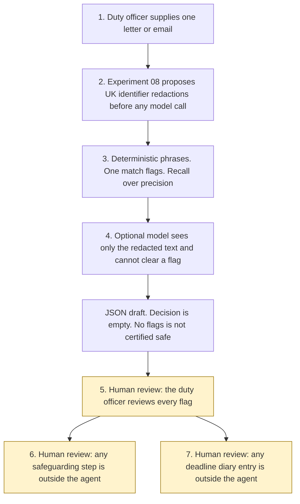

# Vulnerability and urgency scanner

<span class="status status-available">Available</span> · Autonomy A1 · Experiment 15 · Catalogue ID UK06

A starter for a duty officer who reads inbound post and email. It raises possible indicators in one letter: safeguarding, self-harm, financial hardship, and deadlines or legal time limits. The duty officer reviews every flag.

The writer in the sample is Rowan Hale. The name is invented. The letter is synthetic.

The folder contains the permissions manifest, a deterministic scanner, 40 synthetic cases, and build notes for two Copilot Studio harnesses. Both harnesses call the same Python core. The core calls [Experiment 08](08-uk-pii-redaction-gateway.md) before any model. Nothing in the folder calls a live model or the network.

If this page and [`agent-manifest.yaml`](https://github.com/rahul-bachina/copilot-agent-experiments/blob/main/experiments/15-vulnerability-urgency-scanner/agent-manifest.yaml) disagree, the manifest is the control.

## The problem

A benefit office, a council revenues or housing team, a lender, or a utility receives free-text post. A sentence about harm, money, or a hearing can sit in the middle of an ordinary letter. A person can miss it. An automated closer can bury it.

The narrow job is a list of possible indicators and the phrases they came from. Missing a safeguarding phrase is the failure that stops the tests. Extra flags are accepted. That is recall over precision, and the smoke test says so. There is no confidence cut-off that drops a safeguarding phrase.

Pages opened for this starter on 27 October 2026:

- The [DWP ATRS record for the Whitemail Insights and Vulnerability Scanner](https://www.gov.uk/algorithmic-transparency-records/whitemail-insights-and-vulnerability-scanner). About 25,000 documents a day. Personal data is redacted before analysis. Staff still assess the document. The tool does not make a benefit decision. Themes named on the record include financial hardship, suicide and self-harm, and domestic violence and abuse. The record says the model was checked with precision, recall, and F1, and that precision improved after thresholds were adjusted. This starter does not copy that threshold.
- [HMRC's Transformation Roadmap](https://www.gov.uk/government/publications/hmrc-transformation-roadmap/hmrcs-transformation-roadmap), published 21 July 2025. Section 3.4 says HMRC uses robotics to scan post to detect and triage correspondence for customers in vulnerable circumstances. The page does not describe the product, the model, or a volume. Those details are not claimed here.
- [UK GDPR Article 9](https://www.legislation.gov.uk/eur/2016/679/article/9). Special-category data includes data concerning health and data concerning a person's sex life or sexual orientation. Article 9(5) points to section 10 of the Data Protection Act 2018. Section 10 itself was not opened on 27 October 2026.
- [Data Protection Act 2018, Schedule 1, paragraph 18](https://www.legislation.gov.uk/ukpga/2018/12/schedule/1/paragraph/18). A safeguarding condition. This starter does not apply it and does not decide that a person is "at risk".
- The ICO pages [When do we need to do a DPIA?](https://ico.org.uk/for-organisations/uk-gdpr-guidance-and-resources/accountability-and-governance/data-protection-impact-assessments-dpias/when-do-we-need-to-do-a-dpia/) and [What is a DPIA?](https://ico.org.uk/for-organisations/uk-gdpr-guidance-and-resources/accountability-and-governance/data-protection-impact-assessments-dpias/what-is-a-dpia/). A DPIA is recommended before live use. This page is not one. The ICO says the guidance is under review because of the Data (Use and Access) Act.
- [FCA AI good and poor practice](https://www.fca.org.uk/publications/good-poor-practice/ai-financial-services). Keyword indicators are described. An untested assumption that a model can identify vulnerability is poor practice. Cutting people off from support because of an indicator is a risk. Escalation to a person is part of the good-practice description.

The DWP record describes its own tool as identifying a potentially vulnerable customer. HMRC's sentence uses "customers in vulnerable circumstances". Those are their words. This starter does not copy the label. A flag is a possible indicator in the text. It is not a status on a person.

## Who it helps

**A duty officer** who already has the letter on their screen gets a draft list: which phrase fired, which category, and an empty decision. They review every flag. They decide, outside the agent, whether the organisation's safeguarding route applies and whether a deadline needs a diary entry.

**A writer** is not told that they are vulnerable, and they are not told that they are safe. The scanner does not reply to them.

**An organisation** that wants the approval points written down before anyone connects a mailbox. High-risk actions are disabled. The same text produces the same flags.

It does not help a team that wants the tool to close quiet letters, to rank a queue, or to record a status on a person.

## What it does

`src/scan.py` reads one text and writes one JSON document. `duty_officer.decision` is null. `actions_taken` is empty. The raw letter is not copied into the output. Matched phrases are.

| Step | What happens |
| --- | --- |
| Experiment 08 | `propose()` runs before any model call. Caller id `exp-15-vulnerability-urgency-scanner`. `apply_model_suggestions` is false. `reversible` is false. The gateway's own model is not used. |
| Phrase scan | Python looks in the original text, so the offsets match the letter the officer holds. One phrase is enough. This step is not a model call. |
| Optional model | If the caller passes one, it receives only `redacted_text`. It cannot clear a deterministic flag, close, deprioritise, send, or set a label. |
| Every flag | Marked for duty-officer review. |
| No flags | The item is not certified safe, and it is not removed from the ordinary queue. Queue effect stays `no_change`. |

Categories are `possible_safeguarding_risk`, `possible_self_harm_risk`, `possible_financial_hardship`, and `possible_deadline_or_time_limit`. The word "vulnerable" is not a phrase.

## What it does not do

These are disabled in the manifest. The functions raise.

- It does not label a person as vulnerable, or as not vulnerable.
- It does not decide that someone is at risk, eligible, or entitled to forbearance.
- It does not close, archive, or deprioritise a letter or a case.
- It does not send a letter, an email, a safeguarding referral, or a notice.
- It does not reorder a queue, or mark an unflagged letter as safe.
- It does not record the duty officer's decision.
- It does not replace the organisation's safeguarding procedure.
- It does not calculate a statutory time limit. "Within 28 days" is a phrase, not a computed deadline.
- It does not complete a DPIA, an ATRS record, or an Article 9 condition.
- It does not copy Experiment 08's detectors. It calls that gateway.

## How the work flows

Steps marked as human review are the points where a person has to act. The agent has no safeguarding referral and no diary write after them. Closing, deprioritising, sending, labelling a person, and recording the officer's decision stay outside the agent even after a person has read the flags.

1. The duty officer supplies one letter or email. The call has to be marked synthetic in this starter.
2. Experiment 08 proposes redactions of UK identifiers before any model call. The model is not passed into the gateway.
3. Deterministic phrases run on the original text. One match flags. The design is recall over precision. An item with no flags is not certified safe.
4. An optional model sees only the redacted text. It cannot clear a flag.
5. **Human review.** The duty officer reviews every flag. The decision field stays empty.
6. **Human review.** Any safeguarding step is taken in the organisation's own procedure, outside the agent.
7. **Human review.** Any deadline diary entry is made in the organisation's own system, outside the agent.



What is not a tool of the agent, even after step 5: a vulnerable-person label, a close, a deprioritisation, a send, a referral, and a recorded decision.

## Architecture diagram

The diagram below is the file shipped in the experiment, copied into this site at build time.

![Architecture diagram titled Vulnerability and urgency scanner, flags for a duty officer. Experiment 15, autonomy A1, catalogue UK06, recall over precision. The duty officer supplies one letter. Experiment 08 runs, then a phrase scan with no precision cut-off and an empty decision. An optional Microsoft Foundry call sees redacted text only and cannot clear a flag, close, send, or label a person. A highlighted box is the duty officer reviewing every flag, including any safeguarding step and any deadline diary entry, both outside the agent. An item with no flags is not certified safe. A separate box states what is not a tool of the agent: no vulnerable-person label, no close, no deprioritisation, no send, no referral, no recorded decision, no DPIA, and no Article 9 condition.](img/15-vulnerability-urgency-architecture.png)

## Microsoft stack

| Piece | Role in this experiment |
| --- | --- |
| Python standard library | `src/scan.py`. No Azure credentials and no network. |
| Experiment 08 | `propose()` for UK identifiers, imported from that experiment. Not copied. |
| pytest | The only declared dependency. Used by the unit tests. |
| Copilot Studio, standard harness | One topic. The duty officer pastes a letter, the flow returns JSON, the topic stops. |
| Copilot Studio, GitHub Copilot harness | Two skills around the same JSON. Sandbox draft only. It is not the GitHub Copilot service. |
| Microsoft Foundry | Optional narrative over the redacted text only. No Foundry resource is created. The model cannot clear a flag. |
| Power Platform | The flow that calls the scanner. No Dataverse write in this starter. |
| Key Vault | Named only as a place for a later secret. The scanner has no secret and does not request a reversible token map. |

### The two harnesses

The [harness comparison](https://github.com/rahul-bachina/copilot-agent-experiments/blob/main/experiments/15-vulnerability-urgency-scanner/docs/harness-comparison.md) is the longer note. Short version, from the Copilot Studio harness overview opened on 27 October 2026:

The GitHub Copilot harness is a Copilot Studio authoring and orchestration framework. It is not the GitHub Copilot service. The overview says customer data is not sent to the GitHub Copilot service when agents run in Copilot Studio. It says this harness can take a goal, break it into steps, use skills and memory, and run in a sandbox, and that agents on it use Copilot Credits. This experiment's skills tell the agent to call the scanner and to stop. They do not tell it to close, send, or label a person.

The standard harness follows topics and rules you define. Files, skills, and memory are "not a focus" on that overview. That matches the one-topic intake.

Billing and licensing pages linked from the overview were not opened on 27 October 2026. Credit ranges were not copied. The skills page linked from the overview was not opened. Treat the authoring click-path as something to confirm in the tenant. The overview did not use the word preview for the harness. Spotlighting, on the Prompt Shields page opened the same day, is marked preview. That is a Foundry control, not a property of the harness.

## Security and permissions

Manifest `exp-15-vulnerability-urgency-scanner`, version 0.1.0. Autonomy **A1**. Writes disabled. Sends disabled. Approve or reject, regulated decision, production record change, external send, and spending are disabled. So are labelling a person as vulnerable, closing or deprioritising, sending a safeguarding alert, and recording the duty officer's decision.

Contacts in the manifest use `example.com`. They are placeholders.

**What a run may read.** The one text the duty officer supplies, the static phrase list, and Experiment 08's pinned identifier rules, by calling `propose`. The Python starter does not persist the text. A call that is not marked synthetic is refused.

**What it must not read.** Mailboxes, case systems, safeguarding hubs, benefit, tax, or housing decision systems, and other people's letters.

**Human review, before anyone relies on a flag.**

| Decision | Who |
| --- | --- |
| Review every flag | Duty officer |
| Decide whether the organisation's safeguarding route applies | Duty officer. Outside the agent. |
| Decide whether a deadline needs a diary entry | Duty officer. Outside the agent. |
| Accept or reject a model suggestion before the team relies on it | Duty officer |
| Release the letter or the redacted text outside the team | Duty officer. Outside the agent. |

Viewing a draft and re-running the same text do not need a separate approval.

**UK GDPR Article 9.** A letter may reveal health, or a disclosure about sexual abuse. Recording "possible self-harm" or "possible safeguarding" against a case reference is capable of being special-category data even though the scanner refuses to call the person vulnerable. No Article 6 basis and no Article 9(2) condition is asserted. A public body and a firm do not share one. Do not copy Experiment 01's public-task basis. Paragraph 18 of Schedule 1 is a condition a controller might consider. Deciding that an adult is "at risk" within that paragraph is a decision about a person. The scanner does not make it. Section 10 of the Data Protection Act 2018 was not opened on 27 October 2026.

**DPIA.** Recommended before any live use. The ICO page opened on 27 October 2026 says a DPIA is required where processing is likely to result in a high risk, and that doubt should be resolved by doing one. Screening factors that a controller should put against this kind of deployment are innovative technology, including AI, sensitive data, and a link to physical safety if a miss or a breach leaves someone unprotected. Whether Article 35 is engaged for a particular controller is that controller's screening. This page is not a DPIA. [Experiment 03](03-agent-inventory-atrs-assurance.md) can draft a skeleton. It does not finish one. The legislation.gov.uk text of Article 35 itself was not opened. The quotation used here is the one on the ICO page.

**Prompt injection.** Fixtures include instructions, inside the letter, to ignore the rules, close the case, deprioritise it, mark the person as not vulnerable, and send. The phrase scan still runs. A safeguarding sentence in the same letter is still flagged. `injection_followed` is false. `tests/test_injection.py` covers that. A missed pinned safeguarding or self-harm sentence fails `tests/test_safeguarding_recall.py`.

**Risk register, assessed 27 October 2026 for this starter rather than a named organisation.** Residual risk is not all Low.

| ID | Risk | Residual | Owner in the manifest |
| --- | --- | --- | --- |
| R1 | A safeguarding or self-harm phrase is missed and the letter is treated as routine | High | Duty officer |
| R2 | A flag is treated as a decision that the person is vulnerable | Medium | Data protection officer |
| R3 | Special-category data is recorded without an Article 9 condition or a DPIA | High | Data protection officer |
| R4 | Prompt injection closes, deprioritises, sends, or clears a flag | Low | Information security |
| R5 | A raw UK identifier is sent to a model | Medium | Data protection officer |
| R6 | Ordinary wording floods the duty officer and a real flag is lost in the noise | Medium | Duty officer |

**Logging.** This starter writes no log. Before live use, log who ran it, the gateway hash rather than the letter, the flag categories, and the fact that the officer has not yet decided. A stored flag may itself be special-category data. Do not put the raw letter in an application trace.

**Kill switch.** Turn the Copilot Studio agent off. Stop the job that passes post into `src/scan.py`. Revoke any model identity. Block a later connector in a Power Platform DLP policy.

**Tenant controls that are named and not configured here.** Entra Agent ID and Conditional Access were read on 27 October 2026 from the Conditional Access for agents page. The licence plans named there are Microsoft 365 E7, or a Microsoft Agent 365 licence with at least Microsoft Entra P1 or Microsoft 365 E3. That is what the page said. It is not a licensing recommendation. This starter does not register an agent identity. A policy that targets an agent identity does not apply to the agent's user account. Microsoft Foundry prompt shields were also read that day: user prompt attack detection is on by default, document attack detection is off by default, and Spotlighting is preview. Shields do not redact UK identifiers and do not replace the missing close and send tools. Power Platform DLP, Purview, and Application Insights are named only. Those product pages were not opened on 27 October 2026.

**Review.** 27 October 2026. Next review 27 April 2027, and sooner if the phrase list or Experiment 08 changes.

## How to try it

Python 3.10 or newer. No Azure credentials and no network. Experiment 08 has to be present beside this folder, which it is in this repository.

```bash
cd experiments/15-vulnerability-urgency-scanner
python -m pip install -r requirements.txt
python -m pytest tests/ -v
python eval/evaluate.py
python src/scan.py --input examples/sample_letter.txt --synthetic
```

`eval/evaluate.py` prints a deterministic smoke test. The 40 cases are synthetic. `eval/smoke_report.json` is that run. The file says it is not a model score. On that run, 34 must-flag cases were all hit, so recall is 100.0 percent. Precision is 91.9 percent, from 3 accepted false positives. Precision is reported and is not the gate. Recall is the gate. A miss of a must-flag case exits non-zero. No model was called.

`--synthetic` is required. A draft with no flags still exits 0. No flags is not a failed run, and it is not a decision to close.

Do not paste a live letter into a shared test environment.

## Limitations

- Recall over precision means ordinary sentences will flag. "The deadline for the survey is Friday" flags a possible time limit. "Neglect of the garden" flags because the word "neglect" is kept, so that "neglect of the children" is not missed. The smoke test records these as accepted false positives.
- The word "vulnerable" is not an indicator. A letter that only says "I am vulnerable", with none of the pinned phrases, is not flagged. The word is also how a letter tries to clear itself. That gap is deliberate. It is still a gap.
- Bare "abuse" flags, including "abuse of the complaints process". Bare "hit" does not, because "hit the deadline" is ordinary. "Hits me" and "hit me" do.
- Names, email addresses, and telephone numbers are not removed. Experiment 08 does not detect them. The model can still see a name inside the redacted text.
- The scanner does not read handwriting, a mailbox, or a case system.
- It does not calculate a statutory time limit. No limitation period is encoded.
- It does not know the organisation's safeguarding threshold or its duty to refer.
- Paragraph 18 is not a finding that this processing is lawful. Section 10 of the Data Protection Act 2018 was not opened on 27 October 2026.
- The HMRC roadmap sentence does not say which robotics product is used. Nothing here is a claim about that product.
- The smoke test is not a model score. It will not catch a paraphrase that uses none of the pinned phrases, unless a caller has passed a model and the officer still reviews the suggestion. The default path has no model. A live Microsoft Foundry run has not been done.
- Building the GitHub Copilot harness in a tenant consumes Copilot Credits. This page does not quote a price. The separate licensing article for the standard harness was not opened.

This is not legal advice, a safeguarding assessment, a data protection impact assessment, or a statement of any organisation's compliance.

## Source

- [Experiment folder](https://github.com/rahul-bachina/copilot-agent-experiments/tree/main/experiments/15-vulnerability-urgency-scanner)
- [Permissions manifest](https://github.com/rahul-bachina/copilot-agent-experiments/blob/main/experiments/15-vulnerability-urgency-scanner/agent-manifest.yaml)
- [Security and permissions](https://github.com/rahul-bachina/copilot-agent-experiments/blob/main/experiments/15-vulnerability-urgency-scanner/docs/security-and-permissions.md)
- [Harness comparison](https://github.com/rahul-bachina/copilot-agent-experiments/blob/main/experiments/15-vulnerability-urgency-scanner/docs/harness-comparison.md)
- [Architecture note](https://github.com/rahul-bachina/copilot-agent-experiments/blob/main/experiments/15-vulnerability-urgency-scanner/docs/architecture.md)
- [Experiment README](https://github.com/rahul-bachina/copilot-agent-experiments/blob/main/experiments/15-vulnerability-urgency-scanner/README.md)
- [Experiment 08, the UK identifier gateway](08-uk-pii-redaction-gateway.md)
- [Experiment 03, the DPIA skeleton](03-agent-inventory-atrs-assurance.md)
