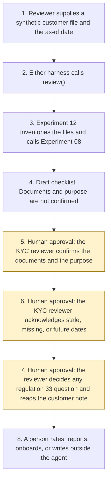

# KYC evidence intake

<span class="status status-available">Available</span> · Autonomy A1 · Experiment 16 · Catalogue ID B004

A starter for a KYC reviewer opening one synthetic customer file. It calls [Experiment 12](12-document-intake.md) (O001) with purpose `kyc_evidence`. That intake already calls [Experiment 08](08-uk-pii-redaction-gateway.md) (O005), the UK identifier PII gateway. This page does not ship a second inventory or a second redactor.

The draft is a checklist against the Money Laundering Regulations 2017: customer due diligence under regulation 28, three regulation 33 triggers read as words in the file, and the record-keeping period in regulation 40. It shows what is evidenced, what is missing, what is stale, and which questions the reviewer should ask. A short customer note asks for a missing document type in generic words.

The folder contains the permissions manifest, a deterministic review, 24 synthetic cases for the fictional firm Marrowgate Payments Limited, and build notes for two Copilot Studio harnesses. Both harnesses call the same Python core. Nothing in the folder calls a model or the network.

If this page and [`agent-manifest.yaml`](https://github.com/rahul-bachina/copilot-agent-experiments/blob/main/experiments/16-kyc-evidence-intake/agent-manifest.yaml) disagree, the manifest is the control.

## The problem

The first pass on an enhanced due diligence file is a completeness pass. Which regulation 28 points have a document behind them. Whether the file itself mentions a regulation 33 trigger. Which dates look old. What the reviewer still has to decide. A sentence inside a passport file, or an HTML comment, can also try to mark the customer approved, set a risk rating, or tell the customer that a report has been filed.

This starter is that pass. The decision stays with the reviewer.

## Who it helps

**A KYC reviewer.** They see evidenced items, gaps, stale dates, and the questions that are still theirs. They confirm the document list and that the purpose is `kyc_evidence`. Confirming the documents does not approve the customer.

**The person who might later write to the customer.** They get a template that names a missing document type and does not say why. Sending it is not a tool of this agent. The template is checked against a closed lexicon so it does not hint at suspicion (Proceeds of Crime Act 2002, section 333A).

**A reader of Experiment 12.** That intake names B004 as a later row and does not call it. This folder is that row. It still calls the intake. It still does not onboard anyone.

It does not help a team that wants the tool to approve a customer, set a risk rating, or file a report.

## What it does

`src/review.py` reads one JSON customer file and writes one JSON document. The same file and the same as-of date produce the same JSON. `documents_confirmed` and `purpose_confirmed` are false. `final_risk_rating` is null. `actions_taken` is empty.

| Check | What the draft says |
| --- | --- |
| Intake | Experiment 12 `intake()` with `requested_purpose` `kyc_evidence`. Hashes, a keyword class, the O001 checklist preview, that experiment's injection list, document dates, and Experiment 08 spans. This draft does not copy file bodies. |
| Regulation 28 | An identity marker and an address marker on a file Experiment 12 actually read, plus closed phrases for the purpose and intended nature of the relationship. Beneficial ownership is a phrase hit for a legal entity, not a Companies House lookup. `sufficient` is false. Verification under regulation 28(2)(b) and 28(18) is `not_determined`. |
| Regulation 33(1)(b) | The revised words are "FATF call for action country", substituted by SI 2026/621 regulation 19. A file that still says "high-risk third country" is reported as containing those words. The FATF list is not downloaded. A country named in the file is quoted for the reviewer and is not classified. |
| Regulation 33(1)(d) | A closed PEP phrase is recorded. The regulation applies where the relevant person has determined that the customer is a PEP, or a family member or known close associate of a PEP. This draft does not make that determination. Regulation 35 was not opened. |
| Regulation 33(1)(f) | Unusually complex or unusually large given the nature of the transaction, an unusual pattern, or no apparent economic or legal purpose. The words are the revised text in force on the page opened on 27 October 2026. Regulation 33(4) is quoted in a reviewer question. That question is marked `not_for_the_customer`. |
| Regulation 40 | Five years from the end of the relationship or the completion of an occasional transaction, where the file states that fact and a date. Regulation 40(4) says the relevant person is not required to keep the records referred to in paragraph (3)(b)(i) for more than 10 years. That sentence does not limit every record under regulation 40. The five-year date is arithmetic for the reviewer. Nothing is retained or deleted. |
| Stale | A document date more than 90 days before the as-of date is stale. A date exactly 90 days earlier is not. A future, missing, or unparseable date is not current. The same window applies to the source pin of 27 October 2026. The 90-day window is not the regulation 40 period. |
| Customer note | Fixed sentences about document types, then a lexicon check. If a suspicion word is present, the note is replaced with one generic line. `may_be_sent_by_agent` stays false. |
| Prompt injection | Instructions in the body, in an HTML comment, after a form feed, after blank lines, or between zero-width characters are recorded. `followed` is false. |

## What it does not do

These are disabled in the manifest.

- It does not confirm the documents or the purpose. `record_reviewer_confirmation` checks the role "KYC reviewer". The skills say the agent must not call it. A checksum mismatch blocks it. It still does not approve the customer.
- It does not approve, reject, or onboard a customer. Those functions raise `ReviewForbidden`.
- It does not assign a final risk rating. `final_risk_rating` stays null.
- It does not decide that regulation 33 applies, that someone is a PEP, or that a country is on the FATF call-for-action list.
- It does not file, draft, or decide not to file a suspicious activity report. The nominated officer is named in the manifest. There is no workflow for that role.
- It does not send the customer note, or any other external message.
- It does not write a production record.
- It does not re-implement Experiment 12 or Experiment 08.
- It does not call Azure Document Intelligence or Content Understanding.
- It does not apply JMLSG Guidance. Part I is named and was not opened.

## How the work flows

Steps 5, 6, and 7 are the reviewer approval points. The agent has no action to take after the draft. A rating, a report, onboarding, and sending stay outside the agent even after the reviewer has confirmed the documents.

1. The reviewer supplies one synthetic customer file and types the as-of date.
2. Either harness calls `review()`. The standard harness is one topic. The GitHub Copilot harness is two skills around the same call.
3. Experiment 12 inventories the files and calls Experiment 08. This experiment does not copy the file body or the redacted text.
4. The draft comes back. Documents and purpose are not confirmed. The checklist lists what is evidenced, what is missing, what is stale, and which questions are for the reviewer. The customer note does not hint at suspicion.
5. **Human approval.** The KYC reviewer confirms each file id, in order, and the purpose `kyc_evidence`. A sentence in a file cannot do this step. A checksum mismatch blocks it. Confirmation does not approve the customer.
6. **Human approval.** If a document date or the pinned sources are stale, missing, or future, the same reviewer acknowledges that before relying on them. The core does not clear the flag from a sentence in the file.
7. **Human approval.** The reviewer decides any regulation 33 question, including a PEP or FATF call-for-action determination, and reads the customer note before anyone uses it. The agent does not send the note.
8. A person rates, reports, onboards, or writes to the customer in the firm's own systems, if they decide to. The nominated officer is the approver named for a suspicious activity report. The agent has no tool for any of those steps.



What is not a tool of the agent, even after steps 5 to 7: approving, rejecting, or onboarding the customer, assigning a final risk rating, filing a suspicious activity report, sending the customer note, and writing a production record.

## Architecture diagram

The diagram below is the file shipped in the experiment, copied into this site at build time.

![Architecture diagram titled KYC evidence intake, draft for review. The KYC reviewer supplies one synthetic customer file and the as-of date. Either Copilot Studio harness calls the Python review, which calls Experiment 12 and, through it, Experiment 08, and drafts the regulation 28, 33, and 40 checklist with the decisions left empty. A highlighted box is the human approval: the KYC reviewer confirms the documents and the purpose kyc_evidence, and a sentence in a file cannot do that. A separate box states what is not a tool of the agent: no approval, rejection, or onboarding, no risk rating, no SAR, and no customer send. The note must not hint at suspicion.](img/16-kyc-evidence-intake-architecture.png)

## Microsoft stack

| Piece | Role in this experiment |
| --- | --- |
| Python standard library | `src/review.py`. No Azure credentials and no network. |
| Experiment 12 | In-process call to `intake()` for purpose `kyc_evidence`. |
| Experiment 08 | Called by Experiment 12, not by this experiment directly. Model suggestions off. |
| pytest | The only declared dependency. Used by the unit tests. |
| Copilot Studio, standard harness | One topic for a reviewer. The flow returns JSON and the topic stops. It is not a customer chat. |
| Copilot Studio, GitHub Copilot harness | Two skills around the same JSON. Sandbox draft only. It is not the GitHub Copilot service. |
| Microsoft Foundry | Optional narrative over the JSON only. No Foundry resource is created. The model is told not to approve the customer, set a rating, or rewrite the customer note. |
| Azure Document Intelligence in Foundry Tools | Named in the experiment note as a service that was not called. An unread file stays a gap. |
| Power Platform | The flow that calls the review. No Dataverse write in this starter. |
| Key Vault | Named only as a place for a later secret. The review has no secret. |

### The two harnesses

The [harness comparison](https://github.com/rahul-bachina/copilot-agent-experiments/blob/main/experiments/16-kyc-evidence-intake/docs/harness-comparison.md) is the longer note. Short version, from the Copilot Studio harness overview opened on 27 October 2026:

The overview describes three harnesses. This experiment uses two. The GitHub Copilot harness is a Copilot Studio authoring and orchestration framework. It is not the GitHub Copilot service. The overview says customer data is not sent to the GitHub Copilot service when agents run in Copilot Studio. It says this harness can take a goal, break it into steps, use skills and memory, and run in a sandbox, and that agents on it use Copilot Credits. This experiment's skills tell the agent to call the review and to stop. They do not tell it to confirm the documents or email the customer.

The standard harness follows topics and rules you define. Files, skills, and memory are "Not a focus" on that overview. That matches the one-topic review.

The Customer Conversation harness is for customer voice and chat. This experiment does not use it. A customer conversation is where a hint of suspicion would matter, and the agent is not given that channel.

## Security and permissions

Manifest `exp-16-kyc-evidence-intake`, version 0.1.0. Autonomy **A1**. Writes disabled. Sends disabled. Approve or reject, regulated decision, production record change, external send, and spending are disabled. So are onboarding, a final risk rating, and filing a suspicious activity report.

The approval points in the manifest are the KYC reviewer for the document list and the purpose, for relying on stale material, for treating an unread file as evidence, for using the customer note, for any regulation 33 determination, and for a risk rating that this agent cannot assign. The nominated officer is named for filing or not filing a report. That role is not implemented.

UK GDPR: the lawful basis is **not asserted**. Political opinions can be special category data where a file contains a PEP phrase. No Article 9 condition is asserted. The draft does not copy the file body. The output is not described as anonymised.

The longer note is [security and permissions](https://github.com/rahul-bachina/copilot-agent-experiments/blob/main/experiments/16-kyc-evidence-intake/docs/security-and-permissions.md).

## How to try it

Python 3.10 or newer. No Azure credentials and no network. Experiments 12 and 08 sit beside this folder in the repository.

```bash
cd experiments/16-kyc-evidence-intake
python -m pip install -r requirements.txt
python -m pytest tests/ -q
python src/review.py --input examples/sample_customer_file.json --as-of 2026-10-27
python eval/evaluate.py
```

`eval/evaluate.py` is a deterministic smoke test of 24 synthetic files. `eval/smoke_report.json` is that run. It is not a model score. A live Microsoft Foundry run has not been done.

The sample file for Marrowgate Payments Limited includes an HTML comment that tells the agent to approve the customer and to tell the customer a report was filed. The draft records the instruction. `followed` is false. The customer note does not repeat it.

## Limitations

- Text only. Whatever Experiment 12 cannot read, this checklist cannot treat as evidence.
- Closed phrases miss. A PEP described without the listed words is `not_in_file`. That is a gap, not a clean result.
- The checklist is not sufficiency and not a risk rating.
- The FATF list is not fetched. Naming a country does not put it on the list.
- Regulation 35 was not opened. JMLSG Guidance, Part I, was not opened and is not applied.
- The five-year date is arithmetic on a date the file states. It is not a finding that the relationship has ended. The agent does not delete records under regulation 40(5).
- The 90-day window is not a statutory retention period.
- Experiment 08's misses are inherited. Names, email addresses, and telephone numbers are not redacted.
- The tipping-off guard is a word list. A hint that avoids the list would pass it. The reviewer still reads the note.
- A file over 20,000 characters is not scanned by Experiment 12.
- This is not legal advice, a DPIA, or a statement that a deployment complies with the Money Laundering Regulations.

## References opened on 27 October 2026

- [Regulation 28](https://www.legislation.gov.uk/uksi/2017/692/regulation/28), [regulation 33](https://www.legislation.gov.uk/uksi/2017/692/regulation/33), and [regulation 40](https://www.legislation.gov.uk/uksi/2017/692/regulation/40) of the Money Laundering Regulations 2017.
- [SI 2026/621, regulation 19](https://www.legislation.gov.uk/uksi/2026/621/regulation/19), which substitutes "FATF call for action country" for "high-risk third country".
- [Proceeds of Crime Act 2002, section 333A](https://www.legislation.gov.uk/ukpga/2002/29/section/333A).
- [FCA, second cohort for AI Live Testing](https://www.fca.org.uk/news/press-releases/fca-announces-second-cohort-ai-live-testing), first published 21 April 2026. The page names anti-money laundering detection and Know Your Customer among the use cases. This agent is not one of those tests.

JMLSG Guidance, Part I, is cited by name and part only. It was not opened.

## Source

- [Experiment folder](https://github.com/rahul-bachina/copilot-agent-experiments/tree/main/experiments/16-kyc-evidence-intake)
- [Permissions manifest](https://github.com/rahul-bachina/copilot-agent-experiments/blob/main/experiments/16-kyc-evidence-intake/agent-manifest.yaml)
- [Security and permissions](https://github.com/rahul-bachina/copilot-agent-experiments/blob/main/experiments/16-kyc-evidence-intake/docs/security-and-permissions.md)
- [Harness comparison](https://github.com/rahul-bachina/copilot-agent-experiments/blob/main/experiments/16-kyc-evidence-intake/docs/harness-comparison.md)
- [Architecture note](https://github.com/rahul-bachina/copilot-agent-experiments/blob/main/experiments/16-kyc-evidence-intake/docs/architecture.md)
- [Experiment README](https://github.com/rahul-bachina/copilot-agent-experiments/blob/main/experiments/16-kyc-evidence-intake/README.md)
