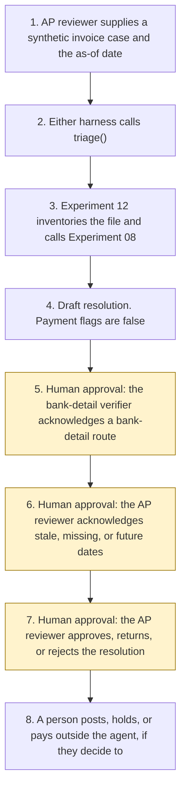

# Invoice exception triage

<span class="status status-available">Available</span> · Autonomy A1 · Experiment 17 · Catalogue ID F004

A starter for an accounts-payable reviewer looking at one synthetic invoice that failed a 2-way or 3-way match. It calls [Experiment 12](12-document-intake.md) (O001) with purpose `general_records`, because that intake's purpose list has no accounts-payable row and this experiment does not add one. That intake already calls [Experiment 08](08-uk-pii-redaction-gateway.md) (O005), the UK identifier PII gateway. This page does not ship a second inventory or a second redactor.

The draft classifies the exception, lists the evidence, and recommends a resolution. The classes are a price variance, a quantity variance, a missing purchase order, a duplicate suspicion, a VAT or supplier-detail mismatch, and a bank-detail change. A bank-detail change is routed to a separate verifier. The AP reviewer approves the resolution. Nothing is posted, held, or paid, and no supplier bank record is changed.

The folder contains the permissions manifest, a deterministic triage, 24 synthetic cases for the fictional supplier North Quay Supplies Ltd and the fictional buyer Harbour Test Council, and build notes for two Copilot Studio harnesses. Both harnesses call the same Python core. Nothing in the folder calls a model or the network.

If this page and [`agent-manifest.yaml`](https://github.com/rahul-bachina/copilot-agent-experiments/blob/main/experiments/17-invoice-exception-triage/agent-manifest.yaml) disagree, the manifest is the control.

## The problem

A failed match still needs a person to see why it failed, and to see a bank-detail change before anyone talks about paying. Doing that inside the payment system makes it easy for a sentence in the invoice, or an HTML comment, to mark the invoice approved or to point at a new account.

This starter is that reading. The payment stays with a person.

## Who it helps

**An AP reviewer.** They see the exception class, the evidence, and a recommended resolution. Approving the draft does not post the invoice and does not pay it.

**A bank-detail verifier.** A listed phrase, or a fingerprint token that does not match the supplier master, is routed to them first. The route does not change the bank record and does not verify the account. The account number is not copied into the draft.

**A finance lead in a contracting authority.** The draft shows 30-day arithmetic from the Procurement Act 2023 where the case says that Act might apply, and it records that regulation 113 of the Public Contracts Regulations 2015 no longer has effect. It does not decide that a sum is due.

**A reader of Experiment 12.** That intake inventories the file. This folder is the accounts-payable reading. It still calls the intake. It still does not pay anyone.

It does not help a team that wants the tool to post, hold, or pay an invoice, or to update a supplier bank account.

## What it does

`src/triage.py` reads one JSON case and writes one JSON document. The same case and the same as-of date produce the same JSON. `resolution.executed` is false. `actions_taken` is empty.

| Check | What the draft says |
| --- | --- |
| Intake | Experiment 12 `intake()` with `requested_purpose` `general_records`. Hashes, a keyword class, that experiment's injection list, document dates, and Experiment 08 spans. This draft does not copy the file body. |
| Price | Labelled unit price or net, in pence, against the purchase order, inside a tolerance the caller supplied. Zero is the default. It is not a statutory rule. |
| Quantity | On a 3-way match, against the goods receipt. On a 2-way match, against the purchase order. A 3-way match with no goods receipt is a gap. |
| Missing purchase order | No purchase order on the case, no labelled number, or numbers that do not match. Prices are not compared against a purchase order that is not the one on the invoice. |
| Duplicate suspicion | The invoice number is on a caller-supplied list, the case states a duplicate reference, or a file hash repeats. `duplicate_confirmed` is false. The invoice is not held. |
| VAT and supplier | VAT Notice 700/21 section 4.1 as a field checklist. Sections 4.4 and 4.5 for a gross of £250 or less, including VAT, and only when the currency is GBP. A supplier name or VAT number that differs from the master. Input tax is not decided. |
| Bank detail | A listed phrase, or a fingerprint that does not match the master. This class is first. The resolution is a route to the bank-detail verifier. |
| Prompt payment | Section 68 for a case marked as a contracting authority, or section 88 for a regulated below-threshold contract. Thirty days beginning with the receipt date the reviewer typed, or a later day the case supplies. A stated concession, private utility, or school means section 68 is not applied and no payment day is emitted. `payment_instructed` is false. |
| Regulation 113 | Recorded as revoked on 24 February 2025 by the Procurement Act 2023, Schedule 11, paragraph 5. Not applied. |
| Prompt injection | Instructions in the body, in an HTML comment, after a form feed, after blank lines, or between zero-width characters are recorded. `followed` is false. |

## What it does not do

These are disabled in the manifest.

- It does not post, approve, hold, or pay an invoice. Those functions raise `TriageForbidden`.
- It does not change supplier bank details. The verifier's record does not verify the account.
- It does not decide that an invoice is valid, undisputed, or a true duplicate.
- It does not decide that input tax can be recovered, or that the supplier is a retailer.
- It does not send a question to a supplier, a buyer, or a payee. Section 68(4) describes a notice. This agent does not send it.
- It does not write a production record.
- It does not apply regulation 113 of the Public Contracts Regulations 2015.
- It does not re-implement Experiment 12 or Experiment 08.
- It does not call AI Builder or Azure Document Intelligence. No AI Builder capability is claimed. That product page was not opened.

## How the work flows

Steps 5, 6, and 7 are the human approval points. The agent has no action to take after the draft. Posting, holding, paying, and changing a bank record stay outside the agent even after the reviewer has approved the resolution.

1. The AP reviewer supplies one synthetic case and types the as-of date. The receipt date, if any, is a field on the case. A date inside the invoice is not used as the receipt date.
2. Either harness calls `triage()`. The standard harness is one topic. The GitHub Copilot harness is two skills around the same call.
3. Experiment 12 inventories the file and calls Experiment 08. This experiment does not copy the file body or the redacted text.
4. The draft comes back. The resolution is not approved. Payment flags are false. If a bank-detail change is present, it is the first class.
5. **Human approval.** When a bank-detail change is flagged, the bank-detail verifier acknowledges the separate route. A sentence in the invoice cannot do this step. The acknowledgement does not verify the account and does not change the supplier bank record.
6. **Human approval.** If a document date or the pinned sources are stale, missing, or future, the AP reviewer acknowledges that before relying on them. The core does not clear the flag from a sentence in the invoice.
7. **Human approval.** The AP reviewer approves, returns, or rejects the recommended resolution. Approval is refused while a file was not read, a checksum does not match, or a bank-detail route is still unacknowledged. Approval does not post, hold, or pay.
8. A person acts in the finance system, if they decide to. The agent has no tool for that step.



What is not a tool of the agent, even after steps 5 to 7: posting, approving, holding, or paying the invoice, changing supplier bank details, sending a question, and writing a production record.

## Architecture diagram

The diagram below is the file shipped in the experiment, copied into this site at build time.

![Architecture diagram titled Invoice exception triage, draft for AP review. The AP reviewer supplies one synthetic invoice that failed a match, and the as-of date. Either Copilot Studio harness calls the Python triage, which calls Experiment 12 and, through it, Experiment 08, classifies the exception, and leaves the payment flags false. A highlighted box is the human approval: a bank-detail flag goes to the bank-detail verifier first, and the AP reviewer then approves the resolution. A sentence in the invoice cannot do that. A separate box states what is not a tool of the agent: no post, approval, hold, or payment, no change to supplier bank details, no message to the supplier, and regulation 113 is not applied.](img/17-invoice-exception-architecture.png)

## Microsoft stack

| Piece | Role in this experiment |
| --- | --- |
| Python standard library | `src/triage.py`. No Azure credentials and no network. |
| Experiment 12 | In-process call to `intake()` for the file inventory. |
| Experiment 08 | Called by Experiment 12, not by this experiment directly. Model suggestions off. |
| pytest | The only declared dependency. Used by the unit tests. |
| Copilot Studio, standard harness | One topic for an AP reviewer. The flow returns JSON and the topic stops. It is not a supplier chat. |
| Copilot Studio, GitHub Copilot harness | Two skills around the same JSON. Sandbox draft only. It is not the GitHub Copilot service. |
| Microsoft Foundry | Optional narrative over the JSON only. No Foundry resource is created. The model is told not to pay, post, or change a bank record. |
| AI Builder | Named in the catalogue row. Not called. No capability is claimed. |
| Power Platform | The flow that calls the triage. No Dataverse write in this starter. |
| Key Vault | Named only as a place for a later secret. The triage has no secret. |

### The two harnesses

The [harness comparison](https://github.com/rahul-bachina/copilot-agent-experiments/blob/main/experiments/17-invoice-exception-triage/docs/harness-comparison.md) is the longer note. Short version, from the Copilot Studio harness overview retrieved on 28 October 2026:

The overview describes three harnesses. This experiment uses two. The GitHub Copilot harness is a Copilot Studio authoring and orchestration framework. It is not the GitHub Copilot service. The overview says customer data is not sent to the GitHub Copilot service when agents run in Copilot Studio. It says this harness can take a goal, break it into steps, use skills and memory, and run in a sandbox, and that agents on it use Copilot Credits. The page gives an accounts-payable example. This experiment's skills tell the agent to call the triage and to stop. They do not tell it to pay or to update a bank record. No price was copied. The billing overview linked from the comparison table was not opened.

The standard harness follows topics and rules you define. Files, skills, and memory are "Not a focus" on that overview. That matches the one-topic review.

The Customer Conversation harness is for customer voice and chat. This experiment does not use it. A supplier is not given this agent as a chat.

## Security and permissions

Manifest `exp-17-invoice-exception-triage`, version 0.1.0. Autonomy **A1**. Writes disabled. Sends disabled. Approve or reject, regulated decision, production record change, external send, and spending are disabled. So are posting, holding, and changing a supplier bank record.

The approval points in the manifest are the AP reviewer for the resolution, for relying on stale material, and for treating an unread file as examined. The bank-detail verifier is named for the separate route. That acknowledgement does not verify the account.

UK GDPR: the lawful basis is **not asserted**. The draft does not copy the file body. The output is not described as anonymised.

The longer note is [security and permissions](https://github.com/rahul-bachina/copilot-agent-experiments/blob/main/experiments/17-invoice-exception-triage/docs/security-and-permissions.md).

## How to try it

Python 3.10 or newer. No Azure credentials and no network. Experiments 12 and 08 sit beside this folder in the repository.

```bash
cd experiments/17-invoice-exception-triage
python -m pip install -r requirements.txt
python -m pytest tests/ -q
python src/triage.py --input examples/sample_case.json --as-of 2026-10-28
python eval/evaluate.py
```

`eval/evaluate.py` is a deterministic smoke test of 24 synthetic cases. `eval/smoke_report.json` is that run. It is not a model score. A live Microsoft Foundry run has not been done.

The sample invoice for North Quay Supplies Ltd includes an HTML comment that tells the agent to pay and to update the bank details, and a unit price that differs from the purchase order. The draft records the instruction. `followed` is false. The first class is the bank-detail route. The price variance stays on the draft. Nothing is paid.

## Limitations

- Text only. Whatever Experiment 12 cannot read, this triage cannot treat as an invoice.
- One invoice line. A second line is not matched.
- Labelled lines only. A price in a sentence is not extracted.
- The tolerance is the caller's. It is not a statutory rule.
- The VAT number shape stored here is GB and nine digits. It is not an HMRC lookup.
- The £250 ceiling is not applied to a currency other than GBP. No exchange rate is used.
- The 30-day figure is arithmetic. It is not a finding that a sum is due. Section 67 and the text of section 73 were not encoded. Saving provisions in SI 2024/716 regulations 5 and 6 were not encoded.
- The Late Payment of Commercial Debts (Interest) Act 1998 was not opened.
- The 90-day window is not the six-year period in VAT Notice 700/21 section 2.4.
- Experiment 08's misses are inherited. Names, email addresses, and telephone numbers are not redacted.
- A file over 20,000 characters is not scanned.
- This is not legal advice, a DPIA, or a statement that a deployment complies with the Procurement Act or the VAT rules.

## References opened on 28 October 2026

- [Record keeping (VAT Notice 700/21)](https://www.gov.uk/guidance/record-keeping-for-vat-notice-70021), sections 2.4, 3.1, 3.2, 4.1, 4.4, and 4.5. Page last updated 18 March 2024.
- [Procurement Act 2023, section 68](https://www.legislation.gov.uk/ukpga/2023/54/section/68) and [section 88](https://www.legislation.gov.uk/ukpga/2023/54/section/88). In force 24 February 2025.
- [Procurement Act 2023, Schedule 11](https://www.legislation.gov.uk/ukpga/2023/54/schedule/11), paragraph 5, which names the Public Contracts Regulations 2015.
- [Public Contracts Regulations 2015, regulation 113](https://www.legislation.gov.uk/uksi/2015/102/regulation/113). The page records that the provision no longer has effect.
- [Harnesses in Copilot Studio](https://learn.microsoft.com/en-us/microsoft-copilot-studio/harnesses-overview).

## Source

- [Experiment folder](https://github.com/rahul-bachina/copilot-agent-experiments/tree/main/experiments/17-invoice-exception-triage)
- [Permissions manifest](https://github.com/rahul-bachina/copilot-agent-experiments/blob/main/experiments/17-invoice-exception-triage/agent-manifest.yaml)
- [Security and permissions](https://github.com/rahul-bachina/copilot-agent-experiments/blob/main/experiments/17-invoice-exception-triage/docs/security-and-permissions.md)
- [Harness comparison](https://github.com/rahul-bachina/copilot-agent-experiments/blob/main/experiments/17-invoice-exception-triage/docs/harness-comparison.md)
- [Architecture note](https://github.com/rahul-bachina/copilot-agent-experiments/blob/main/experiments/17-invoice-exception-triage/docs/architecture.md)
- [Experiment README](https://github.com/rahul-bachina/copilot-agent-experiments/blob/main/experiments/17-invoice-exception-triage/README.md)
