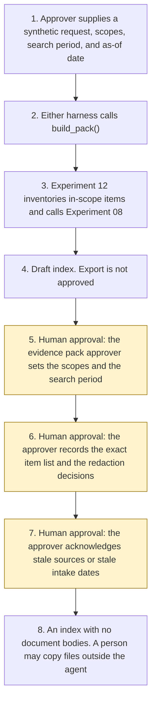

# Evidence pack builder

<span class="status status-available">Available</span> · Autonomy A1 · Experiment 18 · Catalogue ID L004

A starter for a person assembling one synthetic evidence pack: a subject access bundle, a regulator or audit request, a complaint file that might later go to an ombudsman, or an internal investigation. It calls [Experiment 12](12-document-intake.md) (O001) for the items inside the scopes the caller names. That intake calls [Experiment 08](08-uk-pii-redaction-gateway.md) (O005), the UK identifier PII gateway. This page does not ship a second inventory or a second redactor.

The draft is an index. Each in-scope item has a source, a date, and a SHA-256. Duplicates are marked. Possible privileged material and possible third-party personal data are flagged for a person. A proposed page order is not an export. An evidence pack approver must record the exact list of item ids and the redaction decisions before an export index exists. That index does not contain the documents, and the agent does not send it.

The folder contains the permissions manifest, a deterministic builder, 18 synthetic cases for the fictional Reedbank Borough Council, and build notes for two Copilot Studio harnesses. Both harnesses call the same Python core. Nothing in the folder calls a model or the network.

If this page and [`agent-manifest.yaml`](https://github.com/rahul-bachina/copilot-agent-experiments/blob/main/experiments/18-evidence-pack-builder/agent-manifest.yaml) disagree, the manifest is the control.

## The problem

The first pass on a bundle is a scope and index pass. Which pasted items sit inside the scopes the requester is allowed to search. Which copy is the duplicate. Which page it would occupy. Which items need a person to look at third-party data or privilege before anything leaves the building. A sentence inside a letter, or an HTML comment, can also try to mark the pack approved or to add a mailbox to the search.

This starter is that pass. The disclosure, the referral, and any exemption stay with a named person.

## Who it helps

**The person assembling the pack.** They see what was inside the scopes they named, what was left out, and a proposed page order. A document cannot add a scope or set the search period.

**The evidence pack approver.** They approve the exact list, and a redaction decision for any flagged item they include. Until they do, there is no export index. After they do, the index is still not sent.

**A privacy reviewer reading a subject-access pack.** UK identifier spans come from Experiment 08, via Experiment 12. The draft cites [UK GDPR Article 15](https://www.legislation.gov.uk/eur/2016/679/article/15) and [Data Protection Act 2018, Schedule 2, paragraphs 16 and 19](https://www.legislation.gov.uk/ukpga/2018/12/schedule/2/paragraph/16). It does not decide that either exemption applies. The ICO's right-of-access guidance, read on 28 October 2026, says an exemption is considered case by case and is not applied in a blanket way.

**A reader of Experiment 12.** That intake names later catalogue rows and does not call them. This folder calls the intake. It still does not disclose anything.

It does not help a team that wants the tool to disclose the file, apply an exemption, or send the pack to an ombudsman.

## What it does

`src/pack.py` reads one JSON request and writes one JSON document. The same request, pack type, scopes, search period, and as-of date produce the same JSON. `export_approved` and `redactions_approved` are false. `approver_name` is null.

| Check | What the draft says |
| --- | --- |
| Scopes | A closed list, passed as an argument. An item outside it is `out_of_scope`. It is not passed to Experiment 12 and it is not hashed. |
| Search period | Inclusive dates, passed as arguments. If either is missing, no page is proposed. A future date is not proposed. The period is not a finding under Article 15(1A). |
| Intake | Experiment 12 `intake()` for in-scope items, with a purpose preview of `sar_bundle` or `evidence_bundle`. Hashes, a keyword class, that experiment's injection list, and Experiment 08 entity types. This draft does not copy item bodies. |
| Duplicates | A repeated SHA-256 is `duplicate_of` the earlier item. It does not get its own proposed page. |
| Privilege | Closed phrases set `possible_privilege`. Schedule 2 paragraph 19 is cited. `exemption_applied` is false. |
| Third parties | Experiment 08 entity types, and a separate phrase list, set `possible_third_party_personal_data`. Schedule 2 paragraph 16 is cited. The data subject's own identifier is flagged, because the code cannot tell whose it is. |
| Index | Proposed pages are in-scope, read, in-period, non-duplicate items with no review flag and no injection phrase. Order is document date, then item id. |
| Prompt injection | Instructions in the body, in an HTML comment, after a form feed, after blank lines, or between zero-width characters are recorded. `followed` is false. That item is not eligible. |

Article 15 was read on legislation.gov.uk on 28 October 2026. Paragraph 15(1) is the right of access. Paragraph 15(1A) limits it to what the controller can provide based on a reasonable and proportionate search. Paragraph 15(3) is the copy the data subject is entitled to under paragraph 1. Paragraph 15(4) says that copy shall not adversely affect the rights and freedoms of others. This starter does not provide the copy.

## What it does not do

These are disabled in the manifest.

- It does not approve the exact list. `record_export_approval` checks the role "Evidence pack approver" and a name the caller passes. The skills say the agent must not call it.
- It does not apply Schedule 2 paragraph 16 or paragraph 19. `apply_exemption` raises. Paragraph 17 was seen and is not applied.
- It does not decide that the search was reasonable and proportionate.
- It does not disclose personal data, and it does not send anything. The Financial Ombudsman Service and Housing Ombudsman pack types are labels. Their evidence rules were not opened. Unverified.
- It does not write a production record.
- It does not release redacted text or describe it as anonymised.
- It does not search Microsoft 365. Items that were not pasted are invisible.
- It does not re-implement Experiment 12 or Experiment 08.
- It does not read a PDF. `not_read` is a gap.

## How the work flows

Steps 5, 6, and 7 are the approver's points. The agent has no action to take after the draft. Sending and disclosure stay outside the agent even after the index exists.

1. The approver supplies one synthetic request and types the as-of date, the pack type, the authorised scopes, and the search period.
2. Either harness calls `build_pack()`. The standard harness is one topic. The GitHub Copilot harness is two skills around the same call.
3. Experiment 12 inventories the in-scope items and calls Experiment 08. Out-of-scope text is not passed across. This experiment does not copy the body or the redacted text.
4. The draft comes back. The export is not approved. The index lists proposed pages, held items, and exclusions.
5. **Human approval.** The evidence pack approver sets the scopes and the search period. A sentence in an item cannot do this step. An empty scope list excludes every item. A missing period proposes no pages.
6. **Human approval.** The same approver records the exact item ids, in the order they want, and a redaction decision for every flagged item they include. The decision `include_after_review` does not apply an exemption. An injection hit, a duplicate, an unread file, and an out-of-scope id cannot be included.
7. **Human approval.** If the source pin or an intake date is stale, the approver acknowledges that before the list is accepted. The core does not clear the flag.
8. `produce_export` can then return an index of those ids, with no document bodies. A person copies the files in their own system if they decide to. The agent does not send the index.



What is not a tool of the agent, even after steps 5 to 7: sending the pack, disclosing it to a requester, applying an exemption, writing a production record, and releasing redacted text.

## Architecture diagram

The diagram below is the file shipped in the experiment, copied into this site at build time.

![Architecture diagram titled Evidence pack builder, draft index. The evidence pack approver types the scopes, the search period, and the as-of date, and pastes one synthetic set. Either Copilot Studio harness calls the Python pack builder, which checks scope, hashes items, calls Experiment 12 and through it Experiment 08, and leaves the approval empty. A highlighted box is the human approval: the named approver records the exact item ids and every redaction decision, and a sentence in an item cannot do that. A second box is the export index, produced only after that approval, with no document bodies. A separate box states what is not a tool of the agent: no send, no disclosure, no exemption decision, no production write, and no release of redacted text.](img/18-evidence-pack-architecture.png)

## Microsoft stack

| Piece | Role in this experiment |
| --- | --- |
| Python standard library | `src/pack.py`. No Azure credentials and no network. |
| Experiment 12 | In-process call to `intake()` for in-scope items. |
| Experiment 08 | Called by Experiment 12, not re-implemented here. Model suggestions off. `release` is not called. |
| pytest | The only declared dependency. Used by the unit tests. |
| Copilot Studio, standard harness | One topic. The flow returns JSON and the topic stops. It is not a chat for a data subject. |
| Copilot Studio, GitHub Copilot harness | Two skills around the same JSON. Sandbox draft only. It is not the GitHub Copilot service. |
| Microsoft Foundry | Optional narrative over the JSON only. No Foundry resource is created. The model is told not to approve the export or apply an exemption. |
| Microsoft 365 | Named in the catalogue row. This starter does not search a mailbox or a library. |
| Power Platform | The flow that calls the builder. No Dataverse write in this starter. |
| Key Vault | Named only as a place for a later secret. The builder has no secret. |

### The two harnesses

The [harness comparison](https://github.com/rahul-bachina/copilot-agent-experiments/blob/main/experiments/18-evidence-pack-builder/docs/harness-comparison.md) is the longer note. Short version, from the Copilot Studio harness overview opened on 28 October 2026:

The overview describes three harnesses. This experiment uses two. The GitHub Copilot harness is a Copilot Studio authoring and orchestration framework. It is not the GitHub Copilot service. The overview says customer data is not sent to the GitHub Copilot service when agents run in Copilot Studio. It says this harness can take a goal, break it into steps, use skills and memory, and run in a sandbox, and that agents on it use Copilot Credits. This experiment's skills tell the agent to call the builder and to stop. They do not tell it to approve the list or send the pack.

The standard harness is the fixed topic. Files, skills, and memory are not its focus, which matches a pack that always takes the same inputs. The licensing article for that harness was not opened. No price is copied for either harness.

## Security and permissions

Taken from `agent-manifest.yaml` and the security note. The manifest is the control.

**Autonomy.** A1. A named evidence pack approver records the exact list and the redaction decisions. `auto_actions_enabled` is false. There is no A3 path.

**What a run may read.** The one request the user supplies, the arguments they type, the static lists, and Experiment 12's intake of in-scope items. The Python starter does not persist the text. A request that is not marked synthetic is refused.

**What a run must not read.** Mailboxes, SharePoint, Dataverse, ombudsman portals, and items outside the authorised scopes. The Experiment 08 token vault.

**Writes and sends.** Both disabled. `send_external` and `disclose_to_requester` raise.

**UK GDPR.** No Article 6 basis is asserted. No Article 9 condition is asserted. Article 15 is the data subject's right. It is cited so a person can see it. The agent does not answer the request.

**Risk register, assessed 28 October 2026 for this starter rather than a named organisation.** Residual risk is not all Low. The chance that a missed identifier or a missed privilege phrase is treated as clearance stays High, because the phrase lists and Experiment 08 both have known gaps. The approver is the control.

**Logging.** This starter writes no log. Before live use, log who ran it, the request id, the scopes, the search period, and the in-scope hashes rather than the bodies.

**Tenant controls that are named and not configured here.** Entra Agent ID, Conditional Access for agents, Microsoft Foundry prompt shields, Purview audit of Copilot, Power Platform DLP, and Application Insights were not re-opened on 28 October 2026. Unverified here. Key Vault is named because a later secret would go there. This starter has no secret. The security note says so.

**ATRS.** This starter does not submit a record. A public body would decide that separately. Experiment 03 drafts an assurance pack. This experiment does not.

## How to try it

Python 3.10 or newer. Experiments 08 and 12 have to sit beside this folder. No Azure credentials and no network.

```bash
cd experiments/18-evidence-pack-builder
python -m pip install -r requirements.txt
python -m pytest tests/ -q
python eval/evaluate.py
python src/pack.py --input examples/sample_request.json --as-of 2026-10-28 \
  --pack-type sar_bundle --scopes case_file,correspondence \
  --search-from 2026-01-01 --search-to 2026-10-28
```

`eval/evaluate.py` is a deterministic smoke test. `eval/smoke_report.json` is that run. It is not a model score. The sample draft proposes one page, holds the privilege note, the hidden instruction, and the NHS-number note, and excludes the out-of-scope repairs item, the duplicate, and the old letter. `export_approved` is false.

## Limitations

- The starter does not search Microsoft 365. A scope is a check on the paste.
- Article 15(1A) is not implemented as a test. The search period is not a reasonable-and-proportionate finding.
- A privilege phrase is not a finding that a claim to legal professional privilege could be maintained. An identifier is not a finding that paragraph 16 applies.
- Experiment 08's misses are inherited. Names, email addresses, and telephone numbers are not flagged as identifiers. The US spelling "neighbor" is not on the phrase list.
- The data subject's own National Insurance number is flagged as possible third-party data. That over-flag is deliberate.
- PDF and other media types are not read. A file over 20,000 characters is not scanned.
- The 90-day window is a stale flag. Article 15, as read on 28 October 2026, does not state that period. Article 12 was not opened.
- Ombudsman evidence rules were not opened. Nothing is sent.
- The export index does not contain the documents. Recording an approval does not send it.
- The smoke test is not a model score.

This is not legal advice, a DPIA, or a statement that a deployment is compliant.

## Source

[experiments/18-evidence-pack-builder](https://github.com/rahul-bachina/copilot-agent-experiments/tree/main/experiments/18-evidence-pack-builder) on GitHub. The manifest, the security note, and both harness guides are in that folder.
