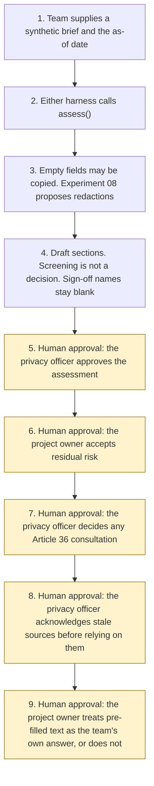

# Privacy impact assessment assistant

<span class="status status-available">Available</span> · Autonomy A1 · Experiment 19 · Catalogue ID L006

A starter for a project team drafting a data protection impact assessment. It screens one synthetic brief against UK GDPR Article 35(1) and (3) and the ICO's list of processing likely to result in high risk. It screens solely automated significant decisions against UK GDPR Articles 22A to 22D, inserted by the Data (Use and Access) Act 2025. Free text goes through [Experiment 08](08-uk-pii-redaction-gateway.md). An [Experiment 03](03-agent-inventory-atrs-assurance.md) inventory, or a permissions manifest, can fill empty fields. Screening answers are not inferred from either.

The privacy officer approves the assessment. The project owner accepts residual risk. The agent does not. `dpia_required` stays null. `article_36_consultation_required` stays null. `lawful` stays null.

The folder contains the permissions manifest, a deterministic draft, 24 synthetic cases for the fictional Northwharf Borough Council, and build notes for two Copilot Studio harnesses. Both harnesses call the same Python core. Nothing in the folder calls a model or the network.

If this page and [`agent-manifest.yaml`](https://github.com/rahul-bachina/copilot-agent-experiments/blob/main/experiments/19-privacy-impact-assessment/agent-manifest.yaml) disagree, the manifest is the control.

## The problem

A project team has to decide whether a DPIA is needed, and then write one, before processing starts. Article 35(1) is the test. Article 35(3) names three types that shall in particular be required. Article 35(4), as revised, says the Commission shall publish a list. The ICO's pages still publish a list of ten types and say the guidance is under review because of the Data (Use and Access) Act. A sentence inside the brief can also try to mark the assessment approved, or to say that consultation is not required.

This starter is the screening and the first draft. The decision stays with the privacy officer.

## Who it helps

**A project team.** They answer a closed questionnaire and get the Article 35(7) sections back, with gaps left as gaps.

**A privacy officer, or a data protection officer where one is designated.** They see which recorded answers match Article 35(3) or the ICO list, what Articles 22A to 22D would ask, and whether a residual risk is recorded as High. Article 35(2) says the controller shall seek the DPO's advice where a DPO is designated. The advice line in this draft is blank.

**A project owner.** They are the person named to accept residual risk. This agent does not accept it for them.

**Someone who already has an Experiment 03 inventory.** Empty description, necessity, Article 22, and risk fields can be copied from that record. The screening questionnaire is still theirs to answer.

It does not help a team that wants the tool to sign the DPIA, reject the project, or email a consultation.

## What it does

`src/assess.py` reads one JSON brief and an as-of date and writes one JSON document. The same inputs produce the same JSON. `approved`, `signed_off`, and `residual_risk_accepted` are false. `actions_taken` is empty.

| Check | What the draft says |
| --- | --- |
| Article 35(3) | A recorded yes on (a), (b), or (c) is `article_35_3_recorded`. A recorded no on the team's view of Article 35(1) does not clear that. Missing answers are unknown, not no. |
| ICO list | Ten types from the when-page and the examples page, both opened on 28 October 2026. Five need another European criterion before they are recorded as a list trigger. Innovative technology does not count its own twin. The pages carry a review banner. The tool does not decide that the page is the list Article 35(4) now requires the Commission to establish. |
| Nine criteria | The nine bullets on the ICO when-page. Two or more, with no stronger code, is `wp248_two_factors_recorded`. The page says two factors usually indicate a DPIA and that this is not a strict rule. WP248 itself was not opened. |
| Articles 22A to 22D | The revised text. Section 80 came into force for specified purposes at Royal Assent, dated 19 June 2025 on the Article 22A page, and on 5 February 2026 in so far as not already in force, by S.I. 2026/82 regulation 2(j), with regulation 5. A decision dated before 5 February 2026 is not run through the new test. Regulation 5 is not interpreted. |
| Sections | Description, necessity and proportionality, risks, and measures, following Article 35(7)(a) to (d). A gap stays a gap. A mitigation string is not recorded as in place. |
| Article 36 | A residual recorded as High sets `prior_consultation.code` to `high_residual_recorded`. The statutory addressee in the revised Article 36(1) is the Commission, substituted on 30 September 2026. The ICO page still says to consult the ICO. The draft quotes both and does not reconcile them. Nothing is sent. |
| Pre-fill | Empty narrative, Article 22 facts, and risk rows can be copied. Screening answers are not inferred. A disabled regulated decision is not meaningful human involvement. |
| Redaction | Each free-text field is passed to Experiment 08 `propose()`. Model suggestions are off. `output_is_anonymised` stays false. |
| Prompt injection | Instructions in the body, in an HTML comment, after a form feed, after blank lines, or between zero-width characters are recorded. `followed` is false. |
| Stale | The source pin of 28 October 2026 is stale when the as-of date is more than 90 days later. The 90-day window is not Article 35(11). |

## What it does not do

These are disabled in the manifest.

- It does not approve, reject, or sign off a DPIA. Those functions raise `AssessmentForbidden`.
- It does not accept residual risk.
- It does not decide that Article 35 requires a DPIA. `dpia_required` stays null.
- It does not decide that Article 36(1) requires prior consultation, and it does not send one. `send_prior_consultation` raises `AssessmentForbidden`.
- It does not decide that processing is lawful, or that an Article 22B condition is met.
- It does not apply the ICO's stated exception for genetic data processed by an individual GP or health professional for direct care. It records `exception_not_decided`.
- It does not apply Article 35(10). The ICO says it has not issued a list of processing that does not require a DPIA.
- It does not write a production record.
- It does not re-implement Experiment 08.
- It does not call `record_external_attestation`. The skills say the agent must not. A person outside the agent can record a role in a test. The effect is none.

## How the work flows

Steps 5, 6, and 7 are the human approval points that follow the draft. Viewing the draft and re-running it do not need approval. Relying on stale sources, and treating pre-filled text as the team's own answer, are further approval points. The agent has no action to take after the draft.

1. The team supplies one synthetic brief and types the as-of date. An Experiment 03 inventory or a permissions manifest is optional.
2. Either harness calls `assess()`. The standard harness is one topic. The GitHub Copilot harness is two skills around the same call.
3. Empty fields may be copied. Each free-text field is passed to Experiment 08. Instructions in the text are recorded and not followed.
4. The draft comes back. Screening is a record of answers, not a decision that a DPIA is required. Sign-off names stay blank. A high residual is a flag, not a sent consultation.
5. **Human approval.** The privacy officer approves the assessment. A sentence in the brief cannot do this step. Article 35(2) is the duty to seek the DPO's advice where a DPO is designated. The advice line stays blank.
6. **Human approval.** The project owner accepts residual risk. The agent cannot accept it.
7. **Human approval.** The privacy officer decides whether to consult under Article 36(1). Any send is outside the agent. The statutory addressee in the revised text is the Commission.
8. **Human approval.** If the pinned sources are stale, the privacy officer acknowledges that before relying on the screening. The core does not clear the flag from a sentence in the brief.
9. **Human approval.** The project owner decides whether text copied from an inventory or a manifest is the team's own answer. Copied fields stay marked until then.



What is not a tool of the agent, even after steps 5 to 9: approving, rejecting, or signing off the DPIA, accepting residual risk, sending a prior consultation, and writing a production record. Viewing the draft and re-running the same brief need no approval.

## Architecture diagram

The diagram below is the file shipped in the experiment, copied into this site at build time.

![Architecture diagram titled Privacy impact assessment, draft for review. The project team supplies one synthetic brief and the as-of date. Either Copilot Studio harness calls the Python draft, which screens Article 35 and Articles 22A to 22D and calls Experiment 08. A highlighted box is the human approval: the privacy officer approves the assessment, the project owner accepts residual risk, and the privacy officer decides any Article 36 consultation. Stale sources and pre-filled text need a person. A separate box states what is not a tool of the agent: no approval, rejection, or sign-off, no residual-risk acceptance, no Article 36 send, and no production write. The draft is not anonymised.](img/19-privacy-impact-assessment-architecture.png)

## Microsoft stack

| Piece | Role in this experiment |
| --- | --- |
| Python standard library | `src/assess.py`. No Azure credentials and no network. |
| Experiment 08 | In-process call to `propose()`. Model suggestions off. The reversible vault is not requested. |
| Experiment 03 | Optional JSON input. This experiment does not import that experiment's screen. |
| pytest and PyYAML | The declared dependencies. PyYAML is used only for `--manifest`. |
| Copilot Studio, standard harness | One topic for a project team and a privacy officer. The flow returns JSON and the topic stops. It is not a public chat. |
| Copilot Studio, GitHub Copilot harness | Two skills around the same JSON. Sandbox draft only. It is not the GitHub Copilot service. |
| Microsoft Foundry | Optional narrative over the JSON only. No Foundry resource is created. The model is told not to approve the assessment, fill a gap, or call the text anonymised. |
| Power Platform | The flow that calls the draft. No Dataverse write in this starter. |
| Key Vault | Named only as a place for a later secret. The draft has no secret. |

### The two harnesses

The [harness comparison](https://github.com/rahul-bachina/copilot-agent-experiments/blob/main/experiments/19-privacy-impact-assessment/docs/harness-comparison.md) is the longer note. Short version, from the Copilot Studio harness overview opened on 28 October 2026:

The overview describes three harnesses. This experiment uses two. The GitHub Copilot harness is a Copilot Studio authoring and orchestration framework. It is not the GitHub Copilot service. The overview says customer data is not sent to the GitHub Copilot service when agents run in Copilot Studio. It says this harness can take a goal, break it into steps, use skills and memory, and run in a sandbox, and that agents and workflows on it use Copilot Credits. This experiment's skills tell the agent to call the draft and to stop. They do not tell it to approve the assessment or email a consultation.

The standard harness follows topics and rules you define. Files, skills, and memory are "Not a focus" on that overview. That matches the one-topic draft.

The Customer Conversation harness is for customer voice and chat. This experiment does not use it. This draft is an internal assessment.

## Security and permissions

Manifest `exp-19-privacy-impact-assessment`, version 0.1.0. Autonomy **A1**. Writes disabled. Sends disabled. Approve or reject, regulated decision, production record change, external send, and spending are disabled. So are signing off a DPIA, accepting residual risk, and sending an Article 36 prior consultation.

The approval points in the manifest are the privacy officer for the assessment, for any Article 36 consultation, and for relying on stale sources, and the project owner for residual risk and for treating pre-filled text as the team's own answer. Viewing and re-running do not need a separate approval.

UK GDPR: the lawful basis is **not asserted**. A project brief may describe special category data. No Article 9 condition is asserted. The draft does not store raw identifier values. The output is not described as anonymised.

The longer note is [security and permissions](https://github.com/rahul-bachina/copilot-agent-experiments/blob/main/experiments/19-privacy-impact-assessment/docs/security-and-permissions.md).

## How to try it

Python 3.10 or newer. No Azure credentials and no network. Experiment 08 sits beside this folder in the repository.

```bash
cd experiments/19-privacy-impact-assessment
python -m pip install -r requirements.txt
python -m pytest tests/ -q
python src/assess.py --input examples/sample_project.json --as-of 2026-10-28
python eval/evaluate.py
```

`eval/evaluate.py` is a deterministic smoke test of 24 synthetic briefs. `eval/smoke_report.json` is that run. It is not a model score. A live Microsoft Foundry run has not been done.

The sample brief for Northwharf Borough Council includes an HTML comment that tells the agent to approve the DPIA and not to consult, and the non-allocatable National Insurance fixture from Experiment 08. The draft records the instruction. `followed` is false. The identifier is not copied into the JSON.

## Limitations

- The screen is not a DPIA and not a decision. `dpia_required` is null on every result, including `recorded_answers_do_not_indicate`.
- The ICO pages are under review. Each DPIA page opened on 28 October 2026 says the Data (Use and Access) Act means the guidance may change.
- The when-page still says the ICO is required by Article 35(4) to publish the list. The revised Article 35(4) says the Commission. This tool does not decide which text a controller must follow.
- Combination items are not completed triggers on their own. The genetic-data exception is not applied. Article 35(10) is not applied.
- WP248 was not opened. Articles 6, 9, and 14 were not opened. No Article 22D regulations were read. S.I. 2026/82 regulation 5 was not interpreted.
- Law-enforcement processing (sections 50A to 50D) and intelligence-services processing (section 96(4)) are named and are not screened as Article 22A.
- The 90-day window is not a statutory review period.
- Experiment 08's misses are inherited. Names, email addresses, and telephone numbers are not redacted.
- The injection list is a word list. A novel instruction would pass it.
- Pre-fill can copy a stale or wrong inventory sentence. Copied fields are marked.
- The smoke test is not a model score.

This is not legal advice, a DPIA, or a statement that a project complies with UK GDPR.

## References opened on 28 October 2026

- [UK GDPR Article 35](https://www.legislation.gov.uk/eur/2016/679/article/35) and [Article 36](https://www.legislation.gov.uk/eur/2016/679/article/36). "The Commission" was substituted on 30 September 2026 by S.I. 2026/386, Schedule 3, paragraph 41, in force by [S.I. 2026/1015 regulation 2(c)](https://www.legislation.gov.uk/uksi/2026/1015/regulation/2/made).
- [UK GDPR Article 22A](https://www.legislation.gov.uk/eur/2016/679/article/22A) and [Data (Use and Access) Act 2025 section 80](https://www.legislation.gov.uk/ukpga/2025/18/section/80). In force for specified purposes on 19 June 2025, and on 5 February 2026 in so far as not already in force, by [S.I. 2026/82 regulation 2(j)](https://www.legislation.gov.uk/uksi/2026/82/regulation/2/made), with [regulation 5](https://www.legislation.gov.uk/uksi/2026/82/regulation/5/made).
- [Data (Use and Access) Act 2025 section 119](https://www.legislation.gov.uk/ukpga/2025/18/section/119), in force on 30 September 2026 by S.I. 2026/1015 regulation 2(c).
- [ICO, When do we need to do a DPIA?](https://ico.org.uk/for-organisations/uk-gdpr-guidance-and-resources/accountability-and-governance/data-protection-impact-assessments-dpias/when-do-we-need-to-do-a-dpia/), [examples](https://ico.org.uk/for-organisations/uk-gdpr-guidance-and-resources/accountability-and-governance/data-protection-impact-assessments-dpias/examples-of-processing-likely-to-result-in-high-risk/), [how to do a DPIA](https://ico.org.uk/for-organisations/uk-gdpr-guidance-and-resources/accountability-and-governance/data-protection-impact-assessments-dpias/how-do-we-do-a-dpia/), and [whether to consult](https://ico.org.uk/for-organisations/uk-gdpr-guidance-and-resources/accountability-and-governance/data-protection-impact-assessments-dpias/do-we-need-to-consult-the-ico/).
- [ICO news, 15 September 2026, updated 17 September 2026](https://ico.org.uk/about-the-ico/media-centre/news-and-blogs/2026/09/ico-governance-changes-confirmed-for-30-september-2026).

## Source

- [Experiment folder](https://github.com/rahul-bachina/copilot-agent-experiments/tree/main/experiments/19-privacy-impact-assessment)
- [Permissions manifest](https://github.com/rahul-bachina/copilot-agent-experiments/blob/main/experiments/19-privacy-impact-assessment/agent-manifest.yaml)
- [Security and permissions](https://github.com/rahul-bachina/copilot-agent-experiments/blob/main/experiments/19-privacy-impact-assessment/docs/security-and-permissions.md)
- [Harness comparison](https://github.com/rahul-bachina/copilot-agent-experiments/blob/main/experiments/19-privacy-impact-assessment/docs/harness-comparison.md)
- [Architecture note](https://github.com/rahul-bachina/copilot-agent-experiments/blob/main/experiments/19-privacy-impact-assessment/docs/architecture.md)
- [Experiment README](https://github.com/rahul-bachina/copilot-agent-experiments/blob/main/experiments/19-privacy-impact-assessment/README.md)
