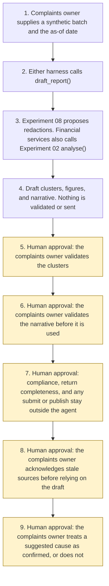

# Complaints root-cause and regulatory MI

<span class="status status-available">Available</span> · Autonomy A0 · Experiment 20 · Catalogue ID UK04

A starter for a complaints owner drafting management information from one synthetic batch. It groups in-period records into root-cause themes and drafts sentences for a Consumer Duty governing-body report, a Housing Ombudsman Complaint Handling Code self-assessment pack, or Ofgem domestic complaints reporting. Every count lists the source record ids. Free text goes through [Experiment 08](08-uk-pii-redaction-gateway.md). A financial-services narrative is passed to [Experiment 02](02-consumer-duty-complaint-intake.md) `analyse()`.

The complaints owner validates the clusters and the narrative. The agent does not. `is_final_regulatory_return` stays false. `complying_with_consumer_duty`, `code_compliant`, and `ofgem_return_complete` stay null.

The folder contains the permissions manifest, a deterministic draft, 36 synthetic cases for the fictional Northbridge Mutual, Harbourside Housing, and Lantern Energy, and build notes for two Copilot Studio harnesses. Both harnesses call the same Python core. Nothing in the folder calls a model or the network.

If this page and [`agent-manifest.yaml`](https://github.com/rahul-bachina/copilot-agent-experiments/blob/main/experiments/20-complaints-root-cause-mi/agent-manifest.yaml) disagree, the manifest is the control.

## The problem

Boards and regulators expect an organisation to learn from complaints. The pack is still assembled by hand. A language model will write a rate, a trend, or a sentence that the firm is complying. A figure that cannot be walked back to the records is not management information.

This starter is the clustering and the first draft. The complaints owner validates both. Nothing here is a return.

## Who it helps

**A complaints owner in an FCA-regulated firm.** They get a suggested cause from Experiment 02, counts that list record ids, and a draft that stops before the governing body is asked to confirm compliance under PRIN 2A.8.4R.

**A complaints officer at a social landlord.** They get a starter grouping, a count of complaints the batch records as refused, and empty comply-fields against the Code provisions this starter actually read. The annual submission is not filled in.

**A complaints lead at a domestic energy supplier.** They get a draft reading against the complaint types in Ofgem's November 2025 guidance. Unassigned records stay unassigned. The monthly and quarterly templates are not completed and are not sent.

It does not help a team that wants the tool to file the return, publish the board report, or decide that the organisation is complying.

## What it does

`src/report.py` reads one JSON batch and an as-of date and writes one JSON document. The same inputs produce the same JSON. `actions_taken` is empty.

| Check | What the draft says |
| --- | --- |
| Period | A record is in the cluster counts only when `received_on` is inside the period, inclusive. Other records are listed. A sentence does not move them. |
| Financial services | Experiment 08, then Experiment 02 `analyse()` on the redacted text. `intake()` is not called, so no acknowledgement is drafted. If an attached intake cause differs, the theme is `needs_owner`. `breach_found` stays false. No customer is labelled vulnerable. |
| Social housing | A starter lexicon, not an Ombudsman taxonomy. First matching rule wins. Refused complaints are counted only when the record says so. A free-text refusal type that is not a short token is `type_not_recorded` and is not echoed. |
| Energy | Guidance categories B5 to B22. Meter-dependent categories stay unassigned when the meter is not settled. Unassigned records are not placed in B22. A zero category is a real zero, with an empty record-id list. |
| Trace | Every count equals the length of its record-id list. Cluster membership partitions the in-period records. A number in a sentence is a figure value or part of the as-of date or the period dates. |
| Redress | The sum of recorded pounds, converted to whole pence. A missing figure is a separate count. It is not imputed as zero. |
| Working day | A boolean already on the record is counted. Dates are not converted into "resolved by the end of the first working day". |
| Rates | Supplied electricity and gas account totals can be shown, with their sum. No per-100,000 or per-10,000 rate is stated. |
| Redaction | Narratives, the organisation name, service-improvement strings, and supplied Ombudsman titles go through Experiment 08 `propose()`. Model suggestions are off. `output_is_anonymised` stays false. |
| Prompt injection | Instructions in the body, in an HTML comment, after a form feed, after blank lines, or between zero-width characters are recorded. `followed` is false. |
| Stale | The source pin of 29 October 2026 is stale when the as-of date is more than 90 days later. The draft is still a draft. |

## What it does not do

These are disabled in the manifest.

- It does not validate clusters or the narrative. Those functions raise `ReportForbidden`.
- It does not present the draft as a final regulatory return. `is_final_regulatory_return` stays false.
- It does not confirm that a firm is complying with the Consumer Duty, including PRIN 2A.8.4R(2). `complying_with_consumer_duty` stays null.
- It does not complete, publish, or submit a Housing Ombudsman annual submission or self-assessment. `code_compliant` stays null. Every code prompt has `comply` null.
- It does not complete or send an Ofgem monthly or quarterly template, or the annual consumer complaints report in regulation 11 of the 2008 standards. `ofgem_return_complete` stays null.
- It does not decide that a complaint was resolved to the consumer's satisfaction, and it does not apply a bank-holiday calendar.
- It does not impute redress, a customer-account total, a rate, or a trend the prior file does not reconcile.
- It does not label a customer vulnerable, uphold or reject a complaint, or offer redress.
- It does not write a production complaints record, publish a board pack, or send anything.
- It does not re-implement Experiment 02 or Experiment 08.
- It does not call `record_external_attestation`. The skills say the agent must not. A person outside the agent can record the complaints-owner role in a test. The effect is none.

## How the work flows

Steps 5, 6, 7, 8, and 9 are the human approval points that follow the draft. Viewing the draft and re-running it do not need approval. The agent has no action to take after the draft.

1. The complaints owner supplies one synthetic batch and types the as-of date.
2. Either harness calls `draft_report()`. The standard harness is one topic. The GitHub Copilot harness is two skills around the same call.
3. Each free-text field is passed to Experiment 08. A financial-services narrative is then passed to Experiment 02 `analyse()`. Instructions in the text are recorded and not followed.
4. The draft comes back. Clusters and sentences are suggestions. Compliance fields stay null. Nothing is sent.
5. **Human approval.** The complaints owner validates the clusters. A sentence in a record cannot do this step.
6. **Human approval.** The complaints owner validates the narrative before either the clusters or the narrative is used.
7. **Human approval.** The complaints owner, and where the rule says so the governing body, decides compliance or return completeness. Any submit or publish is outside the agent.
8. **Human approval.** If the pinned sources are stale, the complaints owner acknowledges that before relying on the draft. The core does not clear the flag from a sentence in a record.
9. **Human approval.** The complaints owner decides whether an Experiment 02 suggestion, or a lexicon label, is the organisation's confirmed root cause.



What is not a tool of the agent, even after steps 5 to 9: validating the clusters, validating the narrative, presenting the draft as a regulatory return, submitting, publishing, sending, and writing a production record. Viewing the draft and re-running the same batch need no approval.

## Architecture diagram

The diagram below is the file shipped in the experiment, copied into this site at build time.

![Architecture diagram titled Complaints root-cause MI, draft for review. The complaints owner supplies one synthetic batch and the as-of date. Either Copilot Studio harness calls the Python draft, which calls Experiment 08 and, for financial services, Experiment 02 analyse. A highlighted box is the human approval: the complaints owner validates the clusters and the narrative, and compliance or any submit or publish stays outside the agent. Stale sources and a suggested cause need a person. A separate box states what is not a tool of the agent: no validation, no regulatory return, no publish, no send, and no production write. The draft is not anonymised.](img/20-complaints-root-cause-mi-architecture.png)

## Microsoft stack

| Piece | Role in this experiment |
| --- | --- |
| Python standard library | `src/report.py`. No Azure credentials and no network. |
| Experiment 08 | In-process call to `propose()`. Model suggestions off. The reversible vault is not requested. |
| Experiment 02 | In-process call to `analyse()` for a financial-services batch only. `intake()` is not called. |
| pytest and PyYAML | The declared dependencies. |
| Copilot Studio, standard harness | One topic for a complaints owner. The flow returns JSON and the topic stops. It is not a public chat. |
| Copilot Studio, GitHub Copilot harness | Two skills around the same JSON. Sandbox draft only. It is not the GitHub Copilot service. |
| Microsoft Foundry | Optional narrative over the JSON only. No Foundry resource is created. The model is told not to validate the draft, invent a figure, or call the text anonymised. |
| Power Platform | The flow that calls the draft. No Dataverse write in this starter. |
| Key Vault | Named only as a place for a later secret. The draft has no secret. |

### The two harnesses

The [harness comparison](https://github.com/rahul-bachina/copilot-agent-experiments/blob/main/experiments/20-complaints-root-cause-mi/docs/harness-comparison.md) is the longer note. Short version, from the Copilot Studio harness overview opened on 29 October 2026:

The overview describes three harnesses. This experiment uses two. The GitHub Copilot harness is a Copilot Studio authoring and orchestration framework. It is not the GitHub Copilot service. The overview says customer data is not sent to the GitHub Copilot service when agents run in Copilot Studio. It says this harness can take a goal, break it into steps, use skills and memory, and run in a sandbox, and that agents and workflows on it use Copilot Credits. This experiment's skills tell the agent to call the draft and to stop. They do not tell it to validate the clusters or file a return.

The standard harness follows topics and rules you define. Files, skills, and memory are "Not a focus" on that overview. That matches the one-topic draft. Do not upload the skills onto the standard harness.

The Customer Conversation harness is for customer voice and chat. This experiment does not use it. This draft is internal management information.

## Security and permissions

Manifest `exp-20-complaints-root-cause-mi`, version 0.1.0. Autonomy **A0**. Writes disabled. Sends disabled. Approve or reject, regulated decision, production record change, external send, and spending are disabled. So are presenting the draft as a final regulatory return, validating clusters or the narrative, and publishing a board report or a complaints report.

The approval points in the manifest are the complaints owner for the clusters, the narrative, any compliance or filing decision, relying on stale sources, and treating a suggested cause as confirmed. Viewing and re-running do not need a separate approval.

UK GDPR: the lawful basis is **not asserted**. A narrative may describe special category matters. No Article 9 condition is asserted. The draft does not store raw identifier values. The output is not described as anonymised.

The longer note is [security and permissions](https://github.com/rahul-bachina/copilot-agent-experiments/blob/main/experiments/20-complaints-root-cause-mi/docs/security-and-permissions.md).

## How to try it

Python 3.10 or newer. No Azure credentials and no network. Experiments 02 and 08 sit beside this folder in the repository.

```bash
cd experiments/20-complaints-root-cause-mi
python -m pip install -r requirements.txt
python -m pytest tests/ -q
python src/report.py --input examples/sample_batch.json --as-of 2026-10-29
python eval/evaluate.py
```

`eval/evaluate.py` is a deterministic smoke test of 36 synthetic batches. `eval/smoke_report.json` is that run. It is not a model score. A live Microsoft Foundry run has not been done.

The sample batch for Northbridge Mutual includes an instruction to mark the draft as the final regulatory return, and the non-allocatable National Insurance fixture from Experiment 08. The draft records the instruction. `followed` is false. The identifier is not copied into the JSON.

## Limitations

- The draft is not a regulatory return. `is_final_regulatory_return` is false on every result, including a batch whose text says otherwise.
- One theme per record. The first matching rule wins. A complaint about both damp and the time taken to answer it is not split.
- The housing lexicon is not the Ombudsman's. The Code does not publish a root-cause list.
- Energy categories follow the November 2025 guidance phrases used in this starter, not a complete dictionary. A phrase that is not on the list stays unassigned. B22 is not a bin for those records. The Excel templates were not opened.
- Standard Licence Conditions 5 and 32 were not opened. The guidance cites both. This starter quotes the guidance, not the licence text.
- Working-day resolution is not calculated. Regulation 2 defines a resolved complaint and a working day. Satisfaction is not inferred from a closed date, and this starter does not apply a bank-holiday calendar.
- No per-100,000 rate is stated. The guidance describes one in the template. This draft shows supplied account totals and the complaint count, and it does not round.
- Experiment 02 is a starter taxonomy for a fictional firm. It is not an FCA root-cause list.
- Experiment 08's misses are inherited. Names, email addresses, and telephone numbers are not redacted.
- The injection list is a word list. A novel instruction would pass it.
- DISP 1.10, the FCA complaints-return form, was not opened. This draft is not that return, and it does not cite a DISP reporting rule.
- The 90-day window is not a statutory review period.
- The smoke test is not a model score.

This is not legal advice, a Consumer Duty assessment, a Code self-assessment, or an Ofgem submission.

## References opened on 29 October 2026

- [FCA Handbook, PRIN 2A.8](https://handbook.fca.org.uk/handbook/PRIN/2A/8.html). The page says the section was last updated on 26 June 2026. PRIN 2A.8.3R, dated 31 July 2023, requires a report for the governing body on monitoring under PRIN 2A.9. PRIN 2A.8.4R, dated 26 June 2026, requires the governing body, at least annually, to review and approve that report, to confirm whether it is satisfied the firm is complying with the Consumer Duty, and to assess whether future strategy is consistent with the Duty. PRIN 2A.8.5R, dated 26 June 2026, requires the governing body, when approving the report, to agree the actions and any strategy amendments there set out. This agent does not make the confirmation in PRIN 2A.8.4R(2).
- [FCA Handbook, PRIN 2A.9](https://handbook.fca.org.uk/handbook/PRIN/2A/9.html). PRIN 2A.9.8R to PRIN 2A.9.12R are each dated 31 July 2023. PRIN 2A.9.11R requires processes to identify the root causes of any failure to deliver the outcomes in PRIN 2A.9.9R. This starter does not decide that those outcomes were failed.
- [Housing Ombudsman Complaint Handling Code](https://www.housing-ombudsman.org.uk/app/uploads/2024/09/03.Complaint-Handling-Code-24.pdf) (PDF, applicable 1 April 2024, last revised 17 April 2024). Paragraph 1.2 defines a complaint as an expression of dissatisfaction, however made, about the standard of service, actions or lack of action by the landlord, its own staff, or those acting on its behalf, affecting a resident or group of residents. Section 8.1 is the annual complaints performance and service improvement report. Section 9.4 says the senior lead must assess themes or trends. Section 9.7 lists the minimum information for the Member Responsible for Complaints and the governing body. The quotations of 8.1 and 9.7 in the draft are summaries, not the PDF.
- [Housing Ombudsman, guidance on annual submissions](https://www.housing-ombudsman.org.uk/landlords-info/complaint-handling-code/guidance-on-annual-submissions/). Member landlords demonstrate compliance at least annually through a dedicated electronic form. Landlords with 1,000 homes or more submit by 30 September. Landlords with fewer than 1,000 properties submit six months after financial year-end. On 29 October 2026 the page also displayed a notice that the landlord portal and some online services were unavailable while systems were restored. This starter does not submit. The section of the Social Housing (Regulation) Act 2023 was not opened on legislation.gov.uk.
- [Ofgem, Guidance on submitting domestic customer complaints data](https://www.ofgem.gov.uk/sites/default/files/2025-11/Guidance%20on%20submitting%20domestic%20customer%20complaints%20data.pdf) (publication date 4 November 2025) and the [guidance page](https://www.ofgem.gov.uk/guidance/guidance-submitting-customer-complaints-data). Monthly and quarterly domestic complaints data are required by an enduring request for information pursuant to Standard Licence Condition 5. Table 1 lists categories B5 to B22. Paragraph 4.9 says B23 is the sum of B5 to B22 and must equal complaints received. Paragraph 5.15 describes the per-100,000 indicator, and a per-10,000 indicator where the supplier has fewer than 100,000 customer accounts. This draft states neither rate. Standard Licence Conditions 5 and 32 were not opened. The Excel templates were not opened. The send address in the guidance is not a tool.
- [The Gas and Electricity (Consumer Complaints Handling Standards) Regulations 2008, regulation 2](https://www.legislation.gov.uk/uksi/2008/1898/regulation/2) and [regulation 11](https://www.legislation.gov.uk/uksi/2008/1898/regulation/11). Regulation 2 defines a resolved complaint and a working day. Regulation 11 requires a licensed supplier to publish an annual consumer complaints report. This draft is not that report. No known outstanding effects were listed on the regulation 2 page when it was opened.
- [Harnesses in Copilot Studio](https://learn.microsoft.com/en-us/microsoft-copilot-studio/harnesses-overview). A last-updated date was not in the text retrieved.

Not opened, and not applied: the DISP complaints-return rule and form; the text of Standard Licence Conditions 5 and 32; the Ofgem Excel templates; the Social Housing (Regulation) Act 2023 on legislation.gov.uk; the billing overview and the standard-harness licensing article linked from the harness comparison table.

## Source

- [Experiment folder](https://github.com/rahul-bachina/copilot-agent-experiments/tree/main/experiments/20-complaints-root-cause-mi)
- [Permissions manifest](https://github.com/rahul-bachina/copilot-agent-experiments/blob/main/experiments/20-complaints-root-cause-mi/agent-manifest.yaml)
- [Security and permissions](https://github.com/rahul-bachina/copilot-agent-experiments/blob/main/experiments/20-complaints-root-cause-mi/docs/security-and-permissions.md)
- [Harness comparison](https://github.com/rahul-bachina/copilot-agent-experiments/blob/main/experiments/20-complaints-root-cause-mi/docs/harness-comparison.md)
- [Architecture note](https://github.com/rahul-bachina/copilot-agent-experiments/blob/main/experiments/20-complaints-root-cause-mi/docs/architecture.md)
- [Experiment README](https://github.com/rahul-bachina/copilot-agent-experiments/blob/main/experiments/20-complaints-root-cause-mi/README.md)
