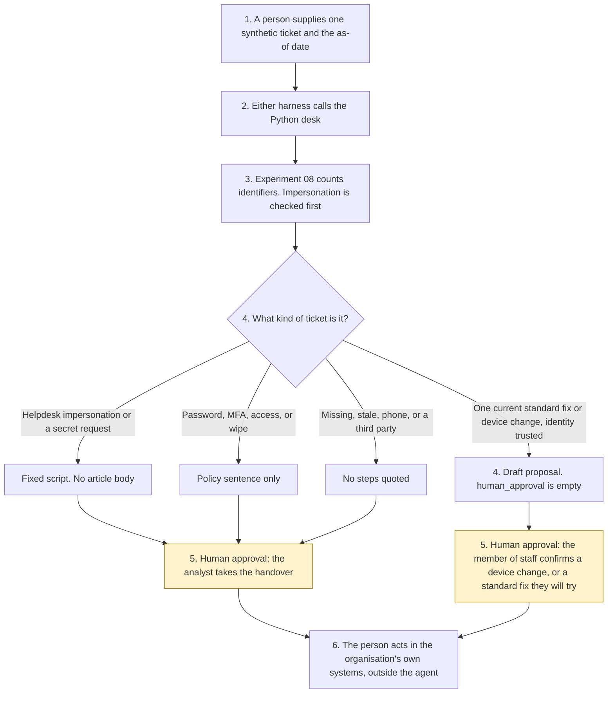

# IT service desk

<span class="status status-available">Available</span> · Autonomy A1 · Experiment 21 · Catalogue ID Q009

A starter for a signed-in member of staff, or for a service desk analyst, at a UK organisation. It reads one synthetic IT ticket and returns either a quotation from a fixed knowledge base or a handover to an analyst. The member of staff confirms a device change. Password resets, MFA changes, and access grants go to the analyst. Nothing is executed.

The organisation in the samples is Aldermere District Council. Its desk is Aldermere Shared ICT. Both are invented. The articles, the staff ids, and the asset tags are synthetic.

The folder contains the permissions manifest, a deterministic desk, 38 synthetic tickets, and build notes for two Copilot Studio harnesses. Both harnesses call the same Python core. The core calls [Experiment 08](08-uk-pii-redaction-gateway.md) before a draft is built, and it follows the catalogue-and-review shape of [Experiment 13](13-council-contact-front-door.md). Nothing in the folder calls a live model or the network.

If this page and [`agent-manifest.yaml`](https://github.com/rahul-bachina/copilot-agent-experiments/blob/main/experiments/21-it-service-desk/agent-manifest.yaml) disagree, the manifest is the control.

## The problem

Staff raise the same tickets often, and they also raise the tickets a script must not finish: a forgotten password, a change to multi-factor authentication, a request for access, or a caller who says they are the helpdesk. A desk that resets a password because the ticket says so is worse than a queue.

The narrow job is to match one ticket to an article the desk has already published, show the review date, collect the diagnostics the article names, draft a ticket note, and propose a standard fix without executing it.

Pages opened for this starter on 29 October 2026:

- [Phishing attacks: defending your organisation](https://www.ncsc.gov.uk/guidance/phishing). Attackers can exploit ways of working to trick people into handing over information, including passwords. Important requests should be verified using a second type of communication. No publication date was printed on the page that was read.
- [Advice for End Users](https://www.ncsc.gov.uk/guidance/end-user-devices-advice-end-users), published 24 September 2016. A person must never disclose a password to anyone, including IT support. The helpdesk confirms identity before a password reset.
- [Incidents impacting retailers](https://www.ncsc.gov.uk/blog-post/incidents-impacting-retailers), published 4 May 2025. The post encourages organisations to review how the helpdesk authenticates staff before resetting passwords, especially privileged accounts. It discusses social engineering of IT helpdesks. Press speculation named in the post is not repeated here as fact.
- [UK GDPR Article 6](https://www.legislation.gov.uk/eur/2016/679/article/6) and [Article 32](https://www.legislation.gov.uk/eur/2016/679/article/32). No lawful basis is asserted. Points (ea) and (f) of Article 6(1) do not apply to processing by public authorities in the performance of their tasks.

## Who it helps

**A member of staff** who is signed in on the portal or in Teams chat gets a published sentence for a routine fault, with a review date, or a clear statement that the catalogue does not contain the answer. They are told the draft was written by an automated AI chatbot. They are not given a password reset.

**An analyst** who already has the ticket on their screen gets a draft: which article matched, whether identity was trusted, whether the article is stale, and whether the ticket should stop because someone is impersonating the helpdesk. They take the privileged work in the organisation's own identity system.

**A service desk** that wants the approval points written down before anyone connects Microsoft Entra or an ITSM tool. High-risk actions are disabled. The same ticket and the same as-of date produce the same JSON.

It does not help a team that wants the tool to reset a password on its own.

## What it does

`src/desk.py` reads one JSON ticket and writes one JSON document. `human_approval` is null. `actions_taken` is empty. `executed` is false. The ticket's words are not copied into the output. Free text goes through Experiment 08. The redacted text is not copied out either, because that gateway does not redact names. `output_is_anonymised` stays false.

| Situation | What the draft says |
| --- | --- |
| Signed-in portal or Teams chat, VPN error 809 | The article body, including "Quit the VPN client and open it again." The member of staff may later confirm they will try the steps. The agent does not run them. |
| Outlook will not open, diagnostics present | A device-change proposal. Confirmation does not rename the cache folder. |
| Printer, with an asset tag | A proposal to map the queue SYN-PRINT. The agent does not map it. |
| Password, MFA, access, or remote wipe | A policy sentence. It does not describe a click-path. The member of staff cannot confirm it. |
| Service desk hours, including on the phone | The published hours. No session is required. |
| Phone or email, for a fix | Steps are not quoted. Words in the ticket are not proof of identity. |
| Identity check from another day | Not trusted. Steps are not quoted. |
| Requester is not the subject account | Steps for the other person's device are not quoted. |
| "This is the IT helpdesk" or a request for a password or an MFA code | A fixed script. Do not share a password or a code. No article body. |
| Stale article, or a pinned source older than 180 days | The body is not copied. Equal to 180 days is still current. |
| Two articles, or none | Neither procedure is invented. An analyst chooses, or the draft says the catalogue does not contain the answer. |

`record_review` records `user_confirm_standard_fix`, `user_confirm_device_change`, `analyst_take_handover`, or `reject_draft` from a separate review object. It refuses reset, MFA change, access grant, execute, write, send, purchase, and wipe. `reset_password` and the other direct functions raise.

## What it does not do

These are disabled in the manifest.

- It does not reset a password or change MFA.
- It does not grant access.
- It does not change or wipe a device. A recorded confirmation is not the change.
- It does not execute a standard fix.
- It does not write a production ticket.
- It does not send an email, a Teams message, or an SMS.
- It does not buy a licence.
- It does not ask for a password or a code.
- It does not treat ticket text as an identity check, and it does not call Microsoft Entra.
- It does not quote a stale article, or read a live knowledge base.
- It does not describe Experiment 08's output as anonymised.
- It does not publish an ATRS record. Experiment 13 opened the scope policy on 27 October 2026. This experiment did not re-open it.

## How the work flows

Steps marked as human approval are the points where a person has to act. The agent has no service action to take after them. Resetting a password, changing MFA, granting access, changing a device, writing the ticket, and sending a message stay outside the agent even after a person confirms a draft.

1. A member of staff or an analyst supplies one synthetic ticket and types the as-of date.
2. Either harness calls the Python desk. The standard harness is one topic. The GitHub Copilot harness is three skills around the same call.
3. The desk sends free text through Experiment 08, checks impersonation and secret requests first, then matches the catalogue. It records injection and a stale article. It does not call a model.
4. The draft comes back with an outcome, citations, and an empty `human_approval`.
5. **Human approval.** The signed-in member of staff confirms a standard fix they will try, or confirms a device change when the required diagnostics are present. An analyst takes a password reset, an MFA change, an access grant, a wipe, an unverified caller, a third-party request, a social-engineering stop, or a stale article.
6. The person acts in the organisation's own systems, if they decide to. The agent has no tool for that.



What is not a tool of the agent, even after step 5: a password reset, an MFA change, an access grant, a device change, a remote wipe, a ticket write, a message, and a licence purchase.

## Architecture diagram

The diagram below is the file shipped in the experiment, copied into this site at build time.

![Architecture diagram titled IT service desk, draft for a signed-in member of staff or an analyst. The person supplies one synthetic ticket and the as-of date. Either Copilot Studio harness calls the Python desk, which calls Experiment 08, treats identity as a channel object, and leaves the approval empty. A highlighted box is the human approval: the member of staff confirms a device change or a standard fix they will try, and an analyst takes a password, MFA, or access handover, then acts in the organisation's own systems. A separate box states what is not a tool of the agent: no password reset, no MFA change, no access grant, no remote wipe, no device change performed, no ticket write, no message, and no licence purchase.](img/21-it-service-desk-architecture.png)

## Microsoft stack

| Piece | Role in this experiment |
| --- | --- |
| Python standard library | `src/desk.py`. No Azure credentials and no network. |
| Experiment 08 | In-process call to `propose()`. Model suggestions off. The reversible vault is not requested. The redacted text is not copied out. |
| Experiment 13 | The pattern for a fixed catalogue, a stale window, instruction sentences dropped before matching, and a separate review object. This experiment does not import that code. |
| pytest | The only declared dependency. Used by the unit tests. |
| Copilot Studio, standard harness | One topic. The person pastes a ticket, the flow returns JSON, the topic stops. Microsoft's harness overview, opened 29 October 2026, gives an internal help desk as an example of this harness. |
| Copilot Studio, GitHub Copilot harness | Three skills around the same JSON. Sandbox draft only. It is not the GitHub Copilot service. |
| Customer Conversation harness | Described on the harness overview for customer voice and chat. Not built here. |
| Microsoft Foundry | Optional narrative over the JSON only. No Foundry resource is created. The model is told not to invent a click-path or set `human_approval`. |
| Power Platform | The flow that calls the desk. No Dataverse write and no Entra connector in this starter. |
| Key Vault | Named only as a place for a later secret, and as a way to remove Foundry access. The desk has no secret. |

### The two harnesses

The [harness comparison](https://github.com/rahul-bachina/copilot-agent-experiments/blob/main/experiments/21-it-service-desk/docs/harness-comparison.md) is the longer note. Short version, from the Copilot Studio harness overview opened on 29 October 2026:

The GitHub Copilot harness is a Copilot Studio authoring and orchestration framework. It is not the GitHub Copilot service. The overview says customer data is not sent to the GitHub Copilot service when agents run in Copilot Studio. It says this harness can take a goal, break it into steps, use skills and memory, and run in a sandbox, and that agents on it use Copilot Credits. This experiment's skills tell the agent to call the desk and to stop. They do not tell it to reset a password.

The standard harness follows topics and rules you define. Files, skills, and memory are "not a focus" on that overview. The page gives an internal help desk as an example. That matches the one-topic intake.

The same overview describes a Customer Conversation harness for customer voice and chat, with a route to a person, also billed in Copilot Credits. This folder does not implement it. An unattended password-reset line on that harness would sit outside this A1 design.

Billing and licensing pages linked from the overview were not opened on 29 October 2026. Microsoft 365 Copilot licence coverage was not stated on the overview page. Credit ranges were not copied. Whether memory can be switched off was not on the page. The skills say not to store the ticket anyway.

The overview did not use the word preview for the harness. The skills page it links to was not opened. Treat the authoring click-path as something to confirm in the tenant. This page does not turn that silence into a general-availability claim.

## Security and permissions

Manifest `exp-21-it-service-desk`, version 0.1.0. Autonomy **A1**. Writes disabled. Sends disabled. Approve or reject, regulated decision, production record change, external send, and spending are disabled. So are password reset, MFA change, access grant, performing a device change, remote wipe, and collecting a secret.

Contacts in the manifest use `aldermere.example.gov.uk`. They are placeholders. The council is fictional.

**What a run may read.** The one ticket the person supplies, the as-of date, a channel identity object, and the static catalogue. The Python starter does not persist the text. A record that is not marked synthetic is refused, and the refusal does not echo the text.

**What it must not read.** Identity systems, device consoles, ITSM production tickets, mailboxes, purchasing systems, live knowledge bases, and password stores.

**Human approval, before anyone relies on a draft.**

| Decision | Who |
| --- | --- |
| Confirm a standard fix the person will try | The signed-in member of staff who raised the ticket |
| Confirm a device change | That same person. Required diagnostics must be present. The change is not performed. |
| Reset a password, change MFA, or grant access | Service desk analyst, in the identity system. A user confirmation is refused. A passed session does not replace the analyst's own check. |
| Take an impersonation stop, an unverified caller, or a third-party request | Service desk analyst |
| Rely on an article after it is marked stale | Service desk analyst, after someone re-opens the organisation's article |
| Write the ticket, send a message, wipe a device, or buy a licence | The person authorised for that action. Outside the agent. |

Viewing a draft and re-running it do not need a separate approval.

**UK GDPR.** The manifest does not assert a lawful basis. Article 6 and Article 32 were read on 29 October 2026. A member of staff may volunteer health information. Article 9 was not opened. No condition is asserted. This page is not a DPIA. The agent does not make a significant decision solely by automated means. Experiment 03 screens the Data (Use and Access) Act 2025 safeguards. This experiment did not open section 80 on 29 October 2026 and does not run that screen.

**ATRS.** Not a record and not a scope decision. The manifest's `atrs_mapping` block is a pointer. Experiment 03 drafts a pack. It does not approve one.

**Prompt injection.** Fixtures include instructions to ignore the rules, impersonate the helpdesk, request a password, override a stale flag, and execute a fix. The checker records them and does not follow them. `tests/test_desk.py` and `tests/test_review.py` cover that.

**Stale data.** Older than the threshold, default 180 days, is stale. Equal to the threshold is not. The legacy VPN article, last reviewed 15 January 2025, is stale on 29 October 2026, and its body is not in the JSON. A pinned source older than the window also stops a quotation.

**Prohibited actions.** `record_review` refuses `reset_password`, `change_mfa`, `grant_access`, `execute_fix`, `write_ticket`, `send_message`, `purchase_licence`, and `remote_wipe`. The direct functions raise `DeskForbidden`.

**Risk register, assessed 29 October 2026 for this starter rather than a named organisation.** Residual risk is not all Low.

| ID | Risk | Residual | Owner in the manifest |
| --- | --- | --- | --- |
| R1 | Ticket text is treated as authority to reset, change MFA, or grant access | Low | IT service desk operations |
| R2 | A caller impersonates the helpdesk, or a process asks for a password or an MFA code | Medium | Information security |
| R3 | Steps are read out to a caller who was not checked, including on the phone | Medium | IT service desk operations |
| R4 | A stale article is followed as current | Low | IT service desk operations |
| R5 | Prompt injection marks a fix as executed, writes the ticket, or sends a message | Low | Information security |
| R6 | A live ticket is pasted into a shared test run | Medium | Data protection officer |
| R7 | A pinned NCSC or legislation page changes and the notes are still treated as current | Medium | IT service desk operations |

**Logging.** This starter writes no log. Before live use, log who ran it, the ticket id rather than the words, the as-of date, whether identity was trusted, whether an article was stale, and the analyst's later review. Do not put the ticket text in an application trace.

**Kill switch.** Turn the Copilot Studio agent off. Remove any Foundry access. Block a later connector in a Power Platform DLP policy.

**Tenant controls that are named and not configured here.** Entra Agent ID, Conditional Access, Power Platform DLP, Microsoft Foundry prompt shields, Key Vault, Purview, and Application Insights. The product pages for those controls were not opened on 29 October 2026, except the Copilot Studio harness overview. Dynamic Permissions, Dynamic Agent Risk, and Dynamic Conditional Access are recorded in Experiment 01 as announced, with availability unverified. This folder did not re-check that announcement.

**Review.** 29 October 2026. Next review 29 April 2027, and sooner if the catalogue, the NCSC pages, or Article 6 or 32 change.

## How to try it

Python 3.10 or newer. No Azure credentials and no network. Experiment 08 has to be present beside this folder. This experiment does not carry a second copy of the gateway.

```bash
cd experiments/21-it-service-desk
python -m pip install -r requirements.txt
python -m pytest tests/ -v
python eval/evaluate.py
python src/desk.py --input examples/sample_ticket.json --as-of 2026-10-29
```

`eval/evaluate.py` prints a deterministic smoke test. The 38 cases are synthetic. `eval/smoke_report.json` is that run. The file says it is not a model score. It records 38 of 38 cases passed by the checker, and an agreement rate of 100.0 on those fixtures. No model was called.

A stale-data check:

```bash
python src/desk.py --input examples/sample_ticket.json --as-of 2027-10-29
```

On that date the pinned sources are outside the 180-day window. The VPN steps are not in the JSON. `human_approval` is still null.

## Limitations

- The matcher is a keyword list. Wording that is not on the list becomes no match or a handover. The word "password" routes to the analyst even when the rest of the ticket is a VPN fault.
- The social-engineering list is short. A phrase that is not on it is not detected. Absence of a flag is not a finding that the caller is genuine.
- The 180-day window is a starter default, not a review duty.
- A passed `entra_session` is a field in the JSON. This starter does not call Microsoft Entra.
- Experiment 08 does not redact names. That is why the redacted text is not copied into the draft.
- Aldermere, its articles, and its staff ids are fictional.
- The smoke test is not a model score. No live model has been scored.
- The Customer Conversation harness is not built here.
- This page is not legal advice, a DPIA, an NCSC assurance statement, or an ATRS submission.

## Source

- [Experiment folder](https://github.com/rahul-bachina/copilot-agent-experiments/tree/main/experiments/21-it-service-desk)
- [Permissions manifest](https://github.com/rahul-bachina/copilot-agent-experiments/blob/main/experiments/21-it-service-desk/agent-manifest.yaml)
- [Security and permissions](https://github.com/rahul-bachina/copilot-agent-experiments/blob/main/experiments/21-it-service-desk/docs/security-and-permissions.md)
- [Harness comparison](https://github.com/rahul-bachina/copilot-agent-experiments/blob/main/experiments/21-it-service-desk/docs/harness-comparison.md)
- [Architecture note](https://github.com/rahul-bachina/copilot-agent-experiments/blob/main/experiments/21-it-service-desk/docs/architecture.md)
- [Experiment README](https://github.com/rahul-bachina/copilot-agent-experiments/blob/main/experiments/21-it-service-desk/README.md)
- [Experiment 08, the UK identifier gateway](08-uk-pii-redaction-gateway.md)
- [Experiment 13, the council contact-centre front door](13-council-contact-front-door.md)
