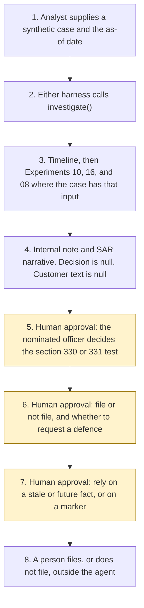

# On-chain alert investigator and SAR narrative drafter

<span class="status status-available">Available</span> · Autonomy A1 · Experiment 22 · Catalogue ID UK07

A starter for an analyst who has a synthetic blockchain-analytics alert and needs one internal timeline for the nominated officer. It can attach a Travel Rule transfer from [Experiment 10](10-travel-rule-exception-triage.md) (UK05) and a KYC file from [Experiment 16](16-kyc-evidence-intake.md) (B004). Free-text notes go through [Experiment 08](08-uk-pii-redaction-gateway.md) (O005). The monitoring expectation is the same FCA registration page cited by [Experiment 04](04-fca-cryptoasset-readiness.md) (UK02). This page does not re-score that pack.

The draft is an evidence timeline, an investigation note, and a suspicious activity report narrative. The MLRO, or the nominated officer, decides whether to file. Nothing is filed with the National Crime Agency. The agent does not draft customer-facing content about the suspicion.

The folder contains the permissions manifest, a deterministic draft, 28 synthetic cases for the fictional firm Harbourline Markets Ltd, and build notes for two Copilot Studio harnesses. Both harnesses call the same Python core. Nothing in the folder calls a model, a chain, or the network.

If this page and [`agent-manifest.yaml`](https://github.com/rahul-bachina/copilot-agent-experiments/blob/main/experiments/22-onchain-alert-sar-drafter/agent-manifest.yaml) disagree, the manifest is the control.

## The problem

[Regulation 19(4)(d)](https://www.legislation.gov.uk/uksi/2017/692/regulation/19) of the Money Laundering Regulations 2017 says the firm's policies must require anyone who knows or suspects, or has reasonable grounds for knowing or suspecting, that a person is engaged in money laundering or terrorist financing to comply with Part 7 of the Proceeds of Crime Act 2002 or Part 3 of the Terrorism Act 2000. [Regulation 21(3)](https://www.legislation.gov.uk/uksi/2017/692/regulation/21) requires a nominated officer. Regulation 21(5) is that officer's determination. This starter does not make it.

[Section 330](https://www.legislation.gov.uk/ukpga/2002/29/section/330) is the regulated-sector failure-to-disclose offence. [Section 331](https://www.legislation.gov.uk/ukpga/2002/29/section/331) is the nominated officer's onward disclosure. [Section 333A](https://www.legislation.gov.uk/ukpga/2002/29/section/333A) is tipping off in the regulated sector. Those pages were opened on 29 October 2026. They warn that revised legislation on the site may not be fully up to date. The MLR pages say they are up to date with changes known to be in force on or before 25 October 2026.

The FCA registration page, last updated on that site on 30 June 2026, expects an on-chain and an off-chain monitoring tool, and the rules and thresholds set in those tools. It says the FCA cannot recommend or endorse any tool. It also expects a SAR route to the MLRO or nominated officer and to the National Crime Agency. This starter does not configure a tool and does not file.

## Who it helps

**An analyst.** They see the hops that used synthetic tokens, what was omitted, what is stale, and which facts are still a person's to weigh. A sentence inside the alert cannot file the report.

**The nominated officer.** They receive an internal note and a narrative that says it is not a disclosure and has not been submitted. They decide whether section 330 or section 331 is met, and whether to file.

**A reader of Experiments 04, 10, and 16.** Those folders already stop before a filing decision. This folder can call the Travel Rule triage and the KYC checklist, and it still does not file.

It does not help a team that wants the tool to file, request a defence, or tell the customer.

## What it does

`src/investigate.py` reads one JSON case and writes one JSON document. The same case and the same as-of date produce the same JSON. `mlro_decision` is null. `sar_filed` is false. `actions_taken` is empty. `customer_facing.text` is null.

| Check | What the draft says |
| --- | --- |
| Timeline | Hops and ledger rows whose addresses match `SYNTH-ADDR-` and whose hashes match `SYNTH-TX-`. A live-looking string is omitted and is not copied. |
| Stale | A source pin or an alert date more than 90 days before the as-of date is stale. Equal to the threshold is not. An event after the as-of date is listed and not treated as having happened. |
| Travel Rule | If a transfer is attached, Experiment 10's categories are kept. Party names are not copied. `analyst_decision` stays null. |
| KYC | If a customer file is attached, Experiment 16's missing-item ids are kept. That experiment's customer note is not copied. Documents are not confirmed. |
| Identifiers | The analyst note is passed to Experiment 08. `output_is_anonymised` stays false. |
| Narrative | Written for the nominated officer. It quotes the opened words of section 330(2) and says the test is not decided. It does not say "we suspect". It does not select a glossary code. The UKFIU reason field limit of 8,000 characters, from chapter 2 version 1.1 (December 2025), is marked if the draft exceeds it. |
| Prompt injection | Instructions to file, not to file, tell the customer, freeze, move, or request a defence are recorded. `followed` is false. |
| Customer text | Never drafted. A requested customer message is scanned and dropped. |

## What it does not do

These are disabled in the manifest.

- It does not file, submit, or suppress a suspicious activity report. `file_with_nca` raises `InvestigationForbidden`.
- It does not request a defence against money laundering or terrorist financing. UKFIU chapter 3 was not opened.
- It does not decide that anyone knows or suspects, or that regulation 21(5) is satisfied.
- It does not draft a Terrorism Act disclosure. Part 3 was not opened. A marker is passed through.
- It does not assign a glossary code. The glossary was not opened.
- It does not draft or send any customer-facing wording, including a neutral holding reply.
- It does not apply sections 333B, 333C, or 333D. Those sections were not opened.
- It does not freeze a wallet or move a cryptoasset.
- It does not query a chain.
- It does not re-score Experiment 04, decide a Travel Rule hold, or confirm a KYC file.

## How the work flows

Steps 5, 6, and 7 are the nominated officer's approval points. The agent has no action to take after the draft. Filing, a defence request, and any customer wording stay outside the agent even after the officer has decided.

1. The analyst supplies one synthetic case and types the as-of date.
2. Either harness calls `investigate()`. The standard harness is one topic. The GitHub Copilot harness is two skills around the same call.
3. The core builds the timeline from synthetic tokens. It calls Experiment 10 when a transfer is attached, Experiment 16 when a KYC file is attached, and Experiment 08 for the analyst note.
4. The draft comes back. The decision is null. The narrative is marked not submitted. Customer text is null.
5. **Human approval.** The nominated officer decides whether the section 330 or section 331 test is met. A sentence in the alert cannot do this step.
6. **Human approval.** The same officer decides whether to file with the National Crime Agency, and whether to request a defence. The agent has no tool for either.
7. **Human approval.** If a source or the alert is stale, or an event is dated after the as-of date, the officer acknowledges that before relying on it. A sanctions marker, a PEP marker, or a counterparty label is not a determination unless that officer treats it as one. Any customer-facing wording, which this agent does not draft, would also need that officer.
8. A person files, or does not file, in the firm's own process, if they decide to. The agent has no tool for that step.



What is not a tool of the agent, even after steps 5 to 7: filing with the NCA, requesting a defence, drafting or sending customer text, freezing or moving a cryptoasset, assigning a glossary code, and querying a chain.

## Architecture diagram

The diagram below is the file shipped in the experiment, copied into this site at build time.

![Architecture diagram titled On-chain alert draft, for the nominated officer. The analyst supplies one synthetic alert case and the as-of date. Either Copilot Studio harness calls the Python draft, which builds a timeline of synthetic tokens and calls Experiments 10, 16, and 08 when the case has that input, leaving the decision null. A highlighted box is the human approval: the nominated officer decides whether section 330 or 331 is met and whether to file, and stale and future facts stay flagged. A separate box states what is not a tool of the agent: no NCA filing, no defence request, no customer text, no freeze, no move, and no chain query.](img/22-onchain-alert-sar-architecture.png)

## Microsoft stack

| Piece | Role in this experiment |
| --- | --- |
| Python standard library | `src/investigate.py`. No Azure credentials and no network. |
| Experiment 10 | In-process call to `triage()` when a transfer is attached. |
| Experiment 16 | In-process call to `review()` when a KYC file is attached. That call uses Experiment 12. |
| Experiment 08 | In-process call to `propose()` for the analyst note. |
| Experiment 04 | The registration-page pin. The gap register is not run. |
| pytest | The only declared dependency. Used by the unit tests. |
| Copilot Studio, standard harness | One topic for an analyst. The flow returns JSON and the topic stops. It is not a customer chat. |
| Copilot Studio, GitHub Copilot harness | Two skills around the same JSON. Sandbox draft only. It is not the GitHub Copilot service. |
| Microsoft Foundry | Optional narrative over the JSON only. No Foundry resource is created. The model is told not to set the decision, file, or draft customer text. |
| Microsoft Fabric | Named in the catalogue as a place a firm might later hold an alert export. This starter does not connect to a workspace. |
| Power Platform | The flow that calls the draft. No Dataverse write and no SAR Portal connector in this starter. |
| Key Vault | Named only as a place for a later secret. The draft has no secret. |

### The two harnesses

The [harness comparison](https://github.com/rahul-bachina/copilot-agent-experiments/blob/main/experiments/22-onchain-alert-sar-drafter/docs/harness-comparison.md) is the longer note. Short version, from the Copilot Studio harness overview opened on 29 October 2026:

The overview describes three harnesses. This experiment uses two. The GitHub Copilot harness is a Copilot Studio authoring and orchestration framework. It is not the GitHub Copilot service. The overview says customer data is not sent to the GitHub Copilot service when agents run in Copilot Studio. It says this harness can take a goal, break it into steps, use skills and memory, and run in a sandbox, and that agents on it use Copilot Credits. This experiment's skills tell the agent to call the draft and to stop. They do not tell it to file or to write to the customer.

The standard harness follows topics and rules you define. Files, skills, and memory are "Not a focus" on that overview. That matches the one-topic draft.

The Customer Conversation harness is for customer voice and chat. This experiment does not use it. A customer conversation about this case is the tipping-off question, and the agent is not given that channel.

## Security and permissions

Manifest `exp-22-onchain-alert-sar-drafter`, version 0.1.0. Autonomy **A1**. Writes disabled. Sends disabled. Approve or reject, regulated decision, production record change, external send, and spending are disabled. So are filing, a defence request, customer-facing content, and a glossary code.

The approval points in the manifest are the nominated officer for the section 330 or 331 test, for filing or not filing, for a defence request, for relying on stale or future facts, for treating a marker or a label as a determination, and for any customer-facing wording. This agent drafts none.

UK GDPR: the lawful basis is **not asserted**. No Article 9 condition is asserted. A candidate basis for the firm to consider is Article 6(1)(c). This file does not choose. The draft does not copy a live-looking address. The output is not described as anonymised. There is no ATRS mapping.

The longer note is [security and permissions](https://github.com/rahul-bachina/copilot-agent-experiments/blob/main/experiments/22-onchain-alert-sar-drafter/docs/security-and-permissions.md).

## How to try it

Python 3.10 or newer. No Azure credentials and no network. Experiments 04, 08, 10, 12, and 16 sit beside this folder in the repository.

```bash
cd experiments/22-onchain-alert-sar-drafter
python -m pip install -r requirements.txt
python -m pytest tests/ -q
python src/investigate.py --input examples/sample_alert.json --as-of 2026-10-29
python eval/evaluate.py
```

`eval/evaluate.py` is a deterministic smoke test of 28 synthetic cases. `eval/smoke_report.json` is that run. It is not a model score. A live Microsoft Foundry run has not been done.

The sample alert includes an instruction to file and a requested customer sentence. The draft records the instruction, does not follow it, and does not copy the customer sentence.

## Limitations

- A timeline is not a finding that money laundering occurred, and it is not a finding that a disclosure is required.
- The core does not see the chain.
- Section 333A turns on whether a disclosure is likely to prejudice an investigation. The agent does not make that judgement. It writes nothing for a customer.
- UKFIU chapter 3 was not opened. The seven-working-day notice period mentioned in chapter 2 is not calculated.
- The MARC on-chain sentence on the 30 June 2026 overview is not an AML monitoring rule. The Financial Crime Guide was not opened.
- The NCA suspicious-activity-reports HTML page was not opened. The fetch timed out on 29 October 2026.
- The POCA pages warn that the revised text may not be fully up to date.
- The smoke test is not a model score.
- Building the GitHub Copilot harness in a tenant consumes Copilot Credits. This page does not quote a price.

This is not legal advice and it is not a statement of any firm's compliance.

## Source

[experiments/22-onchain-alert-sar-drafter](https://github.com/rahul-bachina/copilot-agent-experiments/tree/main/experiments/22-onchain-alert-sar-drafter) on GitHub. MIT Licence.
