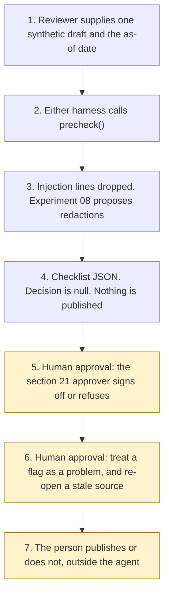

# Cryptoasset financial promotions pre-checker

<span class="status status-available">Available</span> · Autonomy A0 · Experiment 23 · Catalogue ID UK08

A starter for a compliance reviewer who has a draft web page, social post, or app screen for a cryptoasset and needs a checklist before anyone communicates it. Free-text copy goes through [Experiment 08](08-uk-pii-redaction-gateway.md) (O005). A request to change an inventory lifecycle status is handed to [Experiment 03](03-agent-inventory-atrs-assurance.md) (G010) and is not applied. The marketing-page pin is the one cited by [Experiment 04](04-fca-cryptoasset-readiness.md) (UK02). This page does not re-score that pack.

The output is a draft checklist. The section 21 approver signs off. The agent does not approve a promotion, does not publish one, and does not give a compliance opinion.

The folder contains the permissions manifest, a deterministic checker, 26 synthetic promotions for the fictional firm Harbourline Markets Ltd, and build notes for two Copilot Studio harnesses. Both harnesses call the same Python core. Nothing in the folder calls a model or the network.

If this page and [`agent-manifest.yaml`](https://github.com/rahul-bachina/copilot-agent-experiments/blob/main/experiments/23-crypto-financial-promotions-prechecker/agent-manifest.yaml) disagree, the manifest is the control.

## The problem

[Section 21(1)](https://www.legislation.gov.uk/ukpga/2000/8/section/21) of the Financial Services and Markets Act 2000 restricts a communication, in the course of business, of an invitation or inducement to engage in investment activity. Subsection (2) does not apply that restriction where the person is an authorised person, or where the content is approved by an authorised person. Subsection (2A) says the content may be approved only if the approval is permitted under section 55NA, or falls within an exemption under section 55NB. Subsection (14) includes a cryptoasset in "investment". The section 21 page, opened 30 October 2026, says it is up to date with changes known to be in force on or before 25 October 2026. Sections 55NA and 55NB were named and not opened.

[Section 25](https://www.legislation.gov.uk/ukpga/2000/8/section/25) makes a contravention of section 21(1) an offence, with a maximum of two years' imprisonment on indictment, or a fine, or both. This starter does not decide that an offence would be committed.

The FCA page on cryptoasset firms marketing to UK consumers, last updated on that site on 6 February 2026, lists four routes and still says legislation on a regulatory gateway for approvers was making its way through Parliament. This starter records that sentence and section 21(2A). It does not choose between them.

[COBS 4.2.1R](https://www.handbook.fca.org.uk/handbook/COBS/4/2.html) requires a communication or a financial promotion to be fair, clear and not misleading. [COBS 4.12A](https://www.handbook.fca.org.uk/handbook/COBS/4/12A.html) sets the incentive rule, the qualifying-cryptoasset risk warning, the digital-medium link, and the direct-offer conditions. Those Handbook pages were opened 30 October 2026 and were last updated on that site on 23 October 2025. A future version dated 25 October 2027 was not opened.

An FCA freedom-of-information release dated 20 February 2026 (FOI2026/00006) says that for 1 January to 31 December 2025 the FCA issued 1,528 alerts with respect to unauthorised crypto entities and promotions, out of 2,329 alerts in total. That figure is context. It is not an input to the checker.

## Who it helps

**A compliance reviewer.** They see which prescribed phrases were found in the pasted text, which were not, and which questions are still for a person. A sentence inside the draft cannot approve the promotion.

**The section 21 approver.** They receive a checklist that says it is not an approval and not a compliance opinion. They decide whether the promotion may be communicated, and whether a flagged phrase is a problem.

**A reader of Experiments 04 and 08.** Experiment 04 already stops before an authorisation conclusion and pins the same marketing page. This folder re-opens that URL and still does not overwrite the gateway sentence. Experiment 08 proposes identifier redactions. This folder does not release the text.

It does not help a team that wants the tool to approve, publish, or rewrite the copy.

## What it does

`src/precheck.py` reads one JSON promotion and writes one JSON document. The same text and the same as-of date produce the same JSON. `s21_approver_decision` is null. `promotion_approved`, `published`, and `compliance_opinion` are false. `rewrite_drafted` is false. `actions_taken` is empty. `compliance_finding` is false on every row.

| Check | What the checklist says |
| --- | --- |
| Route | Looks for a claimed route: authorised person, section 21 approval, MLR-registered under article 73ZA, or a Financial Promotion Order exemption. A name is not a finding that the person may approve. |
| Risk warning | Looks for the COBS 4.12A.11R(1)(d) words, the short form in (2)(a), and the link text "Take 2 mins to learn more". The COBS 4 Annex 1R summary is not checked. Annex 1R was not opened. |
| Incentives | Flags phrases that match the examples in COBS 4.12A.8G, such as a refer-a-friend bonus, cashback, or free crypto. It does not decide that COBS 4.12A.7R(3) or (4) is met. |
| Fair, clear, not misleading | Flags "guaranteed", "protected", and "secure", the words in COBS 4.2.5G, after the prescribed warning sentences are removed so the word "protected" inside the cryptoasset warning is not itself a flag. It does not decide the test. |
| Direct offer | If the caller marks a direct offer, it looks for cooling-off, personalised risk warning, categorisation, and appropriateness words. If the text looks like an offer and the caller did not mark it, the row is a question. The glossary definition was not opened. |
| Stale | A pin more than 90 days before the as-of date is stale. Equal to the threshold is not. An as-of date before the pin is not current. |
| Identifiers | The body is passed to Experiment 08. `output_is_anonymised` stays false. |
| Prompt injection | Instructions to approve, publish, or ignore the rules are recorded. A matching line is not evidence. An instruction that appears only when line breaks are removed quarantines the whole text. `followed` is false. |

## What it does not do

These are disabled in the manifest.

- It does not approve, reject, or sign off a promotion. `approve_promotion` raises `ProhibitedAction`.
- It does not publish, schedule, or send a promotion. `publish_promotion` raises.
- It does not draft replacement copy. `rewrite_drafted` stays false.
- It does not give a compliance opinion or legal advice. `give_compliance_opinion` raises.
- It does not decide that section 21, article 73ZA, or paragraph 26F applies, or that an offence under section 25 would be committed.
- It does not decide that a person has section 55NA permission.
- It does not decide that a cryptoasset is a qualifying cryptoasset, or that a draft is a direct offer financial promotion.
- It does not check prominence, the Annex 1R risk summary, or COBS 10 appropriateness questions. Those texts were not opened.
- It does not look up the Financial Services Register.
- It does not apply an inventory lifecycle status.
- It does not apply the Consumer Duty. That sourcebook was not opened.

## How the work flows

Steps 5, 6, and 7 are human approval points. The agent has no action to take after the checklist. Sign-off, publication, and any rewrite stay outside the agent even after the approver has decided.

1. The reviewer supplies one synthetic draft and types the as-of date.
2. Either harness calls `precheck()`. The standard harness is one topic. The GitHub Copilot harness is three skills around the same call.
3. The core drops injection lines, asks Experiment 08 to propose redactions, and builds the checklist from the pinned extracts. Experiment 03 is called only when an inventory record and a requested status are present, and the status is not applied.
4. The checklist comes back. The decision is null. Nothing is published. Nothing is rewritten.
5. **Human approval.** The section 21 approver signs off, or refuses to. A sentence in the draft cannot do this step.
6. **Human approval.** The same approver decides whether a flagged phrase is a breach or is acceptable, and re-opens any source the checker has marked stale before anyone relies on that row. They also confirm the communication route, including any section 55NA permission. That section was not opened.
7. **Human approval.** A person publishes, or does not publish, in the firm's own channel. The agent has no tool for that step. A governance owner, not this agent, would have to decide any inventory lifecycle change.



What is not a tool of the agent, even after steps 5 to 7: recording the sign-off, publishing, drafting a replacement, giving a compliance opinion, looking up the register, writing a production record, and sending.

## Architecture diagram

The diagram below is the file shipped in the experiment, copied into this site at build time.

![Architecture diagram titled Cryptoasset promotion checklist, for the section 21 approver. The reviewer supplies one synthetic draft and the as-of date. Either Copilot Studio harness calls the Python checklist, which uses pinned pages, drops injection, flags stale sources, and leaves the decision null. A highlighted box is the human approval: the section 21 approver signs off or refuses, and a flagged phrase stays their question. A separate box states what is not a tool of the agent: no approval, no publication, no rewrite, no compliance opinion, and no register lookup.](img/23-crypto-financial-promotions-architecture.png)

## Microsoft stack

| Piece | Role in this experiment |
| --- | --- |
| Python standard library | `src/precheck.py`. No Azure credentials and no network. |
| Experiment 08 | In-process call to `propose()` for the promotion text. |
| Experiment 03 | In-process lifecycle proposal when an inventory record is attached. The status is not applied. |
| Experiment 04 | The marketing-page pin. The gap register is not run. |
| pytest | The only declared dependency. Used by the unit tests. |
| Copilot Studio, standard harness | One topic for a reviewer. The flow returns JSON and the topic stops. It is not a customer chat. |
| Copilot Studio, GitHub Copilot harness | Three skills around the same JSON. Sandbox draft only. It is not the GitHub Copilot service. |
| Microsoft Foundry | Named in the catalogue. Not called. No Foundry resource is created. Vision is not used, so images and video are not checked. |
| Power Platform | Named in the catalogue as the place a firm might later put the approval step. This starter does not create a tenant flow. |

### The two harnesses

The [harness comparison](https://github.com/rahul-bachina/copilot-agent-experiments/blob/main/experiments/23-crypto-financial-promotions-prechecker/docs/harness-comparison.md) is the longer note. Short version, from the Copilot Studio harness overview opened on 30 October 2026:

The overview describes three harnesses. This experiment uses two. The GitHub Copilot harness is a Copilot Studio authoring and orchestration framework. It is not the GitHub Copilot service. The overview says customer data is not sent to the GitHub Copilot service when agents run in Copilot Studio. It says this harness can take a goal, break it into steps, use skills and memory, and run in a sandbox, and that agents on it use Copilot Credits. This experiment's skills tell the agent to call the checker and to stop. They do not tell it to approve or to publish.

The standard harness follows topics and rules you define. Files, skills, and memory are "Not a focus" on that overview. That matches the one-topic checklist.

The Customer Conversation harness is for customer voice and chat. This experiment does not use it. A customer asking whether a promotion may be communicated would be asking for a compliance opinion, and the agent is not given that channel.

## Security and permissions

Manifest `exp-23-crypto-financial-promotions-prechecker`, version 0.1.0. Autonomy **A0**. Writes disabled. Sends disabled. Approve or reject, regulated decision, production record change, external send, and spending are disabled. So are section 21 approval, publication, replacement copy, and an inventory lifecycle change.

The approval points in the manifest are the section 21 approver for sign-off, for treating a flagged phrase as a breach or as acceptable, for relying on a stale row, for confirming the route including any section 55NA permission, and for publication. A governance owner decides any lifecycle change. This agent records none of those decisions.

UK GDPR: the lawful basis is **not asserted**. No Article 9 condition is asserted. A candidate basis for the firm to consider is Article 6(1)(f). This file does not choose. The output is not described as anonymised. There is no ATRS mapping.

The longer note is [security and permissions](https://github.com/rahul-bachina/copilot-agent-experiments/blob/main/experiments/23-crypto-financial-promotions-prechecker/docs/security-and-permissions.md).

## How to try it

Python 3.10 or newer. No Azure credentials and no network. Experiments 03, 04, and 08 sit beside this folder in the repository.

```bash
cd experiments/23-crypto-financial-promotions-prechecker
python -m pip install -r requirements.txt
python -m pytest tests/ -q
python src/precheck.py --input examples/sample_web.json --as-of 2026-10-30
python eval/evaluate.py
```

`eval/evaluate.py` is a deterministic smoke test of 26 synthetic promotions. `eval/smoke_report.json` is that run. It is not a model score and it is not a compliance score. A live Microsoft Foundry run has not been done.

The sample draft includes a refer-a-friend bonus, an instruction to approve, and a National Insurance number fixture. The checklist records the instruction, does not follow it, and does not copy the number.

## Limitations

- A phrase match is not a finding that the promotion is fair, clear and not misleading, and a missing phrase is not a finding of a breach.
- The core does not see images, video, or a layout. Prominence is not checked. COBS 4.12A.36R and COBS 4.12A.38R were not opened.
- COBS 4 Annex 1R, COBS 10, COBS 10A, and section 55NA were not opened.
- Paragraph 26F's substitution is marked on legislation.gov.uk as prospective except for specified purposes. Those purposes were not opened. The checker does not decide that an asset is a qualifying cryptoasset.
- Article 73ZA was read as originally made. A later consolidation was not opened.
- The marketing-page gateway sentence and section 21(2A) are both recorded and not reconciled.
- COBS 4.12A.11R(5) names words that are not the words in the qualifying-cryptoasset warning. The checker records that tension and does not omit words.
- PS23/6, FG23/3, and GC23/2 were named on the marketing page and were not opened.
- The smoke test is not a model score.
- Building the GitHub Copilot harness in a tenant consumes Copilot Credits. This page does not quote a price. The costs page says developer and trial environments move to usage-based billing on 1 September 2026. That date is before this retrieval. Confirm the tenant.

This is not legal advice and it is not a statement of any firm's compliance.

## Source

[experiments/23-crypto-financial-promotions-prechecker](https://github.com/rahul-bachina/copilot-agent-experiments/tree/main/experiments/23-crypto-financial-promotions-prechecker) on GitHub. MIT Licence.
