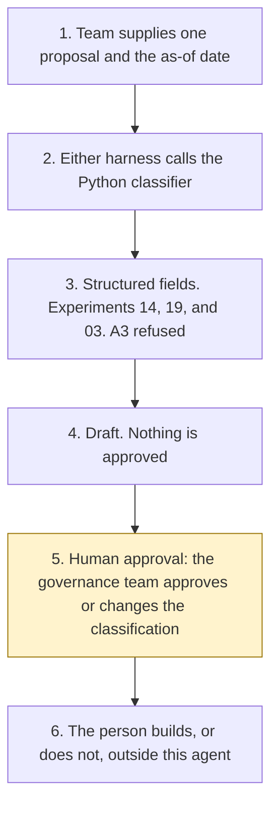

# Agent use-case intake

<span class="status status-available">Available</span> · Autonomy A1 · Experiment 24 · Catalogue ID G001

A starter for a business team that has an idea for an agent and needs one structured draft for the governance team. The team records the problem, the users, the data, whether personal or special-category data is involved, the decisions affected, the autonomy they want, and the systems the idea would touch.

The draft suggests an autonomy level of A0, A1, or A2, a risk tier for the queue, whether a DPIA is indicated on the answers recorded, whether an ATRS record is indicated for public-sector use, and which catalogue pattern or existing experiment the idea resembles. **The governance team approves the intake classification, or changes it.** The agent does not approve the use case and does not provision anything.

The folder contains the permissions manifest, a deterministic classifier, 18 synthetic cases, and build notes for two Copilot Studio harnesses. Both harnesses call the same Python core. The core calls [Experiment 14](14-agent-architecture-advisor.md) for the autonomy table, [Experiment 19](19-privacy-impact-assessment.md) for the DPIA screen, and [Experiment 03](03-agent-inventory-atrs-assurance.md) for an ATRS applicability note. Nothing in the folder calls a model or the network.

If this page and [`agent-manifest.yaml`](https://github.com/rahul-bachina/copilot-agent-experiments/blob/main/experiments/24-agent-use-case-intake/agent-manifest.yaml) disagree, the manifest is the control.

## The problem

Teams arrive with an agent idea before anyone has said what it would be allowed to do. Governance then reconstructs the same facts from a slide: whose data, which decision, whether the team wants the agent to act on its own, and whether a DPIA or an ATRS record belongs in the conversation.

[UK GDPR Article 35(1)](https://www.legislation.gov.uk/eur/2016/679/article/35), opened on 30 October 2026, is the overarching test: where a type of processing is likely to result in a high risk to the rights and freedoms of natural persons, the controller shall, prior to the processing, carry out an assessment. Article 35(3) says an assessment shall in particular be required in three listed cases. This starter does not decide that the test is met. `dpia_required` stays null.

The [ATRS guidance](https://www.gov.uk/government/publications/guidance-for-organisations-using-the-algorithmic-transparency-recording-standard/algorithmic-transparency-recording-standard-guidance-for-public-sector-bodies), opened the same day, says the standard is mandatory for all government departments, and for ALBs which deliver public or frontline services or directly interact with the general public, and, within those organisations, for tools which have a significant influence on a decision-making process with public effect, or which directly interact with the general public. It also says the standard is recommended by the Data Standards Authority across the public sector. This starter does not decide mandatory scope.

## Who it helps

**A business team** that can fill a structured form and wants a draft back, rather than a yes. The same proposal and the same as-of date produce the same JSON.

**A governance team** that has to approve or change the classification before anyone builds. A privacy officer decides whether a DPIA indication is a reason to start a DPIA.

**A reader of Experiments 03, 14, and 19.** Those folders already stop before an approval. This folder calls them and still does not approve.

It does not help a team that wants the tool to approve the idea or to create the agent.

## What it does

`src/classify.py` reads one JSON proposal and writes one JSON document. The label is DRAFT FOR THE GOVERNANCE TEAM. `approved` is false. `provisioned` is false. `governance_decision` is null. `actions_taken` is empty.

| Draft field | Where it comes from |
| --- | --- |
| Suggested autonomy | Experiment 14's decision table. A request for A3 is flagged out of scope. The suggested level is never A3. |
| Risk tier | A queueing heuristic in `src/risk.py`. It is not an ICO score and not an Orange Book assessment. The Orange Book was not opened. |
| DPIA | Experiment 19's screen, passed the team's recorded yes, no, or unknown answers. A special-category flag does not invent a trigger. |
| ATRS | The guidance sentences above, plus Experiment 03's applicability note. A council, a police force, or another wider public body is a recommendation, not a finding that the body is on the mandatory organisation list. |
| Resemblance | A recorded hint, or a single keyword hit, against experiments already in this repository. Two hits are listed and not ranked. |

Free text is not an input to those rules. Instructions in the problem statement are recorded and not followed.

The sample is Northmere Borough Council, which is fictional. It is an internal draft of hazard wording. No consequential action is recorded, so Experiment 14's table suggests A0 even though the team asked for A1. The governance team can change that. This agent does not.

## What it does not do

These are disabled in the manifest.

- It does not approve a use case, reject a use case, or record that the governance team has done either.
- It does not provision, deploy, publish, or create a Copilot Studio agent, a Power Automate flow, a Dataverse table, or a Microsoft Foundry resource.
- It does not suggest autonomy A3.
- It does not decide that Article 35 requires a DPIA. A recorded "no" on every screen answer is not a finding that Article 35(1) does not apply.
- It does not decide that an organisation or a tool is inside the ATRS mandatory scope, and it does not email a record.
- It does not select a platform. `platform_selected` stays null.
- It does not call Experiment 03's manifest generator. That generator needs packages this experiment's tests do not install, and it cannot mark a manifest approved.
- It does not write a production record or send a message.
- It does not look up a licence, a system, or a live policy.

## How the work flows

Step 5 is the governance team's approval. The agent has no action to take after the draft. Approving the use case, provisioning an agent, starting a DPIA, and sending an ATRS record stay outside the agent even after that approval.

1. The team supplies one proposal and types the as-of date.
2. Either harness calls `classify()`. The standard harness is one topic. The GitHub Copilot harness is three skills around the same call.
3. Structured fields go to Experiments 14, 19, and 03. A request for autonomy A3 is refused as a suggestion. No model is called and no network call is made.
4. The draft comes back. Nothing is approved. Nothing is provisioned.
5. **Human approval.** The governance team approves or changes the intake classification. A privacy officer decides whether a DPIA indication is a reason to start a DPIA. The governance team decides whether an ATRS indication is a reason to draft a record. If a pin is stale, they re-open the page before anyone relies on it.
6. A person builds, or does not build, outside this agent.



What is not a tool of the agent, even after step 5: approving or rejecting the use case, provisioning or deploying an agent, deciding that a DPIA is required, deciding ATRS mandatory scope, emailing an ATRS record, selecting a platform, writing a production record, and sending a message.

## Architecture diagram

The diagram below is the file shipped in the experiment, copied into this site at build time.

![Architecture diagram titled Agent use-case intake, draft classification for one proposal. The business team supplies the problem, users, data, decisions, autonomy wanted, systems, and the as-of date. Either Copilot Studio harness calls the Python classifier, which uses structured fields, calls Experiments 14, 19, and 03, and refuses autonomy A3. A highlighted box is the human approval: the governance team approves or changes the intake classification, a privacy officer decides whether to start a DPIA, and a stale citation is re-opened before anyone relies on it. A separate box states what is not a tool of the intake: no use case is approved, nothing is provisioned, no ATRS email is sent, no DPIA is determined, and there is no production write and no send.](img/24-agent-use-case-intake-architecture.png)

## Microsoft stack

| Piece | Role in this experiment |
| --- | --- |
| Python standard library | `src/classify.py`. No Azure credentials and no network. |
| Experiment 14 | In-process call to `rules.score` for suggested autonomy. The advisor's platform selection is not used. `platform_selected` stays null. |
| Experiment 19 | In-process call to `screen()` on the team's recorded answers. |
| Experiment 03 | In-process call to `draft_atrs` and `screen_duaa` when the organisation kind is recognised. The manifest generator is not called. |
| pytest | The only declared dependency. Used by the unit tests. |
| Copilot Studio, standard harness | One topic. The team points at a proposal, the topic returns JSON, and it stops. |
| Copilot Studio, GitHub Copilot harness | Three skills around the same JSON. Sandbox draft only. It is not the GitHub Copilot service. |
| Microsoft Foundry | Optional narrative over the JSON only. No Foundry resource is created. The Agent Service page was not re-opened for this experiment. |
| Power Platform | A flow note that returns JSON and stops. No Dataverse write and no connector that provisions an agent. |

### The two harnesses

The [harness comparison](https://github.com/rahul-bachina/copilot-agent-experiments/blob/main/experiments/24-agent-use-case-intake/docs/harness-comparison.md) is the longer note. Short version, from the Copilot Studio harness overview opened on 30 October 2026:

The GitHub Copilot harness is a Copilot Studio authoring and orchestration framework. It is not the GitHub Copilot service. The overview says customer data is not sent to the GitHub Copilot service when agents run in Copilot Studio. It says this harness is for reasoning-heavy, multi-step work, with skills and memory, file creation, and a sandbox, and that agents on it use Copilot Credits. The overview does not mark the harness as preview. This experiment's skills tell the agent to call `classify` and to stop. They do not tell it to approve a use case. Whether memory can be switched off was not on the page. The skills say not to store the proposal.

The standard harness is described for rule-based agents and agent flows. That matches the one-topic intake. There is no skill on that path.

The Customer Conversation harness is on the same overview, for customer voice and chat, using Copilot Credits. This experiment does not use it.

The licensing article linked from the overview was not opened. No price is copied.

## Security and permissions

Manifest `exp-24-agent-use-case-intake`, version 0.1.0. Autonomy **A1**. Writes disabled. Sends disabled. Approving or rejecting a decision, changing a production record, sending externally, and spending are disabled. So are approving the classification, provisioning an agent, and marking an ATRS or DPIA record submitted.

The approval points in the manifest are the governance team for the classification, a privacy officer for treating a DPIA indication as a reason to start a DPIA, the governance team for treating an ATRS indication as a reason to draft a record, and the governance team for re-opening a stale pin. This agent records none of those decisions.

UK GDPR: the lawful basis is **not asserted**. Article 6 was not opened for this experiment. No Article 9 condition is asserted. A proposal that is not marked synthetic is refused, and the body is not copied. There is no ATRS mapping that this agent submits.

Entra Agent ID, Conditional Access, data loss prevention, Microsoft Foundry prompt shields, Key Vault, Purview, and Application Insights were not opened for this experiment. They are unverified here and not configured.

The longer note is [security and permissions](https://github.com/rahul-bachina/copilot-agent-experiments/blob/main/experiments/24-agent-use-case-intake/docs/security-and-permissions.md).

## How to try it

Python 3.10 or newer. No Azure credentials and no network. Experiments 03, 14, and 19 sit beside this folder in the repository.

```bash
cd experiments/24-agent-use-case-intake
python -m pip install -r requirements.txt
python -m pytest tests/ -q
python src/classify.py --input examples/sample_proposal.json --as-of 2026-10-30
python eval/evaluate.py
```

`eval/evaluate.py` is a deterministic smoke test of 18 synthetic cases. `eval/smoke_report.json` is that run. It is not a model score. A live Microsoft Foundry run has not been done.

The sample proposal asks for autonomy A1 and records no consequential action. The draft suggests A0. That difference is for the governance team.

## Limitations

- The risk tier is a queue. It is not a DPIA and not an Orange Book score.
- `dpia_likely_needed` follows Experiment 19's recorded answers. `dpia_required` is never set. Article 35(10) and Article 35(11) are on the legislation page and are not applied.
- `atrs_likely_needed` follows the guidance sentences opened on 30 October 2026. The scope and exemptions policy was not opened. A recommendation for the wider public sector is not a mandatory-scope finding.
- Resemblance is a recorded hint or a keyword hit. It is not a measure of similarity.
- Experiment 14's suggested autonomy can differ from the autonomy the team asked for. This agent does not resolve it.
- The licensing article and the harness comparison page were not opened on 30 October 2026. No price is quoted.
- The smoke test is not a model score.
- The samples are synthetic. Northmere Borough Council is not a real authority.

This is not legal advice and it is not a statement of any organisation's compliance.

## Source

[experiments/24-agent-use-case-intake](https://github.com/rahul-bachina/copilot-agent-experiments/tree/main/experiments/24-agent-use-case-intake) on GitHub. MIT Licence.
