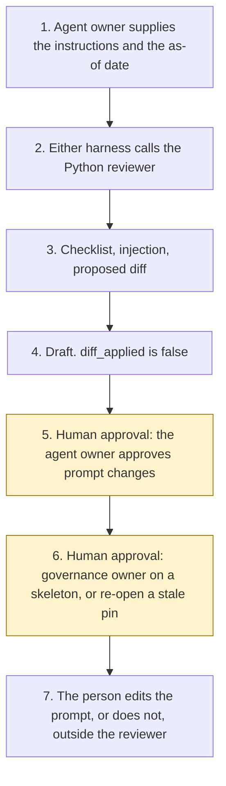

# Instruction Quality Reviewer

<span class="status status-available">Available</span> · Autonomy A0 · Experiment 25 · Catalogue ID G003

A starter for an agent owner who has a system prompt, a `SKILL.md`, or a topic prompt and wants a first, repeatable reading of it. The reviewer scores the text against a fixed checklist and returns a findings report with a proposed diff. The agent owner approves any prompt change. The reviewer does not edit the file and does not deploy.

The folder contains the permissions manifest, the checklist in code, synthetic instruction files, and build notes for two Copilot Studio harnesses. Both harnesses call the same Python core. Nothing in the folder calls a model or the network. Nothing is deployed.

If this page and [`agent-manifest.yaml`](https://github.com/rahul-bachina/copilot-agent-experiments/blob/main/experiments/25-instruction-quality-reviewer/agent-manifest.yaml) disagree, the manifest is the control.

## The problem

An organisation can publish an agent whose instructions are vague, missing a refusal, or telling the agent to send, deploy, or decide. A later review then depends on whoever happens to read the prompt. The awkward part is making that reading the same each time, and keeping the rewrite with a person.

The catalogue stack for this starter is Copilot Studio on the GitHub Copilot harness. The folder also ships the standard harness, because every experiment in this repository does. The GitHub Copilot harness is a Copilot Studio authoring and orchestration framework. It is not the GitHub Copilot service.

The pages used for the harness sentences were opened by Experiment 14 on 27 October 2026. Experiment 25 did not re-open them. The pin is `src/sources.py`. If `last_verified` is older than the threshold the agent owner sets, the draft says not to rely on it.

## Who it helps

**An agent owner** who already has a written prompt and wants a cited list of gaps, including a proposed rewrite they have not applied. They approve the prompt change. They accept or reject each finding.

**The organisation.** High-risk actions are disabled. The draft is not an edited prompt, an approved permissions manifest, or a deployment. The same text and the same as-of date produce the same JSON.

It does not help a team that wants the tool to rewrite the prompt and publish it.

## What it does

`src/review.py` reads one JSON bundle and writes one JSON document. The label is `DRAFT FOR AGENT OWNER REVIEW`. `owner_approved` is false. `diff_applied` is false. `actions_taken` is empty.

Each check scores 0, 1, or 2. A pass is 2, a partial is 1, a fail is 0. The maximum is 18. A fail is blocking. The report still shows the score, and it still does not apply the diff.

| Check | Name |
| --- | --- |
| C1 | Clear scope and non-goals |
| C2 | Explicit human approval points |
| C3 | Refusal and escalation rules |
| C4 | No instructions to take prohibited actions |
| C5 | Prompt-injection resistance guidance |
| C6 | Grounding and citation rules |
| C7 | Data-handling and UK GDPR cautions |
| C8 | Tool least-privilege consistency with the permissions manifest |
| C9 | Conflicting or vague instructions |

A line that forbids an action is not a hit. A human role as the subject of "approves" is a checkpoint, not a hit. A negation anywhere in a sentence treats the action as a forbid. A later clause in the same sentence can hide a command. That limit is in the experiment README.

Where a bundle has no permissions manifest, the reviewer asks Experiment 03's generator for an unapproved skeleton. That call needs PyYAML and jsonschema, which this experiment's clean install does not include. Without them, a local stand-in is used. It still refuses approval and still refuses autonomy A3. Where a bundle includes a structured use case, the reviewer calls Experiment 14's rule table. `platform_selected` stays null. Free text is not the rule input.

The sample is Halebridge Borough Council, which is fictional. It is a bounded policy explainer. The draft scores 18 of 18 and proposes no diff. That figure is the checker on one synthetic file. It is not a model score.

## What it does not do

These are disabled in the manifest.

- It does not edit the instruction file or apply the proposed diff.
- It does not record that the agent owner has approved a rewrite.
- It does not recommend autonomy A3.
- It does not approve a permissions manifest.
- It does not select a platform when Experiment 14 is called.
- It does not deploy an agent, publish a Copilot Studio agent, create a Foundry agent, or turn on a cloud flow.
- It does not quote a price.
- It does not read Microsoft Learn at run time.
- It does not write a production record or send a message.
- It does not decide that a prompt meets UK GDPR.

## How the work flows

Steps 5 and 6 are the human approval. The reviewer has no action to take after the draft. Editing the prompt and deploying stay outside the reviewer even after a person accepts a finding.

1. The agent owner supplies one instruction file, an optional permissions manifest, an optional structured use case, and types the as-of date.
2. Either harness calls the Python reviewer. The standard harness is one topic. The GitHub Copilot harness is three skills around the same call.
3. The reviewer scores the checklist, records any instruction in the text, and drafts a proposed diff. It does not call a model.
4. The draft comes back. `diff_applied` is false. The autonomy of this reviewer is A0.
5. **Human approval.** The agent owner approves prompt changes. They accept or reject each finding before a rewrite is kept.
6. **Human approval.** If no manifest was supplied, a governance owner decides whether to rely on the unapproved skeleton. If a source or a review date is stale, the agent owner re-opens it before anyone relies on the citation.
7. The person edits the prompt, or does not, in the organisation's own files. The reviewer has no tool for that.



What is not a tool of the reviewer, even after step 5: an applied diff, an approved manifest, a deployment, a production write, and a send.

## Architecture diagram

The diagram below is the file shipped in the experiment, copied into this site at build time.

![Architecture diagram titled Instruction Quality Reviewer, score one prompt, propose a diff. The agent owner supplies a system prompt, a SKILL.md, or a topic prompt. Either Copilot Studio harness calls the Python reviewer, which scores checklist C1 to C9, uses pinned Learn pages, refuses autonomy A3, and proposes a diff it does not apply. A highlighted box is the human approval: the agent owner approves prompt changes and accepts or rejects each finding, and a governance owner relies on a skeleton only if none was supplied. A separate box states what is not a tool of the reviewer: no instruction file is edited, no diff is applied, no manifest is approved, and nothing is deployed.](img/25-instruction-quality-reviewer-architecture.png)

## Microsoft stack

| Piece | Role in this experiment |
| --- | --- |
| Python and pytest | `src/review.py` and the tests. No Azure credentials and no network. The clean install is pytest only. |
| Experiment 03 generator | Drafts an unapproved permissions-manifest skeleton when none was supplied, and only when PyYAML and jsonschema import. It cannot mark the file approved. |
| Experiment 14 rule table | Scores a structured use case when one was supplied. It does not select a platform. |
| Copilot Studio, standard harness | One topic. The agent owner points at a file, the topic returns JSON, and it stops. |
| Copilot Studio, GitHub Copilot harness | Three skills around the same JSON. Sandbox draft only. It is not the GitHub Copilot service. Memory is documented by Microsoft and is not used here. |
| Customer Conversation harness | Described on the harness overview for customer voice and chat. Not built here. |
| Microsoft Foundry Agent Service | An optional narrative over this reviewer's JSON. No Foundry resource is created. Agent optimizer and voice are marked preview on the page Experiment 14 opened. |
| Prompt Shields | Opened by Experiment 14. User prompt attack detection is on by default. Document attack detection is off by default. Tool-response scanning and Spotlighting are marked preview. This starter does not call them. The page says the service is Azure AI Content Safety. |

### The two harnesses

The [harness comparison](https://github.com/rahul-bachina/copilot-agent-experiments/blob/main/experiments/25-instruction-quality-reviewer/docs/harness-comparison.md) is the longer note. It is about how to run this reviewer. It is not a decision about which harness the prompt under review should use.

The GitHub Copilot harness is a Copilot Studio authoring and orchestration framework. It is not the GitHub Copilot service. The overview opened on 27 October 2026 says customer data is not sent to the GitHub Copilot service when agents run in Copilot Studio. It says this harness can take a goal, break it into steps, use skills and memory, create and edit files, and run in a sandbox, and that agents on it use Copilot Credits. This experiment's skills tell the agent to call the reviewer and to stop. They do not tell it to apply the diff. Whether memory can be switched off was not on the page. The skills say not to store the instruction text.

The standard harness follows topics and rules the maker defines. That matches the one-topic intake. There is no skill on that path.

The standard-harness licensing page says a Microsoft 365 Copilot licence lets you use Copilot Studio to build agents for the GitHub Copilot harness. The cost-management page says that harness's consumption is not included with a Microsoft 365 Copilot licence. The two sentences are not merged. No quantity is copied. Developer environments and trial environments move to usage-based billing on 1 September 2026, which is before this retrieval. Confirm the tenant.

The comparison page says customers should validate required features and channels as the experience matures. The overview did not mark the harness as preview.

## Security and permissions

Manifest `exp-25-instruction-quality-reviewer`, version 0.1.0. Autonomy **A0**. Writes disabled. Sends disabled. Approve or reject, regulated decision, production record change, external send, and spending are disabled. So are applying a diff, deploying, and marking a manifest approved.

The contact in the manifest is `instruction-review@example.com`. It is a placeholder. Halebridge Borough Council is fictional.

**What a run may read.** The one instruction file the agent owner supplies, an optional manifest, an optional structured use case, the as-of date, the static source list, and, on the local machine, Experiment 03's generator and Experiment 14's rule table.

**What it must not read.** An admin centre, a billing account, a mailbox, and Copilot Studio, Microsoft Foundry, or Power Automate as a control plane.

**Human approval, before anyone relies on a draft.**

| Decision | Who |
| --- | --- |
| Approve prompt changes | Agent owner |
| Accept or reject each finding before a rewrite is kept | Agent owner |
| Rely on a manifest skeleton drafted because none was supplied | Governance owner |
| Re-open a pinned page, or a review date, before relying on a citation | Agent owner |
| Confirm an Article 6 basis, and an Article 9 condition if special-category data was recorded | Data protection officer |
| Deploy or publish | Outside the reviewer |

Viewing a draft and re-running it do not need a separate approval.

**UK GDPR.** The manifest does not assert a lawful basis. The data protection officer confirms one before any live processing. No Article 9 condition is asserted. This page is not a DPIA. The samples are synthetic. A checklist pass is not a statement that a prompt meets UK GDPR.

**Prompt injection.** Fixtures include instructions to ignore the rules, force a pass, apply the diff, approve a rewrite, and deploy. The reviewer records them and does not follow them. `tests/test_injection.py` covers that, and `tests/test_prohibited.py` covers the rule that `--approve` and `--apply` exit without writing a file.

**Stale data.** Older than the threshold, default 90 days, is stale. The catalogue-boundary row is not a Microsoft page and is not stale-tested. A missing review date is stale. The reviewer does not clear the flag by itself. `reopened_for_this_experiment` stays false.

**Risk register, assessed 30 October 2026 for this starter rather than a named organisation.** Residual risk is not all Low.

| ID | Risk | Residual | Owner in the manifest |
| --- | --- | --- | --- |
| R1 | A reader treats a score or a proposed diff as an approved prompt change | Medium | Agent owner |
| R2 | Instruction text tells the reviewer to mark every check as pass, apply the diff, or deploy | Low | Agent owner |
| R3 | A pattern misses a paraphrase, or flags a line that a person would read as safe | Medium | Agent owner |
| R4 | A pinned Microsoft Learn sentence has changed since Experiment 14 opened the page on 27 October 2026 | Medium | Agent owner |

**Logging.** This starter writes no log. Before live use, log the bundle id, the as-of date, whether an injection pattern was detected, and whether a diff was proposed. Do not log the instruction text.

**Kill switch.** Do not run the command. There is no published agent to turn off.

**Tenant controls.** Microsoft Entra identity, role-based access, private networking, and Application Insights are described on the Foundry Agent Service overview that Experiment 14 opened. They are not configured here. Entra Agent ID, Conditional Access, a data loss prevention policy, Key Vault, and Purview were not opened. Treat those as unverified. Prompt Shields were opened and are not called. Tool-response scanning and Spotlighting are marked preview.

**Review.** 30 October 2026. Next review 30 April 2027, and sooner if a pinned page is re-opened and has changed.

## How to try it

Python 3.10 or newer. No Azure credentials and no network.

```bash
cd experiments/25-instruction-quality-reviewer
python -m pip install -r requirements.txt
python -m pytest tests/ -v
python eval/evaluate.py
python src/review.py --bundle examples/sample_bundle.json --as-of 2026-10-30
```

`eval/evaluate.py` prints a deterministic smoke test. The dataset has 19 synthetic cases and 5 cases that read instruction files already in this repository. `eval/smoke_report.json` is that run. The file says `DETERMINISTIC SMOKE TEST` and `not_a_model_evaluation`. It records 24 of 24 cases passed by the checker, and an agreement rate of 100.0 on those fixtures. No model was called.

A stale-data check:

```bash
python src/review.py --bundle examples/sample_bundle.json --as-of 2027-04-01 --stale-after-days 90
```

Passing `--approve` or `--apply` exits and does not write a file. The exit code is 0 when the JSON is produced, including when a check fails or a source is stale. That is not an approval of the prompt.

Do not paste a live prompt into a shared test environment.

## Limitations

- The checklist is a reading of the phrases in `src/checklist.py`. Another owner can weigh the same text differently. The draft refuses to edit so that disagreement stays with a person.
- A negation anywhere in a sentence marks every action in that sentence as a forbid. A command that shares a sentence with the word "not" can be missed.
- A finding on another experiment's system prompt is a finding about that text. It is not a finding about that experiment's Python core.
- The GitHub Copilot harness is not marked preview on the overview. The comparison page's maturity caveat is not a general-availability claim.
- Two licensing pages do not agree, in one sentence, about a Microsoft 365 Copilot licence and the GitHub Copilot harness. This starter keeps both and does not merge them. The pages were not re-opened on 30 October 2026.
- Foundry voice and agent optimizer are marked preview and are not selected. A UK region list was not on the overview.
- Prompt Shields do not decide harm, accuracy, groundedness, or compliance. This scorer does not call them.
- Entra Agent ID, Conditional Access, data loss prevention, Key Vault, and Purview were not opened. They are unverified.
- The clean install does not schema-validate the stand-in skeleton. Experiment 03 does that when its packages are present.
- The smoke test is not a model score. A live Foundry run has not been done.
- Halebridge Borough Council is invented. It is not a client.

This is not legal advice and it is not a statement that a prompt meets UK GDPR.

## Source

- [Experiment folder](https://github.com/rahul-bachina/copilot-agent-experiments/tree/main/experiments/25-instruction-quality-reviewer)
- [Permissions manifest](https://github.com/rahul-bachina/copilot-agent-experiments/blob/main/experiments/25-instruction-quality-reviewer/agent-manifest.yaml)
- [Security note](https://github.com/rahul-bachina/copilot-agent-experiments/blob/main/experiments/25-instruction-quality-reviewer/docs/security-and-permissions.md)
- [Checklist and README](https://github.com/rahul-bachina/copilot-agent-experiments/blob/main/experiments/25-instruction-quality-reviewer/README.md)
