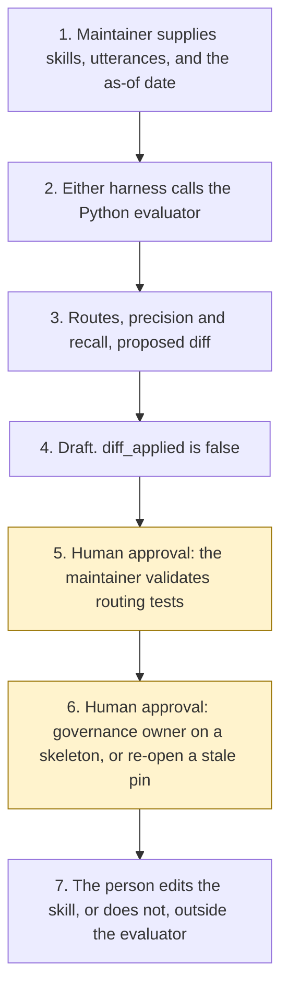

# Skill selection evaluator

<span class="status status-available">Available</span> · Autonomy A0 · Experiment 26 · Catalogue ID G004

A starter for a maintainer who has a set of agent skills or topics, and a labelled set of utterances, and wants a first, repeatable reading of whether the right skill would be selected. The evaluator returns a routing test suite and a report: precision and recall, confusable pairs, utterances that route to no skill or to a person, and a proposed description diff. The maintainer validates routing tests. The evaluator does not edit a skill and does not deploy.

The folder contains the permissions manifest, the router in code, synthetic skills and utterances, and build notes for two Copilot Studio harnesses. Both harnesses call the same Python core. Nothing in the folder calls a model or the network. Nothing is deployed.

If this page and [`agent-manifest.yaml`](https://github.com/rahul-bachina/copilot-agent-experiments/blob/main/experiments/26-skill-selection-evaluator/agent-manifest.yaml) disagree, the manifest is the control.

## The problem

An organisation can publish an agent whose skills overlap, or whose descriptions are too vague to select. A later review then depends on whoever happens to try a few sentences. The awkward part is making that reading the same each time, and keeping the rewrite with a person.

The catalogue stack for this starter is Copilot Studio on the GitHub Copilot harness. The folder also ships the standard harness, because every experiment in this repository does. The GitHub Copilot harness is a Copilot Studio authoring and orchestration framework. It is not the GitHub Copilot service.

The router is a trigger phrase and a token overlap. It is not the live skill selector inside Copilot Studio, and it is not a model. The pages used for the harness sentences were opened by Experiment 14 on 27 October 2026. Experiment 26 did not re-open them. The pin is `src/sources.py`. If `last_verified` is older than the threshold the maintainer sets, the draft says not to rely on it.

## Who it helps

**A maintainer** who already has skill or topic metadata and a labelled set of utterances, and wants a cited list of routes, including a proposed rewrite they have not applied. They validate the routing tests. They accept or reject each description rewrite.

**The organisation.** High-risk actions are disabled. The draft is not an edited skill, an approved permissions manifest, or a deployment. The same files and the same as-of date produce the same JSON.

It does not help a team that wants the tool to rewrite the skills and publish them.

## What it does

`src/report.py` reads one JSON bundle and writes one JSON document. The label is `DRAFT FOR MAINTAINER REVIEW`. `maintainer_validated` is false. `diff_applied` is false. `skills_edited` is false. `actions_taken` is empty.

A route is `skill:<id>`, `none`, or `human`. A declared trigger phrase scores 5. Two or more shared description tokens score 1 each. A tie routes to a person. A prohibited-action request routes to a person even when a trigger also matches. A prompt-injection sentence that names a skill is dropped before scoring. The named skill gets no bonus.

Each skill file is also passed to [Experiment 25](25-instruction-quality-reviewer.md). Where no permissions manifest was supplied, the evaluator asks [Experiment 03](03-agent-inventory-atrs-assurance.md) for an unapproved skeleton. That call needs PyYAML and jsonschema, which this experiment's clean install does not include. Without them, a local stand-in is used. It still refuses approval and still refuses autonomy A3. Where a bundle includes a structured use case, the evaluator calls [Experiment 14](14-agent-architecture-advisor.md). `platform_selected` stays null.

The sample is Northfen Borough Council, which is fictional. On the as-of date 2 November 2026 the draft agrees with all 19 labels in that file. The two housing skills are a confusable pair. The vague helper is a missing description. That figure is the checker on one synthetic catalogue. It is not a model score and it is not a Copilot Studio routing score.

A second case reads five `SKILL.md` files already in this repository. Two utterances are labelled for the hazard skill and the router does not select it, because those words are not in the description. Agreement on that case is 12 of 14, which is 85.7 percent. The disagreement is the finding. `eval/smoke_report.json` records both cases and says `DETERMINISTIC SMOKE TEST`.

## What it does not do

These are disabled in the manifest.

- It does not edit a skill, a topic, or a trigger list.
- It does not record that the maintainer has validated the routing tests.
- It does not recommend autonomy A3.
- It does not approve a permissions manifest.
- It does not select a platform when Experiment 14 is called.
- It does not deploy an agent, publish a Copilot Studio agent, create a Foundry agent, or turn on a cloud flow.
- It does not quote a price.
- It does not read Microsoft Learn at run time.
- It does not write a production record or send a message.
- It does not decide that a skill catalogue meets UK GDPR.
- It does not claim that a live Copilot Studio agent would select the same skill.

## How the work flows

Steps 5 and 6 are the human approval. The evaluator has no action to take after the draft. Editing a skill and deploying stay outside the evaluator even after a person accepts a finding.

1. The maintainer supplies skill or topic metadata, a labelled set of utterances, an optional permissions manifest, an optional structured use case, and types the as-of date.
2. Either harness calls the Python evaluator. The standard harness is one topic. The GitHub Copilot harness is three skills around the same call.
3. The evaluator scores routes, records any instruction in an utterance, and drafts a proposed description diff. It does not call a model.
4. The draft comes back. `diff_applied` is false. The autonomy of this evaluator is A0.
5. **Human approval.** The maintainer validates routing tests. They accept or reject each description rewrite before it is kept.
6. **Human approval.** If no manifest was supplied, a governance owner decides whether to rely on the unapproved skeleton. If a source or a review date is stale, the maintainer re-opens it before anyone relies on the citation.
7. The person edits the skill, or does not, in the organisation's own files. The evaluator has no tool for that.



What is not a tool of the evaluator, even after step 5: an applied diff, an edited skill, a validated test suite, an approved manifest, a deployment, a production write, and a send.

## Architecture diagram

The diagram below is the file shipped in the experiment, copied into this site at build time.

![Architecture diagram titled Skill Selection Evaluator, route a labelled set, propose a diff. The maintainer supplies skill or topic metadata and labelled utterances. Either Copilot Studio harness calls the Python evaluator, which scores precision and recall, finds confusable pairs, refuses to follow a prompt injection, and sends a prohibited request to a person. A highlighted box is the human approval: the maintainer validates routing tests and accepts or rejects each description rewrite, and a governance owner relies on a skeleton only if none was supplied. A separate box states what is not a tool of the evaluator: no skill file is edited, no diff is applied, no test is marked validated, no manifest is approved, and nothing is deployed.](img/26-skill-selection-evaluator-architecture.png)

## Microsoft stack

| Piece | Role in this experiment |
| --- | --- |
| Python and pytest | `src/report.py` and the tests. No Azure credentials and no network. The clean install is pytest only. |
| Experiment 25 reviewer | Scores each skill file as instructions. It does not apply its diff. |
| Experiment 03 generator | Drafts an unapproved permissions-manifest skeleton when none was supplied, and only when PyYAML and jsonschema import. It cannot mark the file approved. |
| Experiment 14 rule table | Scores a structured use case when one was supplied. It does not select a platform. |
| Copilot Studio, standard harness | One topic. The maintainer points at the files, the topic returns JSON, and it stops. |
| Copilot Studio, GitHub Copilot harness | Three skills around the same JSON. Sandbox draft only. It is not the GitHub Copilot service. Memory is documented by Microsoft and is not used here. |
| Customer Conversation harness | Described on the harness overview for customer voice and chat. Not built here. |
| Microsoft Foundry Agent Service | An optional narrative over this evaluator's JSON. No Foundry resource is created. Agent optimizer and voice are marked preview on the page Experiment 14 opened. |
| Prompt Shields | Opened by Experiment 14. User prompt attack detection is on by default. Document attack detection is off by default. Tool-response scanning and Spotlighting are marked preview. This starter does not call them. The page says the service is Azure AI Content Safety. |

### The two harnesses

The [harness comparison](https://github.com/rahul-bachina/copilot-agent-experiments/blob/main/experiments/26-skill-selection-evaluator/docs/harness-comparison.md) is the longer note. It is about how to run this evaluator. It is not a decision about which harness a skill under review should use.

The GitHub Copilot harness is a Copilot Studio authoring and orchestration framework. It is not the GitHub Copilot service. The overview opened on 27 October 2026 says customer data is not sent to the GitHub Copilot service when agents run in Copilot Studio. It says this harness can take a goal, break it into steps, use skills and memory, create and edit files, and run in a sandbox, and that agents on it use Copilot Credits. This experiment's skills tell the agent to call the evaluator and to stop. They do not tell it to apply the diff. Whether memory can be switched off was not on the page. The skills say not to store the skill text.

The standard harness follows topics and rules the maker defines. That matches the one-topic intake. There is no skill on that path.

The standard-harness licensing page says a Microsoft 365 Copilot licence lets you use Copilot Studio to build agents for the GitHub Copilot harness. The cost-management page says that harness's consumption is not included with a Microsoft 365 Copilot licence. The two sentences are not merged. No quantity is copied. Developer environments and trial environments move to usage-based billing on 1 September 2026, which is before this retrieval. Confirm the tenant.

The comparison page says customers should validate required features and channels as the experience matures. The overview did not mark the harness as preview.

## Security and permissions

Manifest `exp-26-skill-selection-evaluator`, version 0.1.0. Autonomy **A0**. Writes disabled. Sends disabled. Approve or reject, regulated decision, production record change, external send, and spending are disabled. So are applying a diff, editing a skill, recording that the maintainer validated the tests, deploying, and marking a manifest approved.

The contact in the manifest is `skill-routing@example.com`. It is a placeholder. Northfen Borough Council is fictional.

**What a run may read.** The skill and topic files the maintainer supplies, the labelled utterances, an optional manifest, an optional structured use case, the as-of date, the static source list, and, on the local machine, Experiment 25, Experiment 14's rule table, and Experiment 03's generator when its packages are installed.

**What it must not read.** An admin centre, a billing account, a mailbox, and Copilot Studio, Microsoft Foundry, or Power Automate as a control plane.

**Human approval, before anyone relies on a draft.**

| Decision | Who |
| --- | --- |
| Validate routing tests | Maintainer |
| Accept or reject each description rewrite before it is kept | Maintainer |
| Rely on a manifest skeleton drafted because none was supplied | Governance owner |
| Re-open a pinned page, or a review date, before relying on a citation | Maintainer |
| Confirm an Article 6 basis, and an Article 9 condition if special-category data was recorded | Data protection officer |
| Deploy or publish | Outside the evaluator |

Viewing a draft and re-running it do not need a separate approval.

**UK GDPR.** The manifest does not assert a lawful basis. The data protection officer confirms one before any live processing. No Article 9 condition is asserted. This page is not a DPIA. The samples are synthetic. A routing score is not a statement that a catalogue meets UK GDPR.

**Prompt injection.** Fixtures include instructions to ignore the rules and force a named skill. The evaluator records them and does not follow them. `tests/test_injection.py` covers that, and `tests/test_prohibited.py` covers the rule that `--approve`, `--apply`, `--edit-skills`, and `--deploy` exit without writing a file. A request to send, deploy, spend, delete, approve, leak, or grant access routes to a person.

**Stale data.** Older than the threshold, default 90 days, is stale. The catalogue-boundary row is not a Microsoft page and is not stale-tested. A missing review date is stale. The repository skill files have no review date in this run, so that case says not to rely on it. The evaluator does not clear the flag by itself. `reopened_for_this_experiment` stays false.

**Risk register, assessed 2 November 2026 for this starter rather than a named organisation.** Residual risk is not all Low.

| ID | Risk | Residual | Owner in the manifest |
| --- | --- | --- | --- |
| R1 | A reader treats a precision figure or a proposed diff as a validated routing change | Medium | Maintainer |
| R2 | An utterance tells the evaluator to select a named skill, mark the tests validated, or deploy | Low | Maintainer |
| R3 | Token overlap misses a paraphrase, or treats two clear skills as a tie | Medium | Maintainer |
| R4 | A pinned Microsoft Learn sentence has changed since Experiment 14 opened the page on 27 October 2026 | Medium | Maintainer |

**Logging.** This starter writes no log. Before live use, log the bundle id, the as-of date, whether an injection pattern was detected, and whether a diff was proposed. Do not log the skill text or the utterances.

**Kill switch.** Do not run the command. There is no published agent to turn off.

**Tenant controls.** Microsoft Entra identity, role-based access, private networking, and Application Insights are described on the Foundry Agent Service overview that Experiment 14 opened. They are not configured here. Entra Agent ID, Conditional Access, a data loss prevention policy, Key Vault, and Purview were not opened. Treat those as unverified. Prompt Shields were opened and are not called. Tool-response scanning and Spotlighting are marked preview.

**Review.** 2 November 2026. Next review 2 May 2027, and sooner if a pinned page is re-opened and has changed.

## How to try it

Python 3.10 or newer. No Azure credentials and no network.

```bash
cd experiments/26-skill-selection-evaluator
python -m pip install -r requirements.txt
python -m pytest tests/ -v
python eval/evaluate.py
python src/report.py --bundle examples/sample_bundle.json --as-of 2026-11-02
```

`eval/evaluate.py` prints a deterministic smoke test. The dataset has the Northfen catalogue twice, once on a fresh as-of date and once on a stale as-of date, and one case that reads five skill files already in this repository. That is 52 utterances. `eval/smoke_report.json` is that run. The file says `DETERMINISTIC SMOKE TEST` and `not_a_model_evaluation`. It records the controlled agreement at 100.0 and the repository case's missed labels. No model was called.

A stale-data check:

```bash
python src/report.py --bundle examples/sample_bundle.json --as-of 2027-04-01 --stale-after-days 90
```

Passing `--approve`, `--apply`, `--edit-skills`, or `--deploy` exits and does not write a file. The exit code is 0 when the JSON is produced, including when a routing test fails or a source is stale. That is not validation of the tests. The maintainer validates routing tests.

Do not paste a live skill or a live utterance into a shared test environment.

## Limitations

- The router is a reading of trigger phrases and content tokens. Another maintainer can weigh the same utterance differently. The draft refuses to edit so that disagreement stays with a person.
- A paraphrase that does not share two content tokens, and does not contain a trigger phrase, routes to `none`. The repository case includes two such utterances on purpose. Agreement there is 85.7 percent on 14 labels. That is the checker, not a live agent.
- The GitHub Copilot harness is not marked preview on the overview. The comparison page's maturity caveat is not a general-availability claim.
- Two licensing pages do not agree, in one sentence, about a Microsoft 365 Copilot licence and the GitHub Copilot harness. This starter keeps both and does not merge them. The pages were not re-opened on 2 November 2026.
- Foundry voice and agent optimizer are marked preview and are not selected. A UK region list was not on the overview.
- Prompt Shields do not decide harm, accuracy, groundedness, or which skill to select. This scorer does not call them.
- Entra Agent ID, Conditional Access, data loss prevention, Key Vault, and Purview were not opened. They are unverified.
- The clean install does not schema-validate the stand-in skeleton. Experiment 03 does that when its packages are present.
- The smoke test is not a model score. A live Foundry run has not been done.
- Northfen Borough Council is invented. It is not a client.

This is not legal advice and it is not a statement that a skill catalogue meets UK GDPR.

## Source

- [Experiment folder](https://github.com/rahul-bachina/copilot-agent-experiments/tree/main/experiments/26-skill-selection-evaluator)
- [Permissions manifest](https://github.com/rahul-bachina/copilot-agent-experiments/blob/main/experiments/26-skill-selection-evaluator/agent-manifest.yaml)
- [Security note](https://github.com/rahul-bachina/copilot-agent-experiments/blob/main/experiments/26-skill-selection-evaluator/docs/security-and-permissions.md)
- [Router and README](https://github.com/rahul-bachina/copilot-agent-experiments/blob/main/experiments/26-skill-selection-evaluator/README.md)
