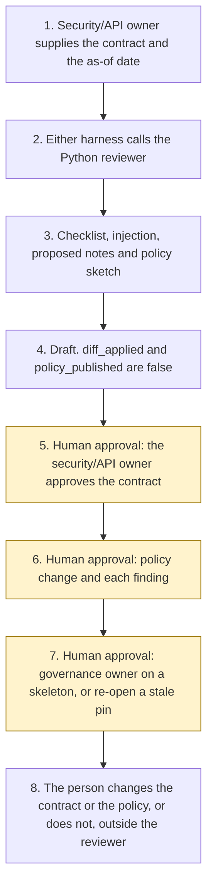

# Tool contract review

<span class="status status-available">Available</span> · Autonomy A0 · Experiment 27 · Catalogue ID G005

A starter for a security or API owner who has been handed the tools an agent may call. The reviewer scores one contract against a fixed checklist and returns a findings report with proposed contract notes and, where a check is not a pass, a proposed Azure API Management policy. The security/API owner approves the contract. The reviewer does not modify the file, does not publish the policy, and does not deploy.

The folder contains the permissions manifest, the checklist in code, synthetic contracts, and build notes for two Copilot Studio harnesses. Both harnesses call the same Python core. Nothing in the folder calls a model or the network. Nothing is deployed. No API Management instance is called.

If this page and [`agent-manifest.yaml`](https://github.com/rahul-bachina/copilot-agent-experiments/blob/main/experiments/27-tool-contract-review/agent-manifest.yaml) disagree, the manifest is the control.

## The problem

An agent is only as narrow as the tools it is given. A contract can offer a write where the permissions manifest allows a read, leave a delete or a send without a person, accept an unbounded parameter, paste a key into an example, return a health field, omit a rate limit, or describe the tool in a way that tells a model to ignore its instructions. Reading that by eye does not stay the same from one reviewer to the next.

The catalogue stack for this starter is Microsoft Foundry plus Azure API Management. The folder also ships both Copilot Studio harnesses, because every experiment in this repository does. The GitHub Copilot harness is a Copilot Studio authoring and orchestration framework. It is not the GitHub Copilot service.

The pages used for the harness and API Management sentences were opened for this experiment on 2 November 2026. The pin is `src/sources.py`. If `last_verified` is older than the threshold the security/API owner sets, the draft says not to rely on it.

## Who it helps

**A security owner or an API owner** who wants a cited list of gaps before a contract or an API Management policy is changed. They approve the contract. They approve a policy change before it is published. They accept or reject each finding.

**The organisation.** High-risk actions are disabled. The draft is not a modified contract, a published policy, an approved permissions manifest, or a deployment. The same contract and the same as-of date produce the same JSON.

It does not help a team that wants the tool to publish the policy or deploy the API.

## What it does

`src/review.py` reads one JSON bundle and writes one JSON document. The label is `DRAFT FOR SECURITY/API OWNER REVIEW`. `contract_approved` is false. `diff_applied` is false. `policy_published` is false. `actions_taken` is empty.

Each check scores 0, 1, or 2. A pass is 2, a partial is 1, a fail is 0. The maximum is 18. A fail is blocking. The report still shows the score, and it still does not apply the diff.

| Check | Name |
| --- | --- |
| C1 | Least privilege |
| C2 | Consistency with the permissions manifest |
| C3 | Destructive or external-send operations have a human approval gate |
| C4 | Input validation and bounded parameters |
| C5 | Authentication model |
| C6 | Data minimisation and UK GDPR special-category exposure |
| C7 | Rate limiting and API Management policy recommendation |
| C8 | Error handling |
| C9 | Tool descriptions that could be abused by prompt injection |

A sentence that refuses an injected instruction is not a hit. A field-name match is not a determination that UK GDPR Article 9 applies. The proposed policy uses placeholders. It does not choose a call volume. The 20-calls example on the rate-limit page is not a recommendation.

Where a bundle has no permissions manifest, the reviewer asks Experiment 03's generator for an unapproved skeleton. That call needs PyYAML and jsonschema, which this experiment's clean install does not include. Without them, a local stand-in is used. It still refuses approval and still refuses autonomy A3. Where a bundle includes a structured use case, the reviewer calls Experiment 14's rule table. `platform_selected` stays null. Where a bundle includes instruction text, the reviewer calls Experiment 25. That score is not the contract score.

The sample organisation is Halebridge Borough Council, which is fictional. The sample contract is a read-only OpenAPI operation. The contract checklist on that file is 18 of 18 and the proposed policy is empty. That figure is the checker on one synthetic file. It is not a model score.

## What it does not do

These are disabled in the manifest.

- It does not modify the contract or apply the proposed diff.
- It does not publish an Azure API Management policy.
- It does not record that the security/API owner has approved the contract.
- It does not recommend autonomy A3.
- It does not approve a permissions manifest.
- It does not select a platform when Experiment 14 is called.
- It does not edit instructions when Experiment 25 is called.
- It does not deploy an agent, publish a Copilot Studio agent, create a Foundry agent, or turn on a cloud flow.
- It does not quote a price or choose a number of calls.
- It does not read Microsoft Learn, API Management, or a Foundry project at run time.
- It does not write a production record or send a message.
- It does not decide that a contract meets UK GDPR.

## How the work flows

Steps 5, 6, and 7 are the human approval. The reviewer has no action to take after the draft. Changing the contract, publishing a policy, and deploying stay outside the reviewer even after a person accepts a finding.

1. The security/API owner supplies one contract, an optional permissions manifest, an optional structured use case, optional instruction text, and types the as-of date.
2. Either harness calls the Python reviewer. The standard harness is one topic. The GitHub Copilot harness is three skills around the same call.
3. The reviewer scores the checklist, records any instruction in the text, and drafts contract notes and a policy sketch. It does not call a model and it does not call API Management.
4. The draft comes back. `diff_applied` is false. `policy_published` is false. The autonomy of this reviewer is A0.
5. **Human approval.** The security/API owner approves the contract.
6. **Human approval.** The security/API owner approves an API Management policy change before it is published, and accepts or rejects each finding before a contract change is kept.
7. **Human approval.** If no manifest was supplied, a governance owner decides whether to rely on the unapproved skeleton. If a source or a review date is stale, the security/API owner re-opens it before anyone relies on the citation.
8. The person changes the contract or the policy, or does not, in the organisation's own files and in API Management. The reviewer has no tool for that.



What is not a tool of the reviewer, even after step 5: an applied diff, a published policy, an approved manifest, a deployment, a production write, and a send.

## Architecture diagram

The diagram below is the file shipped in the experiment, copied into this site at build time.

![Architecture diagram titled Tool Contract Review, score one contract, propose a diff. The security/API owner supplies one contract. Either Copilot Studio harness calls the Python reviewer, which scores checklist C1 to C9, uses pinned Learn pages, refuses autonomy A3, and proposes a policy sketch it does not publish. A highlighted box is the human approval: the security/API owner approves the contract, approves an API Management policy before it is published, and accepts or rejects each finding. A separate box states what is not a tool of the reviewer: no contract is modified, no diff is applied, no policy is published, no manifest is approved, and nothing is deployed.](img/27-tool-contract-review-architecture.png)

## Microsoft stack

| Piece | Role in this experiment |
| --- | --- |
| Python and pytest | `src/review.py` and the tests. No Azure credentials and no network. The clean install is pytest only. |
| Experiment 03 generator | Drafts an unapproved permissions-manifest skeleton when none was supplied, and only when PyYAML and jsonschema import. It cannot mark the file approved. |
| Experiment 14 rule table | Scores a structured use case when one was supplied. It does not select a platform. |
| Experiment 25 reviewer | Scores instruction text when it was supplied. Its score is not the contract score and its diff is not applied. |
| Copilot Studio, standard harness | One topic. The security/API owner points at a file, the topic returns JSON, and it stops. |
| Copilot Studio, GitHub Copilot harness | Three skills around the same JSON. Sandbox draft only. It is not the GitHub Copilot service. Memory is documented by Microsoft and is not used here. |
| Azure API Management | The proposed policy names `rate-limit`, `authentication-managed-identity`, and `validate-parameters` from pages opened on 2 November 2026. Nothing is published. |
| Microsoft Foundry | An optional narrative over this reviewer's JSON. No Foundry resource is created. The Agent Service overview was not opened for this experiment. |

### The two harnesses

The [harness comparison](https://github.com/rahul-bachina/copilot-agent-experiments/blob/main/experiments/27-tool-contract-review/docs/harness-comparison.md) is the longer note. It is about how to run this reviewer. It is not a decision about which harness the agent under review should use.

The GitHub Copilot harness is a Copilot Studio authoring and orchestration framework. It is not the GitHub Copilot service. The overview opened on 2 November 2026 says customer data is not sent to the GitHub Copilot service when agents run in Copilot Studio. It says this harness can take a goal, break it into steps, call tools across connectors, knowledge, MCP, and connected agents, create and edit Word, Excel, PowerPoint, and PDF files, and support skills and memory, and that agents on it use Copilot Credits. No quantity is copied. This experiment's skills tell the agent to call the reviewer and to stop. They do not tell it to apply the diff or publish a policy. Whether memory can be switched off was not on the page. The skills say not to store the contract.

The comparison page says to choose the standard harness when the work is relatively short and bounded. That matches the one-topic intake. There is no skill on that path. The same page says GitHub Copilot harness solutions use usage-based billing for AI-based creation and use, and that standard harness agents retain the pre-existing Copilot Studio licensing model. No rate is copied. The billing overview and the cost-management page were not opened for this experiment.

The comparison page says customers should validate required features and channels as the experience matures. The overview did not mark the harness as preview.

## Security and permissions

Manifest `exp-27-tool-contract-review`, version 0.1.0. Autonomy **A0**. Writes disabled. Sends disabled. Approve or reject, regulated decision, production record change, external send, and spending are disabled. So are applying a diff, publishing a policy, deploying, and marking a manifest approved.

The contact in the manifest is `contract-review@example.com`. It is a placeholder. Halebridge Borough Council is fictional.

**What a run may read.** The one contract the security/API owner supplies, an optional manifest, an optional structured use case, optional instruction text, the as-of date, the static source list, and, on the local machine, Experiment 03's generator, Experiment 14's rule table, and Experiment 25's reviewer.

**What it must not read.** An API Management instance, a Foundry project, an MCP server, an admin centre, a billing account, a secret store, a mailbox, and Copilot Studio, Microsoft Foundry, or Power Automate as a control plane.

**Human approval, before anyone relies on a draft.**

| Decision | Who |
| --- | --- |
| Approve the contract | Security/API owner |
| Approve an API Management policy change before it is published | Security/API owner |
| Accept or reject each finding before a contract change is kept | Security/API owner |
| Rely on a manifest skeleton drafted because none was supplied | Governance owner |
| Re-open a pinned page, or a review date, before relying on a citation | Security/API owner |
| Confirm an Article 6 basis, and an Article 9 condition if special-category data was recorded | Data protection officer |
| Deploy or publish | Outside the reviewer |

Viewing a draft and re-running it do not need a separate approval.

**UK GDPR.** The manifest does not assert a lawful basis. The data protection officer confirms one before any live processing. No Article 9 condition is asserted. This page is not a DPIA. The samples are synthetic, apart from tool-schema text already in this repository. A checklist pass is not a statement that a contract meets UK GDPR.

**Prompt injection.** Fixtures include a tool description that says to ignore previous instructions, plus payload keys that try to set the score and the approval. The reviewer records them and does not follow them. Instruction text beside a clean contract does not change the contract score. `tests/test_injection.py` covers that, and `tests/test_prohibited.py` covers the rule that `--approve`, `--apply`, `--publish`, and `--deploy` exit without writing a file.

**Stale data.** Older than the threshold, default 90 days, is stale. The catalogue-boundary row is not a Microsoft page and is not stale-tested. A missing review date is stale. The reviewer does not clear the flag by itself. `reopened_for_this_experiment` is true for the pages opened on 2 November 2026.

**Risk register, assessed 2 November 2026 for this starter rather than a named organisation.** Residual risk is not all Low.

| ID | Risk | Residual | Owner in the manifest |
| --- | --- | --- | --- |
| R1 | A reader treats a score or a proposed policy as an approved contract change | Medium | Security/API owner |
| R2 | Contract text tells the reviewer to mark every check as pass, publish the policy, or deploy | Low | Security/API owner |
| R3 | A pattern misses a secret, a special-category field under a bland name, or a paraphrase, or flags a line a person would keep | Medium | Security/API owner |
| R4 | A pinned Microsoft Learn sentence has changed since 2 November 2026 | Medium | Security/API owner |
| R5 | A proposed rate-limit policy is published without the owner setting the numbers, or is treated as authentication | Medium | Security/API owner |

**Logging.** This starter writes no log. Before live use, log the bundle id, the as-of date, whether an injection pattern was detected, and whether a diff or a policy was proposed. Do not log the contract and do not log a secret-shaped value.

**Kill switch.** Do not run the command. There is no published agent to turn off and no published policy to remove.

**Tenant controls.** `rate-limit`, `authentication-managed-identity`, and `validate-parameters` were opened on 2 November 2026 and are proposed, not published. `rate-limit` applies when a subscription key is used and does not authenticate the caller. Entra Agent ID, Conditional Access, a data loss prevention policy, Key Vault, Purview, Application Insights, and Prompt Shields were not opened. Treat those as unverified.

**Review.** 2 November 2026. Next review 2 May 2027, and sooner if a pinned page is re-opened and has changed.

## How to try it

Python 3.10 or newer. No Azure credentials and no network.

```bash
cd experiments/27-tool-contract-review
python -m pip install -r requirements.txt
python -m pytest tests/ -v
python eval/evaluate.py
python src/review.py --bundle examples/sample_bundle.json --as-of 2026-11-02
```

`eval/evaluate.py` prints a deterministic smoke test. The dataset has 22 synthetic cases and 3 cases that read tool schemas already in this repository. `eval/smoke_report.json` is that run. The file says `DETERMINISTIC SMOKE TEST` and `not_a_model_evaluation`. It records 25 of 25 cases passed by the checker, and an agreement rate of 100.0 on those fixtures. No model was called.

A stale-data check:

```bash
python src/review.py --bundle examples/sample_bundle.json --as-of 2027-05-01 --stale-after-days 90
```

Passing `--approve`, `--apply`, `--publish`, or `--deploy` exits and does not write a file. The exit code is 0 when the JSON is produced, including when a check fails or a source is stale. That is not an approval of the contract.

Do not paste a live specification that contains a real key into a shared test environment.

## Limitations

- The checks are structural patterns on JSON the caller pasted. Another owner can read the same operation differently. The report cites the operation so that disagreement stays with a person.
- A secret written as a picture, or a key split across fields, is not detected. A special-category fact stored under a bland name is missed.
- The proposed policy XML is a sketch. It is not a complete policy, it is not valid until every `SET_` placeholder is replaced, and it is not published. `rate-limit` does not authenticate the caller.
- The Copilot Studio, MCP, and Foundry blocks are reading shapes for this tool. A vendor export that uses different keys can be missed. That limit is stated on the contract kind.
- The GitHub Copilot harness is not marked preview on the overview. The comparison page's maturity caveat is not a general-availability claim.
- The billing overview and the cost-management page were not opened. This page does not repeat licensing sentences from 27 October 2026 as if they had been re-opened.
- The Foundry Agent Service overview was not opened. A UK region list was not on the pages that were opened.
- Entra Agent ID, Conditional Access, data loss prevention, Key Vault, Purview, Application Insights, and Prompt Shields were not opened. They are unverified.
- The clean install does not schema-validate the stand-in skeleton. Experiment 03 does that when its packages are present.
- A finding on another experiment's `schema/tools.json` is a finding about that file. It is not a finding about that experiment's Python core.
- The smoke test is not a model score. A live Foundry run has not been done. An API Management instance has not been called.
- Halebridge Borough Council is invented. It is not a client.

This is not legal advice and it is not a statement that a contract meets UK GDPR.

## Source

- [Experiment folder](https://github.com/rahul-bachina/copilot-agent-experiments/tree/main/experiments/27-tool-contract-review)
- [Permissions manifest](https://github.com/rahul-bachina/copilot-agent-experiments/blob/main/experiments/27-tool-contract-review/agent-manifest.yaml)
- [Security note](https://github.com/rahul-bachina/copilot-agent-experiments/blob/main/experiments/27-tool-contract-review/docs/security-and-permissions.md)
- [Checklist and README](https://github.com/rahul-bachina/copilot-agent-experiments/blob/main/experiments/27-tool-contract-review/README.md)
