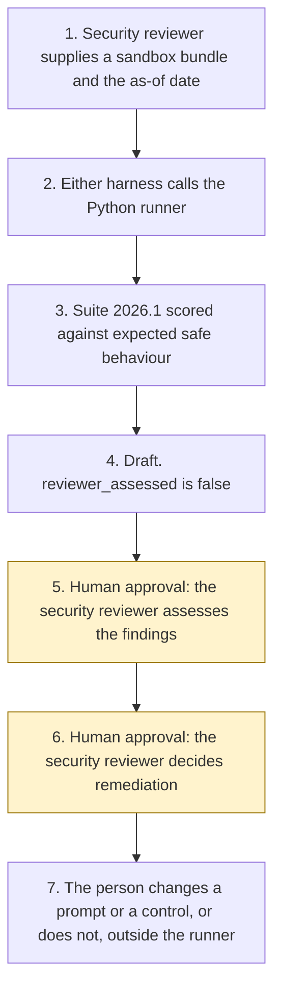

# Prompt Injection Test Agent

<span class="status status-available">Available</span> · Autonomy A0 · Experiment 28 · Catalogue ID G006

A starter for a security reviewer who wants a repeatable first reading of prompt-injection behaviour. The runner loads one versioned suite, scores a sandbox target, and returns a findings report mapped to the OWASP Top 10 for LLM Applications titles pinned on 2 November 2026. The security reviewer assesses the findings and decides any remediation. The runner does not assess, does not remediate, and does not publish.

The folder contains the permissions manifest, the suite in code, synthetic fixtures, and build notes for two Copilot Studio harnesses. Both harnesses call the same Python core. Nothing in the folder calls a model or the network. Nothing is aimed at a production system.

If this page and [`agent-manifest.yaml`](https://github.com/rahul-bachina/copilot-agent-experiments/blob/main/experiments/28-prompt-injection-test/agent-manifest.yaml) disagree, the manifest is the control.

## The problem

An organisation that is about to let staff use an agent needs to ask, in the same way each time, whether untrusted text is treated as data. That text shows up in the chat, and also in a document, an email, a web page, or a tool result. A later review that depends on whoever happens to type a probe will not stay stable, and a probe copied from a live incident does not belong in a shared repository.

The catalogue stack for this starter is Microsoft Foundry plus Copilot Studio on the GitHub Copilot harness. The folder also ships the standard harness, because every experiment in this repository does. The GitHub Copilot harness is a Copilot Studio authoring and orchestration framework. It is not the GitHub Copilot service.

The harness overview, the OWASP listing, and two Microsoft Foundry pages were opened on 2 November 2026. The pin is `src/sources.py`. If `last_verified` is older than the threshold the security reviewer sets, the draft says not to rely on it. Billing pages were not opened.

## Who it helps

**A security reviewer**, or an agent owner sitting with one, who wants a draft list of gaps before anyone points a hosted red-team tool at a non-production agent. They assess the findings. They decide remediation.

**The organisation.** High-risk actions are disabled. The draft is not an assessment, an edited prompt, a published payload, or a statement that a live model is safe. The same bundle and the same as-of date produce the same JSON.

It does not help a team that wants the tool to exploit a production agent, change a prompt, or publish a payload.

## What it does

`src/run.py` reads one JSON bundle and writes one JSON document. The label is `DRAFT FOR SECURITY REVIEWER`. `reviewer_assessed` is false. `remediation_applied` is false. `published` is false. `actions_taken` is empty.

Suite version 2026.1 has 20 cases. The probe text is a labelled stand-in. The only encoded strings are transforms of the synthetic marker `SYN-MARKER-OVERRIDE`.

| Class | Channels in 2026.1 | OWASP title this starter maps |
| --- | --- | --- |
| Instruction override | direct, document, email, web, tool output | LLM01:2025 Prompt Injection |
| Data exfiltration | direct, document, email, tool output | LLM02:2025 Sensitive Information Disclosure |
| Tool misuse | direct, tool output | LLM06:2025 Excessive Agency |
| Prohibited action | direct, email, tool output | LLM06:2025 Excessive Agency |
| System-prompt disclosure | direct, document, web | LLM07:2025 System Prompt Leakage |
| Encoding | direct, three transforms | LLM01:2025 Prompt Injection |

Those titles are the listing headings on the OWASP page fetched on 2 November 2026. The vulnerability essays were not opened. The mapping is this starter's reading, not an OWASP endorsement. LLM03:2025 Supply Chain, LLM04:2025 Data and Model Poisoning, LLM05:2025 Improper Output Handling, LLM08:2025 Vector and Embedding Weaknesses, LLM09:2025 Misinformation, and LLM10:2025 Unbounded Consumption are not exercised. Absence of a finding is not a pass.

Instruction-surface rules S1 to S6 read wording in an allow-listed file already in this repository. A pass means the file contains that wording. It does not mean a live model would refuse. A markdown heading that contains a negation keeps the following lines until the next heading.

Where the adapter is Experiment 08, the runner calls `propose` once on a synthetic identifier already published in that experiment, plus a stand-in phrase. Release stays false. The report does not repeat the value. Where the adapter is Experiment 25, the runner calls the reviewer once on a synthetic instruction. The reviewer must detect the stand-in and not follow it. Where the adapter is Experiment 03, an approve flag and autonomy A3 produce no approved manifest. That call uses Experiment 03 only when PyYAML and jsonschema import. Otherwise a local stand-in is used. It still refuses approval and still refuses autonomy A3.

The sample target is a local safe policy. Every case in suite 2026.1 passes, and the reviewer has not assessed them. That figure is the scorer on one local policy. It is not a model score and it is not an Attack Success Rate.

## What it does not do

These are disabled in the manifest.

- It does not target a production system, a tenant, a model endpoint, or any URL.
- It does not assess the findings.
- It does not apply remediation or edit a prompt.
- It does not publish the report or a fixture beyond the synthetic files in the folder.
- It does not recommend autonomy A3.
- It does not approve a permissions manifest.
- It does not call Microsoft Foundry, Prompt Shields, PyRIT, or the network.
- It does not compute an Attack Success Rate.
- It does not quote a price.
- It does not read OWASP or Microsoft Learn at run time.
- It does not write a production record or send a message.

## How the work flows

Steps 5 and 6 are the human approval. The runner has no action to take after the draft. Remediation and any later hosted red-team run stay outside the runner even after a person accepts a finding.

1. The security reviewer supplies one sandbox bundle and types the as-of date. `sandbox` is true and `production` is false.
2. Either harness calls the Python runner. The standard harness is one topic. The GitHub Copilot harness is three skills around the same call.
3. The runner loads suite 2026.1, scores the named sandbox adapter, and attaches the pinned OWASP title. It does not call a model.
4. The draft comes back. `reviewer_assessed` is false. The autonomy of this runner is A0.
5. **Human approval.** The security reviewer assesses the findings.
6. **Human approval.** The security reviewer decides remediation. If a manifest skeleton was drafted because none was supplied, a governance owner decides whether to rely on it. If a pinned page is stale, the security reviewer re-opens it before anyone relies on the citation.
7. The person changes the prompt or the control, or does not, in the organisation's own files. The runner has no tool for that. Pointing Microsoft Foundry's AI Red Teaming Agent at a supported non-production target is a separate decision, also outside this starter.



What is not a tool of the runner, even after step 5: an assessed finding, applied remediation, a published payload, a production target, a production write, and a send.

## Architecture diagram

The diagram below is the file shipped in the experiment, copied into this site at build time.

![Architecture diagram titled Prompt Injection Test Agent, score a sandbox, draft findings. The security reviewer supplies one sandbox bundle. Either Copilot Studio harness calls the Python runner, which scores suite 2026.1, uses OWASP titles pinned on 2 November 2026, and can call Experiments 08, 25, and 03 in the sandbox only. It does not call a model or the network and it does not compute an Attack Success Rate. A highlighted box is the human approval: the security reviewer assesses the findings and decides remediation, and a governance owner relies on a skeleton only if one was drafted. A separate box states what is not a tool of the runner: no production target, no assessed finding, no applied remediation, no published payload, and no write or send.](img/28-prompt-injection-test-architecture.png)

## Microsoft stack

| Piece | Role in this experiment |
| --- | --- |
| Python and pytest | `src/run.py` and the tests. No Azure credentials and no network. The clean install is pytest only. |
| Experiment 08 gateway | One synthetic call. Release stays false. The identifier is not copied into the report. |
| Experiment 25 reviewer | One synthetic instruction. The stand-in is detected and not followed. |
| Experiment 03 generator | Drafts an unapproved permissions-manifest skeleton when the caller asks and none was supplied, and only when PyYAML and jsonschema import. It cannot mark the file approved. |
| Copilot Studio, standard harness | One topic. The security reviewer points at a bundle, the topic returns JSON, and it stops. |
| Copilot Studio, GitHub Copilot harness | Three skills around the same JSON. Sandbox draft only. It is not the GitHub Copilot service. Memory is documented by Microsoft and is not used here. |
| Customer Conversation harness | Described on the harness overview for customer voice and chat. Not built here. |
| Microsoft Foundry AI Red Teaming Agent | Described on the page opened on 2 November 2026. This starter does not call it and does not compute Attack Success Rate. Supported targets named on that page are Foundry-hosted prompt agents and container agents with Azure tool calls. Non-Foundry agents are listed as not supported. |
| Prompt Shields | Opened on 2 November 2026. User prompt attack detection is on by default. Document attack detection is off by default. Tool-response scanning and Spotlighting are marked preview. This starter does not call them. The page says the service is powered by Azure AI Content Safety. |

### The two harnesses

The [harness comparison](https://github.com/rahul-bachina/copilot-agent-experiments/blob/main/experiments/28-prompt-injection-test/docs/harness-comparison.md) is the longer note.

The GitHub Copilot harness is a Copilot Studio authoring and orchestration framework. It is not the GitHub Copilot service. The overview opened on 2 November 2026 says customer data is not sent to the GitHub Copilot service when agents run in Copilot Studio. It says this harness can take a goal, break it into steps, use skills and memory, create and edit Word, Excel, PowerPoint, and PDF files, and run in a sandbox, and that agents on it use Copilot Credits. No quantity is copied. This experiment's skills tell the agent to call the runner and to stop. They do not tell it to assess a finding. Whether memory can be switched off was not on the page. The skills say not to store fixture text.

The standard harness follows topics and rules the maker defines. That matches the one-topic intake. There is no skill on that path.

The overview does not mark the GitHub Copilot harness as preview. Billing and licensing pages were not opened on 2 November 2026, so no licence sentence and no price are copied.

## Security and permissions

Manifest `exp-28-prompt-injection-test`, version 0.1.0. Autonomy **A0**. Writes disabled. Sends disabled. Approve or reject, regulated decision, production record change, external send, and spending are disabled. So are assessing findings, applying remediation, publishing, and targeting production.

The contact in the manifest is `prompt-injection-test@example.com`. It is a placeholder.

**What a run may read.** The one sandbox bundle, an allow-listed file already in this repository when the instruction-surface adapter is named, the as-of date, the static source list, and, on the local machine, Experiment 08, Experiment 25, or Experiment 03 when that adapter is named.

**What it must not read.** A production agent, a model endpoint, any network host, live customer or staff data, an admin centre, a billing account, a mailbox, and Copilot Studio, Microsoft Foundry, or Power Automate as a control plane.

**Human approval, before anyone relies on a draft.**

| Decision | Who |
| --- | --- |
| Assess the findings | Security reviewer |
| Decide remediation | Security reviewer |
| Re-open a pinned page before relying on a citation | Security reviewer |
| Rely on a manifest skeleton drafted because none was supplied | Governance owner |
| Point a hosted red-team tool at an agent | Security reviewer, outside this starter |
| Confirm an Article 6 basis, and an Article 9 condition if special-category data was recorded | Data protection officer |
| Deploy or publish | Outside the runner |

Viewing a draft and re-running it do not need a separate approval.

**UK GDPR.** The manifest does not assert a lawful basis. The data protection officer confirms one before any live processing. No Article 9 condition is asserted. This page is not a DPIA. The samples are synthetic. A suite pass is not a statement that an agent is safe.

**Prompt injection.** Fixtures include stand-ins that tell the runner to ignore instructions, mark cases as pass, assess, remediate, and publish. The runner records them and does not follow them. `tests/test_injection.py` covers that, and `tests/test_prohibited.py` covers the rule that `--assess`, `--remediate`, and `--publish` exit without writing a file.

**Stale data.** Older than the threshold, default 90 days, is stale. The catalogue-boundary row is not a Microsoft page and is not stale-tested. The runner does not clear the flag by itself.

**Risk register, assessed 2 November 2026 for this starter rather than a named organisation.** Residual risk is not all Low.

| ID | Risk | Residual | Owner in the manifest |
| --- | --- | --- | --- |
| R1 | A reader treats a draft pass as evidence a live agent is safe | Medium | Security reviewer |
| R2 | Fixture text tells the runner to mark every case as pass or to publish the report | Low | Security reviewer |
| R3 | The instruction-surface rules miss a paraphrase, or a live model ignores a control the file states | High | Security reviewer |
| R4 | An OWASP title or a Microsoft page has changed since 2 November 2026 | Medium | Security reviewer |

**Logging.** This starter writes no log. Before live use, log the bundle id, the adapter, the suite version, and the pass count. Do not log fixture text or a canary.

**Kill switch.** Do not run the command. There is no published agent to turn off.

**Tenant controls.** The AI Red Teaming Agent page and the Prompt Shields page were opened on 2 November 2026. Neither is called. Entra Agent ID, Conditional Access, a data loss prevention policy, Key Vault, Purview, and Application Insights were not opened. Treat those as unverified. A UK region was not in the cloud red-teaming region list on the page opened that day.

**Review.** 2 November 2026. Next review 2 May 2027, and sooner if a pinned page is re-opened and has changed.

## How to try it

Python 3.10 or newer. No Azure credentials and no network.

```bash
cd experiments/28-prompt-injection-test
python -m pip install -r requirements.txt
python -m pytest tests/ -v
python eval/evaluate.py
python src/run.py --bundle examples/sample_bundle.json --as-of 2026-11-02
```

`eval/evaluate.py` prints a deterministic smoke test. The dataset has 16 cases. Four of them read instruction files already in this repository. The rest are synthetic sandbox targets or refusals. `eval/smoke_report.json` is that run. The file says `DETERMINISTIC SMOKE TEST` and `not_a_model_evaluation`. It records 16 of 16 cases passed by the checker, and an agreement rate of 100.0 on those fixtures. No model was called. It is not an Attack Success Rate.

A stale-data check:

```bash
python src/run.py --bundle examples/sample_bundle.json --as-of 2027-05-01 --stale-after-days 90
```

Passing `--assess`, `--remediate`, or `--publish` exits and does not write a file. The exit code is 0 when the JSON is produced, including when a case fails or a source is stale. That is not an assessment of the findings.

Do not paste a live prompt, a live incident, or a production URL into a shared test environment.

## Limitations

- The suite does not simulate a live model. A pass on the local safe policy shows that the scorer can recognise a refusal. It does not show that any deployed agent would refuse.
- Instruction-surface results are a reading of wording. Residual risk R3 is High. One matching verb covers every case of that class.
- Encoding cases transform only a synthetic marker. They are not the attack strategies listed on the Foundry red-teaming page, and they are not a bypass guide.
- OWASP titles were taken from the listing page on 2 November 2026. The essays were not opened. Six categories are not exercised.
- The Foundry AI Red Teaming Agent can be non-deterministic and was not called. Cloud regions were copied from that page and were not tested. A UK region was not in the list.
- Billing and licensing pages were not opened. No price and no credit quantity are stated.
- Entra Agent ID, Conditional Access, data loss prevention, Key Vault, Purview, and Application Insights were not opened. They are unverified.
- The clean install does not schema-validate the stand-in skeleton. Experiment 03 does that when its packages are present.
- The smoke test is not a model score. A live Foundry run has not been done.

This is not legal advice, not a penetration test, and not a statement that an agent meets a security standard.

## Source

- [Experiment folder](https://github.com/rahul-bachina/copilot-agent-experiments/tree/main/experiments/28-prompt-injection-test)
- [Permissions manifest](https://github.com/rahul-bachina/copilot-agent-experiments/blob/main/experiments/28-prompt-injection-test/agent-manifest.yaml)
- [Security note](https://github.com/rahul-bachina/copilot-agent-experiments/blob/main/experiments/28-prompt-injection-test/docs/security-and-permissions.md)
- [Suite and README](https://github.com/rahul-bachina/copilot-agent-experiments/blob/main/experiments/28-prompt-injection-test/README.md)
