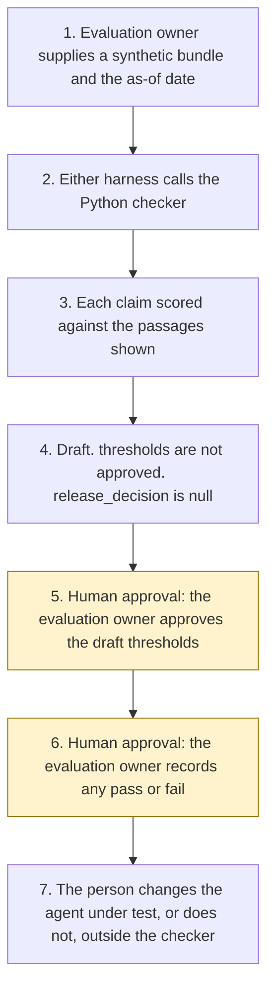

# Groundedness Evaluation Agent

<span class="status status-available">Available</span> · Autonomy A0 · Experiment 29 · Catalogue ID G007

A starter for an evaluation owner who has an agent's answers, the passages that agent was shown, and any citations, and wants a repeatable first reading of whether each claim stays inside those passages. The checker returns a draft report. The evaluation owner approves the thresholds and records any pass or fail release. The checker does not record either decision.

The folder contains the permissions manifest, a deterministic checker, synthetic UK public-sector and regulated-sector fixtures, and build notes for two Copilot Studio harnesses. Both harnesses call the same Python core. Nothing in the folder calls a model or the network. The Microsoft Foundry groundedness evaluator is described from a page opened on 3 November 2026 and is not called.

If this page and [`agent-manifest.yaml`](https://github.com/rahul-bachina/copilot-agent-experiments/blob/main/experiments/29-groundedness-evaluation/agent-manifest.yaml) disagree, the manifest is the control.

## The problem

An answer can look fluent and still add a number, a date, or a sentence that was not in the passage the agent was shown. A citation can name a source that was not shown, or quote words that are not in it. A passage can be older than the window an evaluation owner is willing to trust. Reading that by eye does not stay the same from one reviewer to the next.

The catalogue stack for this starter is Microsoft Foundry. The folder also ships both Copilot Studio harnesses, because every experiment in this repository does. The GitHub Copilot harness is a Copilot Studio authoring and orchestration framework. It is not the GitHub Copilot service.

The RAG evaluators page and the harness overview were opened on 3 November 2026. The pin is `src/sources.py`. If `last_verified` is older than the threshold the caller sets, the draft says not to rely on it. Billing pages were not opened.

## Who it helps

**An evaluation owner**, or a colleague sitting with one, who wants a draft list of unsupported and stale claims before anyone treats an agent's answers as ready to show. They approve the thresholds. They record any pass or fail.

**The organisation.** High-risk actions are disabled. The draft is not a release, a Foundry score, or a statement that a live model is grounded. The same bundle and the same as-of date produce the same JSON.

It does not help a team that wants the tool to approve the thresholds, mark a release, or call Foundry and treat that call as the decision.

## What it does

`src/report.py` reads one JSON bundle and writes one JSON document. The label is `DRAFT FOR EVALUATION OWNER`. `threshold_approved_by_evaluation_owner` is false. `release_decision` is null. `pass_fail_released` is false. `foundry_evaluator_called` is false. `actions_taken` is empty.

Each answer is split into claims. One claim receives one verdict, in this order: citation missing, source not shown, quote not in the passage, number mismatch, date mismatch, unsupported wording, or supported. Later failures on the same claim are listed in `other_failures` and are not added to the totals. A stale cited passage sets `stale_source`. That count is separate from `verdict_total`.

`draft_bar_met` is a calculation against draft numbers. The defaults are a supported rate of 1.0, no non-supported claims, no stale claims, and 180 days. Those numbers are not approved. `draft_bar_is_not_a_release` stays true.

The sample is Northfen Borough Council, which is fictional. On the as-of date 3 November 2026 the three claims in `examples/sample_bundle.json` are supported, nothing is stale, and `draft_bar_met` is true. The release is still null. That figure is the checker on one synthetic leaflet. It is not a model score and it is not a Foundry score.

Fenwick Mutual and Rivertrust NHS Trust are also fictional. The Rivertrust note is a corporate leave sentence and is not clinical. The 8-week sentence in the Fenwick note is fixture text. It is not a citation of the Dispute Resolution sourcebook.

Where the bundle asks for a permissions manifest, the checker calls Experiment 03 only when PyYAML and jsonschema import. Otherwise a local stand-in is used. It still refuses approval and still refuses autonomy A3.

## What it does not do

These are disabled in the manifest.

- It does not approve a threshold.
- It does not record a pass or a fail release.
- It does not call Microsoft Foundry, Groundedness, or Groundedness Pro.
- It does not map its rate onto the 1 to 5 scale described on the Foundry page.
- It does not recommend autonomy A3.
- It does not approve a permissions manifest.
- It does not score a bundle that is not marked synthetic.
- It does not quote a price.
- It does not read Microsoft Learn at run time.
- It does not write a production record or send a message.

## How the work flows

Steps 5 and 6 are the human approval. The checker has no action to take after the draft. A Foundry run stays outside the checker even after a person accepts a draft.

1. The evaluation owner supplies one synthetic bundle and types the as-of date. `synthetic` is true.
2. Either harness calls the Python checker. The standard harness is one topic. The GitHub Copilot harness is three skills around the same call.
3. The checker scores each claim against the passages that were shown. It does not call a model.
4. The draft comes back. `threshold_approved_by_evaluation_owner` is false. The autonomy of this checker is A0.
5. **Human approval.** The evaluation owner approves or refuses the draft thresholds, including the 180-day window.
6. **Human approval.** The evaluation owner records a pass or a fail, or records neither. If a manifest skeleton was drafted, a governance owner decides whether to rely on it. If a pinned page is stale, the evaluation owner re-opens it before anyone relies on the citation.
7. The person changes the agent under test, or does not, in the organisation's own files. The checker has no tool for that. Calling Microsoft Foundry's groundedness evaluator is a separate decision, also outside this starter.



What is not a tool of the checker, even after step 5: an approved threshold, a recorded release, a Foundry call, a production write, and a send.

## Architecture diagram

The diagram below is the file shipped in the experiment, copied into this site at build time.

![Architecture diagram titled Groundedness Evaluation Agent, score claims, draft a report. The evaluation owner supplies one synthetic bundle of answers, passages, and citations. Either Copilot Studio harness calls the Python checker, which gives each claim one verdict, flags stale passages separately, describes the Microsoft Foundry groundedness evaluator without calling it, and can ask Experiment 03 for an unapproved manifest skeleton. A highlighted box is the human approval: the evaluation owner approves the draft thresholds and records any pass or fail release, and a governance owner relies on a skeleton only if one was drafted. A separate box states what is not a tool of the checker: no approved threshold, no recorded release, no Foundry call, no write, no send, and no autonomy A3.](img/29-groundedness-evaluation-architecture.png)

## Microsoft stack

| Piece | Role in this experiment |
| --- | --- |
| Python and pytest | `src/report.py` and the tests. No Azure credentials and no network. The clean install is pytest only. |
| Experiment 03 generator | Drafts an unapproved permissions-manifest skeleton when the caller asks, and only when PyYAML and jsonschema import. It cannot mark the file approved. |
| Copilot Studio, standard harness | One topic. The evaluation owner points at a bundle, the topic returns JSON, and it stops. |
| Copilot Studio, GitHub Copilot harness | Three skills around the same JSON. It is not the GitHub Copilot service. Memory is documented by Microsoft and is not used here. |
| Customer Conversation harness | Described on the harness overview for customer voice and chat. Not built here. |
| Microsoft Foundry groundedness evaluator | Described on the RAG evaluators page opened on 3 November 2026. This starter does not call it. Scores on that page run from 1 to 5, with a default pass threshold of 3. That number is not applied here. |
| Groundedness Pro | Marked preview on the same page. Uses Azure AI Content Safety and returns a boolean. Not called. UK region availability is unverified. |

### The two harnesses

The [harness comparison](https://github.com/rahul-bachina/copilot-agent-experiments/blob/main/experiments/29-groundedness-evaluation/docs/harness-comparison.md) is the longer note.

The GitHub Copilot harness is a Copilot Studio authoring and orchestration framework. It is not the GitHub Copilot service. The overview opened on 3 November 2026 says customer data is not sent to or processed by the GitHub Copilot service when agents run in Copilot Studio. It says this harness can take a goal, break it into steps, use skills and memory, create and edit Word, Excel, PowerPoint, and PDF files, and run in a sandbox, and that agents on it use Copilot Credits. No quantity is copied. This experiment's skills tell the agent to call the checker and to stop. They do not tell it to approve a threshold. Whether memory can be switched off was not on the page. The skills say not to store passage text.

The standard harness follows the topics and rules the maker defines. That matches the one-topic intake. There is no skill on that path.

The overview does not mark the GitHub Copilot harness as preview. Billing and licensing pages were not opened on 3 November 2026, so no licence sentence and no price are copied.

## Security and permissions

Manifest `exp-29-groundedness-evaluation`, version 0.1.0. Autonomy **A0**. Writes disabled. Sends disabled. Approve or reject, regulated decision, production record change, external send, and spending are disabled. So are approving thresholds, recording a release, and calling the Foundry evaluator.

| Decision | Who |
| --- | --- |
| Approve the draft thresholds | Evaluation owner |
| Record a pass or fail release | Evaluation owner |
| Re-open a pinned page before relying on a citation | Evaluation owner |
| Rely on a manifest skeleton | Governance owner |
| Call the Microsoft Foundry groundedness evaluator | Evaluation owner, outside this starter |
| Confirm an Article 6 basis before any live processing | Data protection officer |

The contact in the manifest is `groundedness-evaluation@example.com`. It is a placeholder. Northfen Borough Council, Fenwick Mutual, and Rivertrust NHS Trust are fictional.

Prompt Shields, Entra Agent ID, Conditional Access, a Data Loss Prevention policy, Key Vault, Purview, and Application Insights were not opened for this experiment. They are unverified. The [security note](https://github.com/rahul-bachina/copilot-agent-experiments/blob/main/experiments/29-groundedness-evaluation/docs/security-and-permissions.md) lists each one that way.

The Foundry page does not name a UK region. UK region availability for that evaluator is unverified.

## How to try it

Python 3.10 or newer. No Azure credentials and no network.

```bash
cd experiments/29-groundedness-evaluation
python -m pip install -r requirements.txt
python -m pytest tests/ -q
python eval/evaluate.py
python src/report.py --bundle examples/sample_bundle.json --as-of 2026-11-03
```

`eval/evaluate.py` prints a deterministic smoke test. The dataset has 23 synthetic cases. `eval/smoke_report.json` is that run. The file says `DETERMINISTIC SMOKE TEST` and `not_a_foundry_score`. The summary counts cases once: 23 passed, 0 failed, agreement 100.0 against the expectations written for this checker's own rules. Claim counts stay on each case. No model was called.

Passing `--approve-thresholds`, `--release`, `--pass`, or `--fail` exits without writing a file.

## Limitations

- The checker matches words, digits, quotes, and written dates. A true paraphrase that does not reuse the passage's words is flagged. A shared word can hide a different meaning.
- "twenty-four" is not read as 24. "1 September 2026" does not match "2026-09-01". A full stop ends a claim.
- `other_failures` and `stale_claim_count` are not added to `verdict_total`. The smoke summary does not add claim counts into `total_cases`.
- The 180-day window is a draft. Experiment 03 uses the same unapproved figure inside its narrower G007 check. This experiment does not approve it and does not clear that pack.
- Experiment 03 is not imported on the clean install. The stand-in is not schema-validated until PyYAML and jsonschema are installed. This requirements file does not install them.
- UK region availability for a Foundry evaluation deployment was not on the page opened on 3 November 2026. It is unverified.
- `eval/smoke_report.json` is a deterministic smoke test. Agreement 100.0 is the checker against its own rules. It is not a model score.

## Source

- [Experiment folder](https://github.com/rahul-bachina/copilot-agent-experiments/tree/main/experiments/29-groundedness-evaluation)
- [Permissions manifest](https://github.com/rahul-bachina/copilot-agent-experiments/blob/main/experiments/29-groundedness-evaluation/agent-manifest.yaml)
- [Security note](https://github.com/rahul-bachina/copilot-agent-experiments/blob/main/experiments/29-groundedness-evaluation/docs/security-and-permissions.md)
- [Checker and README](https://github.com/rahul-bachina/copilot-agent-experiments/blob/main/experiments/29-groundedness-evaluation/README.md)
