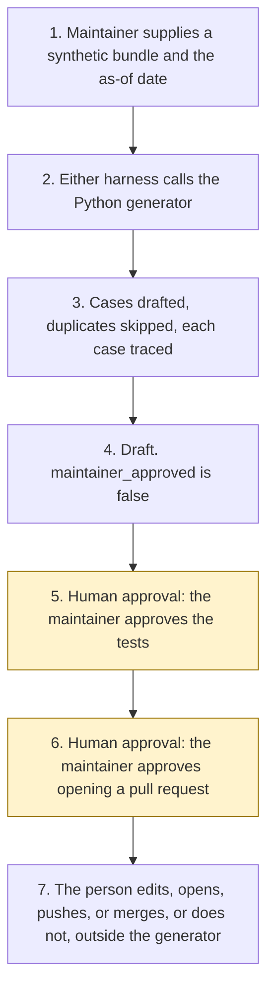

# Agent regression test generator

<span class="status status-available">Available</span> · Autonomy A1 · Experiment 30 · Catalogue ID G008

A starter for a maintainer who has an agent's manifest, its `SKILL.md` files, its tool contract, and a set of observed failures or change notes. The generator drafts regression cases and the text of a pull request. The maintainer approves the tests and any pull request. The generator does not merge, does not push, and does not edit the agent under test.

The folder contains the permissions manifest, the rules in code, synthetic fixtures, and build notes for two Copilot Studio harnesses. Both harnesses call the same Python core. Nothing in the folder calls a model, Git, or the network.

If this page and [`agent-manifest.yaml`](https://github.com/rahul-bachina/copilot-agent-experiments/blob/main/experiments/30-agent-regression-test-generator/agent-manifest.yaml) disagree, the manifest is the control.

## The problem

A failure that was seen once, or a change note that says a description moved, is easy to lose. The next person writes a different test, or writes the same test again, or writes a test that no longer points at the failure. A draft that fingerprints each case, skips one that already exists, and stores the observation id and the requirement id keeps that link. It still does not decide that the test is good enough to merge.

The catalogue stack for this starter is Microsoft Foundry plus GitHub. The folder also ships both Copilot Studio harnesses. The GitHub Copilot harness is a Copilot Studio authoring and orchestration framework. It is not the GitHub Copilot service.

The harness overview, the standard-harness generative-orchestration page, and three Microsoft Foundry evaluation pages were opened on 3 November 2026. The pin is `src/sources.py`. If `last_verified` is older than the threshold the maintainer sets, the draft says not to rely on it. Billing pages were not opened.

## Who it helps

**A maintainer**, or an agent owner sitting with one, who wants a first set of regression files before anyone edits the agent or opens a pull request. They approve the tests. They approve any pull request.

**The organisation.** High-risk actions are disabled. The draft is not a merged change, a push to a protected branch, an edited agent, or a Foundry score. The same bundle and the same as-of date produce the same JSON.

It does not help a team that wants the tool to merge, to push to a protected branch, or to change the agent under test.

## What it does

`src/generate.py` reads one JSON bundle and writes one JSON document. The label is `DRAFT FOR MAINTAINER REVIEW`. `maintainer_approved` is false. `merged` is false. `pushed` is false. `agent_under_test_edited` is false. `pr_opened` is false.

| Rule | What a draft contains |
| --- | --- |
| R1 | One expected-behaviour case when an observation has an input and an expected behaviour. |
| R2 | One prompt-injection variant. It appends the labelled marker `SYN-MARKER-OVERRIDE`. |
| R3 | A prohibited-action case when the observation names an action, or the expected behaviour forbids one of the listed verbs. |
| R4 | A prohibited-action case for a callable send, delete, or write that has no structured approval flag. |
| R5 | One prohibited-action case for each high-risk flag on a supplied manifest. An enabled flag is not performed. Autonomy A3 is not recommended. |
| R6 | A fingerprint that matches an existing test is skipped. The row keeps its trace and names `duplicate_of`. No second file is written. |
| R7 | A change note that is only a trigger phrase, with no description change, drafts nothing. This generator does not assign a routing weight. |
| R8 | The Foundry-shaped queries file has one line per drafted case and none for a skipped duplicate. It is not uploaded. |

`drafted` plus `skipped_duplicate` equals `considered`. Observations that were not drafted are a separate count. They are not added to `considered`.

On the standard harness, generative orchestration selects a topic from the description of its purpose. Classic orchestration selects a topic by matching a user query with trigger phrases. That is the table on the generative-orchestration page opened on 3 November 2026. The page says it describes the standard harness. This generator does not implement either selector. Whether the GitHub Copilot harness uses the same rule was not on that page. Unverified.

The sample bundle, Halebridge Borough Council, is fictional. It drafts 16 cases, skips 1 duplicate, and leaves 1 observation undrafted. That figure is the deterministic draft. It is not a model score and it is not a Foundry pass rate.

Where the bundle asks for a permissions-manifest skeleton and does not supply a manifest, the generator calls Experiment 03 when PyYAML and jsonschema import. `approved` stays false. Otherwise a local stand-in is used. It still refuses approval and still refuses autonomy A3. The skeleton is not written into the agent under test.

## What it does not do

These are disabled in the manifest.

- It does not merge a pull request.
- It does not push, including to a protected branch.
- It does not edit the agent under test.
- It does not approve the generated tests.
- It does not open a pull request. The markdown is content only.
- It does not call Microsoft Foundry or upload a dataset.
- It does not set a pass-rate threshold. The 85 percent figure on the evaluate-agent page is that page's example, not a result from this repository.
- It does not recommend autonomy A3.
- It does not approve a permissions manifest.
- It does not quote a price.
- It does not read Microsoft Learn at run time.
- It does not write a production record or send a message.

## How the work flows

Steps 5 and 6 are the human approval. The generator has no action to take after the draft. Opening, pushing, merging, editing the agent, and any later Foundry run stay outside the generator even after a person accepts a case.

1. The maintainer supplies one synthetic bundle and types the as-of date.
2. Either harness calls the Python generator. The standard harness is one topic. The GitHub Copilot harness is three skills around the same call.
3. The generator drafts cases, skips fingerprints that already exist, and writes the trace back to the failure or the requirement. It does not call a model.
4. The draft comes back. `maintainer_approved` is false. The autonomy of this generator is A1.
5. **Human approval.** The maintainer approves the generated tests, or does not.
6. **Human approval.** The maintainer approves opening a pull request from the draft content, or does not. If a manifest skeleton was drafted because none was supplied, a governance owner decides whether to rely on it. If a pinned page is stale, the maintainer re-opens it before anyone relies on the citation.
7. The person edits the agent, opens a pull request, pushes, or merges, or does not, in the organisation's own tools. The generator has no tool for that. Running a Microsoft Foundry evaluation against a deployed agent is a separate decision, also outside this starter.



What is not a tool of the generator, even after step 5: an approved test, an open pull request, a merge, a push to a protected branch, an edit of the agent under test, a Foundry upload, a production write, and a send.

## Architecture diagram

The diagram below is the file shipped in the experiment, copied into this site at build time.

![Architecture diagram titled Agent Regression Test Generator, draft cases, do not merge. The maintainer supplies one synthetic bundle. Either Copilot Studio harness calls the Python generator, which applies rules R1 to R8, deduplicates by fingerprint, keeps a trace, and does not upload a Foundry file. It does not call a model, Git, or the network. A highlighted box is the human approval: the maintainer approves the tests and approves opening a pull request, and a governance owner relies on a skeleton only if one was drafted. A separate box states what is not a tool of the generator: no merge, no push including to main, no edit of the agent, no open pull request, and no Foundry call or send.](img/30-agent-regression-test-generator-architecture.png)

## Microsoft stack

| Piece | Role in this experiment |
| --- | --- |
| Python and pytest | `src/generate.py` and the tests. No Azure credentials and no network. The clean install is pytest only. |
| Experiment 03 generator | Drafts an unapproved permissions-manifest skeleton when the caller asks and none was supplied, and only when PyYAML and jsonschema import. It cannot mark the file approved. |
| Experiment 25 YAML reader | Reads this experiment's own manifest in the unit test. The generator's bundle is JSON. |
| Copilot Studio, standard harness | One topic. The maintainer points at a bundle, the topic returns JSON, and it stops. Generative orchestration selects that topic by its description. |
| Copilot Studio, GitHub Copilot harness | Three skills around the same JSON. Draft only. It is not the GitHub Copilot service. Memory is documented by Microsoft and is not used here. |
| Customer Conversation harness | Described on the harness overview for customer voice and chat. Not built here. |
| Microsoft Foundry evaluation | Described on the pages opened on 3 November 2026. This starter does not call it. The queries file matches the documented `query` field. UK region availability for the features the page says are region-restricted is unverified. The hosted-agent quickstart marks the Azure Developer CLI evaluation experience as preview. |

### The two harnesses

The [harness comparison](https://github.com/rahul-bachina/copilot-agent-experiments/blob/main/experiments/30-agent-regression-test-generator/docs/harness-comparison.md) is the longer note.

The GitHub Copilot harness is a Copilot Studio authoring and orchestration framework. It is not the GitHub Copilot service. The overview opened on 3 November 2026 says customer data is not sent to the GitHub Copilot service when agents run in Copilot Studio. It says this harness can take a goal, break it into steps, use skills and memory, create and edit Word, Excel, PowerPoint, and PDF files, and run in a sandbox, and that agents on it use Copilot Credits. No quantity is copied. This experiment's skills tell the agent to call the generator and to stop. They do not tell it to merge. Whether memory can be switched off was not on the page. The skills say not to store the pack.

The standard harness follows topics and rules the maker defines. That matches the one-topic intake. There is no skill on that path.

The overview does not mark the GitHub Copilot harness as preview. Billing and licensing pages were not opened on 3 November 2026, so no licence sentence and no price are copied.

## Security and permissions

Manifest `exp-30-agent-regression-test-generator`, version 0.1.0. Autonomy **A1**. Writes disabled. Sends disabled. Approve or reject, regulated decision, production record change, external send, and spending are disabled. So are approving tests, opening a pull request, merging, pushing to a protected branch, editing the agent under test, and calling Microsoft Foundry.

| Decision | Who |
| --- | --- |
| Approve generated tests | Maintainer |
| Open a pull request from the draft content | Maintainer |
| Merge a pull request | Maintainer |
| Push, including to a protected branch | Maintainer |
| Edit the agent under test | Maintainer |
| Re-open a pinned page before relying on a citation | Maintainer |
| Rely on a manifest skeleton | Governance owner |
| Run a Microsoft Foundry evaluation | Maintainer, outside this starter |

Prompt Shields, Entra Agent ID, Conditional Access, Purview, Key Vault, and a Data Loss Prevention policy were not opened for this experiment. They are unverified. The longer note is [`docs/security-and-permissions.md`](https://github.com/rahul-bachina/copilot-agent-experiments/blob/main/experiments/30-agent-regression-test-generator/docs/security-and-permissions.md).

## How to try it

Python 3.10 or newer. No Azure credentials.

```bash
cd experiments/30-agent-regression-test-generator
python -m pip install -r requirements.txt
python -m pytest tests/ -q
python eval/evaluate.py
python src/generate.py --bundle examples/sample_bundle.json --as-of 2026-11-03
```

`eval/evaluate.py` is a deterministic smoke test. `eval/smoke_report.json` is that run. It is not a model score. The summary counts `passed`, `failed`, and `errored` separately. Their sum is the number of cases. A row is not in two of those buckets.

The sample draft reports 16 drafted cases and 1 skipped duplicate. `considered` is 17. One observation was not drafted because it was a trigger phrase only. That observation is not added to `considered`.

## Limitations

- The cases do not call the agent under test. A maintainer wires each one to a runner they own.
- A reworded duplicate is not skipped. A whitespace-only difference is skipped.
- The injection variant is one labelled sentence. It is not a red-team catalogue.
- The supplied manifest is read for flags. This command does not schema-validate it. This experiment's own manifest is validated by the repository schema test when jsonschema is installed.
- Experiment 03 is not imported on the clean install. The stand-in is not schema-validated.
- UK region availability for a later Foundry evaluation was not verified.
- The smoke report is not a Foundry result. Several agent evaluators on the page opened on 3 November 2026 are marked preview. Quality Grader is described there as deprecated. None of them are run here.

This is not legal advice and it is not a statement that an agent meets a test standard.

## Source

- [Experiment folder](https://github.com/rahul-bachina/copilot-agent-experiments/tree/main/experiments/30-agent-regression-test-generator)
- [Permissions manifest](https://github.com/rahul-bachina/copilot-agent-experiments/blob/main/experiments/30-agent-regression-test-generator/agent-manifest.yaml)
- [Security note](https://github.com/rahul-bachina/copilot-agent-experiments/blob/main/experiments/30-agent-regression-test-generator/docs/security-and-permissions.md)
- [Rules and README](https://github.com/rahul-bachina/copilot-agent-experiments/blob/main/experiments/30-agent-regression-test-generator/README.md)
