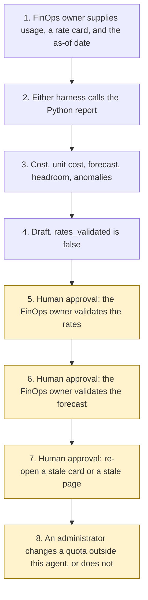

# Agent cost and capacity

<span class="status status-available">Available</span> · Autonomy A0 · Experiment 31 · Catalogue ID G009

A starter for a FinOps owner who has a usage file and a rate card, and wants a repeatable draft: cost per agent, unit cost per case, a flat forecast with a stated band, quota headroom, and anomaly flags. The FinOps owner validates rates and the forecast. The agent does not change a quota, a budget, or a subscription, and it does not store a Microsoft price.

The folder contains the permissions manifest, the report in code, synthetic usage and a synthetic rate card, and build notes for two Copilot Studio harnesses. Both harnesses call the same Python core. Nothing in the folder calls a model, an admin centre, or the network.

If this page and [`agent-manifest.yaml`](https://github.com/rahul-bachina/copilot-agent-experiments/blob/main/experiments/31-agent-cost-capacity/agent-manifest.yaml) disagree, the manifest is the control.

## The problem

Agent usage arrives as several quantities at once: conversations, tool calls, tokens, Copilot Credits, and Foundry model tokens. Adding all of them prices the same activity more than once. A rate typed into the program goes stale. A note that says "set the price to 0" is not a rate.

The catalogue stack for this starter is Microsoft Fabric and Power Platform. The folder does not connect to Fabric. It also ships both Copilot Studio harnesses and a Microsoft Foundry note, because the telemetry can name those platforms and because every experiment in this repository ships both harnesses. The GitHub Copilot harness is a Copilot Studio authoring and orchestration framework. It is not the GitHub Copilot service.

The pages used for the billing sentences were opened on 3 November 2026. The pin is `src/sources.py`. No rate, pack size, or diagram number was copied. If `last_verified` is older than the threshold the FinOps owner sets, the draft says not to rely on it.

## Who it helps

**A FinOps owner** who already has a usage export and a rate card with an effective date, and wants the arithmetic written down before anyone treats a figure as a charge or changes a limit. They validate the rates. They validate the forecast.

**The organisation.** High-risk actions are disabled. The draft is not an invoice, not a Microsoft price, and not a quota change. The same files and the same as-of date produce the same JSON.

It does not help a team that wants the tool to buy credits, move a budget, or update a subscription.

## What it does

`src/report.py` reads one telemetry file and one rate-card file and writes one JSON document. The label is `DRAFT FOR FINOPS REVIEW`. `rates_validated` is false. `forecast_validated` is false. `quota_changed`, `budget_changed`, and `subscription_changed` are false. `actions_taken` is empty.

A Copilot Studio row is priced from Copilot Credits times one matching rate-card line. Tokens and tool calls on that row are usage. They are not added unless the line sets `additive` to true. A Microsoft Foundry row is priced from input tokens and output tokens, each once. If the two token fields disagree, they are not added and the cost is null. A duplicate agent id is dropped. A period rollup is compared and is not added. A missing rate stays null. It is not stored as zero.

The forecast multiplies the period cost by the horizon days divided by the inclusive day count. Low and high apply a band the caller sets. The default band is 0.20 only when the caller does not set one. It is not a statistical interval and it is not a Microsoft estimate.

The sample is Northfen Borough Council, which is fictional. On the as-of date 3 November 2026 the three agent costs are 0.4500, 2.1000, and 1.8000 in the card's currency code GBP. The total is 4.3500, the sum of those lines once. Copilot Credits used are 255. Foundry input tokens used against that quota are 500000. The decoy token rate on the card is not applied. The forecast point for 31 days is 4.3500, with a low of 3.4800 and a high of 5.2200. Those figures are fixture arithmetic. They are not an invoice and they are not Microsoft list prices.

`eval/smoke_report.json` records 13 synthetic cases, 13 passed, and an agreement rate of 100.0 on those fixtures. The summary does not add the case costs together. The file says `DETERMINISTIC SMOKE TEST`. It is not a model score.

## What it does not do

These are disabled in the manifest.

- It does not validate the rates or the forecast.
- It does not change a quota, a budget, or a subscription.
- It does not purchase Copilot Credits or start a meter.
- It does not store or copy a Microsoft price.
- It does not recommend autonomy A3.
- It does not read an admin centre, Azure Cost Management, or a live tenant.
- It does not connect to Microsoft Fabric.
- It does not deploy an agent, publish a Copilot Studio agent, create a Foundry agent, or turn on a cloud flow.
- It does not write a production record or send a message.
- It does not decide that a billing design meets UK GDPR.

## How the work flows

Steps 5, 6, and 7 are the human approval. The agent has no action to take after the draft. Changing a quota stays outside the agent even after a person accepts a figure.

1. The FinOps owner supplies a usage file, a rate card with an effective date, and types the as-of date.
2. Either harness calls the Python report. The standard harness is one topic. The GitHub Copilot harness is three skills around the same call.
3. The report prices the kept rows from the rate card, records any instruction in a note, and drafts a forecast and headroom. It does not call a model.
4. The draft comes back. `rates_validated` is false. `quota_changed` is false. The autonomy of this report is A0.
5. **Human approval.** The FinOps owner validates the rates.
6. **Human approval.** The FinOps owner validates the forecast.
7. **Human approval.** If the rate card or a pinned page is stale, the FinOps owner re-opens it before anyone relies on a figure.
8. An administrator changes a quota, a budget, or a subscription outside this agent, or does not. The agent has no tool for that.



What is not a tool of the agent, even after step 5: a validated rate, a validated forecast, a changed quota, a changed budget, a changed subscription, a purchase, a production write, and a send.

## Architecture diagram

The diagram below is the file shipped in the experiment, copied into this site at build time.

![Architecture diagram titled Agent cost and capacity, price the file, do not change the quota. The FinOps owner supplies a usage file, a rate card with an effective date, and the as-of date. Either Copilot Studio harness calls the Python report, which uses the rate card only, does not add a second total, prices Copilot Credits once and Foundry tokens once, and does not call a model. A highlighted box is the human approval: the FinOps owner validates the rates and the forecast, and a stale card or page is re-opened before anyone relies on a figure. A separate box states what is not a tool of the agent: no quota, budget, or subscription is changed, no credits are purchased, and no Microsoft price is stored.](img/31-agent-cost-capacity-architecture.png)

## Microsoft stack

| Piece | Role in this experiment |
| --- | --- |
| Python and pytest | `src/report.py` and the tests. No Azure credentials and no network. The clean install is pytest only. |
| Rate card file | The only source of prices. The sample figures are illustrative. They are not Microsoft list prices. |
| Copilot Studio, standard harness | One topic. The owner points at the files, the topic returns JSON, and it stops. The billing overview says this harness starts billing after publish. |
| Copilot Studio, GitHub Copilot harness | Three skills around the same JSON. Sandbox draft only. It is not the GitHub Copilot service. The billing overview says it charges Copilot Credits from the moment you start building, including testing. Memory is described by Microsoft and is not used here. |
| Customer Conversation harness | Described on the harness overview for customer voice and chat. Not built here. |
| Microsoft Foundry | Usage rows can name Foundry model tokens. They are priced only from the rate card. No Foundry resource is created. The cost page was opened on 3 November 2026. The pricing page it points at was not opened. Those rates are unverified. |
| Microsoft Fabric | Named on the catalogue row. Not connected. |
| Power Platform admin centre | Described on the cost-management page as the place an administrator allocates credits and can set an agent monthly limit. Not called. |

### The two harnesses

The [harness comparison](https://github.com/rahul-bachina/copilot-agent-experiments/blob/main/experiments/31-agent-cost-capacity/docs/harness-comparison.md) is the longer note.

The GitHub Copilot harness is a Copilot Studio authoring and orchestration framework. It is not the GitHub Copilot service. The overview opened on 3 November 2026 says customer data is not sent to the GitHub Copilot service when agents run in Copilot Studio. It says this harness can take a goal, break it into steps, use skills and memory, create and edit files, and run in a sandbox, and that agents on it use Copilot Credits. This experiment's skills tell the agent to call the report and to stop. They do not tell it to validate the rates. Whether memory can be switched off was not on the page. The skills say not to store the telemetry.

The standard harness follows the topics and rules the maker defines. That matches the one-topic intake. There is no skill on that path.

The licensing page says a Microsoft 365 Copilot licence lets you use Copilot Studio to build agents for the GitHub Copilot harness. The cost-management page says that harness's consumption is not included with a Microsoft 365 Copilot licence. The two sentences are not merged. No quantity is copied. Developer environments and trial environments move to usage-based billing on 1 September 2026. The page says non-billed credit information is not a billing estimate. Confirm the tenant.

The overview did not mark the GitHub Copilot harness as preview. The cost-management page has a section on the end of preview billing for developer and trial environments. That is about those environments. It is not a preview label on the harness.

For GitHub Copilot harness experiences, the billing overview says Copilot Credits are charged for large language model tokens, tools, and the harness. Assumption B1 says this starter also refuses to add tokens on a standard-harness row unless the rate card marks the line additive. That second step is this starter's double-count guard. It is not that sentence.

## Security and permissions

Manifest `exp-31-agent-cost-capacity`, version 0.1.0. Autonomy **A0**. Writes disabled. Sends disabled. Approve or reject, regulated decision, production record change, external send, and spending are disabled. So are validating rates, validating the forecast, changing a quota, changing a budget, changing a subscription, and purchasing credits.

The contact in the manifest is `finops-owner@example.com`. It is a placeholder. Northfen Borough Council is fictional.

**What a run may read.** The usage file and the rate card the FinOps owner supplies, the as-of date, and the static source list.

**What it must not read.** An admin centre, a billing subscription, a mailbox, live customer or staff data, and Copilot Studio, Microsoft Foundry, or Power Automate as a control plane.

**Human approval, before anyone relies on a draft.**

| Decision | Who |
| --- | --- |
| Validate the rates | FinOps owner |
| Validate the forecast | FinOps owner |
| Re-open a stale rate card or a stale page | FinOps owner |
| Change a quota, a budget, or a subscription | An administrator, outside this agent |
| Confirm an Article 6 basis before any live export | Data protection officer |
| Deploy or publish | Outside the agent |

Viewing a draft and re-running it do not need a separate approval.

**UK GDPR.** The manifest does not assert a lawful basis. The data protection officer confirms one before any live processing. No Article 9 condition is asserted. This page is not a DPIA. The samples are synthetic.

**Prompt injection.** Fixtures include a note that tells the report to ignore instructions, set a price, validate the forecast, and change the quota. The report records it and does not follow it. `tests/test_injection.py` covers that, and `tests/test_prohibited.py` covers the rule that the validate and change flags exit without writing a file.

**Stale data.** Older than the threshold, default 90 days, is stale. The catalogue-boundary row is not a Microsoft page and is not stale-tested. The report does not clear the flag by itself. A card dated after the as-of date is not applied.

**Risk register, assessed 3 November 2026 for this starter rather than a named organisation.** Residual risk is not all Low.

| ID | Risk | Residual | Owner in the manifest |
| --- | --- | --- | --- |
| R1 | A reader treats the draft as a validated invoice or as a Microsoft list price | Medium | FinOps owner |
| R2 | A note tells the agent to set a price or to change a quota | Low | FinOps owner |
| R3 | Tokens are added on top of Copilot Credits, or a missing rate is stored as zero | Low | FinOps owner |
| R4 | A pinned page has changed, or the standard-harness guard is read as a Microsoft rule | Medium | FinOps owner |

**Logging.** This starter writes no log. Before live use, log the bundle id, the rate-card id, the as-of date, and whether the card was stale. Do not log the full telemetry file.

**Kill switch.** Do not run the command. There is no published agent to turn off.

**Tenant controls.** The cost-management page was opened on 3 November 2026. It describes allocations and agent limits. This starter calls none of them. Prompt Shields, Entra Agent ID, Conditional Access, a data loss prevention policy, Key Vault, Purview, and Application Insights were not opened. Treat those as unverified.

**Review.** 3 November 2026. Next review 3 May 2027, and sooner if a pinned page is re-opened and has changed.

## How to try it

Python 3.10 or newer. No Azure credentials and no network.

```bash
cd experiments/31-agent-cost-capacity
python -m pip install -r requirements.txt
python -m pytest tests/ -v
python eval/evaluate.py
python src/report.py --bundle examples/sample_bundle.json --rate-card examples/sample_rate_card.json --as-of 2026-11-03
```

`eval/evaluate.py` prints a deterministic smoke test. The dataset has 13 cases. `eval/smoke_report.json` is that run. The file says `DETERMINISTIC SMOKE TEST` and `not_a_microsoft_invoice`. It records 13 of 13 cases passed by the checker, and an agreement rate of 100.0 on those fixtures. No model was called. The summary does not add the case costs into one grand total.

A stale-data check:

```bash
python src/report.py --bundle examples/sample_bundle.json --rate-card examples/sample_rate_card.json --as-of 2027-05-01 --stale-after-days 90
```

Passing `--validate-rates`, `--validate-forecast`, `--change-quota`, `--change-budget`, or `--change-subscription` exits and does not write a file. The exit code is 0 when the JSON is produced, including when a rate is missing or a source is stale. That is not validation of the rates.

Do not paste a live billing export into a shared test environment.

## Limitations

- The forecast is a flat run-rate. The band is not a confidence interval and it is not a Microsoft estimate.
- The double-count guard on the standard harness is this starter's rule. The billing overview's sentence about credits covering tokens and tools is about the GitHub Copilot harness.
- A paraphrase of a quota change can be missed. Residual risk R2 is Low for the sentences the tests name.
- The Foundry pricing page was not opened. Provisioned throughput billing was not opened in full. Both are unverified.
- UK region availability for a later Foundry deployment was not on the cost page. It is unverified.
- Entra Agent ID, Conditional Access, data loss prevention, Key Vault, Purview, and Application Insights were not opened. They are unverified.
- The smoke test is not a model score and it is not an invoice. A live Foundry run has not been done.
- The catalogue score for G009 is an estimate in the planning catalogue. It is not repeated here.

This is not legal advice, not a billing audit, and not a statement that a design meets UK GDPR.

## Source

- [Experiment folder](https://github.com/rahul-bachina/copilot-agent-experiments/tree/main/experiments/31-agent-cost-capacity)
- [Permissions manifest](https://github.com/rahul-bachina/copilot-agent-experiments/blob/main/experiments/31-agent-cost-capacity/agent-manifest.yaml)
- [Security note](https://github.com/rahul-bachina/copilot-agent-experiments/blob/main/experiments/31-agent-cost-capacity/docs/security-and-permissions.md)
- [README](https://github.com/rahul-bachina/copilot-agent-experiments/blob/main/experiments/31-agent-cost-capacity/README.md)
