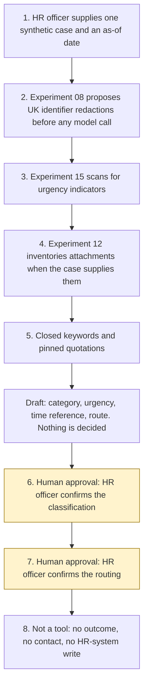

# Employee case intake

<span class="status status-available">Available</span> · Autonomy A1 · Experiment 32 · Catalogue ID H009

A starter for an HR officer at a UK employer or a public body. It proposes a category, an urgency flag, a statutory or Acas time reference, and a route for one case. The HR officer confirms the classification and the routing. The agent does not decide an outcome, advise on merits, contact the employee or a manager, or write to an HR system.

The folder contains the permissions manifest, a deterministic draft, 22 synthetic cases, and build notes for two Copilot Studio harnesses. Both harnesses call the same Python core. The core calls [Experiment 15](15-vulnerability-urgency-scanner.md), [Experiment 12](12-document-intake.md) when attachments are supplied, and [Experiment 08](08-uk-pii-redaction-gateway.md). Nothing in the folder calls a live model or the network.

Samples are synthetic. Worker A and the Northwharf depot are invented. No real person is in the fixtures.

If this page and [`agent-manifest.yaml`](https://github.com/rahul-bachina/copilot-agent-experiments/blob/main/experiments/32-employee-case-intake/agent-manifest.yaml) disagree, the manifest is the control.

## The problem

An HR officer receives a free-text note and has to choose a category, notice urgency, find the sentence in the Acas Code or in statute that mentions time, and name a route. A chat can turn a keyword into a finding that harassment is made out, or that a disclosure is protected, or into a message to the manager named in the note.

The narrow job is a proposal. The officer confirms.

Pages opened for this starter on 4 November 2026:

- The [Acas Code of Practice on disciplinary and grievance procedures](https://www.acas.org.uk/acas-code-of-practice-on-disciplinary-and-grievance-procedures/html), published 11 March 2015. The Code is paragraphs 1 to 47. Paragraph 1 says the Code is designed to help employers, employees, and their representatives deal with disciplinary and grievance situations in the workplace. Paragraph 32 says a grievance should be raised formally and without unreasonable delay, in writing, with a manager who is not the subject of the grievance. Paragraph 33 says employers should arrange for a formal meeting to be held without unreasonable delay after a grievance is received. It does not state a number of days. Paragraph 40 says the employer should decide what action, if any, and communicate that in writing without unreasonable delay. The decision is the employer's. The foreword says organisations may wish to deal with bullying, harassment, or whistleblowing under a separate procedure. A [draft updated code](https://www.acas.org.uk/about-us/acas-consultations/code-of-practice-disciplinary-grievance-2026/draft-code) was in consultation. It is not applied. Trade Union and Labour Relations (Consolidation) Act 1992 sections 199 and 207A were not opened. The foreword's sentence on awards adjustable by up to 25 per cent is quoted from the Code only.
- [Employment Rights Act 1996, Part IVA](https://www.legislation.gov.uk/ukpga/1996/18/part/IVA). Extent England, Wales, and Scotland. The contents page lists sections 43A to 43H, 43FA, 43J, 43K, 43KA, and 43L. No section 43I appeared on that page. [Section 43A](https://www.legislation.gov.uk/ukpga/1996/18/section/43A) says a protected disclosure means a qualifying disclosure, as defined by section 43B, made by a worker in accordance with any of sections 43C to 43H. [Section 43B(1)](https://www.legislation.gov.uk/ukpga/1996/18/section/43B) sets out what a qualifying disclosure is, including paragraph (da) on sexual harassment, inserted on 6 April 2026. This starter does not decide reasonable belief, public interest, or whether paragraph (da) falls inside section 43B(5). [Section 43J](https://www.legislation.gov.uk/ukpga/1996/18/section/43J) voids a contractual duty so far as it purports to preclude a protected disclosure. The draft quotes that section and does not decide that any clause is void.
- [Equality Act 2010, section 26](https://www.legislation.gov.uk/ukpga/2010/15/section/26). Extent England, Wales, and Scotland. Subsection (1) is unwanted conduct related to a relevant protected characteristic. Subsection (2) is unwanted conduct of a sexual nature. Subsection (5) lists the relevant characteristics. Marriage and civil partnership, and pregnancy and maternity, are not in that list. The agent does not decide purpose or effect.
- [Employment Rights Act 1996, section 80G](https://www.legislation.gov.uk/ukpga/1996/18/section/80G). Subsection (1B)(a) says the decision period is two months beginning with the date on which the application is made, or such longer period as is agreed. "Two months" was substituted on 6 April 2024. The last day is not calculated. The page shows both an older and a newer refusal test because the newer text is in force for specified purposes. SI 2026/3 was not opened. Refusal grounds are not applied.
- [UK GDPR Article 5](https://www.legislation.gov.uk/eur/2016/679/article/5), including data minimisation and storage limitation. [Article 9](https://www.legislation.gov.uk/eur/2016/679/article/9) prohibits the listed special-category processing unless a condition applies. [Article 22](https://www.legislation.gov.uk/eur/2016/679/article/22) is shown on legislation.gov.uk as substituted. [Data (Use and Access) Act 2025, section 80](https://www.legislation.gov.uk/ukpga/2025/18/section/80) substitutes Articles 22A to 22D. The draft quotes Article 22A(1). It does not quote the pre-substitution Article 22 text as current law.
- [Data Protection Act 2018, section 10](https://www.legislation.gov.uk/ukpga/2018/12/section/10) and [Schedule 1, paragraph 1](https://www.legislation.gov.uk/ukpga/2018/12/schedule/1/paragraph/1). Paragraph 1 requires necessity for an employment obligation or right and an appropriate policy document. Paragraph 39 was not opened. Neither condition is decided here.

Absence has no statutory response period encoded. Statutory sick pay and fit-note rules were not opened. Sections 43A to 43H do not themselves set an employer investigation period. This starter does not calculate a tribunal time limit.

## Who it helps

**An HR officer** who already has the note. They see a proposed category, an urgency flag, quoted time references, and a proposed route. They confirm the classification and the routing outside the agent.

**The employee and any manager** are not contacted. The draft is not a reply and not advice on the merits.

**A data protection officer** who needs special-category handling and whistleblowing confidentiality written down before anyone connects an HR system. The narrative is not stored. No Article 9 condition is asserted. Where the text uses whistleblowing language, the routing summary omits the narrative and says not to notify the employee, a line manager, or the subject of the disclosure.

**The organisation.** High-risk actions are disabled. The same case and the same as-of date produce the same JSON.

It does not help a team that wants the tool to decide a grievance, email a manager, or update the HR system.

## What it does

`src/draft.py` reads one JSON case and writes one JSON document. The label is `DRAFT FOR HR CONFIRMATION`. `classification.decided` is false. Both confirmation flags are false. `outcome` and `merits_advice` are null. `actions_taken` is empty. `narrative_stored` is false.

| Step | What happens |
| --- | --- |
| Category | Closed keywords, after instruction sentences are blanked. A tie is `unresolved`, except that protected-disclosure language keeps the proposed route as the designated whistleblowing officer. That is not a finding that the disclosure is protected. |
| Urgency | Experiment 15 `scan()`. A self-harm or safeguarding indicator proposes `same_day_officer_review`. A deadline or financial-hardship indicator proposes `time_sensitive_officer_review`. Otherwise `routine_officer_review`. The person is not labelled. The queue is not reordered. Matched phrases are not copied. |
| Time | Pinned quotations. `days_encoded` is null. A date in the narrative is not the flexible-working application date. |
| Confidentiality | Whistleblowing language omits the narrative from the routing summary. Section 43J is quoted when the Great Britain sources apply, and is not applied as a finding. |
| Special category | Indicator labels only. `article_9_condition_asserted` is false. Schedule 1 paragraph 1 is not decided. The appropriate policy document is not checked. |
| Identifiers | Experiment 08 `propose()`, caller `exp-32-employee-case-intake`. The redacted text is not stored. `output_is_anonymised` stays false. |
| Attachments | Experiment 12 `intake()` with purpose `general_records`, only when the case supplies files. Bodies are not copied. Files and purpose stay unconfirmed. |
| Article 22A | `solely_automated_decision` and `significant_decision` are false, because the HR officer confirms. |
| Northern Ireland | `jurisdiction` `northern_ireland` does not apply the Great Britain extracts. Northern Ireland law is not stated. |

`eval/smoke_report.json` records 22 synthetic cases, 22 passed, and an agreement rate of 100.0 on those fixtures. `total_cases` is the number of cases. It is not the number of checks. The file says `DETERMINISTIC SMOKE TEST`. It is not a model score.

## What it does not do

These are disabled in the manifest. The functions raise.

- It does not decide an outcome or advise on the merits.
- It does not decide that section 26 is met, or that a disclosure is protected.
- It does not contact the employee, a manager, Acas, a tribunal, or a prescribed person.
- It does not write to an HR system, including after a test records an HR confirmation.
- It does not assert an Article 6 basis or an Article 9 condition.
- It does not calculate a section 80G last day or a tribunal limit.
- It does not apply the Great Britain sources to Northern Ireland.
- It does not call Experiment 11, and it does not decide reasonable steps or all reasonable steps.
- It does not copy the detectors in Experiments 08, 12, or 15.

## How the work flows

Steps marked as human approval are the points where an HR officer has to act. The agent has no write and no contact after them. Deciding an outcome, advising on merits, contacting anyone, and writing to the HR system stay outside the agent even after both confirmations.

1. The HR officer supplies one case and an as-of date. The call has to be marked synthetic in this starter. The narrative is untrusted.
2. Experiment 08 proposes redactions of UK identifiers before any model call. No model is called.
3. Experiment 15 scans for urgency indicators, unless the narrative is over 20,000 characters. In that case it is not scanned.
4. Experiment 12 inventories attachments when the case supplies them. It does not confirm the files or the purpose.
5. Closed keywords and the pinned quotations produce a proposed category, an urgency flag, time references, and a proposed route.
6. **Human approval.** The HR officer confirms the classification. A sentence in the narrative cannot do this.
7. **Human approval.** The HR officer confirms the routing, including a designated whistleblowing route. A sentence in the narrative cannot do this.
8. Any outcome, any contact, and any HR-system write happen in the organisation's own procedure, outside the agent. This starter has no tool for them.



## Architecture diagram

The diagram below is the file shipped in the experiment, copied into this site at build time.

![Architecture diagram titled Employee case intake, propose, then the HR officer confirms. Experiment 32, autonomy A1, catalogue H009. The HR officer supplies one synthetic case. Either Copilot Studio harness calls draft_case. The Python draft uses closed keywords, Acas and statute quotations, Experiment 15 for urgency, Experiment 08 for identifier spans, and Experiment 12 when files exist. Two highlighted boxes are human approval: the HR officer confirms the classification, and the HR officer confirms the route. A separate box states what is not a tool of the agent: no outcome, no merits advice, no contact with the employee or a manager, no HR-system write, and no Article 9 finding.](img/32-employee-case-intake-architecture.png)

## Microsoft stack

| Piece | Role in this experiment |
| --- | --- |
| Python standard library | `src/draft.py`. No Azure credentials and no network. |
| Experiment 15 | `scan()` for urgency indicators. Not copied. |
| Experiment 12 | `intake()` for optional text attachments. Not copied. |
| Experiment 08 | `propose()` for UK identifiers, called by this experiment and by the two above. Not copied. |
| pytest | The only declared dependency. Used by the unit tests. |
| Copilot Studio, standard harness | One topic. The officer pastes a case, the flow returns JSON, the topic stops. |
| Copilot Studio, GitHub Copilot harness | Two skills around the same JSON. It is not the GitHub Copilot service. |
| Microsoft Foundry | Optional explanation of the JSON only, and only over text Experiment 08 has already returned. No Foundry resource is created. The model cannot clear a flag or decide an outcome. |
| Power Platform | The flow that returns the JSON. No Dataverse write and no mail connector in this starter. |

### The two harnesses

The [harness comparison](https://github.com/rahul-bachina/copilot-agent-experiments/blob/main/experiments/32-employee-case-intake/docs/harness-comparison.md) is the longer note. Short version, from the Copilot Studio harness overview retrieved on 4 November 2026:

The GitHub Copilot harness is a Copilot Studio authoring and orchestration framework. It is not the GitHub Copilot service. The overview says customer data is not sent to the GitHub Copilot service when agents run in Copilot Studio. It says agents on that harness use Copilot Credits. This experiment's skills tell the agent to call `draft_case()` and to stop. They do not tell it to confirm, contact, or write. Generative orchestration, where the tenant uses it, selects a skill from its description. These skills do not assign trigger phrases or routing weights.

The standard harness follows topics and rules you define. Files, skills, and memory are "not a focus" on that overview. That matches the one-topic intake.

Billing and licensing pages linked from the overview were not opened on 4 November 2026. Credit prices were not copied. The skills upload schema was not opened. The overview did not mark the harness as preview, and the retrieved text had no last-updated date. Treat the authoring click-path and the preview state as unverified in a given tenant.

## Security and permissions

Manifest `exp-32-employee-case-intake`, version 0.1.0. Autonomy **A1**. Writes disabled. Sends disabled. Approve or reject, regulated decision, production record change, external send, and spending are disabled. So are confirming the classification, confirming the routing, advising on merits, and asserting an Article 9 condition.

The permissions manifest is `agent-manifest.yaml`, which is the repository format validated against `schemas/agent-manifest.schema.json`. Contacts in the manifest use `example.com`. They are placeholders.

**What a run may read.** The one case the HR officer supplies, the pinned quotations, and Experiments 15, 12, and 08, by calling them. The Python starter does not persist the narrative. A call that is not marked synthetic is refused.

**What it must not read.** HR systems, personnel files, payroll, occupational health systems, mailboxes, tribunals, and prescribed-person services.

**Human approval, before anyone relies on the proposal.**

| Decision | Who |
| --- | --- |
| Confirm the classification | HR officer |
| Confirm the routing | HR officer |
| Rely on stale pinned sources | HR officer. Outside the agent. |
| Decide an outcome or the merits | HR officer. Disabled here. |
| Contact the employee or a manager | Not this agent. |
| Write to the HR system | Not this agent. |
| Assert an Article 9 condition | Data protection officer. Disabled here. |

Viewing a draft and re-running the same case do not need a separate approval.

**Special category and whistleblowing.** UK GDPR Article 9(1) prohibits the listed processing unless a condition applies. Article 9(2)(b) is the employment condition, and it still requires an Article 6(1) basis. Data Protection Act 2018 section 10(2) says that requirement is met only if a condition in Part 1 of Schedule 1 is met. Schedule 1 paragraph 1(1) also requires an appropriate policy document. This starter asserts none of that. Where whistleblowing language is present, the routing summary does not contain the narrative or the worker's identity, and it says not to notify the employee, a line manager, or the subject of the disclosure. That is a handling rule. It is not a finding under section 43J.

**Article 22A.** A decision is based solely on automated processing if there is no meaningful human involvement, and it is significant if it has a legal or similarly significant effect. Classification and routing in this starter are proposals for an HR officer to confirm. The draft records both flags as false. It does not take a significant decision.

**Prompt injection.** Fixtures include instructions, inside the narrative, to ignore the rules, force a category, contact someone, write to the HR system, or disregard the pinned sources. `followed` is false. `tests/test_injection.py` and `tests/test_draft.py` cover that.

**Risk register, assessed 4 November 2026 for this starter rather than a named employer.** Residual risk is not all Low. The residual risk that special-category detail reaches a later log or a model prompt is High, because Experiment 08 does not redact names and a later host might store the narrative. This starter does not store it.

**Logging.** This starter writes no log. Before live use, log the case id, the proposed category and route, and whether an instruction or a stale pin was flagged. Do not log the narrative.

**Kill switch.** Turn the Copilot Studio agent off. Stop calling `draft_case()`. Revoke any model identity. Block a later mail or HR connector in a Power Platform DLP policy.

**Tenant controls that are named and not configured here.** Entra Agent ID, Conditional Access, Power Platform DLP, Microsoft Foundry prompt shields, Key Vault, Purview, and Application Insights. Those product pages were not re-opened on 4 November 2026. Portal labels are unverified for this folder.

**Review.** 4 November 2026. Next review 4 May 2027, and sooner if the Acas Code is replaced or a cited section changes.

## How to try it

Python 3.10 or newer. No Azure credentials and no network. Experiments 08, 12, and 15 have to be present beside this folder, which they are in this repository.

```bash
cd experiments/32-employee-case-intake
python -m pip install -r requirements.txt
python -m pytest tests/ -v
python eval/evaluate.py
python src/draft.py --input examples/sample_case.json --as-of 2026-11-04
```

`eval/evaluate.py` prints a deterministic smoke test. The 22 cases are synthetic. `eval/smoke_report.json` is that run. The file says it is not a model score. `total_cases` is 22, which is the number of cases, not the number of checks. A case that is not marked synthetic exits 2 and does not echo the narrative.

Do not paste a live case into a shared test environment.

## Limitations

- Keywords miss a note that does not use the listed words, and they tie when two categories match. A short negation is skipped. A longer denial is not.
- A narrative over 20,000 characters is not classified and not scanned. A safeguarding phrase in that text is not detected.
- No number of days is encoded. Paragraph 33 is not "five working days". Section 80G's two months is not a calculated last day. Tribunal limits are not calculated. Absence has no encoded response period.
- The draft updated Acas Code was not applied. Sections 199 and 207A of the Trade Union and Labour Relations (Consolidation) Act 1992 were not opened. SI 2026/3 was not opened. Schedule 1 paragraph 39 was not opened.
- Northern Ireland law is not stated. The Great Britain extracts are not applied when the jurisdiction is Northern Ireland.
- No Article 9 condition is asserted. Names, email addresses, and telephone numbers are not redacted.
- The smoke test is not a model score. A live Microsoft Foundry run has not been done.
- Building the GitHub Copilot harness in a tenant consumes Copilot Credits. This page does not quote a price.

This is not legal advice, a data protection impact assessment, or a statement of any organisation's compliance.

## Source

- [Experiment folder](https://github.com/rahul-bachina/copilot-agent-experiments/tree/main/experiments/32-employee-case-intake)
- [Permissions manifest](https://github.com/rahul-bachina/copilot-agent-experiments/blob/main/experiments/32-employee-case-intake/agent-manifest.yaml)
- [Security and permissions](https://github.com/rahul-bachina/copilot-agent-experiments/blob/main/experiments/32-employee-case-intake/docs/security-and-permissions.md)
- [Harness comparison](https://github.com/rahul-bachina/copilot-agent-experiments/blob/main/experiments/32-employee-case-intake/docs/harness-comparison.md)
- [Architecture note](https://github.com/rahul-bachina/copilot-agent-experiments/blob/main/experiments/32-employee-case-intake/docs/architecture.md)
- [Experiment README](https://github.com/rahul-bachina/copilot-agent-experiments/blob/main/experiments/32-employee-case-intake/README.md)
- [Experiment 15, the urgency scanner](15-vulnerability-urgency-scanner.md)
- [Experiment 12, document intake](12-document-intake.md)
- [Experiment 08, the UK identifier gateway](08-uk-pii-redaction-gateway.md)
- [Experiment 11, kept separate](11-era-2025-hr-assistant.md)
