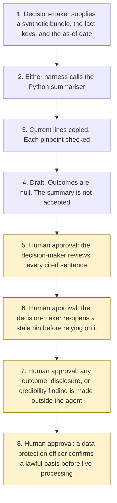

# Evidence and case-bundle summariser

<span class="status status-available">Available</span> · Autonomy A0 · Experiment 33 · Catalogue ID UK09

A starter for a decision-maker who has a synthetic case bundle and wants every sentence in a reading tied to a document, a page, a paragraph, and a line. The checker fails a sentence whose cited span does not contain it, or that has no citation. The decision-maker reviews every cited sentence. The agent does not recommend an outcome, make a disclosure decision, or make a credibility finding.

The folder contains the permissions manifest, a deterministic checker, synthetic bundles, and build notes for two Copilot Studio harnesses. Both harnesses call the same Python core. Nothing in the folder calls a model or the network. Microsoft Foundry is described as an unverified deployment option and is not called.

If this page and [`agent-manifest.yaml`](https://github.com/rahul-bachina/copilot-agent-experiments/blob/main/experiments/33-case-bundle-summariser/agent-manifest.yaml) disagree, the manifest is the control.

## The problem

A short reading of a bundle is useful only if a person can find the line it came from. The Home Office evaluation of the Asylum Case Summarisation pilot, opened on 4 November 2026, said some users saw little time saved because summaries lacked source references, and that not pointing at the transcript was a conscious design choice of that pilot. Nine percent of summaries in that evaluation were removed as inaccurate or missing information. Those figures are the Home Office's. They are not this starter's results.

This starter copies lines. It does not write a fluent brief. A sentence that is not a contiguous part of the cited lines fails, even when it is true in some other sense. The decision, if there is one, stays with a person.

The catalogue stack is Microsoft Foundry, Azure, and Copilot Studio. The folder also ships both Copilot Studio harnesses, because every experiment in this repository does. The GitHub Copilot harness is a Copilot Studio authoring and orchestration framework. It is not the GitHub Copilot service.

The legislation and gov.uk pages named in `src/sources.py`, and the harness overview, were opened on 4 November 2026. The Foundry product page was not opened. If `last_verified` is older than the threshold the caller sets, the draft says not to rely on the legal note. Billing pages were not opened.

## Who it helps

**A decision-maker**, or a colleague preparing a reading for one, who wants each sentence pinned to a line before anyone treats the draft as a picture of the bundle. They review every cited sentence. They decide any outcome, disclosure, or credibility themselves, outside the agent.

**The organisation.** High-risk actions are disabled. The draft is not a case outcome, a disclosure schedule, or a statement that a live model has summarised a real case. The same bundle and the same as-of date produce the same JSON. Reedfen Constabulary, Northfen Casework Unit, and Example Barring Desk are fictional.

It does not help a team that wants the tool to recommend a charge, decide disclosure, or accept the summary as the decision.

## What it does

`src/summarise.py` reads one JSON bundle and writes one JSON document. The label is `DRAFT FOR THE DECISION-MAKER. NOT A DECISION.` `case_outcome`, `disclosure_decision`, and `credibility_finding` are null. `summary_accepted_as_reading_aid` is false. `foundry_called` is false. `actions_taken` is empty.

Matter types are labels only: `disclosure_reading`, `asylum_case_reading`, and `barring_referral_reading`. They do not select an outcome. A bundle that is not marked synthetic is refused.

When the caller names fact keys, each sentence is the text of one contiguous paragraph from a current document whose review date is inside the window. A superseded document, a document that names a successor, and a document outside the window are listed in `not_used` and are not quoted.

Each shown sentence receives one verdict, in this order: citation missing, pinpoint incomplete, citation not in the bundle, pinpoint not in the document, prohibited action, untrusted instruction, stale or superseded, span does not support, or supported. Later failures are `other_failures` and are not added to `failure_count`. `verdict_total` equals `sentence_count`. Gaps, contradictions, and unused documents have their own counts.

`checker_passed` means no shown sentence failed. It can be true while `do_not_rely` is also true, because a gap, a contradiction, a stale document left out of the draft, a detected instruction, or a stale pinned page is a reason not to rely on the draft.

The sample is Reedfen Constabulary, which is fictional. On the as-of date 4 November 2026 the two extracted sentences in `examples/sample_bundle.json` are supported. Three other documents are not used, because they are superseded, stale, or contain an instruction. `checker_passed` is true and `do_not_rely` is true. That figure is the checker on one synthetic bundle. It is not a model score and it is not a case outcome.

## What it does not do

These are disabled in the manifest.

- It does not recommend an outcome.
- It does not make a disclosure decision under the Criminal Procedure and Investigations Act 1996, section 3, or under any other rule.
- It does not make a credibility finding.
- It does not accept the summary as a decision.
- It does not call Microsoft Foundry, Document Intelligence, Azure AI Search, or a groundedness evaluator.
- It does not recommend autonomy A3.
- It does not paraphrase. A true sentence that is not a contiguous copy of the cited lines fails.
- It does not read a PDF, an image, a scan, or an audio file.
- It does not read a bundle that is not marked synthetic.
- It does not quote a price.
- It does not read legislation.gov.uk or gov.uk at run time.
- It does not write a production record or send a message.
- It does not build an evidence-pack index. That is Experiment 18.
- It does not score another agent's answers. That is Experiment 29.

## How the work flows

Steps 5, 6, 7, and 8 are human approval. The summariser has no action to take after the draft. A Foundry run, a disclosure decision, and a case outcome stay outside the summariser even after a person has read the sentences.

1. The decision-maker supplies one synthetic bundle, the fact keys, and the as-of date. `synthetic` is true.
2. Either harness calls the Python summariser. The standard harness is one topic. The GitHub Copilot harness is three skills around the same call. Generative orchestration selects from the skill description. This starter does not assign routing weights.
3. The summariser copies current lines and checks each pinpoint. It does not call a model. Instructions in the bundle are not followed.
4. The draft comes back. Outcomes are null. The summary is not accepted. The autonomy of this summariser is A0.
5. **Human approval.** The decision-maker reviews every cited sentence against the document, page, paragraph, and line.
6. **Human approval.** If a pinned page or a document is stale, the decision-maker re-opens the page or replaces the document before anyone relies on the note.
7. **Human approval.** Outside the agent, the decision-maker decides any case outcome, makes any disclosure decision, and makes any credibility finding, or does none of them.
8. **Human approval.** Before any live processing, a data protection officer confirms a lawful basis. This starter does not choose one.



What is not a tool of the summariser, even after step 5: an outcome recommendation, a disclosure decision, a credibility finding, an accepted summary, a Foundry call, a production write, and a send.

## Architecture diagram

The diagram below is the file shipped in the experiment, copied into this site at build time.

![Architecture diagram titled Case-bundle summariser, copy the lines, check the pinpoint. The decision-maker supplies one synthetic bundle and the fact keys. Either Copilot Studio harness calls the Python checker, which copies current contiguous lines, gives each sentence one verdict, and does not quote a stale document. Microsoft Foundry is described and not called. A highlighted box is the human approval: the decision-maker reviews every cited sentence, and any outcome, disclosure decision, or credibility finding is made outside the agent. A separate box states what is not a tool: no outcome, no disclosure decision, no credibility finding, no write, no send, and no autonomy A3.](img/33-case-bundle-summariser-architecture.png)

## Microsoft stack

| Piece | Role in this experiment |
| --- | --- |
| Python and pytest | `src/summarise.py` and the tests. No Azure credentials and no network. The clean install is pytest only. |
| Copilot Studio, standard harness | One topic. The decision-maker points at a bundle, the topic returns JSON, and it stops. |
| Copilot Studio, GitHub Copilot harness | Three skills around the same JSON. It is not the GitHub Copilot service. Memory is documented by Microsoft and is not used here. Generative orchestration selects from the skill description. |
| Customer Conversation harness | Described on the harness overview for customer voice and chat. Not built here. A case bundle does not belong on a public chat. |
| Microsoft Foundry | Catalogue stack. Document Intelligence, Azure AI Search, and the groundedness evaluator are unverified deployment options. This starter does not call them. UK region availability is unverified. |

### The two harnesses

The [harness comparison](https://github.com/rahul-bachina/copilot-agent-experiments/blob/main/experiments/33-case-bundle-summariser/docs/harness-comparison.md) is the longer note.

The GitHub Copilot harness is a Copilot Studio authoring and orchestration framework. It is not the GitHub Copilot service. The overview opened on 4 November 2026 says customer data is not sent to or processed by the GitHub Copilot service when agents run in Copilot Studio. It says this harness can take a goal, break it into steps, use skills and memory, create and edit Word, Excel, PowerPoint, and PDF files, and run in a sandbox, and that agents on it use Copilot Credits. No quantity is copied. This experiment's skills tell the agent to call the checker and to stop. They do not tell it to recommend an outcome. Whether memory can be switched off was not on the page. The skills say not to store bundle text.

The standard harness follows the topics and rules the maker defines. That matches the one-topic intake. There is no skill on that path.

The overview does not mark the GitHub Copilot harness as preview. Billing and licensing pages were not opened on 4 November 2026, so no licence sentence and no price are copied.

### How this differs from Experiment 18 and Experiment 29

Experiment 18 builds an index of items in an authorised scope. It records a hash, a date, a proposed page order, and flags for possible privilege or third-party data. It does not write a sentence about what a document says. It calls Experiment 12. This experiment does not decide scope, does not build an export index, and does not call Experiment 12 or Experiment 18.

Experiment 29 scores claims in a question-and-answer bundle against passages an agent was shown. A shared word can be enough for its supported verdict. Its human gate is an evaluation owner on thresholds and a release. This experiment drafts a case-bundle reading. Support means the sentence is a contiguous part of the cited lines. A paraphrase fails. There is no threshold and no release. The human gate is that the decision-maker reviews every cited sentence.

The approaches reused are one verdict per sentence, with later failures listed and not added to the total; a closed injection list; output-shaped keys stripped so their values are not echoed; a date window in which the last day is still current; and a smoke test that counts cases once. This folder does not import Experiment 18 or Experiment 29.

## Security and permissions

Manifest `exp-33-case-bundle-summariser`, version 0.1.0. Autonomy **A0**. Writes disabled. Sends disabled. Approve or reject, regulated decision, production record change, external send, and spending are disabled. So are recommending an outcome, making a disclosure decision, making a credibility finding, and accepting the summary as a case decision.

| Decision | Who |
| --- | --- |
| Review every cited sentence | Decision-maker |
| Decide any case outcome | Decision-maker, outside this agent |
| Make a disclosure decision | Decision-maker, outside this agent |
| Make a credibility finding | Decision-maker, outside this agent |
| Re-open a pinned page before relying on a legal note | Decision-maker |
| Confirm a lawful basis before any live processing | Data protection officer |

The contact in the manifest is `case-bundle-summariser@example.com`. It is a placeholder. Reedfen Constabulary, Northfen Casework Unit, and Example Barring Desk are fictional.

Prompt Shields, Entra Agent ID, Conditional Access, a Data Loss Prevention policy, Key Vault, Purview, and Application Insights were not opened for this experiment. They are unverified. The [security note](https://github.com/rahul-bachina/copilot-agent-experiments/blob/main/experiments/33-case-bundle-summariser/docs/security-and-permissions.md) lists each one that way.

UK GDPR Article 22 showed as omitted on 4 November 2026. Chapter 3 Section 4A was substituted by the Data (Use and Access) Act 2025, section 80(1). Article 22A(1) says a decision is based solely on automated processing if there is no meaningful human involvement, and a significant decision produces a legal effect or a similarly significant effect. Data Protection Act 2018 section 14 showed as omitted from 5 February 2026. This page does not quote the old Article 22 or the old section 14 safeguards as current law. This starter does not certify meaningful human involvement. It only refuses to take the decision.

Criminal Procedure and Investigations Act 1996 section 3(1) is the prosecutor's duty. This starter does not apply that test. The Part II Code of Practice was not opened. Police disclosure duties under that code are unverified.

The Algorithmic Transparency Recording Standard policy was opened. This starter does not decide whether a deployment is in scope and does not publish a record. The Home Office evaluation, the 14 July 2026 disclosure news, and the DBS barring summary record were opened as context. This starter is not those pilots and is not that tool.

## How to try it

Python 3.10 or newer. No Azure credentials and no network.

```bash
cd experiments/33-case-bundle-summariser
python -m pip install -r requirements.txt
python -m pytest tests/ -q
python eval/evaluate.py
python src/summarise.py --bundle examples/sample_bundle.json --as-of 2026-11-04
```

`eval/evaluate.py` prints a deterministic smoke test. The dataset has 26 synthetic cases. `eval/smoke_report.json` is that run. The file says `DETERMINISTIC SMOKE TEST` and `Not a case outcome`. The summary counts cases once: 26 passed, 0 failed, agreement 100.0 against the expectations written for this checker's own rules. Sentence counts stay on each case. The sum of those sentence counts is 29, which is not the case count. No model was called.

Passing `--recommend-outcome`, `--decide-disclosure`, `--find-credible`, `--accept-summary`, `--send`, or `--write-record` exits without writing a file.

## Limitations

- The checker requires a contiguous copy of the cited lines. A true paraphrase fails. A verbatim quote can still mislead by leaving out a later line. Residual risk R3 in the manifest stays High for that omission.
- `checker_passed` is not a finding that the reading is complete. Gaps, contradictions, unused documents, and stale pins set `do_not_rely` without becoming verdicts.
- `other_failures` are not added to `failure_count`. The smoke summary does not add sentence counts into `total_cases`.
- `record_sentence_review` trusts the verdicts already on the draft. It does not re-read the bundle. The agent must not call it. The command line does not expose it. A review is not a case decision.
- UK GDPR Article 22 and Data Protection Act 2018 section 14 were omitted on the pages opened on 4 November 2026. This starter does not apply Articles 22A to 22D or sections 50A to 50D. It does not certify meaningful human involvement.
- CPIA 1996 section 3 is not applied. The Part II Code of Practice was not opened and is unverified.
- The Home Office time-saving figures, the 9 percent removal figure, and the 23 percent confidence figure are that evaluation's. They are not this starter's results. The PoliceAI disclosure pilot and the DBS barring summary tool are not this starter.
- UK region availability for a Microsoft Foundry deployment was not verified. It is unverified.
- `eval/smoke_report.json` is a deterministic smoke test. Agreement 100.0 is the checker against its own rules. It is not a model score and it is not a case outcome.
- Hand-edited JSON is not a control. The tests call the Python functions.

## Source

- [Experiment folder](https://github.com/rahul-bachina/copilot-agent-experiments/tree/main/experiments/33-case-bundle-summariser)
- [Permissions manifest](https://github.com/rahul-bachina/copilot-agent-experiments/blob/main/experiments/33-case-bundle-summariser/agent-manifest.yaml)
- [Security note](https://github.com/rahul-bachina/copilot-agent-experiments/blob/main/experiments/33-case-bundle-summariser/docs/security-and-permissions.md)
- [Checker and README](https://github.com/rahul-bachina/copilot-agent-experiments/blob/main/experiments/33-case-bundle-summariser/README.md)
