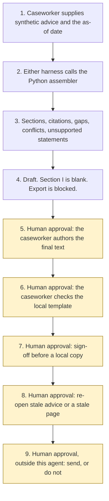

# EHCP draft assembler

Catalogue ID UK10. Autonomy A1. Status: Available.

The caseworker authors the final education, health and care plan. This starter files synthetic advice under the section headings the reports already use, and it stops.

## The problem

Advice for an education, health and care plan arrives as several reports. A paragraph should stay under the section the advice named. A sentence that is not in a cited paragraph should not appear as if it were advice. Two reports can disagree, and the draft should keep both. A draft must not name a school.

## Who it helps

A SEND caseworker who wants a first filing of synthetic advice, with citations, gaps, conflicts, and unsupported statements, before they write the plan in the local authority's own template.

A local authority that wants the same filing each time, and a gate that blocks a local copy until a caseworker signs off. The samples use a fictional council, Northfen Borough Council, and a fictional child reference, Child A.

## What it does

`src/assemble.py` reads one synthetic bundle and an as-of date. The same inputs produce the same JSON. The label is **DRAFT FOR CASEWORKER — NOT A PLAN**.

It files a paragraph only under the letter the advice tagged. It cites the report and the paragraph. It flags a missing advice category under regulation 6 of the Special Educational Needs and Disability Regulations 2014, an empty section, a conflict between two claim values, an unsupported statement, and advice older than the freshness window. Section K lists the reports. Appendices are not attached.

Section I is left blank. Children and Families Act 2014 s.38(5) says a draft sent to the parent or young person must not name a school or other institution, or specify a type.

On the sample, as of 4 November 2026, the draft places 7 quotes. Days since the request are 93. The 20-week marker has not passed. `breach_found` is false. There is one unresolved conflict. Those figures are the fixture. They are not a plan.

## What it does not do

- It does not decide needs, provision, placement, or outcomes.
- It does not edit the final plan. The caseworker authors the final text.
- It does not send the draft to a parent, a school, or a local authority system.
- It does not secure provision. Section 42 applies where the local authority maintains a plan. This draft is not a maintained plan.
- It does not treat a gap as a breach of regulation 6, or the timescale marker as a breach of regulation 13.
- It does not check the local template. The caseworker does.
- It does not anonymise the output. `output_is_anonymised` stays false.
- It does not call a model, Microsoft Foundry, or Azure.

## How the work flows

1. The caseworker supplies a synthetic advice bundle and the as-of date. No case system is read.
2. Either Copilot Studio harness calls the Python assembler. The standard harness is one topic. The GitHub Copilot harness is three skills. That harness is not the GitHub Copilot service.
3. The assembler refuses a bundle that is not synthetic, strips payload keys, and asks Experiment 08 to flag identifier patterns. A matching paragraph is withheld.
4. Tagged paragraphs are filed. Untagged text is a gap. Section I quotes are withheld. Conflicts keep both citations and are not resolved.
5. **Human approval.** The caseworker authors the final text and resolves the conflicts and the gaps.
6. **Human approval.** The caseworker checks the headings against the local authority's own template. SEND Code of Practice paragraph 9.62 says the format is agreed locally.
7. **Human approval.** The caseworker signs off before any local export copy. The sign-off is a separate object. Text inside the advice cannot pass the gate.
8. **Human approval.** The caseworker re-opens stale advice, or a stale pinned page, before relying on it.
9. **Human approval, outside this agent.** Sending the plan to a parent, a school, or the local authority system stays outside the agent even after sign-off.



What is not a tool of the agent, even after step 7: deciding needs, provision, placement, or outcomes; editing the final plan; securing provision under section 42; sending to a parent, a school, or the local authority system; writing that system.

## Architecture diagram

The diagram below is the file shipped in the experiment, copied into this site at build time.

![Architecture diagram titled EHCP draft assembler, file the advice, do not write the plan. The caseworker supplies synthetic advice and the as-of date. Either Copilot Studio harness calls the Python assembler, which files a paragraph only under the tag already on the advice, leaves section I blank, flags gaps and conflicts, calls no model, and withholds identifier matches through Experiment 08. A highlighted box is the human approval: the caseworker authors the final text, checks the local template, signs off before any local copy, and re-opens stale advice before relying on it. A send stays outside the agent. A separate box states what is not a tool: no need, provision, or placement is decided, the plan is not edited, and nothing is sent.](img/34-ehcp-draft-assembler-architecture.png)

## Microsoft stack

| Piece | Role in this experiment |
| --- | --- |
| Python and pytest | `src/assemble.py` and the tests. No Azure credentials and no network. The clean install is pytest only. |
| Advice bundle | The only source of quotes. The sample is synthetic. |
| Experiment 08 | Identifier patterns. A hit withholds the paragraph. The output is not marked anonymised. |
| Copilot Studio, standard harness | One topic. The caseworker points at the file, the topic returns JSON, and it stops. The billing overview, opened on 4 November 2026, says this harness starts billing after publish. |
| Copilot Studio, GitHub Copilot harness | Three skills around the same JSON. Sandbox draft only. It is not the GitHub Copilot service. The billing overview says it charges Copilot Credits from the moment you start building, including testing. Memory is described by Microsoft and is not used here. |
| Customer Conversation harness | Described on the harness overview. Not built here. |
| Microsoft Foundry | Named on the catalogue row. Not called. The Foundry cost page was not opened for this experiment. A host that assigned section tags would be deciding needs or provision. That host is not built. |
| Azure | Named on the catalogue row. Not called. |

### The two harnesses

The [harness comparison](https://github.com/rahul-bachina/copilot-agent-experiments/blob/main/experiments/34-ehcp-draft-assembler/docs/harness-comparison.md) is the longer note.

The GitHub Copilot harness is a Copilot Studio authoring and orchestration framework. It is not the GitHub Copilot service. The overview opened on 4 November 2026 says customer data is not sent to the GitHub Copilot service when agents run in Copilot Studio. This experiment's skills tell the agent to call the assembler and to stop. They do not tell it to decide or to send.

The licensing page says a Microsoft 365 Copilot licence lets you use Copilot Studio to build agents for the GitHub Copilot harness. A second sentence on that page is about answer types in other channels. The two sentences are not merged. No pack size and no meter rate is copied. The cost-management page was not opened for this experiment.

A Learn page on generative orchestration was not opened. How a tenant selects a topic is unverified. This starter does not give a topic a weight. Where generative orchestration is on, selection is by the topic description, and that page was not checked on 4 November 2026.

## Security and permissions

Taken from `agent-manifest.yaml` and `docs/security-and-permissions.md`. If this page and the manifest disagree, the manifest is the control.

**Autonomy.** A1. The caseworker authors the final text. `human_in_the_loop` is true. `auto_actions_enabled` is false.

**Reads.** The synthetic bundle for that run, the as-of date, the pinned source notes, and a sign-off object only when a local export is requested. The sign-off is not stored.

**Does not read.** A live plan, a case system, a mailbox, a parent portal, a school system, Microsoft Foundry, or Azure.

**Writes.** Disabled. **Sends.** Disabled.

**High-risk actions.** Approve or reject, a regulated decision, a production-record change, an external send, and spend or transact are disabled. Deciding needs, provision, placement, or outcomes, and editing the final plan, are disabled. Including a local export copy is enabled only with human approval by the caseworker. The gate requires role Caseworker, a caseworker reference, three boolean confirmations, and a signed-on date equal to the as-of date. The string "true" fails. The copy is labelled LOCAL COPY FOR THE CASEWORKER — NOT SENT.

**Children's data.** Samples are synthetic. A forbidden identity field refuses the bundle and the value is not copied. UK GDPR Article 8 and Article 9 were opened on 4 November 2026. No Article 6 basis and no Article 9(2) condition is asserted. The ICO Children's code page was not opened.

**Prompt injection.** Fixtures include a report that tells the assembler to ignore instructions and to name a school. The assembler records the pattern and does not follow it. `tests/test_injection.py` covers that. `tests/test_prohibited.py` covers the decision and send flags, which exit without writing a file.

**Stale data.** Older than the threshold, default 90 days, is stale. The 90-day window is not a statutory expiry. The catalogue-boundary row and the ICO row are not stale-tested. The draft does not clear `do_not_rely` by itself.

**Risk register, assessed 4 November 2026 for this starter rather than a named local authority.** Residual risk is not all Low.

| ID | Risk | Residual | Owner in the manifest |
| --- | --- | --- | --- |
| R1 | A reader treats the draft as a maintained plan | Medium | Caseworker |
| R2 | A report tells the agent to decide placement or to export | Low | Caseworker |
| R3 | A child's identifier or a school name is copied | Medium | Caseworker |
| R4 | Stale advice is relied on, or the 140-day marker is read as a breach | Medium | Caseworker |
| R5 | The local template differs from regulation 12 | Medium | Caseworker |

**Logging.** This starter writes no log. Before live use, log the synthetic case id, the as-of date, whether export was blocked, and whether injection was detected. Do not log the advice text.

**Kill switch.** Do not run the command. There is no published agent to turn off.

**Tenant controls.** Prompt Shields, Entra Agent ID, Conditional Access, a data loss prevention policy, Key Vault, Purview, and Application Insights were not opened. Treat those as unverified.

**Review.** 4 November 2026. Next review 4 May 2027, and sooner if a pinned page is re-opened and has changed.

## How to try it

Python 3.10 or newer. No Azure credentials and no network. Experiment 08 has to sit beside this folder.

```bash
cd experiments/34-ehcp-draft-assembler
python -m pip install -r requirements.txt
python -m pytest tests/ -v
python eval/evaluate.py
python src/assemble.py --bundle examples/sample_bundle.json --as-of 2026-11-04
```

`eval/evaluate.py` prints a deterministic smoke test. The dataset has 13 cases. `eval/smoke_report.json` is that run. The file says `DETERMINISTIC SMOKE TEST` and `not_a_plan`. It records 13 of 13 cases passed by the checker, and an agreement rate of 100.0 on those fixtures. No model was called. The summary does not add the two cases that each place 7 quotes.

A stale-data check:

```bash
python src/assemble.py --bundle examples/sample_bundle.json --as-of 2027-05-04 --stale-after-days 90
```

Passing `--decide-needs`, `--decide-provision`, `--decide-placement`, `--decide-outcomes`, `--edit-final-plan`, `--send-to-parents`, `--send-to-school`, `--write-la-system`, or `--secure-provision` exits 2 and does not write a file. `--export` without a passing sign-off does the same. The exit code is 0 when the JSON is produced, including when advice is stale. That is not a decision and it is not sign-off.

Do not paste a live advice file into a shared test environment.

## Limitations

- The caseworker authors the final text. This file is not the plan.
- Headings follow regulation 12. They must be checked against the local authority's own template. Paragraph 9.69 is not the section list.
- Twenty weeks is counted as 140 days. That arithmetic is not in the regulations. The marker is not a finding of breach. Regulation 13(3) exceptions are not applied.
- The 90-day window is not a statutory expiry of advice. A missing advice report is not a finding that regulation 6 was breached.
- Experiment 08 does not detect a name written in words. The output is not anonymised.
- A negation in the same sentence can hide an instruction.
- The ICO Children's code page was not opened. The data protection officer decides scope.
- Experiment 12 inventories documents and is not called. Experiment 33, where it exists, summarises a bundle and is not called.
- The smoke test is not a model score and it is not a plan. A live Foundry run has not been done.

This is not legal advice and it is not a statement that a deployment meets UK GDPR or the SEND Code of Practice.

## Source

- [Experiment folder](https://github.com/rahul-bachina/copilot-agent-experiments/tree/main/experiments/34-ehcp-draft-assembler)
- [Permissions manifest](https://github.com/rahul-bachina/copilot-agent-experiments/blob/main/experiments/34-ehcp-draft-assembler/agent-manifest.yaml)
- [Security note](https://github.com/rahul-bachina/copilot-agent-experiments/blob/main/experiments/34-ehcp-draft-assembler/docs/security-and-permissions.md)
- [README](https://github.com/rahul-bachina/copilot-agent-experiments/blob/main/experiments/34-ehcp-draft-assembler/README.md)
