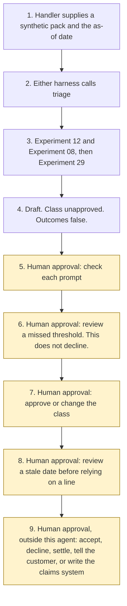

# Claims document triage

Catalogue ID B007. Autonomy A1. Status: Available.

The claims handler approves the classification. This starter quotes a synthetic first notification, an invoice, a report, and a policy extract, and it stops.

## The problem

A claims handler reads several documents before they decide anything. A short reading should stay inside those documents: the date of loss, the peril, the amounts, and one policy line that uses the same peril words. Two documents can disagree on a figure or a date. A sentence inside an invoice can try to make the tool decline the claim. A summary written elsewhere can state a coverage outcome the files do not contain.

The FCA's note of 19 October 2026, case study K, describes a firm that assessed AI-generated claims information for completeness, faithfulness to source information, conciseness, adequacy of reasoning, and safety, combining staff checks with an automated assessment, including LLM-as-a-judge. This starter is a staff-facing draft plus a deterministic scorecard. It is not that firm's system, and it is not an LLM judge.

## Who it helps

A claims handler who wants a first reading of one synthetic pack, with coverage pointers and prompts to check, before they decide the class.

An evaluation owner who wants the same three checks on a summary written elsewhere: faithfulness to the files, completeness of the labelled lines, and no unsupported coverage statement. A miss asks a person to look. It does not decline the claim.

A general insurer that wants the same draft each time, and a gate that never accepts, declines, settles, tells the customer, or writes the claims system. The sample uses a fictional firm, Reedmarsh General, and a fictional policyholder, Policyholder A.

## What it does

`src/triage.py` reads one synthetic pack and an as-of date. The same inputs produce the same JSON. The label is **DRAFT FOR THE CLAIMS HANDLER**.

It calls Experiment 12, which inventories the files and calls Experiment 08. A file with a deterministic identifier finding is not quoted. Faithfulness uses Experiment 29 `score_claim` on the quoted lines. Completeness is a closed list of labelled lines. Unsupported coverage is a closed list of decision phrases that are not a quote from a file this run read. The three results are not added together.

A single peril from a closed list is proposed. The handler approves or changes the class. Recording the class does not accept the claim and does not write a claims system. This starter has no claims-system connector.

On the sample, as of 5 November 2026, the draft proposes `escape_of_water`, quotes 15 lines, and has no prompts. Faithfulness is 1.0 on those 15 lines. Completeness is 5 of 5 applicable rows. Unsupported coverage phrases are 0. Those figures are the fixture. They are not a claims decision and they are not a model score.

## What it does not do

- It does not accept, decline, or settle a claim.
- It does not decide that a loss is within the policy. A coverage pointer is a quote. `coverage_decided` stays false.
- It does not tell the customer anything. `customer_message` stays null.
- It does not write a claims system, including after the handler records a class.
- It does not label the policyholder's conduct. A prompt is not a finding and not a fraud indicator.
- It does not confirm the purpose. Experiment 12 leaves `purpose_confirmed` false. Experiment 12 does not call B007. This experiment calls Experiment 12.
- It does not score conciseness or adequacy of reasoning. Case study K names them. This checker does not.
- It does not call a model, Microsoft Foundry, or an LLM-as-a-judge. `llm_as_judge` stays false.
- It does not describe the output as anonymised.

## How the work flows

1. The claims handler supplies a synthetic pack and the as-of date. No claims system is read.
2. Either Copilot Studio harness calls `triage()`. The standard harness is one topic. The GitHub Copilot harness is three skills. That harness is not the GitHub Copilot service.
3. The Python calls Experiment 12, which calls Experiment 08. Quoted lines and one policy pointer are built. Experiment 29 scores the quotes. A mismatch becomes a prompt, not a finding.
4. The draft proposes a class. The class is not approved. Accept, decline, settle, customer message, and claims-system write stay false.
5. **Human approval.** The claims handler checks each inconsistency prompt. A prompt is not a finding and not a reason to choose an outcome.
6. **Human approval.** If a draft threshold is missed, the claims handler reviews the scorecard. That review does not decline the claim.
7. **Human approval.** The claims handler approves or changes the proposed class. Recording the class still does not accept, settle, or write.
8. **Human approval.** The claims handler reviews a stale or not-current document, or a stale pinned page, before relying on a line.
9. **Human approval, outside this agent.** Accepting, declining, settling, telling the customer, and typing the class into the claims system stay outside the agent even after the class is recorded.



What is not a tool of the agent, even after step 7: accepting, declining, or settling the claim; telling the customer anything; writing the claims system; treating a prompt as a finding; calling Microsoft Foundry or an LLM-as-a-judge.

## Architecture diagram

The diagram below is the file shipped in the experiment, copied into this site at build time.

![Architecture diagram titled Claims document triage, quote the file, do not decide the claim. The claims handler supplies a synthetic pack and the as-of date. Either Copilot Studio harness calls the Python triage, which calls Experiment 12 and Experiment 08, quotes labelled lines and one policy pointer, raises prompts rather than findings, and scores the quotes with Experiment 29. No model is called. A highlighted box is the human approval: the handler checks each prompt, reviews a missed threshold without declining, approves or changes the class, and reviews a stale date before relying on a line. A separate box states what is not a tool: no accept, no decline, no settlement, no message to the customer, no write to the claims system, and no fraud label.](img/35-claims-document-triage-architecture.png)

## Microsoft stack

| Piece | Role in this experiment |
| --- | --- |
| Python and pytest | `src/triage.py` and the tests. No Azure credentials and no network. The clean install is pytest only. |
| Synthetic pack | FNOL, invoice, report, and policy extract. The sample is synthetic. |
| Experiment 12 | Inventories the files. Purpose `claims_fnol` is requested and not confirmed. |
| Experiment 08 | Called by Experiment 12. A deterministic identifier withholds the file from quotes. |
| Experiment 29 | Scores each quoted line. Stale claims are counted apart from the supported rate. |
| Copilot Studio, standard harness | One topic. The handler pastes the pack, the topic returns JSON, and it stops. The licensing article linked from the harness overview was not opened on 5 November 2026. |
| Copilot Studio, GitHub Copilot harness | Three skills around the same JSON. Sandbox draft only. It is not the GitHub Copilot service. The overview says agents on that harness use Copilot Credits. The billing article was not opened. |
| Customer Conversation harness | Described on the harness overview. Not built here. This agent does not speak to the customer. |
| Microsoft Foundry | Document reading and the RAG groundedness evaluator are described and not called. Groundedness on the page opened on 5 November 2026 is a 1 to 5 LLM-judge. This checker is not that scale. |

### The two harnesses

The [harness comparison](https://github.com/rahul-bachina/copilot-agent-experiments/blob/main/experiments/35-claims-document-triage/docs/harness-comparison.md) is the longer note.

Where generative orchestration is on, a topic is selected from its description. This page does not assign a weight to a phrase. A separate Learn page on that behaviour was not opened on 5 November 2026. The exact behaviour is unverified.

## Security and permissions

Manifest `exp-35-claims-document-triage`, version 0.1.0. Autonomy **A1**. Writes disabled. Sends disabled. Approve or reject, regulated decision, production record change, external send, and spending are disabled. So are accepting a claim, declining a claim, settling a claim, telling the customer, and writing to the claims system.

The claims handler approves or changes the proposed class. That approval is mandatory. Checking a prompt, reviewing a missed threshold, and re-opening a stale date are also mandatory. Accepting, declining, settling, telling the customer, and writing the claims system are named as approvals that stay outside this agent.

ICOBS 8.1, opened on 5 November 2026, says an insurer must handle claims promptly and fairly; provide reasonable guidance to help a policyholder make a claim and appropriate information on its progress; not unreasonably reject a claim (including by terminating or avoiding a policy); and settle claims promptly once settlement terms are agreed. A point-in-time chapter dated 21 January 2025 labels those words ICOBS 8.1.1R. The current page's retrieved text did not print "8.1.1" beside the first rule. The next numbered rule on that page is ICOBS 8.1.2.

PRIN 2.1 Principle 12: a firm must act to deliver good outcomes for retail customers. PRIN 2A.2: a firm must act in good faith towards retail customers; must avoid causing foreseeable harm to retail customers; and must enable and support retail customers to pursue their financial objectives. The paragraph numbers beside those three rules were not in the text retrieved on 5 November 2026.

UK GDPR Article 22, opened the same day, has no operative text. The Data (Use and Access) Act 2025 section 80 substituted Articles 22A to 22D, in force on 5 February 2026. Article 22A(1) says a decision is based solely on automated processing if there is no meaningful human involvement, and it is a significant decision if it produces a legal effect or a similarly significant effect. A decline can be that kind of decision. This starter does not take it. Whether a particular decline meets the test is for the firm's data protection officer.

Entra Agent ID, Conditional Access, Purview, Key Vault, prompt shields, and Application Insights were not opened on 5 November 2026. They are unverified. This starter does not call them.

The longer note is [security and permissions](https://github.com/rahul-bachina/copilot-agent-experiments/blob/main/experiments/35-claims-document-triage/docs/security-and-permissions.md).

## How to try it

From a clean checkout, with Experiments 12, 08, and 29 beside this folder:

```bash
cd experiments/35-claims-document-triage
python -m pip install -r requirements.txt
python -m pytest tests/ -v
python eval/evaluate.py
python src/triage.py --pack examples/sample_pack.json --as-of 2026-11-05
```

`eval/evaluate.py` prints a deterministic smoke test. On the run checked in with this folder, 13 cases passed and 3 of those cases asked for a person because a supplied summary missed a draft threshold. The case count is not added to the escalation count. That file is `eval/smoke_report.json`. It is not a model score and it is not an LLM-as-a-judge result.

`--accept-claim`, `--decline-claim`, `--settle-claim`, `--tell-customer`, `--write-claims-system`, and `--approve-thresholds` exit 2 and write nothing.

## Limitations

- Text only. A file Experiment 12 cannot read stays unread. Document Intelligence is not called.
- Labelled lines only. A date written in a sentence is not extracted.
- Conciseness and adequacy of reasoning are not scored.
- The draft thresholds are not approved by an evaluation owner.
- The 90-day window is a freshness flag, not a claims time limit.
- Experiment 08 does not detect every name, email address, or telephone number. The output is not anonymised.
- PRIN 2A.2 paragraph numbers, the live ICOBS 8.1.1 label, harness billing pages, and a UK region for the Foundry evaluator were not verified on 5 November 2026.
- This is not legal advice, a Consumer Duty assessment, or a statement that a deployment complies with ICOBS.

## Source

- [Experiment folder](https://github.com/rahul-bachina/copilot-agent-experiments/tree/main/experiments/35-claims-document-triage)
- [Permissions manifest](https://github.com/rahul-bachina/copilot-agent-experiments/blob/main/experiments/35-claims-document-triage/agent-manifest.yaml)
- [Security note](https://github.com/rahul-bachina/copilot-agent-experiments/blob/main/experiments/35-claims-document-triage/docs/security-and-permissions.md)
- [README](https://github.com/rahul-bachina/copilot-agent-experiments/blob/main/experiments/35-claims-document-triage/README.md)
