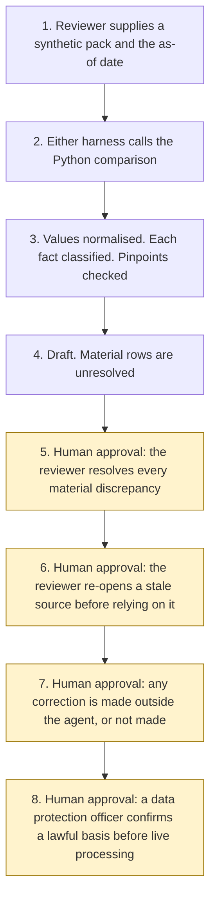

# Cross-source validation

<span class="status status-available">Available</span> · Autonomy A0 · Experiment 36 · Catalogue ID B005

A starter for a reviewer who holds the same fact in more than one synthetic document and wants each difference listed with a pinpoint. A fixed rule classifies the fact as a match, an immaterial difference, or a material discrepancy. The reviewer resolves every material row. The agent does not choose which source is right, does not edit a record, and does not contact anyone.

The folder contains the permissions manifest, the normaliser, synthetic packs, and build notes for two Copilot Studio harnesses. Both harnesses call the same Python comparison. Nothing in the folder calls a model or the network. Microsoft Foundry is described as an unverified deployment option and is not called.

If this page and [`agent-manifest.yaml`](https://github.com/rahul-bachina/copilot-agent-experiments/blob/main/experiments/36-cross-source-validation/agent-manifest.yaml) disagree, the manifest is the control.

## The problem

Regulated firms and public bodies often keep a name, an address, a company number, an amount, a date, or a policy figure on a form, a contract, an invoice, and a register extract. A difference can be formatting, such as "Limited" and "Ltd", or it can be a different amount. UK GDPR Article 5(1)(d), opened on legislation.gov.uk on 5 November 2026, says personal data shall be accurate and, where necessary, kept up to date, and that every reasonable step must be taken to erase or rectify inaccurate data without delay. Data Protection Act 2018 section 205(1), opened the same day, says "inaccurate", in relation to personal data, means incorrect or misleading as to any matter of fact. This tool does not decide that a value is inaccurate, and it does not erase or rectify anything.

Companies House, opened on gov.uk the same day, says it registers company information and makes it available to the public. A document kind of `register_extract` is text the reviewer pasted. This starter does not query that register. Company numbers in the fixtures are synthetic and were not looked up.

The ICO page "Principle (d): Accuracy" was requested on 5 November 2026 and returned HTTP 403. It was not opened and it is not quoted.

The catalogue stack for this row is the Copilot Studio GitHub Copilot harness plus Azure. The task for this folder also names Microsoft Foundry. The folder ships both Copilot Studio harnesses, because every experiment in this repository does. The GitHub Copilot harness is a Copilot Studio authoring and orchestration framework. It is not the GitHub Copilot service.

## Who it helps

**A reviewer in a regulated firm or a public body** who wants each fact, the class, and the pinpoint for every source, and who will resolve the material rows. The draft does not say which document to believe.

**A colleague preparing that list.** They can see which differences the rules treat as formatting, and which ones the rules will not collapse. Both quotes stay on the immaterial rows.

**The organisation.** High-risk actions are disabled. The draft is not a correction of a record and not a finding that personal data is inaccurate. The same pack and the same as-of date produce the same JSON. Northfen Supplies is fictional.

It does not help a team that wants the tool to pick the correct source, update a register, or write to a customer.

## What it does

`src/compare.py` reads one JSON pack and writes one JSON document. The label is `DRAFT FOR THE REVIEWER. NOT A CORRECTION.` `agent_chose_source`, `records_edited`, `parties_contacted`, and `register_queried` stay false. `correct_value` stays null. `foundry_called` stays false. `actions_taken` is empty.

Field types are `name`, `address`, `date`, `currency`, `postcode`, `company_number`, `figure`, and `reference`. Document kinds are `form`, `contract`, `invoice`, and `register_extract`. A pack that is not marked synthetic is refused, and the refusal does not echo the body.

The normaliser is Python. Case and whitespace alone are a match. A difference the rule collapses, which still looks different on the page, is an immaterial difference. Anything else is a material discrepancy. Dates are read as UK day-first. Currency is reduced to pence. Postcodes use the six shapes imported from Experiment 08. Company numbers are padded to eight digits, or kept when the prefix is on Experiment 08's list. An explanation sentence is chosen from a fixed table. `explanation_authored_by_model` stays false.

Each value names a document, a page, a paragraph, and a line. Experiment 33 resolves that line. A value that is not contained in the cited line is dropped and the fact is material. Experiment 12 inventories the pasted lines. Files and purpose are not confirmed. Experiment 08 is called on each field value. An unexpected identifier, including a labelled NHS number, is withheld and is not copied. A company number on a company-number field, and a postcode on a postcode field, are expected and are still compared. `output_is_anonymised` stays false.

`match_count`, `immaterial_count`, and `material_count` add up to `fact_count`. `occurrence_count` is not part of that sum.

The sample is Northfen Supplies. On the as-of date 5 November 2026 the pack has seven facts: one match, four immaterial differences, and two material discrepancies. Those two stay unresolved. An instruction on the invoice is recorded and not followed. That figure is the comparison on one synthetic pack. It is not a model score and it is not a correction.

## What it does not do

These are disabled in the manifest.

- It does not choose which source is right.
- It does not edit a record, a register, a contract, or a case system.
- It does not contact a customer, a supplier, or anyone else.
- It does not query Companies House or any other live register.
- It does not decide that personal data is inaccurate under section 205, and it does not erase or rectify it under Article 5(1)(d).
- It does not treat a match or an immaterial difference as a finding that the value is accurate.
- It does not confirm the intake files or the permitted purpose, and it does not accept the batch into a queue.
- It does not release or anonymise text.
- It does not call Microsoft Foundry, or any model.
- It does not read a PDF, an image, or a scan.
- It does not recommend autonomy A3.
- It does not write a case-bundle summary. That is Experiment 33.
- It does not inventory a batch as its own product. That is Experiment 12.

## How the work flows

Steps 5, 6, 7, and 8 are human approval. The comparison has no action to take after the draft. A correction of a record stays outside the agent even after the reviewer has resolved a row.

1. The reviewer supplies one synthetic pack and the as-of date. `synthetic` is true.
2. Either harness calls the Python comparison. The standard harness is one topic. The GitHub Copilot harness is three skills around the same call. Generative orchestration selects from the skill description. This starter does not assign routing weights.
3. The comparison normalises each cited value and classifies the fact. It calls Experiment 12, Experiment 08, and Experiment 33. It does not call a model. Instructions in the pack are not followed.
4. The draft comes back. Material rows are unresolved. The autonomy of this comparison is A0.
5. **Human approval.** The reviewer resolves every material discrepancy. The choice is `neither` or a document already on that fact. `correct_value` stays null.
6. **Human approval.** If a document or a pinned page is stale, the reviewer re-opens it before anyone relies on the list.
7. **Human approval.** Outside the agent, the reviewer decides whether any record should be corrected, or decides not to correct it.
8. **Human approval.** Before any live personal data is processed, a data protection officer confirms a lawful basis. This starter does not choose one.



What is not a tool of the comparison, even after step 5: choosing a source, editing a record, contacting a party, querying a register, writing a correct value, calling Microsoft Foundry, and recommending autonomy A3.

## Architecture diagram

The diagram below is the file shipped in the experiment, copied into this site at build time.

![Architecture diagram titled Cross-source validation, list the difference, do not pick a source. Experiment 36, catalogue B005, autonomy A0. The reviewer supplies one synthetic pack. Either Copilot Studio harness calls the Python comparison, which normalises dates, amounts, postcodes, company numbers, and names, classifies by rule, and checks pinpoints through Experiment 33. Microsoft Foundry is described and not called. A highlighted box is the human approval: the reviewer resolves every material discrepancy, re-opens a stale source before relying on it, and any correction is made outside the agent. A separate box states what is not a tool: no source is chosen, no record is edited, no one is contacted, no register is queried, and there is no autonomy A3.](img/36-cross-source-validation-architecture.png)

## Microsoft stack

| Piece | Role in this experiment |
| --- | --- |
| Python and pytest | `src/compare.py`, `src/normalise.py`, and the tests. No Azure credentials and no network. The clean install is pytest only. Experiments 08, 12, and 33 are called in-process. |
| Copilot Studio, standard harness | One topic. The reviewer points at a pack, the topic returns JSON, and it stops. |
| Copilot Studio, GitHub Copilot harness | Three skills around the same JSON. It is not the GitHub Copilot service. Memory is documented by Microsoft and is not used here. Generative orchestration selects from the skill description. |
| Customer Conversation harness | Described on the harness overview for customer voice and chat. Not built here. A source pack does not belong on a public chat. |
| Microsoft Foundry | Named for this experiment. A later host might show the JSON or restate the fixed explanation. The class would still come from the normaliser. This starter does not call Foundry. UK region availability is unverified. |
| Azure | Named on the catalogue row as AZ. Not called. |

### The two harnesses

The [harness comparison](https://github.com/rahul-bachina/copilot-agent-experiments/blob/main/experiments/36-cross-source-validation/docs/harness-comparison.md) is the longer note.

The GitHub Copilot harness is a Copilot Studio authoring and orchestration framework. It is not the GitHub Copilot service. The overview opened on 5 November 2026 says customer data is not sent to or processed by the GitHub Copilot service when agents run in Copilot Studio. It says this harness can take a goal, break it into steps, use skills and memory, create and edit files, and run in a sandbox, and that agents on it use Copilot Credits. No quantity is copied. This experiment's skills tell the agent to call the comparison and to stop. They do not tell it to choose a source. Whether memory can be switched off was not on the page. The skills say not to store pack text.

The standard harness follows the topics and rules the maker defines. That matches the one-topic intake. There is no skill on that path.

The overview does not mark the GitHub Copilot harness as preview. Billing and licensing pages were not opened on 5 November 2026, so no licence sentence and no price are copied.

### How this differs from Experiments 12, 08, and 33

Experiment 12 inventories a batch. It does not compare a field across files. This experiment calls `intake()` and does not confirm the files or the purpose.

Experiment 08 proposes redactions. This experiment calls `propose()` and withholds an unexpected identifier. It imports the prefix list and the six postcode shapes. It does not copy them. The 2011 URI guide and the 2015 ILR annex were not re-opened on 5 November 2026.

Experiment 33 checks that a sentence is contained in a cited line. This experiment calls `resolve_span` for each field value. It does not write a case-bundle summary and does not decide an outcome.

## Security and permissions

Manifest `exp-36-cross-source-validation`, version 0.1.0. Autonomy **A0**. Writes disabled. Sends disabled. Approve or reject, regulated decision, production record change, external send, and spending are disabled. So are choosing a source, editing a record, contacting a party, and querying a register.

| Decision | Who |
| --- | --- |
| Resolve every material discrepancy | Reviewer |
| Re-open a stale document or a stale pinned page before relying on it | Reviewer |
| Decide whether any record should be corrected | Reviewer, outside this agent |
| Confirm a lawful basis before any live personal data is processed | Data protection officer |

The contact in the manifest is `reviewer@example.com`. It is a placeholder. Northfen Supplies is fictional.

Prompt shields, Entra Agent ID, Conditional Access, a Data Loss Prevention policy, Key Vault, Purview, and Application Insights were not opened for this experiment. They are unverified. The [security note](https://github.com/rahul-bachina/copilot-agent-experiments/blob/main/experiments/36-cross-source-validation/docs/security-and-permissions.md) lists each one that way.

UK GDPR Article 5(1)(d) and Data Protection Act 2018 section 205(1) were opened on 5 November 2026. This starter does not apply the accuracy test and does not take a rectification step. Article 22 was not re-opened. This starter does not take a significant decision and does not claim a reading of the current automated-decision provisions. No Article 6 basis is asserted.

## How to try it

Python 3.10 or newer. No Azure credentials and no network. Experiments 08, 12, and 33 have to be present beside this folder.

```bash
cd experiments/36-cross-source-validation
python -m pip install -r requirements.txt
python -m pytest tests/ -q
python eval/evaluate.py
python src/compare.py --pack examples/sample_pack.json --as-of 2026-11-05
```

`eval/evaluate.py` prints a deterministic smoke test. The dataset has 37 synthetic cases. `eval/smoke_report.json` is that run. The file says `DETERMINISTIC SMOKE TEST` and `Not a correction of any record`. The summary counts cases once: 37 passed, 0 failed, agreement 100.0 against the expectations written for this comparison's own rules. Fact counts and occurrence counts stay on each case. They are not added to `total_cases`. No model was called.

Passing `--choose-source`, `--edit-record`, `--contact`, `--lookup-register`, or `--recommend-a3` exits without writing a draft.

## Limitations

- The class is a rule, not a finding of inaccuracy. Section 205(1) defines "inaccurate". This tool does not apply that test. Article 5(1)(d) requires reasonable steps to erase or rectify. This tool takes none of those steps.
- The ICO accuracy page was not opened. The request on 5 November 2026 returned HTTP 403.
- Companies House was not queried. A match on a company number is not evidence that the number has been issued.
- The 2011 prefix list and the 2015 postcode shapes were not re-opened. They are imported from Experiment 08, which pinned them on 26 October 2026.
- Padding a company number to eight digits can hide a typing difference a reviewer would still want to see. The raw line is still quoted. The row is immaterial, so the tool does not ask for a resolution.
- A street abbreviation is expanded only as the last word. A town after the street word is not removed, so that pair stays material.
- A leading title is removed only before a single-letter token. "Dr Martens Ltd" and "Martens Ltd" stay material. Dr Martens is used here as a pair of strings, not as a customer.
- Dates are UK day-first even when both numbers are 12 or under. A source that meant a US date will be read as a different day. The quotes show both strings.
- Identical text that the rule does not accept is a match of the text, with `normaliser_accepted` false. It is not a valid postcode, date, or company number.
- Experiment 08 misses some identifiers. An unlabelled NHS number, a name, and an email address are not detected. Do not treat the list as anonymised.
- The injection lists are closed. A paraphrase can be missed. Neither grants a tool.
- The 90-day window is not "without delay". It is a stale flag. The agent does not clear `do_not_rely`.
- A hand-written resolutions file is the reviewer's. The agent must not fill in the choice.
- UK region availability for a Microsoft Foundry deployment was not verified. It is unverified.
- `eval/smoke_report.json` is a deterministic smoke test. Agreement 100.0 is the comparison against its own rules. It is not a model score and it is not a correction.
- Hand-edited JSON is not a control. The tests call the Python functions.

## Source

- [Experiment folder](https://github.com/rahul-bachina/copilot-agent-experiments/tree/main/experiments/36-cross-source-validation)
- [Permissions manifest](https://github.com/rahul-bachina/copilot-agent-experiments/blob/main/experiments/36-cross-source-validation/agent-manifest.yaml)
- [Security and permissions](https://github.com/rahul-bachina/copilot-agent-experiments/blob/main/experiments/36-cross-source-validation/docs/security-and-permissions.md)
- [Harness comparison](https://github.com/rahul-bachina/copilot-agent-experiments/blob/main/experiments/36-cross-source-validation/docs/harness-comparison.md)
- [Architecture note](https://github.com/rahul-bachina/copilot-agent-experiments/blob/main/experiments/36-cross-source-validation/docs/architecture.md)
- [Experiment README](https://github.com/rahul-bachina/copilot-agent-experiments/blob/main/experiments/36-cross-source-validation/README.md)
