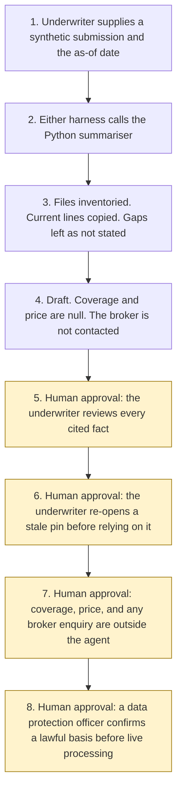

# Underwriting submission summary

<span class="status status-available">Available</span> · Autonomy A0 · Experiment 37 · Catalogue ID B006

A starter for an underwriter who has a synthetic broker submission and wants every stated fact tied to a document, a page, a paragraph, and a line. A closed-list field with no usable line is shown as not stated. The underwriter owns the coverage and pricing decision. The agent does not accept or decline, does not suggest a price or terms, does not contact the broker, and does not write to an underwriting system.

The folder contains the permissions manifest, a deterministic checker, a synthetic submission, and build notes for two Copilot Studio harnesses. Both harnesses call the same Python core. The core calls Experiment 12 to inventory the files and Experiment 29 for a number and date check. Nothing in the folder calls a model or the network. Microsoft Foundry is described as an unverified deployment option and is not called.

If this page and [`agent-manifest.yaml`](https://github.com/rahul-bachina/copilot-agent-experiments/blob/main/experiments/37-underwriting-submission-summary/agent-manifest.yaml) disagree, the manifest is the control.

## The problem

Commercial and specialty insurers, MGAs, and brokers in the Lloyd's market and in UK general insurance receive long submissions: proposal forms, schedules of values, loss runs, and survey reports. A short reading is useful only if the underwriter can find the line a sum insured, a location, or an exclusion came from. A gap the submission left open has to stay a gap.

This starter copies lines. It does not write a fluent brief. A fact that is not a contiguous part of the cited lines fails, even when it might be true in some other sense. Coverage and price stay with a person.

The catalogue stack is the Copilot Studio GitHub Copilot harness and Microsoft Foundry. The folder also ships the Copilot Studio standard harness, because every experiment in this repository does. The GitHub Copilot harness is a Copilot Studio authoring and orchestration framework. It is not the GitHub Copilot service.

The legislation, the FCA handbook pages, and the harness overview named in `src/sources.py` were opened on 5 November 2026. The Foundry product page was not opened. A Lloyd's byelaw was not opened. If `last_verified` is older than the threshold the caller sets, the draft says not to rely on the legal note. Billing pages were not opened.

## Who it helps

**An underwriter** at a commercial or specialty insurer, an MGA, or a broker, who wants each stated fact pinned to a line before anyone treats the draft as a picture of the submission. They review every cited fact. They decide coverage and price themselves, outside the agent.

**The organisation.** High-risk actions are disabled. The draft is not an acceptance, a declinature, a price, or a message to the broker. The same submission and the same as-of date produce the same JSON. Northfen Wharf Ltd is fictional.

It does not help a team that wants the tool to accept the risk, suggest a premium, or email the broker for the missing warranty.

## What it does

`src/summarise.py` reads one JSON submission and writes one JSON document. The label is `DRAFT FOR THE UNDERWRITER. NOT A COVERAGE OR PRICING DECISION.` `coverage_decision`, `price_suggested`, and `terms_suggested` are null. `broker_contacted` and `underwriting_system_written` are false. `foundry_called` is false. `actions_taken` is empty.

The caller may label the submission `commercial_non_consumer` or `retail`. Any other string is `unrecognised`. A missing label is `not_stated`. The agent does not decide the label. A commercial label shows the Insurance Act 2015 notes. A retail label shows the PRIN 2A note. Neither note is a finding that a duty was met.

Experiment 12 inventories the files and does not route them. A file that was not read, is outside the date window, or has a deterministic identifier finding is not quoted.

When a paragraph's fact key is in the closed list, and the document is current, the fact text is that paragraph. Stated warranties are absent from the sample, so that field is `not stated`, with no citation and with `inferred` false.

Each shown fact receives one verdict. Later failures are `other_failures` and are not added to `failure_count`. `verdict_total` equals `stated_fact_count`. Gaps, contradictions, and unused documents have their own counts.

`checker_passed` means no shown fact failed. It can be true while `do_not_rely` is also true, because a gap or a stale document is a reason not to treat the draft as a complete presentation.

The sample is Northfen Wharf Ltd, which is fictional. On the as-of date 5 November 2026 the seven extracted facts in `examples/sample_submission.json` are supported. Stated warranties are not stated. An old survey is not used. `checker_passed` is true and `do_not_rely` is true. That figure is the checker on one synthetic submission. It is not a model score and it is not a coverage decision.

The smoke test in `eval/evaluate.py` scores 12 labelled cases. It counts cases once. The two copies of the sample each keep a stated-fact count of 7. Those counts are not added together. The report says it is not an LLM-as-judge. Experiment 35 is not imported. An FCA publication about an LLM-as-judge for claims summaries was not opened, so that expectation is unverified here.

## What it does not do

These are disabled in the manifest.

- It does not accept, decline, or refer a risk.
- It does not suggest a price, a premium, a rate, or terms.
- It does not decide that Insurance Act 2015 section 3 was met, and it does not apply a section 8 remedy. Schedule 1 was not opened.
- It does not decide what the insurer knows under section 5.
- It does not decide that the Consumer Duty or PRIN 2A was met. PRIN 3 was not opened.
- It does not contact the broker.
- It does not write an underwriting system or bind cover.
- It does not call Microsoft Foundry.
- It does not recommend autonomy A3.
- It does not paraphrase. A true sentence that is not a contiguous copy of the cited lines fails.
- It does not infer a missing field. The value is `not stated`.
- It does not read a PDF, an image, or a scan.
- It does not read a submission that is not marked synthetic.
- It does not read legislation.gov.uk or the FCA handbook at run time.

## How the work flows

Steps 5, 6, 7, and 8 are human approval. The summariser has no action to take after the draft. A price, a message to the broker, and a write to the underwriting system stay outside the summariser even after a person has read the facts.

1. The underwriter supplies one synthetic submission and the as-of date. `synthetic` is true. The market label, if any, is the caller's.
2. Either harness calls the Python summariser. The standard harness is one topic. The GitHub Copilot harness is three skills around the same call. The generative-orchestration guidance opened on 5 November 2026 says a described purpose can select a topic, and that tool names carry more weight than descriptions. This starter does not list trigger phrases and does not assign routing weights.
3. Experiment 12 inventories the files. The summariser copies current lines and checks each pinpoint. It does not call a model. Instructions in the submission are not followed. A missing field is `not stated`.
4. The draft comes back. Coverage and price are null. The broker is not contacted. The autonomy of this summariser is A0.
5. **Human approval.** The underwriter reviews every cited fact against the document, page, paragraph, and line.
6. **Human approval.** If a pinned page or a document is stale, the underwriter re-opens the page or replaces the document before anyone relies on the note.
7. **Human approval.** Outside the agent, the underwriter decides coverage and sets any price or terms, and decides whether to ask the broker about a gap.
8. **Human approval.** Before any live processing, a data protection officer confirms a lawful basis. This starter does not choose one. Writing the decision to an underwriting system stays outside the agent.



What is not a tool of the summariser, even after step 5: an acceptance, a declinature, a price, a message to the broker, a write to the underwriting system, a bind, a Foundry call, and autonomy A3.

## Architecture diagram

The diagram below is the file shipped in the experiment, copied into this site at build time.

![Architecture diagram titled Underwriting submission summary, copy the lines, do not price the risk. The underwriter supplies one synthetic submission. Either Copilot Studio harness calls the Python summary, which inventories files through Experiment 12, copies current contiguous lines, leaves a missing field as not stated, and checks numbers with Experiment 29. Microsoft Foundry is described and not called. A highlighted box is the human approval: the underwriter reviews every cited fact, and coverage, price, any broker message, and any underwriting-system write stay outside the agent. A separate box states what is not a tool: no accept or decline, no price, no broker contact, no write, no bind, and no autonomy A3.](img/37-underwriting-submission-summary-architecture.png)

## Microsoft stack

| Piece | Role in this experiment |
| --- | --- |
| Python and pytest | `src/summarise.py` and the tests. No Azure credentials and no network. The clean install is pytest only. |
| Experiment 12 | In-process inventory of the text files. No purpose is requested. Nothing is routed or queued. |
| Experiment 29 | In-process number and date boundary check. Its token-overlap verdict is not used. |
| Experiment 33 | The contiguous-span rule is the same idea. The package is not imported. |
| Experiment 35 | Not imported. The smoke test mirrors a labelled evaluation harness independently. |
| Copilot Studio, standard harness | One topic. The underwriter points at a submission, the topic returns JSON, and it stops. |
| Copilot Studio, GitHub Copilot harness | Three skills around the same JSON. It is not the GitHub Copilot service. Memory is documented by Microsoft and is not used here. |
| Customer Conversation harness | Described on the harness overview for customer voice and chat. Not built here. A submission does not belong on a public chat. |
| Microsoft Foundry | Catalogue stack. Not called. The product page was not opened. UK region availability is unverified. |

### The two harnesses

The [harness comparison](https://github.com/rahul-bachina/copilot-agent-experiments/blob/main/experiments/37-underwriting-submission-summary/docs/harness-comparison.md) is the longer note.

The GitHub Copilot harness is a Copilot Studio authoring and orchestration framework. It is not the GitHub Copilot service. The overview opened on 5 November 2026 says customer data is not sent to or processed by the GitHub Copilot service when agents run in Copilot Studio. It says this harness can take a goal, break it into steps, use skills and memory, create and edit Word, Excel, PowerPoint, and PDF files, and run in a sandbox, and that agents on it use Copilot Credits. No quantity is copied. This experiment's skills tell the agent to call the checker and to stop. They do not tell it to price a risk. Whether memory can be switched off was not on the page. The skills say not to store submission text.

The standard harness follows the topics and rules the maker defines. That matches the one-topic summary. There is no skill on that path.

The overview does not mark the GitHub Copilot harness as preview. Billing and licensing pages were not opened on 5 November 2026, so no licence sentence and no price are copied.

## Security and permissions

The manifest is the control. Writes and sends are disabled. Accept, decline, price, broker contact, bind, and an underwriting-system write are disabled high-risk actions.

| Decision | Who |
| --- | --- |
| Review every cited fact | Underwriter |
| Decide coverage and set any price or terms | Underwriter, outside this agent |
| Decide whether to ask the broker | Underwriter, outside this agent |
| Write the underwriting system | Underwriter, outside this agent |
| Re-open a stale pin | Underwriter |
| Confirm a lawful basis before live processing | Data protection officer |

Article 22 of the UK GDPR was shown as omitted on 5 November 2026. Article 22A(1) says a decision is based solely on automated processing if there is no meaningful human involvement. This starter does not take the underwriting decision and does not certify that involvement. Article 5 was read. The manifest does not choose an Article 6 basis.

Entra Agent ID, Conditional Access, data loss prevention, Foundry prompt shields, Key Vault, Purview, and Application Insights are not configured here. Those product pages were not opened. They are unverified.

## How to try it

Python 3.10 or newer. No Azure credentials.

```bash
cd experiments/37-underwriting-submission-summary
python -m pip install -r requirements.txt
python -m pytest tests/ -v
python eval/evaluate.py
python src/summarise.py --submission examples/sample_submission.json --as-of 2026-11-05
```

`eval/smoke_report.json` is the deterministic smoke test. Agreement 100.0 means the checker matched its own rules on 12 synthetic cases. It is not a model score.

Passing `--accept`, `--decline`, `--suggest-price`, `--suggest-terms`, `--contact-broker`, `--write-system`, or `--bind` exits without a draft.

## Limitations

- A copied line can still omit the sentence that changes the risk. Residual risk on that omission is High.
- The field list is closed. A point outside those eight fields is not extracted.
- The 90-day window is this starter's rule, not a statute and not a Lloyd's deadline. No Lloyd's byelaw was opened.
- Section 3, section 5, and section 8 of the Insurance Act 2015 were read. They are not applied as a score. Schedule 1 was not opened.
- PRIN 2A.1 and PRIN 2A.2 were read. PRIN 3 and FG22/5 were not opened. The starter does not decide that a firm is in retail market business.
- The Consumer Insurance (Disclosure and Representations) Act 2012 was not opened.
- The smoke test is not an LLM-as-judge and not a Foundry score.

This page is not legal advice, a DPIA, or a coverage opinion.

## Source

- [Experiment folder](https://github.com/rahul-bachina/copilot-agent-experiments/tree/main/experiments/37-underwriting-submission-summary)
- [Permissions manifest](https://github.com/rahul-bachina/copilot-agent-experiments/blob/main/experiments/37-underwriting-submission-summary/agent-manifest.yaml)
- [Security note](https://github.com/rahul-bachina/copilot-agent-experiments/blob/main/experiments/37-underwriting-submission-summary/docs/security-and-permissions.md)
- [README](https://github.com/rahul-bachina/copilot-agent-experiments/blob/main/experiments/37-underwriting-submission-summary/README.md)
