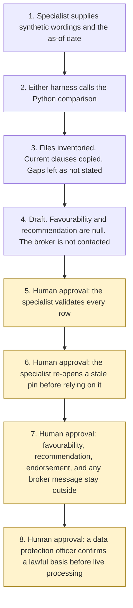

# Policy wording comparison

<span class="status status-available">Available</span> · Autonomy A0 · Experiment 38 · Catalogue ID B008

A starter for a wording specialist who has two or more synthetic policy wordings and wants every stated clause tied to a clause reference, a document, a page, a paragraph, and a line. A topic that one wording states and another does not is shown as not stated. The specialist validates every interpretation. The agent does not say which wording is more favourable, does not recommend buy, sell, or renew, does not draft an endorsement, does not contact a broker, and does not write to a policy administration system.

The folder contains the permissions manifest, a deterministic comparison, a synthetic pack, and build notes for two Copilot Studio harnesses. Both harnesses call the same Python core. The core calls Experiment 12 to inventory the files, Experiment 33 to check that a quote sits inside the cited lines, and Experiment 29 to check numbers and dates. Nothing in the folder calls a model or the network. Azure Document Intelligence and Microsoft Foundry are described and are not called.

If this page and [`agent-manifest.yaml`](https://github.com/rahul-bachina/copilot-agent-experiments/blob/main/experiments/38-policy-wording-comparison/agent-manifest.yaml) disagree, the manifest is the control.

## The problem

In UK general insurance and specialty markets, including Lloyd's, MGAs, brokers, and insurers, someone has to compare wordings, endorsements, and schedules at renewal or across competing quotes. A short reading is useful only if the specialist can find the clause a limit, an exclusion, or a notice provision came from. A gap one wording left open has to stay a gap.

This starter copies clauses. It does not write a coverage opinion. A quote that is not a contiguous part of the cited lines fails, even when it might be true in some other sense. Favourability stays with a person.

The catalogue stack is the Copilot Studio GitHub Copilot harness, with Azure Document Intelligence named as a way a later deployment might read a scan. The folder also ships the Copilot Studio standard harness, because every experiment in this repository does. The GitHub Copilot harness is a Copilot Studio authoring and orchestration framework. It is not the GitHub Copilot service.

The legislation, the FCA handbook page, the Document Intelligence overview, and the harness overview named in `src/sources.py` were opened on 6 November 2026, except where a source row says the page was not opened. PRIN 2A.1 was requested that day and returned only the FCA office address, so it is not quoted. If `last_verified` is older than the threshold the caller sets, the draft says not to rely on the legal note. Billing pages were not opened. No Lloyd's byelaw was opened.

## Who it helps

**A wording specialist** at an insurer, an MGA, or a broker, who wants each stated clause pinned to a line before anyone treats the draft as a picture of the difference. They validate every row. They decide what the difference means, outside the agent.

**The organisation.** High-risk actions are disabled. The draft is not a recommendation, an endorsement, or a message to the broker. The same pack and the same as-of date produce the same JSON. Northfen Wharf Ltd is fictional.

It does not help a team that wants the tool to say which wording is better for the insured, or to draft the endorsement that would close a gap.

## What it does

`src/compare.py` reads one JSON pack and writes one JSON document. The label is `DRAFT FOR THE WORDING SPECIALIST. NOT A COVERAGE OPINION AND NOT A RECOMMENDATION.` `favourable_to`, `recommendation`, `endorsement_draft`, and `coverage_decision` are null. `broker_contacted` and `policy_admin_written` are false. `foundry_called` and `document_intelligence_called` are false. `actions_taken` is empty.

The caller may label the pack `commercial_non_consumer` or `retail`. Any other string is `unrecognised`. A missing label is `not_stated`. The agent does not decide the label. A commercial label shows the Insurance Act 2015 notes. A retail label shows the Consumer Rights Act 2015 and PRIN 2A.5 notes. Neither note is a finding that a duty was met.

The topics are coverage grants, exclusions, conditions, warranties, definitions, limits, deductibles, and notice provisions. The caller also supplies a subject key. The agent does not invent that key from the words of the clause. A paragraph with no topic is listed as unaligned, with a citation, and is not matched to another wording.

Experiment 12 inventories the files and does not route them. A file that was not read, is outside the date window, or has a deterministic identifier finding is not quoted. If every document on a wording was refused, the cell is `not_quoted`. That is not a finding that the topic is absent.

When one wording states a subject and another has no usable clause for it, the empty cell is `not stated`, with no citation and with `inferred` false. When the normalised texts differ, the class is `text_differs`. `amounts_differ` records that the numbers are not the same. It does not say which figure is better. No wording is treated as the baseline.

Each stated quote receives one verdict. Later failures are `other_failures` and are not added to `failure_count`. `verdict_total` equals `stated_cell_count`. Not-stated cells, unaligned clauses, and unused documents have their own counts.

`checker_passed` means no stated quote failed. It can be true while `do_not_rely` is also true, because the specialist has not yet validated the draft.

The sample is Northfen Wharf Ltd, which is fictional. On the as-of date 6 November 2026 there are eight rows and fifteen supported quotes. The renewal wording does not state the flood exclusion. The buildings limits differ. An old endorsement is not used. A transit sentence with no topic key is unaligned. `checker_passed` is true and `do_not_rely` is true. That figure is the checker on one synthetic pack. It is not a model score and it is not a coverage opinion.

The smoke test in `eval/evaluate.py` scores 12 labelled cases. It counts cases once. The two copies of the sample each keep a stated-cell count of 15. Those counts are not added together. The report says it is not an LLM-as-judge.

## What it does not do

These are disabled in the manifest.

- It does not interpret favourability for the insured or the insurer. Section 69 of the Consumer Rights Act 2015 was read and is not applied.
- It does not recommend buy, sell, or renew.
- It does not draft an endorsement.
- It does not decide that Insurance Act 2015 section 3, section 9, section 10, section 11, section 16, or section 17 was met. Section 16A was not opened.
- It does not decide that a term is unfair under section 62, or transparent under section 64(3) or section 68. Schedule 2 was not opened.
- It does not decide that PRIN 2A.5 was met. PRIN 2A.1 was not re-read successfully on 6 November 2026.
- It does not contact the broker.
- It does not write a policy administration system or bind cover.
- It does not call Azure Document Intelligence or Microsoft Foundry.
- It does not recommend autonomy A3.
- It does not paraphrase. A true sentence that is not a contiguous copy of the cited lines fails.
- It does not infer a missing clause. The value is `not stated`.
- It does not read a PDF, an image, or a scan.
- It does not read a pack that is not marked synthetic.
- It does not read legislation.gov.uk or the FCA handbook at run time.

## How the work flows

Steps 5, 6, 7, and 8 are human approval. The comparison has no action to take after the draft. A recommendation, an endorsement, a message to the broker, and a write to a policy administration system stay outside the comparison even after a person has read the rows.

1. The wording specialist supplies two or more synthetic wordings and the as-of date. `synthetic` is true. The market label, if any, is the caller's. The subject keys are the caller's.
2. Either harness calls the Python comparison. The standard harness is one topic. The GitHub Copilot harness is three skills around the same call. The generative-orchestration guidance opened on 6 November 2026 says a described purpose can select a topic, and that tool names carry more weight than descriptions. This starter does not list trigger phrases and does not assign routing weights.
3. Experiment 12 inventories the files. The comparison copies current clauses and checks each pinpoint. It does not call a model. Instructions in a wording are not followed. A missing subject is `not stated`.
4. The draft comes back. Favourability and any recommendation are null. The broker is not contacted. The autonomy of this comparison is A0.
5. **Human approval.** The wording specialist validates every row, including each not stated cell, against the clause text.
6. **Human approval.** If a pinned page or a document is stale, the specialist re-opens the page or replaces the document before anyone relies on the note.
7. **Human approval.** Outside the agent, a person decides whether any difference is favourable, whether to buy, sell, or renew, and whether to draft an endorsement or ask the broker.
8. **Human approval.** Before any live processing, a data protection officer confirms a lawful basis. This starter does not choose one. Writing the comparison to a policy administration system stays outside the agent.



What is not a tool of the comparison, even after step 5: a favourability finding, a buy, sell, or renew recommendation, an endorsement, a message to the broker, a write to a policy administration system, a coverage decision, a Foundry call, a Document Intelligence call, and autonomy A3.

## Architecture diagram

The diagram below is the file shipped in the experiment, copied into this site at build time.

![Architecture diagram titled Policy wording comparison, cite the clause, do not rank the cover. The wording specialist supplies two or more synthetic wordings. Either Copilot Studio harness calls the Python comparison, which inventories files through Experiment 12, copies current clauses, leaves a missing topic as not stated, and checks the line with Experiments 33 and 29. Document Intelligence is not called. A highlighted box is the human approval: the specialist validates every row, and favourability, any recommendation, any endorsement, any broker message, and any policy-administration write stay outside the agent. A separate box states what is not a tool: no favourability, no buy or sell or renew, no endorsement, no broker contact, no policy write, no coverage decision, and no autonomy A3.](img/38-policy-wording-comparison-architecture.png)

## Microsoft stack

| Piece | Role in this experiment |
| --- | --- |
| Python and pytest | `src/compare.py` and the tests. No Azure credentials and no network. The clean install is pytest only. |
| Experiment 12 | In-process inventory of the text files. No purpose is requested. Nothing is routed or queued. |
| Experiment 33 | In-process pinpoint span check. The case-bundle summary is not produced. |
| Experiment 29 | In-process number and date boundary check. Its token-overlap verdict is not used. |
| Experiment 36 | The fixed-class idea is mirrored. The package is not imported. |
| Experiment 37 | The not-stated citation style is mirrored. The package is not imported. |
| Copilot Studio, standard harness | One topic. The specialist points at a pack, the topic returns JSON, and it stops. |
| Copilot Studio, GitHub Copilot harness | Three skills around the same JSON. It is not the GitHub Copilot service. Memory is documented by Microsoft and is not used here. |
| Customer Conversation harness | Described on the harness overview for customer voice and chat. Not built here. A wording does not belong on a public chat. |
| Azure Document Intelligence in Foundry Tools | Overview opened 6 November 2026. Read and Layout models are described. No insurance comparison model was named. Not called. UK region availability is unverified. |
| Microsoft Foundry | A Microsoft Foundry agent page was not opened. Not called. |

### The two harnesses

The [harness comparison](https://github.com/rahul-bachina/copilot-agent-experiments/blob/main/experiments/38-policy-wording-comparison/docs/harness-comparison.md) is the longer note.

The GitHub Copilot harness is a Copilot Studio authoring and orchestration framework. It is not the GitHub Copilot service. The overview opened on 6 November 2026 says customer data is not sent to or processed by the GitHub Copilot service when agents run in Copilot Studio. It says this harness can take a goal, break it into steps, use skills and memory, create and edit Word, Excel, PowerPoint, and PDF files, and run in a sandbox, and that agents on it use Copilot Credits. No quantity is copied. This experiment's skills tell the agent to call the comparison and to stop. They do not tell it to rank a wording. Whether memory can be switched off was not on the page. The skills say not to store wording text.

The standard harness follows the topics and rules the maker defines. That matches the one-topic comparison. There is no skill on that path.

The overview does not mark the GitHub Copilot harness as preview. Billing and licensing pages were not opened on 6 November 2026, so no licence sentence and no price are copied. The generative-orchestration guidance says the planner can use trigger phrases and described purpose, and that tool names carry more weight than descriptions. This starter does not assign routing weights. Whether that planner selects the GitHub Copilot harness was not stated on the overview. That link is unverified.

## Security and permissions

The manifest is the control. Writes and sends are disabled. Favourability, a recommendation, an endorsement, broker contact, a policy-administration write, and a coverage decision are disabled high-risk actions.

| Decision | Who |
| --- | --- |
| Validate every row, including each not stated cell | Wording specialist |
| Re-open a stale pin | Wording specialist |
| Decide favourability, buy, sell, renew, or an endorsement | Wording specialist, outside this agent |
| Contact the broker or write a policy administration system | The authorised person, outside this agent |
| Confirm a lawful basis before live processing | Data protection officer |

Article 22 of the UK GDPR was shown as omitted on 6 November 2026. Article 22A(1) says a decision is based solely on automated processing if there is no meaningful human involvement. Articles 22C and 22D were read. This starter does not take a coverage decision and does not certify that involvement. Article 22B paragraph 2 was not in the returned text and is not quoted. Article 5 was read. The manifest does not choose an Article 6 basis.

Entra Agent ID, Conditional Access, data loss prevention, Foundry prompt shields, Key Vault, Purview, and Application Insights are not configured here. Those product pages were not opened for this experiment. They are unverified.

## How to try it

Python 3.10 or newer. No Azure credentials.

```bash
cd experiments/38-policy-wording-comparison
python -m pip install -r requirements.txt
python -m pytest tests/ -v
python eval/evaluate.py
python src/compare.py --pack examples/sample_pack.json --as-of 2026-11-06
```

`eval/smoke_report.json` is the deterministic smoke test. Agreement 100.0 means the checker matched its own rules on 12 synthetic cases. It is not a model score. The two Northfen cases each report 15 stated cells. Those counts are not added together.

Passing `--favourable`, `--recommend`, `--draft-endorsement`, `--contact-broker`, `--write-pas`, or `--decide-coverage` exits without a draft.

## Limitations

- A copied clause can still omit the sentence that changes the cover. Residual risk on that omission is High.
- The topic list is closed. A clause outside those eight topics is not aligned unless the caller left the topic blank, in which case it is listed as unaligned and still not matched by guesswork.
- The subject key is the caller's. The agent does not infer it.
- The 90-day window is this starter's rule, not a statute and not a Lloyd's deadline. No Lloyd's byelaw was opened.
- Sections 2, 3, 9, 10, 11, 16, and 17 of the Insurance Act 2015 were read. They are not applied as a score. Section 16A was not opened.
- Sections 61, 62, 64, 68, and 69 of the Consumer Rights Act 2015 were read. Schedule 2 was not opened. Section 69 is not applied.
- PRIN 2A.5 was read. PRIN 2A.1 was not re-read successfully. PRIN 2A.2 was not opened. The starter does not decide that a firm is in retail market business.
- The Consumer Insurance (Disclosure and Representations) Act 2012 was not opened.
- The Document Intelligence overview did not name a policy-wording comparison model. UK region availability was not checked.
- The smoke test is not an LLM-as-judge and not a Foundry score.

This page is not legal advice, a DPIA, or a coverage opinion.

## Source

- [Experiment folder](https://github.com/rahul-bachina/copilot-agent-experiments/tree/main/experiments/38-policy-wording-comparison)
- [Permissions manifest](https://github.com/rahul-bachina/copilot-agent-experiments/blob/main/experiments/38-policy-wording-comparison/agent-manifest.yaml)
- [Security note](https://github.com/rahul-bachina/copilot-agent-experiments/blob/main/experiments/38-policy-wording-comparison/docs/security-and-permissions.md)
- [README](https://github.com/rahul-bachina/copilot-agent-experiments/blob/main/experiments/38-policy-wording-comparison/README.md)
