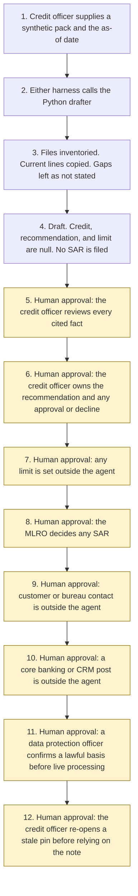

# Credit memo drafting

<span class="status status-available">Available</span> · Autonomy A1 · Experiment 39 · Catalogue ID B009

A starter for a credit officer who has a synthetic pack and wants every stated figure and claim tied to a document, a page, a paragraph, and a line. A closed-list section with no usable line is shown as not stated. The credit officer owns the recommendation and every approval. The agent does not approve or decline credit, does not set a limit, does not contact the customer or a bureau, does not post to a core banking or CRM system, and does not file a SAR.

The folder contains the permissions manifest, a deterministic checker, one synthetic memo pack, and build notes for two Copilot Studio harnesses. Both harnesses call the same Python core. The core calls Experiment 12 to inventory the files, Experiment 29 for a number and date check, and Experiment 36 when the pack supplies a comparisons object. Nothing in the folder calls a model or the network. Microsoft Foundry and Fabric are described as unverified deployment options and are not called. A product page for each was not opened.

If this page and [`agent-manifest.yaml`](https://github.com/rahul-bachina/copilot-agent-experiments/blob/main/experiments/39-credit-memo-drafting/agent-manifest.yaml) disagree, the manifest is the control.

## The problem

UK lenders, invoice-finance houses, trade-credit insurers, and corporate credit teams prepare a credit memo from financials, a pasted bureau extract, and internal notes. A short reading is useful only if the credit officer can find the line a turnover figure, a requested limit, or a risk flag came from. A gap the pack left open has to stay a gap.

This starter copies lines. It does not write a fluent credit opinion. A fact that is not a contiguous part of the cited lines fails, even when it might be true in some other sense. The recommendation and any limit stay with a person.

The catalogue stack is Microsoft Foundry and Fabric. The folder also ships both Copilot Studio harnesses, because every experiment in this repository does. The GitHub Copilot harness is a Copilot Studio authoring and orchestration framework. It is not the GitHub Copilot service.

The legislation, the FCA handbook page, and the harness overview named in `src/sources.py` were opened on 6 November 2026, except where a row says the page was not opened. PRIN 2A.2 was requested and the rule text was not returned. If `last_verified` is older than the threshold the caller sets, the draft says not to rely on the legal note. Billing pages were not opened.

## Who it helps

**A credit officer** at a lender, an invoice-finance house, a trade-credit insurer, or a corporate credit team, who wants each stated figure pinned to a line before anyone treats the draft as a picture of the pack. They review every cited fact. They own the recommendation, any approval or decline, and any limit, outside the agent.

**The MLRO.** A financial-crime phrase in a cited risk flag is narrative for that person. The agent does not decide suspicion and does not file a SAR.

**The organisation.** High-risk actions are disabled. The draft is not an approval, a decline, a limit, a message to the customer, or a post to a core system. The same pack and the same as-of date produce the same JSON. Mereholt Components Ltd is fictional.

It does not help a team that wants the tool to approve the facility, set the limit, or email the customer for the missing covenant.

## What it does

`src/draft.py` reads one JSON pack and writes one JSON document. The label is `DRAFT FOR THE CREDIT OFFICER. NOT A CREDIT DECISION AND NOT A LIMIT.` `credit_decision`, `recommendation`, and `limit_set` are null. `sar_filed`, `customer_contacted`, `bureau_contacted`, `core_banking_posted`, and `crm_posted` are false. `foundry_called` and `fabric_called` are false. `actions_taken` is empty.

The caller may label the pack `commercial_non_consumer`, `retail`, or `sme_consumer_facing`. Any other string is `unrecognised`. A missing label is `not_stated`. The agent does not decide the label. A retail or SME label shows the PRIN 2A note. A commercial label does not apply that note as if the Duty covered the pack. Neither note is a finding that the Duty was met. The glossary definition of a retail customer was not opened.

Experiment 12 inventories the files and does not route them. A file that was not read, is outside the date window, or has a deterministic identifier finding is not quoted.

When a paragraph's fact key is in the closed list, and the document is current, the fact text is that paragraph. Covenants are absent from the sample, so that section is `not stated`, with no citation and with `inferred` false.

Each shown fact receives one verdict. Later failures are `other_failures` and are not added to `failure_count`. `verdict_total` equals `stated_fact_count`. Gaps, contradictions, unused documents, and comparison counts have their own figures and are not added together.

`checker_passed` means no shown fact failed. It can be true while `do_not_rely` is also true, because a gap, a contradiction, a material discrepancy, an equality theme, or a financial-crime phrase is a reason not to treat the draft as a complete picture. `checker_passed` is not an approval. `draft_approved_for_use` stays false.

The sample is Mereholt Components Ltd, which is fictional. On the as-of date 6 November 2026 the nine extracted facts in `examples/sample_pack.json` are supported. Covenants are not stated. An old extract is not used. The two turnover sentences differ in wording, so both are shown, while the currency comparison classes the field values as an immaterial formatting difference. The two facility figures are a material discrepancy. The agent does not choose. `checker_passed` is true and `do_not_rely` is true. That figure is the checker on one synthetic pack. It is not a model score and it is not a credit decision.

The smoke test in `eval/evaluate.py` scores 12 labelled cases. It counts cases once. The two copies of the sample each keep a stated-fact count of 9. Those counts are not added together. The comparison `fact_count` of 2 is not added to 9. The report says it is not an LLM-as-judge.

## What it does not do

These are disabled in the manifest.

- It does not approve, decline, or recommend credit.
- It does not set a limit.
- It does not decide that the Consumer Duty or PRIN 2A was met. PRIN 3 and FG22/5 were not opened. PRIN 2A.2 was not retrieved.
- It does not decide that the Equality Act 2010 was contravened. Schedule 3 was not opened.
- It does not apply an Article 9 condition, and it does not take a solely automated credit decision. Article 22 was shown as omitted on 6 November 2026.
- It does not contact the customer or a credit bureau.
- It does not post to a core banking system or a CRM.
- It does not file a SAR. The MLRO decides. Section 333A was not opened.
- It does not call Microsoft Foundry or write Microsoft Fabric.
- It does not recommend autonomy A3.
- It does not paraphrase. A true sentence that is not a contiguous copy of the cited lines fails.
- It does not infer a missing section. The value is `not stated`.
- It does not read a PDF, an image, or a scan.
- It does not read a pack that is not marked synthetic.
- It does not read legislation.gov.uk or the FCA handbook at run time.

## How the work flows

Steps 5 to 12 are human approval. The drafter has no action to take after the draft. A limit, a message to the customer, a bureau enquiry, a core or CRM post, and a SAR stay outside the drafter even after a person has read the facts.

1. The credit officer supplies one synthetic pack and the as-of date. `synthetic` is true. The product label, if any, is the caller's.
2. Either harness calls the Python drafter. The standard harness is one topic. The GitHub Copilot harness is three skills around the same call. The generative-orchestration guidance opened on 6 November 2026 says a described purpose can select a topic, and that tool names carry more weight than descriptions. This starter does not list trigger phrases and does not assign routing weights.
3. Experiment 12 inventories the files. The drafter copies current lines and checks each pinpoint. Experiment 36 classifies listed fields when a comparisons object is supplied. It does not call a model. Instructions in the pack are not followed. A missing section is `not stated`.
4. The draft comes back. The credit decision, the recommendation, and the limit are null. The customer is not contacted. A SAR is not filed. The autonomy of this drafter is A1.
5. **Human approval.** The credit officer reviews every cited fact against the document, page, paragraph, and line.
6. **Human approval.** The credit officer owns the recommendation and any approval or decline, outside the agent.
7. **Human approval.** Any limit is set outside the agent.
8. **Human approval.** The MLRO decides any SAR.
9. **Human approval.** Customer or bureau contact is outside the agent.
10. **Human approval.** A core banking or CRM post is outside the agent.
11. **Human approval.** Before any live processing, a data protection officer confirms a lawful basis, and any Article 9 condition. This starter does not choose one.
12. **Human approval.** If a pinned page is stale, the credit officer re-opens it before anyone relies on the legal note.



What is not a tool of the drafter, even after step 5: an approval, a decline, a recommendation, a limit, a message to the customer or a bureau, a core or CRM post, a SAR, a Foundry call, a Fabric write, and autonomy A3.

## Architecture diagram

The diagram below is the file shipped in the experiment, copied into this site at build time.

![Architecture diagram titled Credit memo drafting, copy the lines, do not decide the credit. The credit officer supplies one synthetic pack. Either Copilot Studio harness calls the Python draft, which inventories files through Experiment 12, copies current contiguous lines, leaves a missing section as not stated, and compares listed fields through Experiment 36. Microsoft Foundry and Fabric are not called. A highlighted box is the human approval: the credit officer reviews every cited fact, and the recommendation, any approval or decline, any limit, any customer or bureau contact, and any core or CRM post stay outside the agent. The MLRO decides any SAR. A separate box states what is not a tool: no credit decision, no limit, no contact, no post, no SAR, no Foundry call, no Fabric write, and no autonomy A3.](img/39-credit-memo-drafting-architecture.png)

## Microsoft stack

| Piece | Role in this experiment |
| --- | --- |
| Python and pytest | `src/draft.py` and the tests. No Azure credentials and no network. The clean install is pytest only. |
| Experiment 12 | In-process inventory of the text files. No purpose is requested. Nothing is routed or queued. |
| Experiment 16 | The checklist shape is mirrored. The package is not imported. |
| Experiment 29 | In-process number and date boundary check. Its token-overlap verdict is not used. |
| Experiment 36 | In-process comparison when the pack supplies a comparisons object. Counts are not added to stated facts. |
| Experiment 37 | The contiguous-span rule is the same idea. The package is not imported. |
| Copilot Studio, standard harness | One topic. The credit officer points at a pack, the topic returns JSON, and it stops. |
| Copilot Studio, GitHub Copilot harness | Three skills around the same JSON. It is not the GitHub Copilot service. Memory is documented by Microsoft and is not used here. |
| Customer Conversation harness | Described on the harness overview for customer voice and chat. Not built here. A credit pack does not belong on a public chat. |
| Microsoft Foundry | Catalogue stack. Not called. The product page was not opened. UK region availability is unverified. |
| Microsoft Fabric | Catalogue stack. Not written. The product page was not opened. No lakehouse, warehouse, or Power BI capability is claimed. |

### The two harnesses

The [harness comparison](https://github.com/rahul-bachina/copilot-agent-experiments/blob/main/experiments/39-credit-memo-drafting/docs/harness-comparison.md) is the longer note.

The GitHub Copilot harness is a Copilot Studio authoring and orchestration framework. It is not the GitHub Copilot service. The overview opened on 6 November 2026 says customer data is not sent to or processed by the GitHub Copilot service when agents run in Copilot Studio. It says this harness can take a goal, break it into steps, use skills and memory, create and edit Word, Excel, PowerPoint, and PDF files, and run in a sandbox, and that agents on it use Copilot Credits. No quantity is copied. This experiment's skills tell the agent to call the checker and to stop. They do not tell it to decide the credit. Whether memory can be switched off was not on the page. The skills say not to store the pack.

The standard harness follows the topics and rules the maker defines. That matches the one-topic draft. There is no skill on that path.

The overview does not mark the GitHub Copilot harness as preview. Billing and licensing pages were not opened on 6 November 2026, so no licence sentence and no price are copied. The generative-orchestration guidance does not describe numeric routing weights. Whether its planner is the GitHub Copilot harness selector was not stated on the harness overview. That link is unverified.

## Security and permissions

The manifest is the control. Writes and sends are disabled. Approve, decline, a limit, customer or bureau contact, a core or CRM post, and a SAR are disabled high-risk actions.

| Decision | Who |
| --- | --- |
| Review every cited fact, and approve the draft before any use | Credit officer, outside this agent |
| Own the recommendation and any approval or decline | Credit officer, outside this agent |
| Set any limit | Credit officer, outside this agent |
| Decide any SAR | MLRO |
| Contact the customer or a bureau | Credit officer, outside this agent |
| Post to a core banking system or a CRM | Credit officer, outside this agent |
| Re-open a stale pin | Credit officer |
| Confirm a lawful basis, and any Article 9 condition, before live processing | Data protection officer |

Article 22 of the UK GDPR was shown as omitted on 6 November 2026. Article 22A(1) says a decision is based solely on automated processing if there is no meaningful human involvement. This starter does not take the credit decision and does not certify that involvement. Article 22B was read, including the explicit-consent condition in paragraph 2. Article 5 and Article 9 were read. The manifest does not choose an Article 6 basis and does not apply an Article 9 condition.

Entra Agent ID, Conditional Access, data loss prevention, Foundry prompt shields, Key Vault, Purview, and Application Insights are not configured here. Those product pages were not opened. They are unverified.

## How to try it

Python 3.10 or newer. No Azure credentials.

```bash
cd experiments/39-credit-memo-drafting
python -m pip install -r requirements.txt
python -m pytest tests/ -v
python eval/evaluate.py
python src/draft.py --pack examples/sample_pack.json --as-of 2026-11-06
```

`eval/smoke_report.json` is the deterministic smoke test. Agreement 100.0 means the checker matched its own rules on 12 synthetic cases. It is not a model score.

Passing `--approve`, `--decline`, `--set-limit`, `--contact-customer`, `--contact-bureau`, `--post-core`, `--post-crm`, or `--file-sar` exits without a draft.

## Limitations

The checker is extractive. A true paraphrase fails. A sentence that copies its lines can still mislead by what it leaves out. The 90-day window is this starter's rule, not a statutory period. The section list is closed. PRIN 2A.2, PRIN 3, FG22/5, the retail-customer glossary, Equality Act Schedule 3, Proceeds of Crime Act section 333A and Schedule 9, Money Laundering Regulations regulation 28, JMLSG guidance, Data Protection Act 2018 section 10, and the Foundry and Fabric product pages were not opened or not retrieved. Those points are unverified here. The smoke test is not a model score. This is not legal advice and not a credit opinion.
