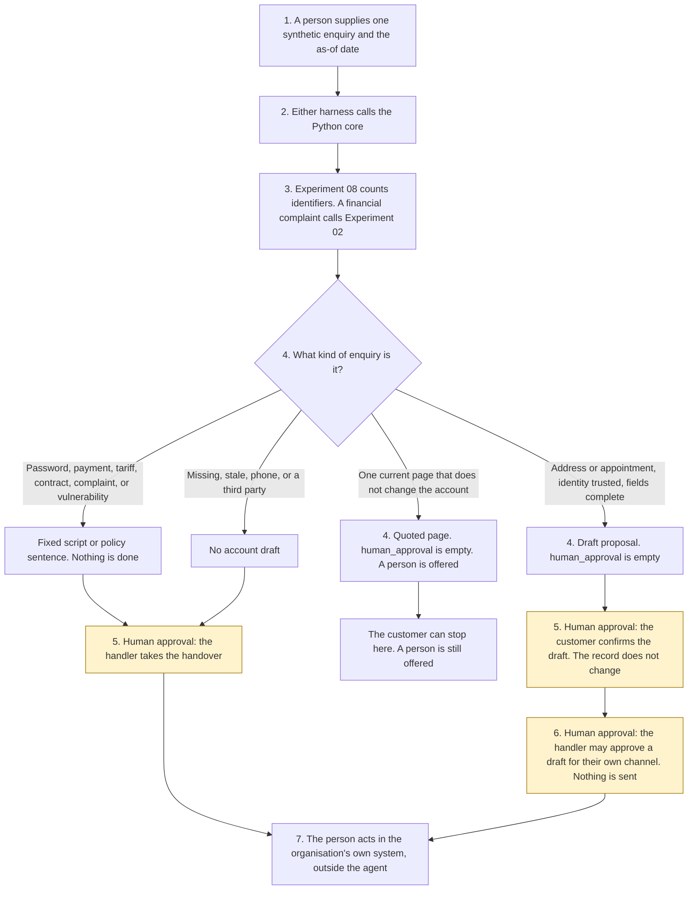

# Customer self-service

<span class="status status-available">Available</span> · Autonomy A1 · Experiment 40 · Catalogue ID C001

A starter for a customer, or for a handler, at a UK utility, a telecoms provider, a financial-services firm, or another public-facing service organisation. It reads one synthetic enquiry and returns either a quotation from a fixed knowledge base or a handover to a person. It can prepare an address-update draft or an appointment-request draft. The customer confirms that draft. Nothing is written to the account. A handler approves any outward draft for their own channel. Nothing is sent.

The organisation in the samples is Mereford Customer Service. It is invented. The pages, the account references, and the telephone number are synthetic.

The folder contains the permissions manifest, a deterministic core, 27 synthetic enquiries, and build notes for two Copilot Studio harnesses. Both harnesses call the same Python core. The core calls [Experiment 08](08-uk-pii-redaction-gateway.md) before a draft is built. For a financial-services complaint or a vulnerability phrase it calls [Experiment 02](02-consumer-duty-complaint-intake.md) `analyse()` and does not calculate a DISP clock. The confirmation shape follows [Experiment 21](21-it-service-desk.md). The warm handover follows [Experiment 13](13-council-contact-front-door.md). The draft-approval shape follows [Experiment 09](09-casework-correspondence-draft.md). Experiments 13, 21, and 09 are not imported. Nothing in the folder calls a live model or the network.

If this page and [`agent-manifest.yaml`](https://github.com/rahul-bachina/copilot-agent-experiments/blob/main/experiments/40-customer-self-service/agent-manifest.yaml) disagree, the manifest is the control.

## The problem

Customers ask the same questions often, and they also ask for the things a script must not finish: a password reset, a card payment, the closure of a complaint, or a change of tariff or contract. An agent that does any of those because the chat said so is worse than a queue.

The narrow job is to match one enquiry to a page the organisation has already approved, show the review date, explain the next step, and prepare a low-risk draft without applying it. A person is always offered, including a non-digital counter.

Pages opened for this starter on 6 November 2026:

- [UK GDPR Article 5](https://www.legislation.gov.uk/eur/2016/679/article/5). Lawfulness, fairness and transparency; data minimisation; accuracy; storage limitation; integrity and confidentiality; accountability. Article 5(3) says compatible further processing is not, by itself, lawful. No lawful basis is asserted. Article 6 was not opened.
- [UK GDPR Article 22A](https://www.legislation.gov.uk/eur/2016/679/article/22A) and [Data (Use and Access) Act 2025, section 80](https://www.legislation.gov.uk/ukpga/2025/18/section/80). Section 80(1) substitutes Articles 22A to 22D for Article 22. This starter does not take a significant decision. S.I. 2026/82 and regulations under Article 22D were not opened.
- [Ofgem and Energy Ombudsman blog, 5 February 2026](https://www.ofgem.gov.uk/blog/understanding-ai-energy-sector-benefits-risks-and-your-rights). Be clear when AI is used, make a person easy to reach, offer a non-digital alternative, and check fairness. The text is a blog. It was not verified as a licence condition. Fairness monitoring has not been done. The May 2026 ethical AI document was not opened.
- [PRIN 2A.1](https://www.handbook.fca.org.uk/handbook/PRIN/2A/1.html), for a financial-services complaint or vulnerability phrase. The cross-cutting obligations are at PRIN 2A.2. That page did not return rule text on 6 November 2026, so it is not quoted. DISP was not re-opened. No breach is found.
- [Equality Act 2010, sections 20, 29, and 149](https://www.legislation.gov.uk/ukpga/2010/15/section/20). Section 20(6) includes an accessible format where the adjustment duty relates to information. Section 29(7) applies that duty to a service-provider. Section 149 is the public sector equality duty, noted only for the public-service scenario. No duty is treated as met.

## Who it helps

**A customer** on the signed-in portal, or on web chat, phone, or email for a published page, gets the approved sentence and the review date, or a clear statement that the catalogue does not contain the answer. They are told the draft was written by an automated AI chatbot. They are offered a person and another format. They are not given a password reset, a payment, or a tariff change.

**A handler** who already has the enquiry on their screen gets a draft: which page matched, whether identity was trusted, whether the page is stale, and whether the enquiry should stop because it is a complaint, a vulnerability, or a prohibited action. They take that work in the organisation's own system.

**A customer-service team** that wants the approval points written down before anyone connects Dynamics 365. High-risk actions are disabled. The same enquiry and the same as-of date produce the same JSON.

It does not help a team that wants the tool to change an account on its own.

## What it does

`src/service.py` reads one JSON enquiry and writes one JSON document. `human_approval` is null. `actions_taken` is empty. `executed` is false. The enquiry's words are not copied into the output. Free text goes through Experiment 08. The redacted text is not copied out. `output_is_anonymised` stays false.

| Situation | What the draft says |
| --- | --- |
| How to give a meter reading, including on an energy account | The page, including "It does not submit the reading." The Ofgem blog sentence is included. The agent does not submit the reading. |
| Signed-in portal, "I have moved", postcode `SYN 1AA` | An address-update draft. The customer may later confirm it. The record does not change. |
| Any other postcode | The postcode is not copied. The customer cannot confirm the draft. |
| Phone, web chat, or email, for an address change | No account draft. Words in the message are not proof of identity. |
| Book an appointment, with a future date, a slot, and a place from the closed list | An appointment-request draft. Confirmation does not book it. |
| Password, payment, tariff, or contract | A policy sentence. It does not describe how to do the thing. The customer cannot confirm it. |
| Financial-services complaint | Experiment 02's suggestion. The handler must confirm. The complaint is not closed. No DISP date is calculated. The customer is not labelled vulnerable. |
| "I can't afford" or a health condition, in any sector | A person takes it. For energy, the human route and the non-digital counter stay in the answer. |
| "I am unhappy" about an energy bill | A person takes it. DISP and PRIN 2A are not applied. |
| Immediate danger | Call 999. No one is contacted. |
| Stale page, or a pinned source older than 180 days | The body is not copied. Equal to 180 days is still current. |
| Two pages, or none | Neither procedure is invented. |
| A record that is not marked synthetic | Refused. The text is not copied. A person is still offered. |

`record_review` records a customer confirmation, a handler handover, a handler approval of a correspondence draft for their own channel, or a rejection. The send approval is refused until the customer has confirmed, and it still does not send. `reset_password` and the other direct functions raise.

A deterministic smoke test of 27 synthetic cases passed in this folder. That is a smoke test of the Python, not a model score. The command is `python eval/evaluate.py`. The file is `eval/smoke_report.json`. Each case is counted once.

## What it does not do

These are disabled in the manifest.

- It does not reset a password or ask for a code.
- It does not take a payment or a refund.
- It does not close, uphold, or reject a complaint, and it does not offer redress.
- It does not change a tariff or a contract.
- It does not change an address, book an appointment, or submit a meter reading. A recorded confirmation is not the change.
- It does not write a Dynamics 365 record.
- It does not send an email, an SMS, or a letter.
- It does not treat enquiry text as an identity check, and it does not call a sign-in product.
- It does not quote a stale page, or read a live knowledge base.
- It does not label a customer as vulnerable, or decide that a duty has been met.
- It does not describe Experiment 08's output as anonymised.
- It does not publish an ATRS record. Experiment 13 opened the scope policy on 27 October 2026. This experiment did not re-open it.

## How the work flows

Steps marked as human approval are the points where a person has to act. The agent has no service action to take after them. Changing the record, booking the appointment, and sending a message stay outside the agent even after a person confirms a draft.

1. A customer or a handler supplies one synthetic enquiry and types the as-of date.
2. Either harness calls the Python core. The standard harness is one topic. The GitHub Copilot harness is four skills around the same call.
3. The core sends free text through Experiment 08. A financial-services complaint or vulnerability phrase also goes through Experiment 02 `analyse()`. Instructions and a stale page are recorded. The core does not call a model.
4. The draft comes back with an outcome, citations, a human route, and an empty `human_approval`.
5. **Human approval.** The signed-in customer confirms an address-update draft or an appointment-request draft when the closed fields are complete. A handler takes a password, a payment, a complaint, a tariff, a contract, a vulnerability, an unverified customer, a third party, or a stale page.
6. **Human approval.** After the customer has confirmed an account draft, a handler may approve the correspondence draft for their own channel. The agent still does not send it.
7. The person acts in the organisation's own system, if they decide to. The agent has no tool for that.



What is not a tool of the agent, even after steps 5 and 6: a password reset, a payment, closing a complaint, a tariff change, a contract change, a record write, an appointment booking, and a message.

## Architecture diagram

The diagram below is the file shipped in the experiment, copied into this site at build time.

![Architecture diagram titled Customer self-service, draft for a customer or a handler. The person supplies one synthetic enquiry and the as-of date. Either Copilot Studio harness calls the Python core, which reads a fixed catalogue, calls Experiment 08, and calls Experiment 02 only for a financial-services complaint or vulnerability. The approval stays empty. A highlighted box is the human approval: the customer confirms an address or appointment draft, a handler takes a prohibited or vulnerable handover, and a handler's own send is a separate step that still does not send. A separate box states what is not a tool of the agent: no password reset, no payment, no complaint closure, no tariff or contract change, no record write, no message, and a person is always offered.](img/40-customer-self-service-architecture.png)

## Microsoft stack

| Piece | Role in this experiment |
| --- | --- |
| Python standard library | `src/service.py`. No Azure credentials and no network. |
| Experiment 08 | In-process call to `propose()`. Model suggestions off. The reversible vault is not requested. The redacted text is not copied out. |
| Experiment 02 | In-process call to `analyse()` for a financial-services complaint or vulnerability phrase. The DISP clock is not called. |
| Experiment 21, Experiment 13, and Experiment 09 | The patterns for confirmation, warm handover, and draft approval. This experiment does not import that code. |
| pytest | The only declared dependency. Used by the unit tests. |
| Copilot Studio, standard harness | One topic. The person pastes an enquiry, the flow returns JSON, the topic stops. The overview opened on 6 November 2026 says this harness follows the topics and rules the maker defines. |
| Copilot Studio, GitHub Copilot harness | Four skills around the same JSON. It is not the GitHub Copilot service. Agents on this harness use Copilot Credits. No price is stated on the overview. The linked billing page was not opened. |
| Dynamics 365 Customer Service | Not connected. [The permission boundary](https://github.com/rahul-bachina/copilot-agent-experiments/blob/main/experiments/40-customer-self-service/docs/dynamics-365-customer-service.md) says what a later connector must not do. Product click-paths were not opened on 6 November 2026. |
| Microsoft Foundry | Optional narrative around the JSON. Not deployed. The core remains the system of record. |

The Customer Conversation harness is described on the same overview for customer voice and chat, with a route to a human representative, billed in Copilot Credits. It is not built here. The detail page linked from the overview was not opened.

## Security and permissions

Manifest `exp-40-customer-self-service`, version 0.1.0. Autonomy **A1**. Writes disabled. Sends disabled. Approve or reject, regulated decision, production record change, external send, and spending are disabled. So are password reset, complaint closure, tariff change, contract change, and labelling a customer as vulnerable.

`permissions.yaml` is the same file as `agent-manifest.yaml`. It validates against `schemas/agent-manifest.schema.json`, the schema Experiment 03's generator validates. This folder does not ask that generator to approve the manifest.

A passed identity check is honoured only for a same-day `portal_session` on the portal, for the same synthetic account reference. Phone, email, and web chat cannot carry it. This starter does not call Microsoft Entra.

These product pages were not opened on 6 November 2026. Treat the names as unverified here: Microsoft Entra Agent ID, Conditional Access for agents, Power Platform DLP as a configured policy, Microsoft Foundry prompt shields, Key Vault, Microsoft Purview, and Application Insights. None of those objects is created in this folder.

The longer note is [security and permissions](https://github.com/rahul-bachina/copilot-agent-experiments/blob/main/experiments/40-customer-self-service/docs/security-and-permissions.md).

## How to try it

Python 3.10 or newer. No credentials and no network. Experiment 08 and Experiment 02 must be present beside this folder. This experiment does not carry a second copy of either.

```bash
cd experiments/40-customer-self-service
python -m pip install -r requirements.txt
python -m pytest tests/ -q
python eval/evaluate.py
python src/service.py --input examples/sample_enquiry.json --as-of 2026-11-06
```

The sample is a meter-reading question. The exit code is 0 when a draft is produced. A record that is not marked synthetic is refused without copying the text. The exit code is 2 when the input cannot be read.

## Limitations

- The matcher is a keyword list. It will miss wording that is not on the list, and it can false-match. "Password" routes to a handler even beside a meter reading.
- The 180-day window is a starter default, not a review duty the organisation already has.
- The vulnerability list is short. Absence of a flag is not a finding that the customer needs no extra help.
- A passed portal session is a field in the JSON. It does not authorise a password reset or a record change.
- Only the postcode `SYN 1AA` is accepted. A real address is not copied, so the draft is not a completed change-of-address form.
- Experiment 08 does not redact names. The redacted text is not copied out, and the output is not described as anonymised.
- DISP, PRIN 2A.2, FG21/1, FG22/5, Article 6, Article 9, S.I. 2026/82, Article 22D regulations, Ofgem's complaint rules, and the May 2026 ethical AI document were not opened or not quoted. Where a page was requested and did not return text, the readme says so.
- The smoke test is not a model score. No live Microsoft Foundry run has been done.
- Mereford Customer Service is fictional. The telephone number is invented. The Ofcom numbering page was not opened.
- This is not legal advice, a DPIA, a Consumer Duty assessment, an Ofgem compliance statement, or an ATRS submission.

## Source

- [Experiment folder](https://github.com/rahul-bachina/copilot-agent-experiments/tree/main/experiments/40-customer-self-service)
- [Permissions manifest](https://github.com/rahul-bachina/copilot-agent-experiments/blob/main/experiments/40-customer-self-service/agent-manifest.yaml)
- [Security and permissions](https://github.com/rahul-bachina/copilot-agent-experiments/blob/main/experiments/40-customer-self-service/docs/security-and-permissions.md)
- [Harness comparison](https://github.com/rahul-bachina/copilot-agent-experiments/blob/main/experiments/40-customer-self-service/docs/harness-comparison.md)
- [Architecture note](https://github.com/rahul-bachina/copilot-agent-experiments/blob/main/experiments/40-customer-self-service/docs/architecture.md)
- [Experiment README](https://github.com/rahul-bachina/copilot-agent-experiments/blob/main/experiments/40-customer-self-service/README.md)
