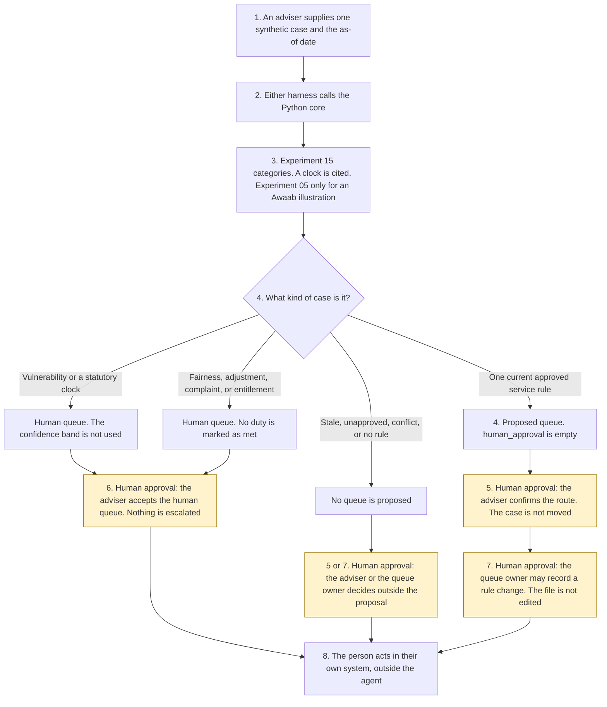

# Case routing assistant

<span class="status status-available">Available</span> · Autonomy A1 · Experiment 42 · Catalogue ID C003

A starter for an adviser, or for a queue owner, in a UK contact centre or a public-service team. It reads one synthetic case and proposes a queue, a priority, and a reason. The adviser confirms a proposed route. The queue owner approves a material change to a routing rule. Nothing is moved. Vulnerability and statutory-clock cases always propose a human queue. A confidence band counts matched rules and cannot move those cases.

The organisation in the samples is Northmere Borough Council. It is invented. The case ids are synthetic.

The folder contains the permissions manifest, a deterministic core, 34 synthetic cases, and build notes for two Copilot Studio harnesses. Both harnesses call the same Python core. The core calls [Experiment 15](15-vulnerability-urgency-scanner.md) for indicator categories. Experiment 15 calls [Experiment 08](08-uk-pii-redaction-gateway.md). Phrases and redacted text are not copied out. An Awaab's Law illustration, when structured fields are present, is asked of [Experiment 05](05-awaabs-law-hazard-triage.md) with officer approval forced off. Classification names follow [Experiment 01](01-foi-complaint-triage.md). That model is not called. Nothing in the folder calls a live model or the network.

If this page and [`agent-manifest.yaml`](https://github.com/rahul-bachina/copilot-agent-experiments/blob/main/experiments/42-case-routing-assistant/agent-manifest.yaml) disagree, the manifest is the control.

## The problem

Cases arrive already mixed: a missed collection, a leaking tap, a freedom-of-information request, a note about mould, a line that says someone cannot afford food. An agent that moves the queue because the text says so, or that puts a statutory-clock case on a routine queue, is worse than leaving the case where it is.

The narrow job is to match one case to a rule the queue owner has already approved, or to say that a person must take it, and to stop.

Pages opened for this starter on 9 November 2026:

- [Data (Use and Access) Act 2025, section 80](https://www.legislation.gov.uk/ukpga/2025/18/section/80). Section 80(1) substitutes Articles 22A to 22D for Article 22. Article 22A(1)(a) says a decision is based solely on automated processing if there is no meaningful human involvement in taking it. Article 22C(2) lists information, representations, human intervention, and a way to contest. The page says section 80 is in force at 5 February 2026, in so far as not already in force, by S.I. 2026/82, regulation 2(j). That instrument was not opened.
- [UK GDPR Article 22](https://www.legislation.gov.uk/eur/2016/679/article/22). The article text is omitted. A footnote records the substitution.
- [UK GDPR Article 12](https://www.legislation.gov.uk/eur/2016/679/article/12). Article 12(3) points to Article 12A for the applicable time period. Article 12A was not opened. No number of days is stated for a subject access request.
- [Equality Act 2010, section 19](https://www.legislation.gov.uk/ukpga/2010/15/section/19), [section 29](https://www.legislation.gov.uk/ukpga/2010/15/section/29), and [section 149](https://www.legislation.gov.uk/ukpga/2010/15/section/149). A routing rule is the sort of provision, criterion or practice section 19 describes. This starter does not apply that test. Section 29(7) applies a reasonable-adjustment duty to a service-provider. Section 20 was not opened. Section 149 requires due regard. This starter does not carry out that assessment. No duty is treated as met.
- [Freedom of Information Act 2000, section 10](https://www.legislation.gov.uk/ukpga/2000/36/section/10). Section 10(1), subject to subsections (2) and (3), is the twentieth working day. The day is not calculated.
- [Environmental Information Regulations 2004, regulation 5](https://www.legislation.gov.uk/uksi/2004/3391/regulation/5). Regulation 5(2) is 20 working days. Regulation 2 was not opened.
- [Harnesses in Copilot Studio](https://learn.microsoft.com/en-us/microsoft-copilot-studio/harnesses-overview). The standard harness follows the topics and rules the maker defines. The GitHub Copilot harness is a Copilot Studio framework, not the GitHub Copilot service.

DISP, the Housing Ombudsman Code, Article 6, Article 9, and Article 12A were not opened.

## Who it helps

**An adviser** who already has the case on their screen gets a proposal: which approved rule matched, or why the case stays with a person, and a confidence band that is a count of rules rather than a probability. They confirm a routine proposal, or they accept a human queue. The case is not moved by this tool.

**A queue owner** who is asked to change a routing rule gets a record of that approval. The rule file in this starter is not edited. A protected characteristic cannot be approved as a feature.

**A resident** is not given an automated queue move. A vulnerability indicator and a statutory clock stay with a person. A person is always offered. This starter does not publish a telephone number.

It does not help a team that wants the tool to move queues on its own.

## What it does

`src/routing.py` reads one JSON case and writes one JSON document. `human_approval` is null. `actions_taken` is empty. `executed` is false. `rerouted` is false. The case text is not copied out.

| Situation | What the proposal says |
| --- | --- |
| Missed bin, leaking tap, how to pay council tax, or opening hours, and the rule is inside 180 days | The queue, the rule id, and a high band when one rule matches. The adviser may confirm. The case is not moved. |
| Experiment 15 returns safeguarding, self-harm, or hardship | `q-human-vulnerability`. The person is not labelled. The band is not used. |
| Freedom of information, environmental information, subject access, mould, or a DISP kind on the case | `q-human-statutory`. Dates are not calculated here. An Awaab illustration from Experiment 05 is not operative. |
| Both a vulnerability category and a clock | The vulnerability queue, and the clock is still recorded. |
| An instruction to route by a protected characteristic | `q-human-fairness`. The instruction is not applied. |
| A wheelchair, a disability, or an interpreter | A human review. Not a routine repair queue. Section 20 is not quoted. |
| A complaint, or an entitlement question | A human review. No timescale and no decision. |
| A rule older than 180 days, or a draft rule the owner has not approved | The queue is not proposed. Equal to 180 days is still current. |
| Two queues, or none | Neither queue is chosen. The band is low. |
| A record that is not marked synthetic | Refused. The text is not copied. A person is still offered. |

`record_review` records an adviser confirmation, acceptance of a human queue, a queue-owner rule approval, or a rejection. A confirmation does not reroute. A rule approval does not edit the file. `reroute_case` and the other direct functions raise.

A deterministic smoke test of 34 synthetic cases passed in this folder. That is a smoke test of the Python, not a model score. The command is `python eval/evaluate.py`. The file is `eval/smoke_report.json`. Each case is counted once.

## What it does not do

These are disabled in the manifest.

- It does not reroute a case, including after confirmation.
- It does not close a case.
- It does not escalate a case. Proposing a human queue is not an escalation the agent has carried out.
- It does not edit a routing rule.
- It does not set a priority on a case system.
- It does not send a message or place a call.
- It does not decide entitlement or a complaint outcome.
- It does not label a person as vulnerable.
- It does not use a protected characteristic as a routing feature.
- It does not calculate a Freedom of Information day, an environmental-information day, or a subject-access period.
- It does not call Experiment 02, and it does not state a DISP timescale.
- It does not let a confidence band move a human-mandatory case.
- It does not publish an ATRS record. Experiment 13 opened the scope policy on 27 October 2026. This experiment did not re-open it.

## How the work flows

Steps marked as human approval are the points where a person has to act. The agent has no service action to take after them. Moving the case, closing it, and editing a rule stay outside the agent even after a person confirms.

1. An adviser supplies one synthetic case and types the as-of date.
2. Either harness calls the Python core. The standard harness is one topic. The GitHub Copilot harness is four skills around the same call.
3. The core calls Experiment 15. A statutory kind is cited. An Awaab illustration calls Experiment 05 with officer approval forced off. Instructions and a stale rule are recorded. The core does not call a model.
4. The proposal comes back with a queue or a human queue, reasons, a confidence band, and an empty `human_approval`.
5. **Human approval.** The adviser confirms a proposed service route. The case is not moved.
6. **Human approval.** The adviser accepts a human queue for vulnerability, a statutory clock, fairness, an adjustment, a complaint, or an entitlement question. The case is not escalated or closed.
7. **Human approval.** The queue owner records approval of a material rule change. The rule file is not edited. A protected characteristic cannot be the feature.
8. The person acts in the organisation's own system, if they decide to. The agent has no tool for that.



What is not a tool of the agent, even after steps 5, 6, and 7: a reroute, a close, an escalation, a rule-file edit, and a message.

## Architecture diagram

The diagram below is the file shipped in the experiment, copied into this site at build time.

![Architecture diagram titled Case routing, a proposal for one synthetic case. The person supplies one synthetic case and the as-of date. Either Copilot Studio harness calls the Python core, which reads approved rules, calls Experiment 15 for categories, and calls Experiment 05 only for an Awaab illustration. The approval stays empty. A highlighted box is the human approval: the adviser confirms a proposed route, a human queue is accepted and not escalated, and the queue owner may record a rule change that does not edit the file. A separate box states what is not a tool of the agent: no reroute, no close, no escalation, no rule edit, no message, and vulnerability and statutory clocks stay with a person.](img/42-case-routing-assistant-architecture.png)

## Microsoft stack

| Piece | Role in this experiment |
| --- | --- |
| Python standard library | `src/routing.py`. No Azure credentials and no network. |
| Experiment 15 | In-process call to `scan()`. No model is passed. Phrases are not copied out. |
| Experiment 08 | Called by Experiment 15. The redacted text is not copied out. |
| Experiment 05 | In-process call to `calculate_statutory_clock()` only when Awaab fields are supplied. Officer approval is forced off. |
| Experiment 01 | Classification names only. The model is not called. |
| pytest | The only declared dependency. Used by the unit tests. |
| Copilot Studio, standard harness | One topic. The adviser pastes a case, the flow returns JSON, the topic stops. The overview opened on 9 November 2026 says this harness follows the topics and rules the maker defines. The queue in the JSON is the Python rule match. |
| Copilot Studio, GitHub Copilot harness | Four skills around the same JSON. It is not the GitHub Copilot service. Agents on this harness use Copilot Credits. No price is stated on the overview. The linked billing page was not opened. |
| Dynamics 365 and Power Platform | Named in the catalogue. Not connected. The flow note says what a later connector must not do. Product click-paths were not opened on 9 November 2026. |
| Microsoft Foundry | Optional narrative around the JSON. Not deployed. The core remains the system of record. |

The Customer Conversation harness is described on the same overview for contact-centre voice and chat, with a route to a human representative, billed in Copilot Credits. It is not built here. The detail page linked from the overview was not opened.

## Security and permissions

Manifest `exp-42-case-routing-assistant`, version 0.1.0. Autonomy **A1**. Writes disabled. Sends disabled. Approve or reject, regulated decision, production record change, external send, and spending are disabled. So are reroute, close, escalate, and editing a routing rule.

`permissions.yaml` is the same file as `agent-manifest.yaml`. It validates against `schemas/agent-manifest.schema.json`.

These product pages were not opened on 9 November 2026. Treat the names as unverified here: Microsoft Entra Agent ID, Conditional Access for agents, Power Platform DLP as a configured policy, Microsoft Foundry prompt shields, Key Vault, Microsoft Purview, and Application Insights. None of those objects is created in this folder.

The longer note is [security and permissions](https://github.com/rahul-bachina/copilot-agent-experiments/blob/main/experiments/42-case-routing-assistant/docs/security-and-permissions.md).

## How to try it

Python 3.10 or newer. No credentials and no network. Experiments 15, 08, and 05 must be present beside this folder. This experiment does not carry a second copy of them.

```bash
cd experiments/42-case-routing-assistant
python -m pip install -r requirements.txt
python -m pytest tests/ -q
python eval/evaluate.py
python src/routing.py --input examples/sample_case.json --as-of 2026-11-09
```

The sample is a missed bin. The exit code is 0 when a proposal is produced. A record that is not marked synthetic is refused without copying the text. The exit code is 2 when the input cannot be read.

## Limitations

- The matcher is a keyword list. It will miss wording that is not on the list, and it can false-match.
- The 180-day window is a starter default, not a review duty the organisation already has.
- Experiment 15 is built for recall. Absence of a flag is not a finding that nobody needs extra help.
- Article 12A, regulation 2, S.I. 2026/82, DISP, section 20, Article 6, and Article 9 were not opened. Where a period was not opened, none is stated.
- The confidence band is a count of rules. It is not a probability and it has not been calibrated.
- Experiment 08 does not redact names. The redacted text is not copied out, and the output is not described as anonymised.
- The smoke test is not a model score. No live Microsoft Foundry run has been done.
- Northmere Borough Council is fictional.
- This is not legal advice, a DPIA, an equality impact assessment, or an ATRS submission.

## Source

- [Experiment folder](https://github.com/rahul-bachina/copilot-agent-experiments/tree/main/experiments/42-case-routing-assistant)
- [Permissions manifest](https://github.com/rahul-bachina/copilot-agent-experiments/blob/main/experiments/42-case-routing-assistant/agent-manifest.yaml)
- [Security and permissions](https://github.com/rahul-bachina/copilot-agent-experiments/blob/main/experiments/42-case-routing-assistant/docs/security-and-permissions.md)
- [Harness comparison](https://github.com/rahul-bachina/copilot-agent-experiments/blob/main/experiments/42-case-routing-assistant/docs/harness-comparison.md)
- [Architecture note](https://github.com/rahul-bachina/copilot-agent-experiments/blob/main/experiments/42-case-routing-assistant/docs/architecture.md)
- [Experiment README](https://github.com/rahul-bachina/copilot-agent-experiments/blob/main/experiments/42-case-routing-assistant/README.md)
