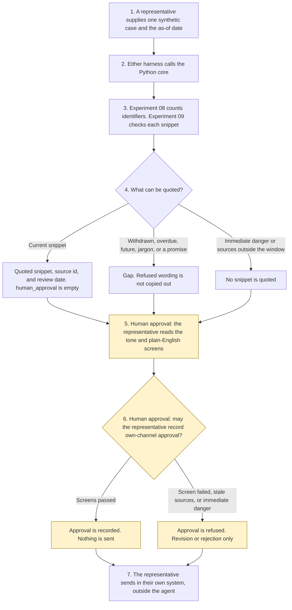

# Response drafting

<span class="status status-available">Available</span> · Autonomy A1 · Experiment 43 · Catalogue ID C004

A starter for a representative at a UK service organisation, including a financial-services firm. It reads one synthetic case and approved knowledge snippets, quotes only a snippet that is still in date, names the source, and runs a tone screen and a plain-English screen. The representative reviews the draft and sends it on their own channel. Nothing is sent by the agent.

The organisation in the samples is Harberton Service. It is invented. The snippets and the case references are synthetic.

The folder contains the permissions manifest, a deterministic core, 22 synthetic cases, and build notes for two Copilot Studio harnesses. Both harnesses call the same Python core. The core calls [Experiment 08](08-uk-pii-redaction-gateway.md) before a draft is built. It calls `line_applicability()` in [Experiment 09](09-casework-correspondence-draft.md) so a snippet is cited only when that gate says it is current. Nothing in the folder calls a live model or the network.

If this page and [`agent-manifest.yaml`](https://github.com/rahul-bachina/copilot-agent-experiments/blob/main/experiments/43-response-drafting/agent-manifest.yaml) disagree, the manifest is the control.

## The problem

Representatives answer the same questions from approved wording, and they are also asked to send, to promise compensation, or to use a line that has been withdrawn. An agent that does any of those because the case said so is worse than a queue.

The narrow job is to match one case to a snippet the organisation has already approved, show the review date, keep the wording plain, and stop for the representative.

Pages opened for this starter on 9 November 2026:

- [PRIN 2A.5](https://handbook.fca.org.uk/handbook/prin2a/prin2as5) and the [PRIN sourcebook PDF](https://api-handbook.fca.org.uk/files/sourcebook/PRIN.pdf). The PDF says it was last updated in June 2026. PRIN 2A.5.3 requires a firm to support retail customer understanding and to communicate in a way which is clear, fair and not misleading. The same PDF cross-refers to that paragraph as PRIN 2A.5.3R. PRIN 2A.5.7 says a firm should use plain and intelligible language. The status letter on 2A.5.7 was not cleanly labelled in the PDF text extraction. PRIN 2A.5.10 requires testing and monitoring where appropriate, and the PDF cross-refers to it as PRIN 2A.5.10R. This screen is not that test. It is attached only for a financial-services case. No outcome is treated as met.
- [UK GDPR Article 12](https://www.legislation.gov.uk/eur/2016/679/article/12). Article 12(1) requires clear and plain language for privacy information and for communications under Articles 15 to 22D and Article 34. A routine service reply is not presented as that information. Article 12 is not treated as met. Article 5, Article 6, Article 9, and Article 22A were not opened.
- [Equality Act 2010, section 20](https://www.legislation.gov.uk/ukpga/2010/15/section/20). Section 20(6) includes an accessible format where the first or third requirement relates to information. This starter offers to ask a person. It does not decide what is reasonable. Section 29 was not opened.
- [Harnesses in Copilot Studio](https://learn.microsoft.com/en-us/microsoft-copilot-studio/harnesses-overview). The standard harness follows topics and rules the maker defines. The GitHub Copilot harness is a Copilot Studio framework, not the GitHub Copilot service. The Customer Conversation harness is described for customer voice and chat. This starter does not build that third harness.

## Who it helps

**A representative** who already has the case on their screen gets a draft: which snippet was quoted, which snippet was refused and why, whether the tone screen and the plain-English screen passed, and a reminder that they send it themselves. They are not given a button that sends.

**A customer** receives nothing from this agent. If the representative later sends a reply, the draft they were shown named its sources, offered a person, and offered another format. The agent does not decide that the reply met the Consumer Duty.

**A customer-service team** that wants the approval points written down before anyone connects Dynamics 365 or a mailbox. High-risk actions are disabled. The same case and the same as-of date produce the same JSON.

It does not help a team that wants the tool to send the reply on its own.

## What it does

`src/response.py` reads one JSON case and writes one JSON document. `human_approval` is null. `actions_taken` is empty. `executed` is false. The case text is not copied into the draft. Free text goes through Experiment 08. The redacted text is not copied out. `output_is_anonymised` stays false.

| Situation | What the draft says |
| --- | --- |
| Opening hours, with a current snippet and a withdrawn one | The current snippet, with its id and review date. The withdrawn wording is not copied out. |
| A bill question, where one snippet is past its review date | The current snippet only. On the review date a snippet is not cited. That rule is Experiment 09's. |
| Terms written with jargon, or a promise of compensation | A gap. No position is stated. The refused wording is not copied out. |
| A snippet that is not yet in force | A gap. The future wording is not copied out. |
| Large print or audio | The accessible-format snippet. The duty is not treated as met. Section 29 was not opened. |
| A meter reading, energy sector | The meter snippet, including that it does not submit the reading. PRIN 2A.5 is not applied. |
| Financial-services case | PRIN 2A.5.3R, PRIN 2A.5.7, and PRIN 2A.5.10R are named. `outcome_met` is false. The screen is not the test in PRIN 2A.5.10R. |
| "I want to complain" | No complaint outcome is decided. A matching current snippet may still be quoted. |
| Immediate-danger wording | Stop for a person. Call 999 if someone is in immediate danger. Nobody is contacted. No snippet is quoted. The customer is not labelled vulnerable. |
| Instructions to send, or to treat a withdrawn snippet as current | The instruction is recorded and not followed. Nothing is sent. |
| More than 180 days after 9 November 2026 | No snippet is quoted. Equal to 180 days is still inside the window. |
| A record that is not marked synthetic | Refused. The text is not copied. A person is still offered. |

`record_review` records approval for the representative's own channel, a request for revision, or a rejection. Send approval is refused when a screen failed, when sources are outside the window, or when immediate-danger wording was flagged. It still does not send. `send_message` and the other direct functions raise.

A deterministic smoke test of 22 synthetic cases passed in this folder. That is a smoke test of the Python, not a model score. The command is `python eval/evaluate.py`. The file is `eval/smoke_report.json`. Each case is counted once.

## What it does not do

These are disabled in the manifest.

- It does not send an email, an SMS, a letter, or a chat reply.
- It does not choose a recipient address. The case text cannot approve one.
- It does not write a Dynamics 365 case or a mailbox.
- It does not offer redress, uphold or reject a complaint, or close a case.
- It does not invent a position that is not a verbatim approved snippet.
- It does not quote a withdrawn, future, or overdue snippet, including on the review date.
- It does not certify the Consumer Duty, PRIN 2A.5, Article 12, or the Equality Act 2010.
- It does not carry out the testing in PRIN 2A.5.10R.
- It does not label a customer as vulnerable.
- It does not describe Experiment 08's output as anonymised.
- It does not publish an ATRS record. The scope policy was not opened for this experiment on 9 November 2026.

## How the work flows

Steps marked as human approval are the points where a person has to act. The agent has no service action to take after them. Sending the response stays with the representative even after they approve a draft.

1. A representative supplies one synthetic case and types the as-of date.
2. Either harness calls the Python core. The standard harness is one topic. The GitHub Copilot harness is three skills around the same call. This starter does not assign a weight to a skill.
3. The core sends free text through Experiment 08 and checks each matching snippet with Experiment 09. Instructions, a stale snippet, and a stale pin are recorded. The core does not call a model.
4. The draft comes back with citations, a tone screen, a plain-English screen, a human route, and an empty `human_approval`.
5. **Human approval.** The representative reads the draft. If a screen failed, if the sources are outside the window, or if immediate-danger wording was flagged, they cannot record approval for their own channel. They can request a revision or reject the draft.
6. **Human approval.** If the screens passed, the representative may record approval for their own channel. The agent still does not send. The recipient address is not chosen here.
7. The representative sends, if they decide to, in the organisation's own system. The agent has no tool for that.



What is not a tool of the agent, even after steps 5 and 6: a message, a case write, redress, closing a complaint, and choosing an address.

## Architecture diagram

The diagram below is the file shipped in the experiment, copied into this site at build time.

![Architecture diagram titled Response drafting, a representative sends the reply. The representative supplies one synthetic case and the as-of date. Either Copilot Studio harness calls the Python core, which uses the Experiment 09 citation gate, calls Experiment 08, and runs the tone and plain-English screens. The approval stays empty. A highlighted box is the human approval: the representative reviews the draft and may approve it for their own channel, and they send outside the agent. A separate box states what is not a tool of the agent: no email, no case write, no redress, no complaint closure, no recipient address, and a person is always offered.](img/43-response-drafting-architecture.png)

## Microsoft stack

| Piece | Role in this experiment |
| --- | --- |
| Python standard library | `src/response.py`. No Azure credentials and no network. |
| Experiment 08 | In-process call to `propose()`. The reversible vault is not requested. The redacted text is not copied out. |
| Experiment 09 | In-process call to `line_applicability()`. The correspondence drafter is not run. On the review date a snippet is not cited. |
| pytest | The only declared dependency. Used by the unit tests. |
| Copilot Studio, standard harness | One topic. The representative pastes a case, the flow returns JSON, the topic stops. The overview opened on 9 November 2026 says this harness follows the topics and rules the maker defines. |
| Copilot Studio, GitHub Copilot harness | Three skills around the same JSON. It is not the GitHub Copilot service. Agents on this harness use Copilot Credits. No price is stated on the overview. The linked billing page was not opened. |
| Dynamics 365 and Microsoft 365 | Not connected. [The permission boundary](https://github.com/rahul-bachina/copilot-agent-experiments/blob/main/experiments/43-response-drafting/docs/dynamics-365-and-microsoft-365.md) says what a later connector must not do. Product click-paths were not opened on 9 November 2026. |
| Microsoft Foundry | Optional narrative around the JSON. Not deployed. The core remains the system of record. |

The Customer Conversation harness is described on the same overview for customer voice and chat, with a route to a human representative, billed in Copilot Credits. It is not built here. The detail page linked from the overview was not opened.

## Security and permissions

Manifest `exp-43-response-drafting`, version 0.1.0. Autonomy **A1**. Writes disabled. Sends disabled. Approve or reject, regulated decision, production record change, external send, and spending are disabled. So are redress, case closure, and choosing a recipient address.

`permissions.yaml` is the same file as `agent-manifest.yaml`. It validates against `schemas/agent-manifest.schema.json`, the schema Experiment 03's generator validates. This folder does not ask that generator to approve the manifest.

These product pages were not opened on 9 November 2026. Treat the names as unverified here: Microsoft Entra Agent ID, Conditional Access for agents, Power Platform DLP as a configured policy, Microsoft Foundry prompt shields, Key Vault, Microsoft Purview, and Application Insights. None of those objects is created in this folder.

The longer note is [security and permissions](https://github.com/rahul-bachina/copilot-agent-experiments/blob/main/experiments/43-response-drafting/docs/security-and-permissions.md).

## How to try it

Python 3.10 or newer. No credentials and no network. Experiment 08 and Experiment 09 must be present beside this folder. This experiment does not carry a second copy of either.

```bash
cd experiments/43-response-drafting
python -m pip install -r requirements.txt
python -m pytest tests/ -q
python eval/evaluate.py
python src/response.py --input examples/sample_case.json --as-of 2026-11-09
```

The sample is an opening-hours question on a financial-services case. The exit code is 0 when a draft or a refusal is produced. The exit code is 2 when the input cannot be read.

## Limitations

- The matcher is a keyword list. It will miss wording that is not on the list, and it can false-match.
- The 25-word cap and the jargon list are a starter screen. They are not PRIN 2A.5.7 and they are not a reading-age measure. A short sentence can still mislead.
- The 180-day window is a starter default, not a review duty the organisation already has.
- Experiment 09 treats the review date itself as overdue. That is the function this experiment calls.
- The vulnerability list is short. Absence of a flag is not a finding that the customer needs no extra help.
- Experiment 08 does not redact names. The redacted text is not copied out, and the output is not described as anonymised.
- Article 5, Article 6, Article 9, Article 22A, section 29, FG22/5, PRIN 2A.2, and DISP were not opened on 9 November 2026. The status letter on PRIN 2A.5.7 was not cleanly labelled in the PDF extract.
- Article 12(1) was read. It governs privacy information and specified communications, not every customer letter.
- The smoke test is not a model score. No live Microsoft Foundry run has been done.
- Harberton Service is fictional.
- This is not legal advice, a DPIA, a Consumer Duty assessment, or an ATRS submission.

## Source

- [Experiment folder](https://github.com/rahul-bachina/copilot-agent-experiments/tree/main/experiments/43-response-drafting)
- [Permissions manifest](https://github.com/rahul-bachina/copilot-agent-experiments/blob/main/experiments/43-response-drafting/agent-manifest.yaml)
- [Security and permissions](https://github.com/rahul-bachina/copilot-agent-experiments/blob/main/experiments/43-response-drafting/docs/security-and-permissions.md)
- [Harness comparison](https://github.com/rahul-bachina/copilot-agent-experiments/blob/main/experiments/43-response-drafting/docs/harness-comparison.md)
- [Architecture note](https://github.com/rahul-bachina/copilot-agent-experiments/blob/main/experiments/43-response-drafting/docs/architecture.md)
- [Experiment README](https://github.com/rahul-bachina/copilot-agent-experiments/blob/main/experiments/43-response-drafting/README.md)
