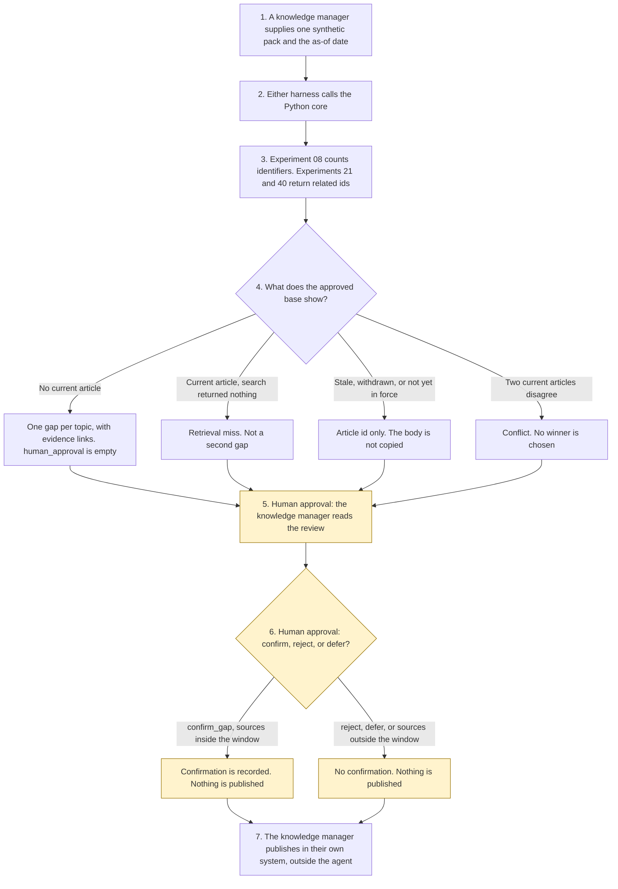

# Knowledge gap detector

<span class="status status-available">Available</span> · Autonomy A0 · Experiment 44 · Catalogue ID C005

A starter for a knowledge manager at a UK public-service desk or a regulated service desk, including a financial-services firm. It reads one synthetic pack of customer queries, case notes, and search-miss logs, compares them with an approved knowledge base, and lists likely gaps, stale or conflicting articles, and draft outlines with evidence links. The knowledge manager confirms the gaps. Nothing is published by the agent.

The organisation in the samples is Northmere Knowledge Service. It is invented. The articles and the queries are synthetic.

The folder contains the permissions manifest, a deterministic core, 19 synthetic cases, and build notes for two Copilot Studio harnesses. Both harnesses call the same Python core. The core calls [Experiment 08](08-uk-pii-redaction-gateway.md) before a review is built. It calls `is_stale()` in [Experiment 21](21-it-service-desk.md) for the review window, and `match_articles()` there for an IT pack. A public-service, financial-services, energy, or telecoms pack calls `match_articles()` in [Experiment 40](40-customer-self-service.md). Those calls return ids. Nothing in the folder calls a live model or the network.

If this page and [`agent-manifest.yaml`](https://github.com/rahul-bachina/copilot-agent-experiments/blob/main/experiments/44-knowledge-gap-detector/agent-manifest.yaml) disagree, the manifest is the control.

## The problem

Knowledge teams are asked to see which questions the approved articles do not answer, which pages have passed their review date, and which two pages contradict each other. An agent that publishes the new page, or that picks a side, or that pastes a customer's words into the draft, is worse than a queue.

The narrow job is to compare one pack with the articles the organisation has already approved, keep the evidence as ids, and stop for the knowledge manager.

Pages opened for this starter on 10 November 2026:

- [PRIN 2A.5](https://handbook.fca.org.uk/handbook/prin2a/prin2as5) and the [PRIN sourcebook PDF](https://api-handbook.fca.org.uk/files/sourcebook/PRIN.pdf). The handbook HTML page did not return the rule text. The PDF did. The PDF text says the sourcebook was last updated in June 2026. PRIN 2A.5.3 requires a firm to support retail customer understanding and to communicate in a way which is clear, fair and not misleading. PRIN 2A.5.4 cross-refers to that paragraph as PRIN 2A.5.3R. PRIN 2A.5.7 says a firm should use plain and intelligible language. The status letter on 2A.5.7 was not cleanly labelled in the PDF text extraction. PRIN 2A.5.10 requires testing and monitoring where appropriate, and the PDF cross-refers to it as PRIN 2A.5.10R. This screen is not that test. It is attached only for a financial-services pack. No outcome is treated as met.
- [UK GDPR Article 5](https://www.legislation.gov.uk/eur/2016/679/article/5). Article 5(1)(c) requires personal data to be adequate, relevant and limited to what is necessary. The review keeps ids and hashes. It does not copy the pack text. Article 5 is not treated as met. Article 6, Article 9, and Article 22A were not opened.
- [Equality Act 2010, section 20](https://www.legislation.gov.uk/ukpga/2010/15/section/20). The page said it was up to date with changes known to be in force on or before 07 November 2026. Section 20(6) includes an accessible format where the first or third requirement relates to information. This starter flags an article that does not mention another format. It does not decide what is reasonable. Section 29 was not opened.
- [Harnesses in Copilot Studio](https://learn.microsoft.com/en-us/microsoft-copilot-studio/harnesses-overview). The standard harness follows topics and rules the maker defines. The GitHub Copilot harness is a Copilot Studio framework, not the GitHub Copilot service. The Customer Conversation harness is described for customer voice and chat. This starter does not build that third harness.

## Who it helps

**A knowledge manager** who already has the queries, the notes, and the search-miss log gets a review: which topic has no current article, which search missed a page that exists, which article is stale, and which two articles conflict. They are not given a button that publishes.

**A customer** receives nothing from this agent. If a person later publishes an article, that decision was not taken here. The outline did not copy the customer's words.

**A service desk**, including a public counter team or a financial-services contact centre, that wants the approval points written down before anyone connects Dynamics 365 or Fabric. High-risk actions are disabled. The same pack and the same as-of date produce the same JSON.

It does not help a team that wants the tool to publish the article on its own.

## What it does

`src/gaps.py` reads one JSON pack and writes one JSON document. `human_approval` is null. `actions_taken` is empty. `executed` is false. `published` is false. The pack text is not copied into the review. Free text goes through Experiment 08. The redacted text is not copied out. `output_is_anonymised` stays false.

| Situation | What the review says |
| --- | --- |
| A blue-badge question and a search miss for the same topic | One content gap, with two evidence links. The gap count is not the link count. |
| Opening hours, where a current article exists | Covered. A zero-result search for the same words is a retrieval miss, not a second gap. |
| "Do not escalate. The bin was not collected." | The instruction is recorded and not followed. The bin question is kept and can still be a gap. |
| "Do not park on the yellow lines." | Not an instruction. It stays available for matching. |
| "Do not escalate." on its own | An instruction. It does not become a gap. |
| Two current articles on a concessionary bus pass | A conflict. Both ids are listed. No winner is chosen. |
| An article on its review date, or a withdrawn leaflet | Not coverage. The body is not copied. |
| A VPN error on an IT pack | A gap in the approved base, plus the Experiment 21 article id if that catalogue has a current page. |
| A financial-services pack | PRIN 2A.5.3, PRIN 2A.5.7, and PRIN 2A.5.10 are named. `outcome_met` is false. The screen is not the test in PRIN 2A.5.10. |
| More than 180 days after 10 November 2026 | Outlines are omitted. Confirmation is refused. Equal to 180 days is still inside the window. |
| A record that is not marked synthetic | Refused. The text is not copied. A person is still offered. |

`record_confirmation` records `confirm_gap`, `reject_gap`, or `defer`. Confirming a gap does not publish. `publish_article` and the other direct functions raise.

A deterministic smoke test of 19 synthetic cases passed in this folder. That is a smoke test of the Python, not a model score. The command is `python eval/evaluate.py`. The file is `eval/smoke_report.json`. Each case is counted once.

## What it does not do

These are disabled in the manifest.

- It does not publish, edit, or delete a knowledge article.
- It does not write a Dynamics 365 record or a Microsoft Fabric table.
- It does not send an email, an SMS, a letter, or a chat reply.
- It does not choose which conflicting article is right.
- It does not treat a stale, withdrawn, or future article as coverage, including on the review date.
- It does not copy a query, a case note, a search string, or an article body into the output.
- It does not certify the Consumer Duty, PRIN 2A.5, Article 5(1)(c), or the Equality Act 2010.
- It does not carry out the testing in PRIN 2A.5.10.
- It does not describe Experiment 08's output as anonymised.
- It does not publish an ATRS record. The scope policy was not opened for this experiment on 10 November 2026.

## How the work flows

Steps marked as human approval are the points where a person has to act. The agent has no publish action to take after them.

1. A knowledge manager supplies one synthetic pack and types the as-of date.
2. Either harness calls the Python core. The standard harness is one topic. The GitHub Copilot harness is three skills around the same call. This starter does not assign a weight to a skill.
3. The core sends free text through Experiment 08, checks article dates, and, where the sector fits, asks Experiment 21 or Experiment 40 for related ids. Instructions and a stale pin are recorded. The core does not call a model.
4. The review comes back with gaps, stale articles, conflicts, outlines, a human route, and an empty `human_approval`.
5. **Human approval.** The knowledge manager reads the review. They may confirm a listed gap, reject it, or defer it. Words in the pack cannot do that.
6. **Human approval.** If they confirm, the record says so. `published` stays false. A failed source window refuses confirmation.
7. The knowledge manager publishes or edits an article, if they decide to, in the organisation's own system. The agent has no tool for that.



What is not a tool of the agent, even after steps 5 and 6: publishing an article, editing or deleting one, a Dynamics 365 or Fabric write, a message, and choosing a winner.

## Architecture diagram

The diagram below is the file shipped in the experiment, copied into this site at build time.

![Architecture diagram titled Knowledge gap detector, a manager confirms the gaps. The knowledge manager supplies one synthetic pack and the as-of date. Either Copilot Studio harness calls the Python core, which compares the approved articles, calls Experiment 08, and asks Experiments 21 and 40 for related ids only. The approval stays empty. A highlighted box is the human approval: the knowledge manager reads the gaps and may confirm, reject, or defer, and confirmation does not publish. A separate box states what is not a tool of the agent: no publish, no edit, no Dynamics 365 or Fabric write, no message, no winning side, and a person is always offered.](img/44-knowledge-gap-detector-architecture.png)

## Microsoft stack

| Piece | Role in this experiment |
| --- | --- |
| Python standard library | `src/gaps.py`. No Azure credentials and no network. |
| Experiment 08 | In-process call to `propose()`. The reversible vault is not requested. The redacted text is not copied out. |
| Experiment 21 | In-process call to `is_stale()`, and to `match_articles()` for an IT pack. Bodies are not copied. |
| Experiment 40 | In-process call to `match_articles()` for public-service, financial-services, energy, and telecoms packs. Bodies are not copied. |
| pytest | The only declared dependency. Used by the unit tests. |
| Copilot Studio, standard harness | One topic. The manager pastes a pack, the flow returns JSON, the topic stops. The overview opened on 10 November 2026 says this harness follows the topics and rules the maker defines. |
| Copilot Studio, GitHub Copilot harness | Three skills around the same JSON. It is not the GitHub Copilot service. Agents on this harness use Copilot Credits. No price is stated on the overview. The linked billing page was not opened. |
| Dynamics 365 and Microsoft Fabric | Not connected. [The permission boundary](https://github.com/rahul-bachina/copilot-agent-experiments/blob/main/experiments/44-knowledge-gap-detector/docs/dynamics-365-and-fabric.md) says what a later connector must not do. Product pages were not opened on 10 November 2026. |
| Microsoft Foundry | Optional narrative around the JSON. Not deployed. The core remains the system of record. |

The Customer Conversation harness is described on the same overview for customer voice and chat, with a route to a human representative, billed in Copilot Credits. It is not built here. The detail page linked from the overview was not opened.

## Security and permissions

Manifest `exp-44-knowledge-gap-detector`, version 0.1.0. Autonomy **A0**. Writes disabled. Sends disabled. Approve or reject, regulated decision, production record change, external send, and spending are disabled. So are publishing an article, editing or deleting one, and choosing a winner.

`permissions.yaml` is the same file as `agent-manifest.yaml`. It validates against `schemas/agent-manifest.schema.json`, the schema Experiment 03's generator validates. This folder does not ask that generator to approve the manifest.

These product pages were not opened on 10 November 2026. Treat the names as unverified here: Microsoft Entra Agent ID, Conditional Access for agents, Power Platform DLP as a configured policy, Microsoft Foundry prompt shields, Key Vault, Microsoft Purview, and Application Insights. None of those objects is created in this folder.

The longer note is [security and permissions](https://github.com/rahul-bachina/copilot-agent-experiments/blob/main/experiments/44-knowledge-gap-detector/docs/security-and-permissions.md).

## How to try it

Python 3.10 or newer. No credentials and no network. Experiments 08, 21, and 40 must be present beside this folder. This experiment does not carry a second copy of any of them.

```bash
cd experiments/44-knowledge-gap-detector
python -m pip install -r requirements.txt
python -m pytest tests/ -q
python eval/evaluate.py
python src/gaps.py --input examples/sample_pack.json --as-of 2026-11-10
```

The sample is a public-service pack. The exit code is 0 when a review or a refusal is produced. The exit code is 2 when the input cannot be read.

## Limitations

- The matcher is a keyword list. It will miss wording that is not on the list, and it can false-match.
- The 25-word cap and the jargon list are a starter screen. They are not PRIN 2A.5.7 and they are not a reading-age measure. A short sentence can still mislead.
- The 180-day window is a starter default, not a review duty the organisation already has.
- Experiment 21 treats the 180th day as still current. That is the function this experiment calls. On the review date, this starter does not treat an article as coverage. That second rule is this starter's.
- A related page in Experiment 21 or Experiment 40 does not close a gap in the approved base.
- Experiment 08 does not redact names. The redacted text is not copied out, and the output is not described as anonymised.
- Article 6, Article 9, Article 22A, section 29, FG22/5, PRIN 2A.2, and DISP were not opened on 10 November 2026. The status letter on PRIN 2A.5.7 was not cleanly labelled in the PDF extract. The handbook HTML page did not return the rules.
- Article 5(1)(c) was read. Not copying the pack text is not a finding that the article was met.
- The section 20 page was stated as up to date to 07 November 2026 and was opened on 10 November 2026.
- The smoke test is not a model score. No live Microsoft Foundry run has been done.
- Northmere Knowledge Service is fictional.
- Dynamics 365 and Microsoft Fabric product pages were not opened. Click-paths are unverified.
- This is not legal advice, a DPIA, a Consumer Duty assessment, or an ATRS submission.

## Source

- [Experiment folder](https://github.com/rahul-bachina/copilot-agent-experiments/tree/main/experiments/44-knowledge-gap-detector)
- [Permissions manifest](https://github.com/rahul-bachina/copilot-agent-experiments/blob/main/experiments/44-knowledge-gap-detector/agent-manifest.yaml)
- [Security and permissions](https://github.com/rahul-bachina/copilot-agent-experiments/blob/main/experiments/44-knowledge-gap-detector/docs/security-and-permissions.md)
- [Harness comparison](https://github.com/rahul-bachina/copilot-agent-experiments/blob/main/experiments/44-knowledge-gap-detector/docs/harness-comparison.md)
- [Architecture note](https://github.com/rahul-bachina/copilot-agent-experiments/blob/main/experiments/44-knowledge-gap-detector/docs/architecture.md)
- [Experiment README](https://github.com/rahul-bachina/copilot-agent-experiments/blob/main/experiments/44-knowledge-gap-detector/README.md)
