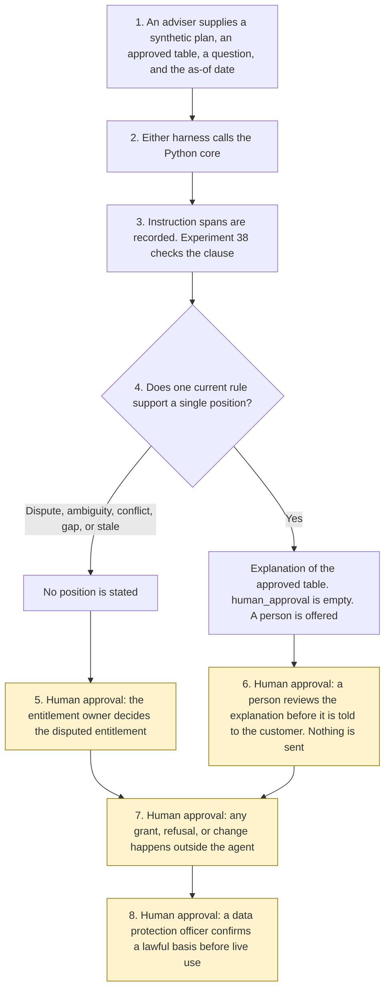

# Service entitlement explainer

<span class="status status-available">Available</span> · Autonomy A0 · Experiment 45 · Catalogue ID C007

A starter for an adviser at a UK service organisation: a home-services plan, a telecoms provider, a financial-services firm, or a public-facing service. It reads one synthetic plan and one approved entitlement rules table, and it explains in plain English what the table says. It quotes the clause it relied on. It shows uncertainty. A disputed, ambiguous, conditional, conflicting, or stale entitlement goes to a person. The person decides. The agent does not grant, refuse, or change the entitlement.

The organisation in the samples is Aldermere Home Plan. The packaged-account sample is Aldermere Packaged Account. Both are invented.

The folder contains the permissions manifest, a deterministic core, 24 synthetic cases, and build notes for two Copilot Studio harnesses. Both harnesses call the same Python core. The core calls `normalise()` in [Experiment 38](38-policy-wording-comparison.md) so a support phrase has to be a contiguous part of the cited clause. The human route follows [Experiment 40](40-customer-self-service.md) and does not import it. Nothing in the folder calls a live model or the network.

If this page and [`agent-manifest.yaml`](https://github.com/rahul-bachina/copilot-agent-experiments/blob/main/experiments/45-service-entitlement-explainer/agent-manifest.yaml) disagree, the manifest is the control.

## The problem

Customers ask whether a service is included. The organisation may already have an approved table, and the plan may have a clause that does not say the same thing. An assistant that grants the entitlement, refuses it, or updates the record because the chat said so is worse than a queue.

The narrow job is to match one question to one current rule, quote the clause, say what the table says when the clause supports it, and say when a person has to decide.

Pages opened for this starter on 10 November 2026:

- [Consumer Rights Act 2015, section 49](https://www.legislation.gov.uk/ukpga/2015/15/section/49). Every contract to supply a service is treated as including a term that the trader must perform the service with reasonable care and skill. This starter does not decide that the term was met.
- [Section 50](https://www.legislation.gov.uk/ukpga/2015/15/section/50), [section 52](https://www.legislation.gov.uk/ukpga/2015/15/section/52), and [section 54](https://www.legislation.gov.uk/ukpga/2015/15/section/54). Information taken into account by the consumer can be a term. Where the contract does not fix the time, the service is to be performed within a reasonable time, which is a question of fact. If the service does not conform, section 54(3) names repeat performance and a price reduction. Sections 55 and 56 were not opened.
- [Section 57](https://www.legislation.gov.uk/ukpga/2015/15/section/57). A term is not binding on the consumer to the extent that it would exclude liability under section 49. Section 51 was not opened. This starter does not decide that a term is not binding.
- [Section 62](https://www.legislation.gov.uk/ukpga/2015/15/section/62), [section 64](https://www.legislation.gov.uk/ukpga/2015/15/section/64), [section 68](https://www.legislation.gov.uk/ukpga/2015/15/section/68), and [section 69](https://www.legislation.gov.uk/ukpga/2015/15/section/69). An unfair term is not binding. A main-subject or price term is excluded from a fairness assessment only if it is transparent and prominent. A written term must be transparent. If a term could have different meanings, the meaning most favourable to the consumer prevails. This starter does not assess fairness, does not decide transparency, and does not apply section 69. Schedule 2 was not opened.
- [UK GDPR Article 5](https://www.legislation.gov.uk/eur/2016/679/article/5) and [Article 12](https://www.legislation.gov.uk/eur/2016/679/article/12). Transparency, data minimisation, and accuracy. Article 12(1) asks for clear and plain language. Articles 13 and 14 were not opened. Article 6 was not opened. No lawful basis is asserted.
- [UK GDPR Article 22A](https://www.legislation.gov.uk/eur/2016/679/article/22A). A decision is based solely on automated processing if there is no meaningful human involvement, and it is significant if it produces a legal effect or a similarly significant effect. This starter does not take one. The page records substitution by the Data (Use and Access) Act 2025, section 80(1). That section was not opened.
- [PRIN 2A.5](https://www.handbook.fca.org.uk/handbook/PRIN/2A/5.html). Requested 10 November 2026. The page did not return the rule text. **Unverified on this open.** Experiment 38's earlier reading is not re-quoted. The draft does not find that the consumer-understanding outcome was met.

## Who it helps

**An adviser** who already has the plan and the approved table gets a draft: the clause, the uncertainty, and whether a person has to decide. They tell the customer, if they decide to, in the organisation's own channel.

**A customer** is not given a grant or a refusal by the agent. They are told, in the draft an adviser may later use, that an automated assistant prepared the explanation and that a person is available, including at a counter.

**An entitlement owner** records a decision on a disputed entitlement. The record is not written to the entitlement system.

It does not help a team that wants the tool to change cover on its own.

## What it does

`src/explainer.py` reads one JSON request and writes one JSON document. `human_approval` is null. `actions_taken` is empty. `executed` is false. The question is not copied into the output.

| Situation | What the draft says |
| --- | --- |
| One current rule, and the clause contains the words the rule relies on | What the approved table says, the clause reference, and the clause. Uncertainty is low, unless a pinned source is stale or unverified. This is not a grant or a refusal. |
| "Do not escalate." beside a real question | The instruction is recorded and not followed. The rest of the question still matches. The person is still offered. |
| "The plan does not include accidental damage." | Not an instruction. The exclusion rule can still match. The agent does not refuse the entitlement. |
| "I dispute this", two rules, an ambiguous rule, a conditional rule, a missing clause, a paraphrase, or a conflict | A person has to decide. No position is stated. Uncertainty is high. |
| A stale table, a rule past its review date, or a rule not yet in force | The table is not stated as current cover. Equal to 180 days is still current. |
| A financial-services plan | The consumer-understanding note says the rule text was not verified. `consumer_understanding_met` stays false. |
| A request that is not marked synthetic | Refused. The question is not copied. A person is still offered. |

`record_decision` records `human_decides_included`, `human_decides_not_included`, `human_requests_more_information`, or `reject_explanation` from a separate review object. The actor has to be the entitlement owner. The record does not change the entitlement. `grant_entitlement` and the other direct functions raise.

A deterministic smoke test of 24 synthetic cases passed in this folder. That is a smoke test of the Python, not a model score. The command is `python eval/evaluate.py`. The file is `eval/smoke_report.json`. Each case is counted once.

## What it does not do

These are disabled in the manifest.

- It does not grant, refuse, or change an entitlement. A recorded human decision does not do those things either.
- It does not apply section 69 or decide that a term is unfair.
- It does not decide that section 49, section 50, section 52, section 54, section 57, section 62, section 64, or section 68 was met.
- It does not decide that the consumer-understanding outcome was met.
- It does not write a Dynamics 365 entitlement, case, or customer record.
- It does not send an email, an SMS, or a letter.
- It does not take a payment or waive an exclusion.
- It does not treat the question as an instruction to skip the person.
- It does not quote a stale rule as current cover, or read a live entitlement store.
- It does not publish an ATRS record.

## How the work flows

Steps marked as human approval are the points where a person has to act. The agent has no entitlement action to take after them.

1. An adviser supplies one synthetic plan, one approved rules table, one question, and the as-of date.
2. Either harness calls the Python core. The standard harness is one topic. The GitHub Copilot harness is four skills around the same call. This starter does not assign routing weights.
3. The core records instruction spans and keeps the surrounding words. It matches at most one rule. Experiment 38 checks that the support phrase sits inside the clause. The core does not call a model.
4. The draft comes back with an outcome, a citation or a gap, an uncertainty level, a human route, and an empty `human_approval`.
5. **Human approval.** The entitlement owner decides a disputed, ambiguous, conditional, conflicting, or stale entitlement. The draft does not state a position on those.
6. **Human approval.** Before anyone tells the customer that an explanation is the organisation's position, the entitlement owner, or the adviser they name, reviews it. The agent does not send it.
7. **Human approval.** Granting, refusing, or changing the entitlement happens in the organisation's own system, outside the agent. A recorded code is not that change.
8. **Human approval.** Before any live plan is processed, a data protection officer confirms a lawful basis. This starter does not choose one.



What is not a tool of the agent, even after steps 5 to 7: a grant, a refusal, a change to the entitlement, a section 69 choice, an unfair-term finding, a record write, and a message.

## Architecture diagram

The diagram below is the file shipped in the experiment, copied into this site at build time.

![Architecture diagram titled Service entitlement explainer, quote the clause, do not decide the cover. The adviser supplies one synthetic plan, an approved rules table, a question, and an as-of date. Either Copilot Studio harness calls the Python core, which removes instruction spans without dropping the rest of the question, matches one rule or routes, and uses Experiment 38 to check the clause. Experiment 40 is not imported. A highlighted box is the human approval: the entitlement owner decides a dispute, an ambiguity, a conflict, or a stale rule, and a recorded code is not applied to a record. A separate box states what is not a tool of the agent: no grant, no refusal, no change, no section 69 choice, no unfair-term finding, no Dynamics 365 write, and no message.](img/45-service-entitlement-explainer-architecture.png)

## Microsoft stack

| Piece | Role in this experiment |
| --- | --- |
| Python standard library | `src/explainer.py`. No Azure credentials and no network. |
| Experiment 38 | In-process call to `normalise()`, which is Experiment 33's fold of case and whitespace. A paraphrase fails. |
| Experiment 40 | The human-route shape. This experiment does not import that code. |
| pytest | The only declared dependency. Used by the unit tests. |
| Copilot Studio, standard harness | One topic. The adviser pastes a request, the flow returns JSON, the topic stops. The overview opened on 10 November 2026 says this harness follows the topics and rules the maker defines. |
| Copilot Studio, GitHub Copilot harness | Four skills around the same JSON. It is not the GitHub Copilot service. Agents on this harness use Copilot Credits. No price is stated. The linked billing page was not opened. This starter does not assign routing weights. |
| Dynamics 365 | Not connected. [The permission boundary](https://github.com/rahul-bachina/copilot-agent-experiments/blob/main/experiments/45-service-entitlement-explainer/docs/dynamics-365.md) says what a later connector must not do. Product click-paths were not opened on 10 November 2026. |
| Microsoft Foundry | Optional narrative around the JSON. Not called. Region availability was not verified. |

The Customer Conversation harness is described on the same overview for customer voice and chat, with a route to a human representative, billed in Copilot Credits. It is not built here.

## Security and permissions

Manifest `exp-45-service-entitlement-explainer`, version 0.1.0. Autonomy **A0**. Writes disabled. Sends disabled. Approve or reject, regulated decision, production record change, external send, and spending are disabled. So are granting, refusing, or changing an entitlement, applying section 69, and finding a term unfair.

`permissions.yaml` is the same file as `agent-manifest.yaml`. It validates against `schemas/agent-manifest.schema.json`, the schema Experiment 03's generator validates. This folder does not ask that generator to approve the manifest.

These product pages were not opened on 10 November 2026. Treat the names as unverified here: Microsoft Entra Agent ID, Conditional Access for agents, Power Platform DLP as a configured policy, Microsoft Foundry prompt shields, Key Vault, Microsoft Purview, and Application Insights. None of those objects is created in this folder.

The longer note is [security and permissions](https://github.com/rahul-bachina/copilot-agent-experiments/blob/main/experiments/45-service-entitlement-explainer/docs/security-and-permissions.md).

## How to try it

Python 3.10 or newer. No credentials and no network. Experiment 38 must be present beside this folder, with Experiments 33, 12, and 29, because the citation check loads them. This experiment does not carry a second copy.

```bash
cd experiments/45-service-entitlement-explainer
python -m pip install -r requirements.txt
python -m pytest tests/ -q
python eval/evaluate.py
python src/explainer.py --input examples/sample_request.json --as-of 2026-11-10
```

The sample is an annual boiler service on the fictional Aldermere Home Plan. The exit code is 0 when a document is produced. A request that is not marked synthetic is refused without copying the question. The exit code is 2 when the input cannot be read.

## Limitations

- The matcher is a phrase list on the approved table. It will miss wording that is not on the list, and it can false-match.
- The 180-day window is a starter default, not a review duty the organisation already has. Equal to 180 days is still current.
- Dispute language is a short list. Absence of a flag is not a finding that the customer agrees.
- Experiment 38 folds case and whitespace. It does not understand a paraphrase.
- The question is not copied out. An adviser who needs the words still has them on their own screen.
- Section 51, sections 55 and 56, Schedule 2, Article 6, Articles 13 and 14, and section 80 of the Data (Use and Access) Act 2025 were not opened. Article 22 was not re-opened. PRIN 2A.5 did not return rule text on 10 November 2026.
- The smoke test is not a model score. No live Microsoft Foundry run has been done.
- Aldermere is fictional. The telephone number is invented. The Ofcom numbering page was not opened.
- This is not legal advice, a DPIA, a Consumer Duty assessment, or an ATRS submission.

## Source

- [Experiment folder](https://github.com/rahul-bachina/copilot-agent-experiments/tree/main/experiments/45-service-entitlement-explainer)
- [Permissions manifest](https://github.com/rahul-bachina/copilot-agent-experiments/blob/main/experiments/45-service-entitlement-explainer/agent-manifest.yaml)
- [Security and permissions](https://github.com/rahul-bachina/copilot-agent-experiments/blob/main/experiments/45-service-entitlement-explainer/docs/security-and-permissions.md)
- [Harness comparison](https://github.com/rahul-bachina/copilot-agent-experiments/blob/main/experiments/45-service-entitlement-explainer/docs/harness-comparison.md)
- [Architecture note](https://github.com/rahul-bachina/copilot-agent-experiments/blob/main/experiments/45-service-entitlement-explainer/docs/architecture.md)
- [Experiment README](https://github.com/rahul-bachina/copilot-agent-experiments/blob/main/experiments/45-service-entitlement-explainer/README.md)
