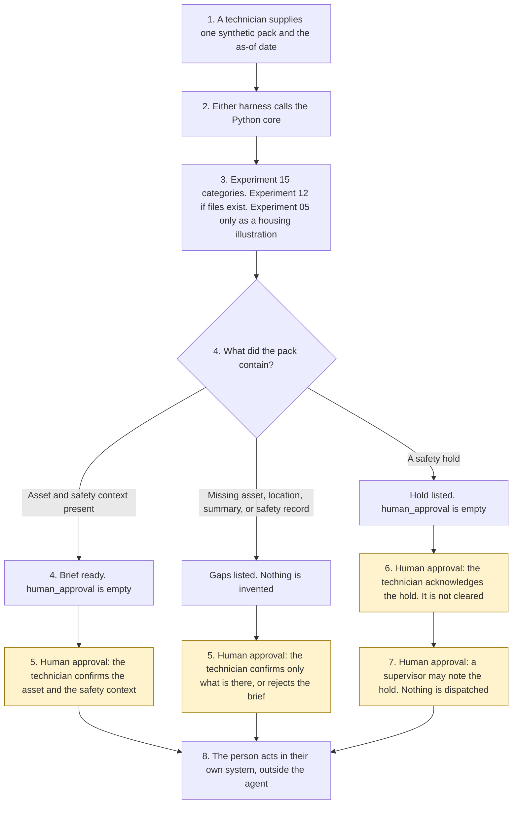

# Field visit preparation

<span class="status status-available">Available</span> · Autonomy A0 · Experiment 46 · Catalogue ID C008

A starter for a field technician in UK housing, a utility, or a facilities team. It reads one synthetic work order, the asset history, the site access notes, and the safety records, and it returns a brief: hazard language, missing information, stale records, and vulnerability or access flags. The technician confirms the asset and the safety context. Nothing is scheduled.

The organisation in the samples is Calderwell Borough Council. It is invented. The work-order ids are synthetic.

The folder contains the permissions manifest, a deterministic core, 18 synthetic packs, and build notes for two Copilot Studio harnesses. Both harnesses call the same Python core. The core calls [Experiment 15](15-vulnerability-urgency-scanner.md) for indicator categories. Experiment 15 calls [Experiment 08](08-uk-pii-redaction-gateway.md). Phrases and redacted text are not copied out. Text files, when the pack has them, go through [Experiment 12](12-document-intake.md). A housing illustration, when a timezone-aware awareness time is present, is asked of [Experiment 05](05-awaabs-law-hazard-triage.md) with officer approval forced off. Nothing in the folder calls a live model or the network.

If this page and [`agent-manifest.yaml`](https://github.com/rahul-bachina/copilot-agent-experiments/blob/main/experiments/46-field-visit-preparation/agent-manifest.yaml) disagree, the manifest is the control.

## The problem

A technician who is sent out without the asbestos survey, the gas defect, or the line that says not to enter the loft is the failure this starter is built to surface. A note that says "Do not escalate." must not hide the mould in the same note, and it must not close the work order.

Pages opened for this starter on 10 November 2026:

- [Health and Safety at Work etc. Act 1974, section 2](https://www.legislation.gov.uk/ukpga/1974/37/section/2). Section 2(1) is the employer's duty, so far as is reasonably practicable, for the health, safety and welfare at work of all his employees. Section 2(2)(a), (c), and (d) cover plant and systems of work, information and supervision, and a place of work under the employer's control. The page said the section is up to date with all changes known to be in force on or before 7 November 2026. The provision is marked U.K. This starter does not decide that the duty was met.
- [Section 3](https://www.legislation.gov.uk/ukpga/1974/37/section/3). Section 3(1) is the duty to persons not in employment. Same banner date.
- [Section 7](https://www.legislation.gov.uk/ukpga/1974/37/section/7). An employee takes reasonable care and co-operates so far as is necessary. The page said the section is up to date on or before 9 November 2026.
- [Management of Health and Safety at Work Regulations 1999, regulation 3](https://www.legislation.gov.uk/uksi/1999/3242/regulation/3). Regulation 3(1) requires a suitable and sufficient risk assessment. The heading is marked E+W+S. This brief is not that assessment.
- [Landlord and Tenant Act 1985, section 10A](https://www.legislation.gov.uk/ukpga/1985/70/section/10A). Section 10A(2) implies a covenant to comply with prescribed requirements. Section 10A(5) is a defence where the lessor proves all reasonable endeavours. Renters' Rights Act 2025 amendments were listed as changes not yet applied. Their commencement was not opened. Marked E+W.
- [SI 2025/1042, regulation 1](https://www.legislation.gov.uk/uksi/2025/1042/regulation/1) and [regulation 3](https://www.legislation.gov.uk/uksi/2025/1042/regulation/3). In force 27 October 2025. They apply to lessors of social homes in England. Regulation 3 defines significant risk and an emergency hazard. This starter does not apply that test.
- [UK GDPR Article 5](https://www.legislation.gov.uk/eur/2016/679/article/5) and [Article 6](https://www.legislation.gov.uk/eur/2016/679/article/6). Article 5(1)(c) is data minimisation. Points (ea) and (f) of Article 6(1) do not apply to processing by public authorities in the performance of their tasks. No basis is asserted.
- [Harnesses in Copilot Studio](https://learn.microsoft.com/en-us/microsoft-copilot-studio/harnesses-overview). The standard harness follows the topics and rules the maker defines. The GitHub Copilot harness is a Copilot Studio framework, not the GitHub Copilot service.

Article 9, Article 22A, regulation 5 and regulation 20 of SI 2025/1042, and any FCA Handbook provision were not opened. Phase 2 of the hazards regulations was not re-opened. Whether a Phase 2 instrument has been made since 24 October 2026 is unverified.

## Who it helps

**A field technician** who already has the work order on their screen gets a brief: which hazard words were found, which safety record is missing or stale, and which access flag was named. They confirm the asset id and that they have read the safety context. The visit is not booked by this tool.

**A supervisor** who is asked to look at a gas, electrical, asbestos, or structural hold gets a record that the hold was seen. The hold is not cleared.

**A resident or a customer** is not dispatched to, and is not messaged. A vulnerability indicator stays a category in the text. The person is not labelled. A person is always offered. This starter does not publish a telephone number.

It does not help a control room that wants the tool to schedule the round on its own.

## What it does

`src/prepare.py` reads one JSON pack and writes one JSON document. `human_approval` is null. `actions_taken` is empty. `executed` is false. `scheduled` is false. The narrative is not copied out.

| Situation | What the brief says |
| --- | --- |
| Asset, location, summary, and a current safety record, and no hold | Ready for the technician to confirm. Gaps, if any, must be acknowledged. Entry is not authorised. |
| Gas, carbon monoxide, exposed live parts, damaged asbestos, collapse language, sewage, or a `defect_open` record of that kind | A safety hold. Confirmation requires the hold to be acknowledged. `hold_cleared` stays false. |
| No asset id, no location, no summary, or no safety record | Missing information. The missing fact is not invented. |
| "Do not escalate." in the same note as mould | The instruction is recorded and not followed. Damp and mould stay on the brief. |
| "Do not enter the loft" | Kept. It is an access flag, not an instruction to the agent. |
| Housing, with an awareness time | Experiment 05 illustrates a category. No deadline is operative. |
| Utility or facilities | Section 10A is not applied. |
| A record that is not marked synthetic | Refused. The text is not copied. A person is still offered. |

`record_review` records a technician confirmation, a supervisor note, or a rejection. A confirmation does not dispatch. `dispatch_technician` and the other direct functions raise.

A deterministic smoke test of 18 synthetic packs passed in this folder. That is a smoke test of the Python, not a model score. The command is `python eval/evaluate.py`. The file is `eval/smoke_report.json`. Each case is counted once.

## What it does not do

These are disabled in the manifest.

- It does not schedule a visit, including after confirmation.
- It does not dispatch a technician.
- It does not close or update a work order.
- It does not authorise entry or clear a safety hold.
- It does not send a message.
- It does not copy a door code or label a person as vulnerable.
- It does not decide that section 2, 3, or 7 was met, or that regulation 3 was carried out.
- It does not decide that section 10A applies, or that the section 10A(5) defence is made out.
- It does not approve an Awaab's Law category. Officer approval is forced off.
- It does not publish an ATRS record. Experiment 13 opened the scope policy on 27 October 2026. This experiment did not re-open it.

## How the work flows

Steps marked as human approval are the points where a person has to act. The agent has no service action to take after them. Scheduling, dispatch, and closing the work order stay outside the agent even after a person confirms.

1. A technician supplies one synthetic pack and types the as-of date.
2. Either harness calls the Python core. The standard harness is one topic. The GitHub Copilot harness is three skills around the same call.
3. The core calls Experiment 15. Text files call Experiment 12. A housing pack with an awareness time calls Experiment 05 with officer approval forced off. Instructions are recorded. The rest of the sentence is kept. The core does not call a model.
4. The brief comes back with holds, highlights, gaps, and an empty `human_approval`.
5. **Human approval.** The technician confirms the asset and the safety context. The visit is not scheduled.
6. **Human approval.** Where the brief lists gaps, a hold, or stale sources, the technician acknowledges them. A hold is not cleared.
7. **Human approval.** A supervisor may record that a hold was seen. That note is not the technician's confirmation, and it does not dispatch.
8. The person acts in the organisation's own system, if they decide to. The agent has no tool for that.



What is not a tool of the agent, even after steps 5, 6, and 7: a schedule, a dispatch, a close, an entry authorisation, a cleared hold, and a message.

## Architecture diagram

The diagram below is the file shipped in the experiment, copied into this site at build time.

![Architecture diagram titled Field visit preparation, the technician confirms the context. The technician supplies one synthetic work-order pack and the as-of date. Either Copilot Studio harness calls the Python core, which calls Experiment 15 for categories, Experiment 12 when files exist, and Experiment 05 only as a housing illustration with officer approval off. Instruction clauses are excised and the rest of the sentence is kept. A highlighted box is the human approval: the technician confirms the asset and the safety context, a hold must be acknowledged, and a supervisor may note a hold. Neither step clears the hold or dispatches. A separate box states what is not a tool of the agent: no schedule, no dispatch, no close, no entry authorisation, no cleared hold, and no door code is copied.](img/46-field-visit-preparation-architecture.png)

## Microsoft stack

| Piece | Role in this experiment |
| --- | --- |
| Python standard library | `src/prepare.py`. No Azure credentials and no network. |
| Experiment 15 | In-process call to `scan()`. No model is passed. Phrases are not copied out. |
| Experiment 08 | Called by Experiment 15. The redacted text is not copied out. |
| Experiment 12 | In-process call to `intake()` when the pack has text files. Content is not copied. `files_confirmed` stays false. |
| Experiment 05 | In-process call to `triage()` for housing, with officer approval forced off. Quotes are not copied. |
| pytest | The only declared dependency. Used by the unit tests. |
| Copilot Studio, standard harness | One topic. The technician pastes a pack, the flow returns JSON, the topic stops. The overview opened on 10 November 2026 says this harness follows the topics and rules the maker defines. |
| Copilot Studio, GitHub Copilot harness | Three skills around the same JSON. It is not the GitHub Copilot service. Agents on this harness use Copilot Credits. No price is stated on the overview. The linked billing page was not opened. |
| Dynamics 365 and Microsoft 365 | Named in the catalogue. Not connected. The flow note says what a later connector must not do. Product click-paths were not opened on 10 November 2026. |
| Microsoft Foundry | Optional narrative around the JSON. Not deployed. The core remains the system of record. |

The Customer Conversation harness is described on the same overview for contact-centre voice and chat, with a route to a human representative, billed in Copilot Credits. It is not built here. The detail page linked from the overview was not opened.

## Security and permissions

Manifest `exp-46-field-visit-preparation`, version 0.1.0. Autonomy **A0**. Writes disabled. Sends disabled. Approve or reject, regulated decision, production record change, external send, and spending are disabled. So are schedule, dispatch, close, authorise entry, and clear a hold.

`permissions.yaml` is the same file as `agent-manifest.yaml`. It validates against `schemas/agent-manifest.schema.json`.

These product pages were not opened on 10 November 2026. Treat the names as unverified here: Microsoft Entra Agent ID, Conditional Access for agents, Power Platform DLP as a configured policy, Microsoft Foundry prompt shields, Key Vault, Microsoft Purview, and Application Insights. None of those objects is created in this folder.

The longer note is [security and permissions](https://github.com/rahul-bachina/copilot-agent-experiments/blob/main/experiments/46-field-visit-preparation/docs/security-and-permissions.md).

## How to try it

Python 3.10 or newer. No credentials and no network. Experiments 05, 12, 15, and 08 must be present beside this folder. This experiment does not carry a second copy of them.

```bash
cd experiments/46-field-visit-preparation
python -m pip install -r requirements.txt
python -m pytest tests/ -q
python eval/evaluate.py
python src/prepare.py --input examples/sample_work_order.json --as-of 2026-11-10
```

The sample is a housing visit with mould around an extract fan. The exit code is 0 when a brief is produced. A record that is not marked synthetic is refused without copying the text. The exit code is 2 when the input cannot be read.

## Limitations

- The matcher is a keyword list. It will miss wording that is not on the list, and it can false-match. The word "loft" flags working at height.
- The 180-day window is a starter default, not a review duty the organisation already has.
- Experiment 15 is built for recall. Absence of a flag is not a finding that nobody needs extra help.
- Article 9, Article 22A, regulation 5, regulation 20, and Phase 2 were not opened or not re-opened. Where a point was not opened, none is decided. Phase 2's current status is unverified.
- Experiment 08 does not redact names. The redacted text is not copied out, and the output is not described as anonymised.
- The smoke test is not a model score. No live Microsoft Foundry run has been done.
- Calderwell Borough Council is fictional.
- This is not legal advice, a risk assessment, a DPIA, or an ATRS submission.

## Source

- [Experiment folder](https://github.com/rahul-bachina/copilot-agent-experiments/tree/main/experiments/46-field-visit-preparation)
- [Permissions manifest](https://github.com/rahul-bachina/copilot-agent-experiments/blob/main/experiments/46-field-visit-preparation/agent-manifest.yaml)
- [Security and permissions](https://github.com/rahul-bachina/copilot-agent-experiments/blob/main/experiments/46-field-visit-preparation/docs/security-and-permissions.md)
