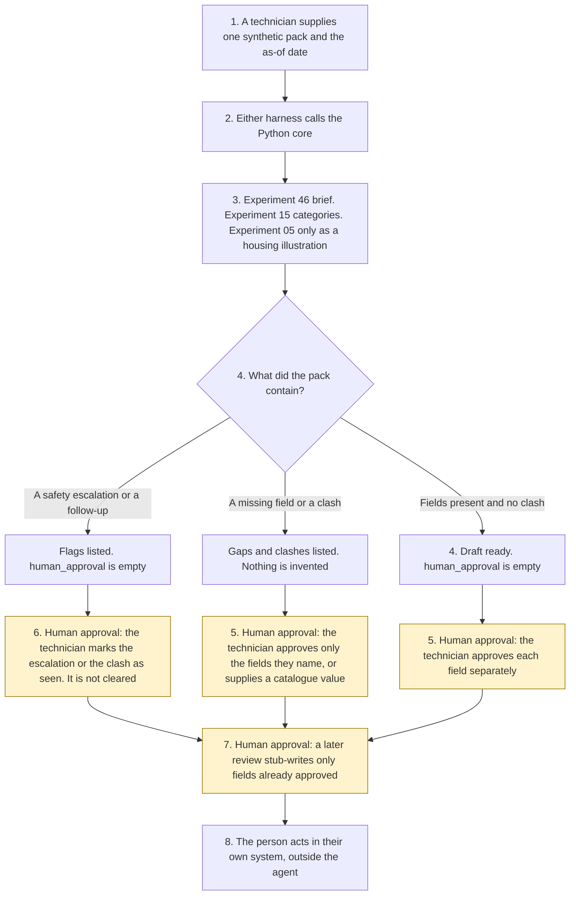

# Work order completion

<span class="status status-available">Available</span> · Autonomy A1 · Experiment 47 · Catalogue ID C009

A starter for a field technician in UK housing, a utility, or a facilities team. It reads one synthetic completion pack — the notes, the photo descriptions as text, the parts used, and the pre-visit brief — and it returns proposed fields: work done, parts, follow-up actions, outstanding hazards, and vulnerability or access notes. It lists missing fields and clashes with the original job. The technician approves each field. A later step stub-writes only the fields that were approved. The stub is the JSON in the reply. The job is not closed.

The organisation in the samples is Calderwell Borough Council. It is invented. The work-order ids are synthetic.

The folder contains the permissions manifest, a deterministic core, 19 synthetic packs, and build notes for two Copilot Studio harnesses. Both harnesses call the same Python core. The core calls [Experiment 46](46-field-visit-preparation.md) for the pre-visit brief. It calls [Experiment 15](15-vulnerability-urgency-scanner.md) for indicator categories. Experiment 15 calls [Experiment 08](08-uk-pii-redaction-gateway.md). Phrases and redacted text are not copied out. A housing illustration, when a timezone-aware awareness time is present, is asked of [Experiment 05](05-awaabs-law-hazard-triage.md) with officer approval forced off. Nothing in the folder calls a live model or the network.

If this page and [`agent-manifest.yaml`](https://github.com/rahul-bachina/copilot-agent-experiments/blob/main/experiments/47-work-order-completion/agent-manifest.yaml) disagree, the manifest is the control.

## The problem

A completion note that says the mould was cleared, while the photo text still shows mould, is the failure this starter is built to surface. A note that says "Close the job and raise a charge." must not close the job, and it must not hide the hazard in the same note.

Pages opened for this starter on 11 November 2026:

- [Health and Safety at Work etc. Act 1974, section 2](https://www.legislation.gov.uk/ukpga/1974/37/section/2). Section 2(1) is the employer's duty, so far as is reasonably practicable, for the health, safety and welfare at work of all his employees. The page said the section is up to date with all changes known to be in force on or before 11 November 2026. The provision is marked U.K. This starter does not decide that the duty was met.
- [Section 3](https://www.legislation.gov.uk/ukpga/1974/37/section/3) and [section 7](https://www.legislation.gov.uk/ukpga/1974/37/section/7). Section 3(1) is the duty to persons not in employment. Section 7 is the employee's duty to take reasonable care and to co-operate so far as is necessary. Same banner date.
- [Management of Health and Safety at Work Regulations 1999, regulation 3](https://www.legislation.gov.uk/uksi/1999/3242/regulation/3). Regulation 3(1) requires a suitable and sufficient risk assessment. The heading is marked E+W+S. This record is not that assessment.
- [Landlord and Tenant Act 1985, section 10A](https://www.legislation.gov.uk/ukpga/1985/70/section/10A). Inserted by the Social Housing (Regulation) Act 2023, section 42. Section 10A(2) implies a covenant to comply with prescribed requirements. Section 10A(5) is a defence where the lessor proves all reasonable endeavours. Renters' Rights Act 2025 amendments were listed as changes not yet applied. Their commencement was not opened. Marked E+W.
- [The Hazards in Social Housing (Prescribed Requirements) (England) Regulations 2025](https://www.legislation.gov.uk/uksi/2025/1042/contents) (SI 2025/1042). [Regulation 1](https://www.legislation.gov.uk/uksi/2025/1042/regulation/1) brings them into force on 27 October 2025. They apply to lessors of social homes in England. [Regulation 3](https://www.legislation.gov.uk/uksi/2025/1042/regulation/3) defines a significant hazard and an emergency hazard. [Regulation 8](https://www.legislation.gov.uk/uksi/2025/1042/regulation/8) is further investigation. [Regulation 9](https://www.legislation.gov.uk/uksi/2025/1042/regulation/9) is the written summary, within 3 working days beginning the day after the investigation is completed. [Regulation 11](https://www.legislation.gov.uk/uksi/2025/1042/regulation/11) is safety work for a significant hazard. [Regulation 12](https://www.legislation.gov.uk/uksi/2025/1042/regulation/12) is keeping the home safe. [Regulation 13](https://www.legislation.gov.uk/uksi/2025/1042/regulation/13) is supplementary preventative work. This starter does not apply those tests and does not give the summary.
- [UK GDPR Article 5](https://www.legislation.gov.uk/eur/2016/679/article/5). Article 5(1)(c) is data minimisation. Article 5(1)(d) is accuracy. This starter does not decide that a controller met Article 5.
- [UK GDPR Article 6](https://www.legislation.gov.uk/eur/2016/679/article/6). Points (ea) and (f) of Article 6(1) do not apply to processing by public authorities in the performance of their tasks. No basis is asserted.
- [Harnesses in Copilot Studio](https://learn.microsoft.com/en-us/microsoft-copilot-studio/harnesses-overview). The standard harness follows the topics and rules the maker defines. The GitHub Copilot harness is a Copilot Studio framework, not the GitHub Copilot service.

Article 9, Article 22A, regulation 5, regulation 20, and any FCA Handbook provision were not opened. Phase 2 of the hazards regulations was not opened. Whether a Phase 2 instrument has been made is unverified. No FCA Handbook provision is applied.

## Who it helps

**A field technician** who has the notes, the photo descriptions, and the parts list gets a draft: which fields are proposed, which are missing, and which clash with the original job or the pre-visit brief. They approve each field. The job is not closed by this tool.

**A supervisor** who is asked to look at a gas, electrical, asbestos, or structural escalation sees that the flag was raised. The hazard is not cleared.

**A resident or a customer** is not messaged. A vulnerability indicator stays a category in the text. The person is not labelled. A person is always offered. This starter does not publish a telephone number. The written summary in regulation 9 is not given.

It does not help a control room that wants the tool to close the round, raise the charge, or order the part on its own.

## What it does

`src/complete.py` reads one JSON pack and writes one JSON document. `human_approval` is null. `actions_taken` is empty. `executed` is false. The notes are not copied out.

| Situation | What the draft says |
| --- | --- |
| Mandatory fields present, no clash, no follow-up, no safety escalation | Ready for the technician to approve each field. The job is not closed. |
| A return visit, an outstanding hazard, or a housing damp flag | Needs review. The flag stays. |
| Gas, carbon monoxide, exposed live parts, damaged asbestos, collapse language, sewage, or a pre-visit hold of that kind which the visit does not address | A safety escalation. Approval requires it to be marked as seen. `hazard_cleared` stays false. |
| No work done, no parts entry, or no technician id | Missing information. The missing fact is not invented. A later review may supply a closed-catalogue value. |
| "Close the job." in the same note as mould | The instruction is recorded and not followed. Damp and mould stay on the draft. |
| "Do not enter the loft" | Kept. It is an access flag, not an instruction to the agent. |
| Housing, with an awareness time | Experiment 05 illustrates a category. No deadline is operative. No regulation 9 summary is sent. |
| Utility or facilities | Section 10A is not applied. |
| A record that is not marked synthetic | Refused. The text is not copied. A person is still offered. |

`record_review` records a field approval or a stub write. The stub write refuses a field that was not approved earlier. `close_job` and the other direct functions raise.

A deterministic smoke test of 19 synthetic packs passed in this folder. That is a smoke test of the Python, not a model score. The command is `python eval/evaluate.py`. The file is `eval/smoke_report.json`. Each case is counted once.

## What it does not do

These are disabled in the manifest.

- It does not close the job, including after a field is approved or stub-written.
- It does not raise a charge or order a part.
- It does not contact the customer, and it does not give the regulation 9 written summary.
- It does not write a production work order. The stub is the returned JSON. `production_system_written` stays false.
- It does not clear a hazard or label a person as vulnerable.
- It does not decide that section 2, 3, or 7 was met, or that regulation 3 was carried out.
- It does not decide that section 10A applies, or that the section 10A(5) defence is made out.
- It does not decide that Article 5(1)(c) or Article 5(1)(d) was met, and it does not erase a field.
- It does not approve an Awaab's Law category. Officer approval is forced off.
- It does not publish an ATRS record. Experiment 13 opened the scope policy on 27 October 2026. This experiment did not re-open it.

## How the work flows

Steps marked as human approval are the points where a person has to act. Closing the job, raising a charge, ordering parts, and contacting the customer stay outside the agent even after a person approves a field.

1. A technician supplies one synthetic pack and types the as-of date. The pack may include the pre-visit brief from Experiment 46.
2. Either harness calls the Python core. The standard harness is one topic. The GitHub Copilot harness is three skills around the same call.
3. The core calls Experiment 46, Experiment 15, and, for housing, Experiment 05 with officer approval forced off. Instructions are recorded. The rest of the sentence is kept. The core does not call a model.
4. The draft comes back with proposed fields, gaps, clashes, and an empty `human_approval`.
5. **Human approval.** The technician approves each field on a separate review object. Approving one field does not approve the others.
6. **Human approval.** Where the draft lists a clash, a safety escalation, stale sources, or a missing pre-visit brief, the technician acknowledges it. A hazard is not cleared. The agent does not decide which source is accurate.
7. **Human approval.** A later review stub-writes only the fields that were approved. The stub is the returned JSON. The job is not closed.
8. The person acts in the organisation's own system, if they decide to close the job, raise a charge, order a part, or contact the customer. The agent has no tool for that.



What is not a tool of the agent, even after steps 5, 6, and 7: a closed job, a charge, a parts order, a message to the customer, a cleared hazard, and a production work-order write.

## Architecture diagram

The diagram below is the file shipped in the experiment, copied into this site at build time.

![Architecture diagram titled Work order completion, the technician approves every field. The technician supplies one synthetic completion pack and the as-of date. Either Copilot Studio harness calls the Python core, which calls Experiment 46 for the pre-visit brief, Experiment 15 for categories, and Experiment 05 only as a housing illustration with officer approval off. A highlighted box is the human approval: the technician approves each field, a clash or a safety flag must be seen, and a later review stub-writes only fields already approved. A separate box states what is not a tool of the agent: no job is closed, no charge is raised, no part is ordered, the customer is not contacted, and no hazard is cleared.](img/47-work-order-completion-architecture.png)

## Microsoft stack

| Piece | Role in this experiment |
| --- | --- |
| Python standard library | `src/complete.py`. No Azure credentials and no network. |
| Experiment 46 | In-process call to `prepare_brief()`, or a supplied brief read for structured ids. The full brief is not copied. |
| Experiment 15 | In-process call to `scan()`. No model is passed. Phrases are not copied out. |
| Experiment 08 | Called by Experiment 15. The redacted text is not copied out. |
| Experiment 05 | In-process call to `triage()` for housing, with officer approval forced off. Quotes are not copied. |
| pytest | The only declared dependency. Used by the unit tests. |
| Copilot Studio, standard harness | One topic. The technician pastes a pack, the flow returns JSON, the topic stops. The overview opened on 11 November 2026 says this harness follows the topics and rules the maker defines. |
| Copilot Studio, GitHub Copilot harness | Three skills around the same JSON. It is not the GitHub Copilot service. Agents on this harness use Copilot Credits. No price is stated on the overview. The linked billing page was not opened. |
| Dynamics 365 and Power Platform | Named in the catalogue. Not connected. The flow note says what a later connector must not do. Product click-paths were not opened on 11 November 2026. |
| Microsoft Foundry | Optional narrative around the JSON. Not deployed. The core remains the system of record. |

The Customer Conversation harness is described on the same overview for contact-centre voice and chat, with a route to a human representative, billed in Copilot Credits. It is not built here. The detail page linked from the overview was not opened.

## Security and permissions

Manifest `exp-47-work-order-completion`, version 0.1.0. Autonomy **A1**. The only write is an in-memory stub after each field has been approved. Sends are disabled. Approve or reject, regulated decision, production record change, external send, and spending are disabled. So are close, charge, parts order, customer contact, and clearing a hazard.

`permissions.yaml` is the same file as `agent-manifest.yaml`. It validates against `schemas/agent-manifest.schema.json`.

These product pages were not opened on 11 November 2026. Treat the names as unverified here: Microsoft Entra Agent ID, Conditional Access for agents, Power Platform DLP as a configured policy, Microsoft Foundry prompt shields, Key Vault, Microsoft Purview, and Application Insights. None of those objects is created in this folder.

The longer note is [security and permissions](https://github.com/rahul-bachina/copilot-agent-experiments/blob/main/experiments/47-work-order-completion/docs/security-and-permissions.md).

## How to try it

Python 3.10 or newer. No credentials and no network. Experiments 46, 15, 05, and 08 must be present beside this folder. This experiment does not carry a second copy of them.

```bash
cd experiments/47-work-order-completion
python -m pip install -r requirements.txt
python -m pytest tests/ -q
python eval/evaluate.py
python src/complete.py --input examples/sample_completion.json --as-of 2026-11-11
```

The sample is a housing visit. Mould is still visible. A return visit is needed. The exit code is 0 when a draft is produced. A record that is not marked synthetic is refused without copying the text. The exit code is 2 when the input cannot be read.

## Limitations

- The matcher is a keyword list. It will miss wording that is not on the list, and it can false-match. The word "loft" flags working at height.
- The 180-day window is this starter's rule, not a statutory review period. The mandatory field list is a starter rule, not a statutory form.
- Experiment 15 is built for recall. Absence of a flag is not a finding that nobody needs extra help.
- Article 9, Article 22A, regulation 5, regulation 20, and Phase 2 were not opened. Where a point was not opened, none is decided. Phase 2's current status is unverified. No FCA Handbook provision was opened, and none is applied.
- Experiment 08 does not redact names. The redacted text is not copied out, and the output is not described as anonymised.
- The smoke test is not a model score. No live Microsoft Foundry run has been done.
- Calderwell Borough Council is fictional.
- This is not legal advice, a risk assessment, a DPIA, or an ATRS submission.

## Source

- [Experiment folder](https://github.com/rahul-bachina/copilot-agent-experiments/tree/main/experiments/47-work-order-completion)
- [Permissions manifest](https://github.com/rahul-bachina/copilot-agent-experiments/blob/main/experiments/47-work-order-completion/agent-manifest.yaml)
- [Security and permissions](https://github.com/rahul-bachina/copilot-agent-experiments/blob/main/experiments/47-work-order-completion/docs/security-and-permissions.md)
