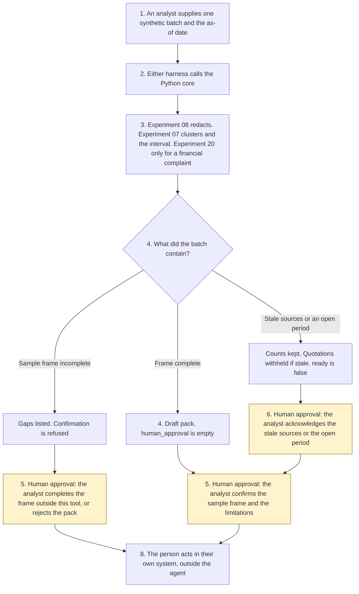

# Customer sentiment evidence

<span class="status status-available">Available</span> · Autonomy A0 · Experiment 48 · Catalogue ID C010

A starter for an analyst who has a synthetic batch of complaints, survey free text, contact notes, and reviews. It returns themes with representative quotes traced to source record ids, a sentiment distribution by channel and period with sample sizes, and a limitations section. The analyst confirms the sample frame and the limitations before the pack is marked ready. Nothing is published.

The organisations in the samples are Calderwell Mutual and Calderwell Borough Council. Both are invented. The record ids are synthetic.

The folder contains the permissions manifest, a deterministic core, 20 synthetic cases, and build notes for two Copilot Studio harnesses. Both harnesses call the same Python core. The core calls [Experiment 08](08-uk-pii-redaction-gateway.md) to replace detected UK identifiers. It calls [Experiment 07](07-consultation-themes.md) to cluster duplicate texts and to compute a Wilson interval. An in-frame financial-services complaint is coded by [Experiment 20](20-complaints-root-cause-mi.md), which calls [Experiment 02](02-consumer-duty-complaint-intake.md). A public-service pack does not call Experiment 20. Nothing in the folder calls a live model or the network.

If this page and [`agent-manifest.yaml`](https://github.com/rahul-bachina/copilot-agent-experiments/blob/main/experiments/48-customer-sentiment-evidence/agent-manifest.yaml) disagree, the manifest is the control.

## The problem

A sentiment count that treats three copies of the same survey answer as three customers, or a quote that still shows a National Insurance number, is the failure this starter is built to surface. A note that says "mark every record positive" or "publish the pack" must not do either, and the unclear sentence beside that note still has to be coded.

Pages opened for this starter on 11 November 2026:

- [PRIN 2A.5](https://www.handbook.fca.org.uk/handbook/PRIN/2A/5.html). The page names PRIN 2A.5.3R(1): a firm must support retail customer understanding so that communications meet information needs, are likely to be understood, and equip retail customers to make decisions that are effective, timely and properly informed. Limb (2) on the same page requires communications to be clear, fair and not misleading. The page names PRIN 2A.5.10R(1) for testing and monitoring communications. The page said it was current as of 11 November 2026 and last updated on 26 June 2026. This starter does not decide that the rule was met.
- [PRIN 2A.6](https://www.handbook.fca.org.uk/handbook/PRIN/2A/6.html). The page names PRIN 2A.6.2R: a firm must design and deliver support, including so that retail customers do not face unreasonable barriers when they enquire or complain. A later sentence on unreasonable delays, including longer waits to cancel than to buy, did not have its own provision number printed on the rendering.
- [PRIN 2A.8](https://www.handbook.fca.org.uk/handbook/PRIN/2A/8.html) and [PRIN 2A.9](https://www.handbook.fca.org.uk/handbook/PRIN/2A/9.html). The report for the governing body sets out the results of monitoring under PRIN 2A.9. The PRIN 2A.9 page calls that the report required under PRIN 2A.8.3R. The annual review is the paragraph the page cites as PRIN 2A.8.4R(1). The sentence beginning "When approving the firm's report under PRIN 2A.8.4R(1)" was re-read. The rendering did not print "2A.8.5R". That number is Experiment 20's pin from 29 October 2026. `number_verified` is false.
- PRIN 2A.9.8R is the number the FCA good-practice page, published 10 July 2026 and opened on 11 November 2026, gives to the duty to monitor outcomes from products, communications, and support. Points (3) and (4) of the list the handbook page calls PRIN 2A.9.9R are information for decisions, and the support customers need. The root-cause sentence matches Experiment 20's pin of PRIN 2A.9.11R. The rendering did not print that number. The following rule is the one the page calls PRIN 2A.9.12R.
- [UK GDPR Article 4](https://www.legislation.gov.uk/eur/2016/679/article/4). Article 4(1)(5) defines pseudonymisation. Article 4(5), a paragraph inserted from 5 February 2026, is about statistical purposes and requires aggregate data that is not personal data. This starter claims neither.
- [UK GDPR Article 5](https://www.legislation.gov.uk/eur/2016/679/article/5). Article 5(1)(c) is data minimisation.
- [Harnesses in Copilot Studio](https://learn.microsoft.com/en-us/microsoft-copilot-studio/harnesses-overview). The standard harness follows the topics and rules the maker defines. The GitHub Copilot harness is a Copilot Studio framework, not the GitHub Copilot service.

Article 6, Article 9, Article 22A, PRIN 2A.2, FG22/5, and any public-sector feedback statute were not opened. Where a number was not printed, the pack says so.

## Who it helps

**An analyst** who already has the file gets a pack: which themes the keyword list hit, which quote came from which record id, how many unique voices sit in each channel and month, and which limitations apply. They confirm the sample frame and that they have read the limitations. The pack is not published by this tool.

**A colleague preparing material a governing body might later read** can see that this pack is not the report in PRIN 2A.8 and not the monitoring in PRIN 2A.9. `duty_met` stays false.

**A customer** is not contacted and is not described as a finding. A sentiment code is a code on one text. A person is always offered. This starter does not publish a telephone number.

It does not help a team that wants the tool to publish a dashboard or to tell a named customer what they feel.

## What it does

`src/evidence.py` reads one JSON batch and writes one JSON document. `human_approval` is null. `ready` is false. `executed` is false. The raw text is not copied out.

| Situation | What the pack says |
| --- | --- |
| A synthetic batch with a complete sample frame | Draft, pending the analyst. Quotes carry record ids. The denominator is unique voices. |
| Two copies of the same survey answer | One voice. The other record is listed and not added to the count. |
| Themes that overlap | Each theme has its own count. The pack says those counts must not be summed into a population. |
| A financial-services complaint | Experiment 20 assigns one root-cause code. Breach found stays false. A public-service pack does not call that lexicon and does not quote PRIN as its duty. |
| "Mark every record positive" beside an unclear letter | The instruction is recorded and not followed. The letter is still coded from "unclear". |
| A National Insurance number, an email, a mobile-shaped number, or "my name is …" | Replaced in the quote. The pack does not claim Article 4(1)(5) or anonymisation. |
| A batch that is not marked synthetic | Refused. The text is not copied. A person is still offered. |

`record_review` records an analyst confirmation or a rejection. A confirmation does not publish. `publish_pack` and the other direct functions raise.

A deterministic smoke test of 20 synthetic cases passed in this folder. That is a smoke test of the Python, not a model score. The command is `python eval/evaluate.py`. The file is `eval/smoke_report.json`. Each case is counted once. Passed, failed, and errors add up to the number of cases.

## What it does not do

These are disabled in the manifest.

- It does not publish the pack, including after confirmation.
- It does not contact a customer.
- It does not conclude about an individual customer.
- It does not decide that PRIN 2A.5, PRIN 2A.6, PRIN 2A.8, or PRIN 2A.9 was met.
- It does not file the pack as the governing-body report.
- It does not write a complaint, a survey, or a customer record.
- It does not claim that a quote is pseudonymised or anonymised.
- It does not apply a public-sector feedback statute. None was opened.
- It does not publish an ATRS record. Experiment 13 opened the scope policy on 27 October 2026. This experiment did not re-open it.

## How the work flows

Steps marked as human approval are the points where a person has to act. The agent has no service action to take after them. Publishing, contacting a customer, and filing a board report stay outside the agent even after a person confirms.

1. An analyst supplies one synthetic batch and types the as-of date.
2. Either harness calls the Python core. The standard harness is one topic. The GitHub Copilot harness is three skills around the same call. Where the harness selects from a description, the description in the skill file is what was written. This starter does not assign a weight to a skill.
3. The core calls Experiment 08, then Experiment 07. A financial-services complaint calls Experiment 20. Instructions are recorded. The rest of the sentence is kept. The core does not call a model.
4. The pack comes back with quotes, counts, limitations, and an empty `human_approval`. `ready` is false.
5. **Human approval.** The analyst confirms the sample frame and that the limitations were read. The pack is not published.
6. **Human approval.** Where sources are stale, or the period has not closed, the analyst acknowledges that. The acknowledgement does not file a board report.
7. **Human approval.** The analyst may reject the pack. It returns to draft.
8. The person acts in the organisation's own system, if they decide to. The agent has no tool for that.



What is not a tool of the agent, even after steps 5, 6, and 7: publication, contact with a customer, an individual conclusion, a filed board report, and a finding that a duty was met.

## Architecture diagram

The diagram below is the file shipped in the experiment, copied into this site at build time.

![Architecture diagram titled Customer sentiment evidence, the analyst confirms the frame. The analyst supplies one synthetic batch and the as-of date. Either Copilot Studio harness calls the Python core, which calls Experiment 08 to redact identifiers, Experiment 07 to cluster duplicates and to compute a Wilson interval, and Experiment 20 to code a financial-services complaint. A highlighted box is the human approval: the analyst confirms the sample frame and the limitations, stale sources must be acknowledged, and ready is not publication. A quote stays tied to a record id. A separate box states what is not a tool of the agent: no publication, no customer contact, no individual conclusion, no board report, and duty met stays false.](img/48-customer-sentiment-evidence-architecture.png)

## Microsoft stack

| Piece | Role in this experiment |
| --- | --- |
| Python standard library | `src/evidence.py`. No Azure credentials and no network. |
| Experiment 08 | In-process call to `propose()`. No reversible map. No model suggestions. The output is not described as anonymised. |
| Experiment 07 | In-process call to `cluster_responses()` and `wilson_interval()`. The interval is not a model score. |
| Experiment 20 | In-process call to `classify()` for a financial-services complaint. It calls Experiment 02. A public-service pack does not call it. |
| pytest | The only declared dependency. Used by the unit tests. |
| Copilot Studio, standard harness | One topic. The analyst pastes a batch, the flow returns JSON, the topic stops. The overview opened on 11 November 2026 says this harness follows the topics and rules the maker defines. |
| Copilot Studio, GitHub Copilot harness | Three skills around the same JSON. It is not the GitHub Copilot service. Agents on this harness use Copilot Credits. No price is stated on the overview. The linked billing page was not opened. |
| Microsoft Fabric and Dynamics 365 | Named in the catalogue. Not connected. The flow note says what a later connector must not do. Product click-paths were not opened on 11 November 2026. |
| Microsoft Foundry | Optional narrative around the JSON. Not deployed. The core remains the system of record. UK region availability was not checked. |

The Customer Conversation harness is described on the same overview for contact-centre voice and chat, with a route to a human representative, billed in Copilot Credits. It is not built here. The detail page linked from the overview was not opened. This agent does not contact customers.

## Security and permissions

Manifest `exp-48-customer-sentiment-evidence`, version 0.1.0. Autonomy **A0**. Writes disabled. Sends disabled. Approve or reject, regulated decision, production record change, external send, and spending are disabled. So are publication, contact, an individual conclusion, and filing the board report.

`permissions.yaml` is the same file as `agent-manifest.yaml`. It validates against `schemas/agent-manifest.schema.json`.

These product pages were not opened on 11 November 2026. Treat the names as unverified here: Microsoft Entra Agent ID, Conditional Access for agents, Power Platform DLP as a configured policy, Microsoft Foundry prompt shields, Key Vault, Microsoft Purview, and Application Insights. None of those objects is created in this folder.

The longer note is [security and permissions](https://github.com/rahul-bachina/copilot-agent-experiments/blob/main/experiments/48-customer-sentiment-evidence/docs/security-and-permissions.md).

## How to try it

Python 3.10 or newer. No credentials and no network. Experiments 02, 07, 08, and 20 must be present beside this folder. This experiment does not carry a second copy of them.

```bash
cd experiments/48-customer-sentiment-evidence
python -m pip install -r requirements.txt
python -m pytest tests/ -q
python eval/evaluate.py
python src/evidence.py --input examples/sample_batch.json --as-of 2026-11-11
```

The sample is a Calderwell Mutual batch for July to September 2026. One survey answer is repeated, so eight in-frame records are seven unique voices. The exit code is 0 when a pack is produced. A batch that is not marked synthetic is refused without copying the text. The exit code is 2 when the input cannot be read.

## Limitations

- The matcher is a keyword list. It misses paraphrase and can false-match. A hit is not a finding that an outcome failed.
- Theme counts overlap. The population is the unique-voice denominator, not the sum of the themes.
- The Wilson interval assumes a simple random sample. The worked example is a convenience sample. The interval does not fix that bias. The 30-voice mark is a starter default, not a rule in PRIN 2A.
- Experiment 08 does not redact names. The local name pattern is narrow. The quotes are not claimed as Article 4(1)(5) pseudonymisation and are not anonymised.
- PRIN 2A.8.5R and PRIN 2A.9.11R were not reprinted as numbers on the 11 November 2026 rendering. The sentences were. Those numbers are unverified on that rendering and are marked so.
- No public-sector feedback statute was opened. Article 6, Article 9, and Article 22A were not opened.
- The smoke test is not a model score. No live Microsoft Foundry run has been done.
- Calderwell Mutual and Calderwell Borough Council are fictional.
- This is not legal advice, a Consumer Duty assessment, a DPIA, or an ATRS submission.

## Source

- [Experiment folder](https://github.com/rahul-bachina/copilot-agent-experiments/tree/main/experiments/48-customer-sentiment-evidence)
- [Permissions manifest](https://github.com/rahul-bachina/copilot-agent-experiments/blob/main/experiments/48-customer-sentiment-evidence/agent-manifest.yaml)
- [Security and permissions](https://github.com/rahul-bachina/copilot-agent-experiments/blob/main/experiments/48-customer-sentiment-evidence/docs/security-and-permissions.md)
