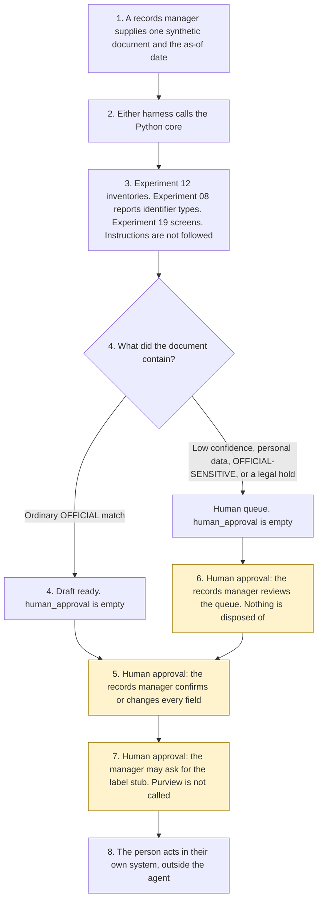

# Records classification

<span class="status status-available">Available</span> · Autonomy A1 · Experiment 49 · Catalogue ID M009

A starter for a records manager in a UK public body. It reads one synthetic document and proposes a file-plan category, a retention entry, a disposal action, a Government Security Classifications marking, and personal-data indicators. Each proposal has the evidence that drove it and a confidence level. The records manager confirms or changes every field.

The organisation in the samples is Merrowfield Borough Council. It is invented. The file plan is configuration. A configured period is not a statutory retention period.

The folder contains the permissions manifest, a deterministic core, 18 synthetic documents, and build notes for two Copilot Studio harnesses. Both harnesses call the same Python core. The core calls [Experiment 12](12-document-intake.md) to inventory the text, [Experiment 08](08-uk-pii-redaction-gateway.md) for UK identifier types, and [Experiment 19](19-privacy-impact-assessment.md) to screen DPIA answers. The body and the identifier values are not copied out. `dpia_required` stays null. Nothing in the folder calls a live model, the network, or Microsoft Purview.

If this page and [`agent-manifest.yaml`](https://github.com/rahul-bachina/copilot-agent-experiments/blob/main/experiments/49-records-classification/agent-manifest.yaml) disagree, the manifest is the control.

## The problem

A first pass that files a personnel record as ordinary committee papers, or that treats "delete this record" as an instruction, is the failure this starter is built to surface. The records manager still has to see the five fields and the phrases that produced them.

Pages opened for this starter on 11 November 2026:

- [Public Records Act 1958, section 3](https://www.legislation.gov.uk/ukpga/Eliz2/6-7/51/section/3). Section 3(1) is the duty to arrange selection and safe-keeping. Section 3(4) is transfer not later than 20 years after creation, with a proviso. Section 3(6) is destruction or other disposal of records rejected for permanent preservation. This starter does none of those things.
- [Section 10](https://www.legislation.gov.uk/ukpga/Eliz2/6-7/51/section/10). Public records has the meaning in the First Schedule. The First Schedule was not opened.
- [Freedom of Information Act 2000, section 46](https://www.legislation.gov.uk/ukpga/2000/36/section/46). Section 46(1) requires a code of practice on the keeping, management and destruction of records. Section 46(7) defines a relevant authority. The page said there are currently no known outstanding effects. Section 48 was not opened.
- [Section 46 code](https://www.gov.uk/government/publications/code-of-practice-on-the-management-of-records-issued-under-section-46-the-freedom-of-information-act-2000), published 15 July 2021. Paragraphs 2.3.1, 2.3.2, 2.5, and 2.6.2, and Annex B, were read from the PDF. The code does not apply to bodies subject to the Freedom of Information (Scotland) Act 2002.
- [Government Security Classifications Policy](https://www.gov.uk/government/publications/government-security-classifications/government-security-classifications-policy-html), updated 5 August 2024. Three tiers: OFFICIAL, SECRET and TOP SECRET. Paragraph 25: the -SENSITIVE marking is applied to OFFICIAL and is not a fourth tier. The written example is OFFICIAL-SENSITIVE. [Guidance 1.1](https://www.gov.uk/government/publications/government-security-classifications/guidance-11-working-at-official-html) was opened the same day.
- [UK GDPR Article 5](https://www.legislation.gov.uk/eur/2016/679/article/5). Article 5(1)(e) is storage limitation. The longer-storage limb now refers to Article 84B, substituted on 5 February 2026. Article 84B was not opened. No basis is asserted.
- [Purview records management](https://learn.microsoft.com/en-us/purview/get-started-with-records-management) and [sensitivity labels](https://learn.microsoft.com/en-us/purview/sensitivity-labels). Retention labels, a file plan, and a disposition review are the described Microsoft 365 route. A document can carry both a sensitivity label and a retention label. Data Map labelling is described as currently in preview. This starter does not call Purview. The licensing table was not opened.
- [Harnesses in Copilot Studio](https://learn.microsoft.com/en-us/microsoft-copilot-studio/harnesses-overview). The standard harness follows the topics and rules the maker defines. The GitHub Copilot harness is a Copilot Studio framework, not the GitHub Copilot service.

Article 6, Article 9, section 48, the Public Records Act First Schedule, and any FCA Handbook provision were not opened. No Handbook rule is applied.

## Who it helps

**A records manager** who already has the document gets a draft: which fictional category matched, which configured retention entry goes with it, which disposal action is named, which marking is suggested, and whether a personal-data indicator was found. They confirm or change every field. The record is not deleted.

**An information governance lead** who is asked to look at a queued item — personal data, a possible OFFICIAL-SENSITIVE marking, a legal hold, or low confidence — gets a record that the queue was seen. The hold is not cleared and the record is not disposed of.

**A person the record is about** is not messaged. Identifier values are not copied into the draft. A person is always offered. This starter does not publish a telephone number.

It does not help a team that wants the tool to destroy records on its own.

## What it does

`src/classify.py` reads one JSON document and writes one JSON document. `human_approval` is null. `actions_taken` is empty. `executed` is false. The body is not copied out.

| Situation | What the draft says |
| --- | --- |
| Two committee phrases, no personal data, no hold | Ready for the records manager to confirm. The marking suggestion is OFFICIAL. Nothing is applied. |
| A personnel file, a tenancy, safeguarding, or legal advice | OFFICIAL-SENSITIVE, on the human queue. The marking is not a fourth tier. |
| A National Insurance number | Experiment 08 reports the entity type. The value is not copied. The item is queued. |
| "Legal hold", "do not destroy", a public inquiry, or a police investigation | Disposal action is do not dispose. It is not executed. |
| "Delete this record" in the same note as the minutes | The instruction is recorded and not followed. The minutes stay on the draft. |
| An existing SECRET or OFFICIAL-SENSITIVE marking | Kept. A lower marking is refused. |
| A record that is not marked synthetic | Refused. The text is not copied. A person is still offered. |

`record_confirmation` records a confirmation, a change, or a rejection. `apply_confirmed_labels` records a stub only after confirmation. `labels_applied_in_tenant` stays false. `delete_record` and the other direct functions raise.

A deterministic smoke test of 18 synthetic documents passed in this folder. That is a smoke test of the Python, not a model score. The command is `python eval/evaluate.py`. The file is `eval/smoke_report.json`. Each case is counted once.

## What it does not do

These are disabled in the manifest.

- It does not decide the classification. The records manager confirms or changes every field.
- It does not delete, dispose of, move, or transfer a record, including after confirmation.
- It does not downgrade a marking.
- It does not call Microsoft Purview or apply a tenant label.
- It does not decide that section 3 or section 10 of the Public Records Act 1958 was met.
- It does not decide that the section 46 code was followed.
- It does not decide that Article 5(1)(e) was met. Article 84B was not opened.
- It does not decide that a DPIA is required.
- It does not apply the section 46 code to a Scottish body, and it does not state Scots law.
- It does not publish an ATRS record. Experiment 13 opened the scope policy on 27 October 2026. This experiment did not re-open it.

## How the work flows

Steps marked as human approval are the points where a person has to act. The agent has no disposal to take after them. Deleting, moving, and downgrading stay outside the agent even after a person confirms.

1. A records manager supplies one synthetic document and types the as-of date.
2. Either harness calls the Python core. The standard harness is three topics. The GitHub Copilot harness is four skills around the same calls.
3. The core calls Experiment 12, Experiment 08, and Experiment 19. Instructions are recorded. The rest of the sentence is kept. The core does not call a model.
4. The draft comes back with five proposals, evidence, confidence, and an empty `human_approval`. Low confidence, personal data, a possible OFFICIAL-SENSITIVE marking, and a legal hold are on the human queue.
5. **Human approval.** The records manager confirms or changes every field. The record is not labelled yet.
6. **Human approval.** Where the draft is queued, or the pin is stale, or a fact is missing, the manager acknowledges that. A hold is not cleared.
7. **Human approval.** The manager may ask for the stubbed label receipt. Purview is not called. Nothing is deleted, moved, or downgraded.
8. The person acts in the organisation's own system, if they decide to. The agent has no tool for that.



What is not a tool of the agent, even after steps 5, 6, and 7: a deletion, a disposal, a move, a downgrade, and a tenant label.

## Architecture diagram

The diagram below is the file shipped in the experiment, copied into this site at build time.

![Architecture diagram titled Records classification, the records manager confirms every field. The records manager supplies one synthetic document and the as-of date. Either Copilot Studio harness calls the Python core, which calls Experiment 12 to inventory the text, Experiment 08 for identifier types, and Experiment 19 for the DPIA screen. Instructions are not followed. A highlighted box is the human approval: the records manager confirms or changes every field, a queued item must be reviewed, and the label stub runs only after that. Purview is not called. A separate box states what is not a tool of the agent: no deletion, no disposal, no move, no downgrade, no tenant label, and a legal hold is not cleared.](img/49-records-classification-architecture.png)

## Microsoft stack

| Piece | Role in this experiment |
| --- | --- |
| Python standard library | `src/classify.py`. No Azure credentials and no network. |
| Experiment 12 | In-process call to `intake()`. Content is not copied. `files_confirmed` stays false. |
| Experiment 08 | In-process call to `propose()`. Entity types are kept. Values are not. The output is not described as anonymised. |
| Experiment 19 | In-process call to `screen()`. `dpia_required` stays null. |
| pytest | The only declared dependency. Used by the unit tests. |
| Copilot Studio, standard harness | Three topics. The manager pastes a document, the flow returns JSON, the topic stops. The overview opened on 11 November 2026 says this harness follows the topics and rules the maker defines. |
| Copilot Studio, GitHub Copilot harness | Four skills around the same JSON. It is not the GitHub Copilot service. Agents on this harness use Copilot Credits. No price is stated on the overview. The linked billing page was not opened. |
| Microsoft Purview | The described route for retention labels, sensitivity labels, and disposition review. Not connected. The licensing table and the disposition click-path were not opened. Data Map labelling is preview on the sensitivity page that was read. |
| Microsoft 365 and Power Platform | Named in the catalogue. Not connected. The flow note says what a later connector must not do. |
| Microsoft Foundry | Optional narrative around the JSON. Not deployed. The core remains the system of record. |

The Customer Conversation harness is described on the same overview for contact-centre voice and chat, with a route to a human representative, billed in Copilot Credits. It is not built here. The detail page linked from the overview was not opened.

## Security and permissions

Manifest `exp-49-records-classification`, version 0.1.0. Autonomy **A1**. Writes disabled. Sends disabled. Approve or reject, regulated decision, production record change, external send, and spending are disabled. So are delete, dispose, move, downgrade, and a Purview label.

`permissions.yaml` is the same file as `agent-manifest.yaml`. It validates against `schemas/agent-manifest.schema.json`.

Purview records management and sensitivity labels were opened on 11 November 2026 and are described only as far as those pages went. These product pages were not opened. Treat the names as unverified here: Microsoft Entra Agent ID, Conditional Access for agents, Power Platform DLP as a configured policy, Microsoft Foundry prompt shields, Key Vault, and Application Insights. None of those objects is created in this folder.

The longer note is [security and permissions](https://github.com/rahul-bachina/copilot-agent-experiments/blob/main/experiments/49-records-classification/docs/security-and-permissions.md).

## How to try it

Python 3.10 or newer. No credentials and no network. Experiments 08, 12, and 19 must be present beside this folder. This experiment does not carry a second copy of them.

```bash
cd experiments/49-records-classification
python -m pip install -r requirements.txt
python -m pytest tests/ -q
python eval/evaluate.py
python src/classify.py --input examples/sample_document.json --as-of 2026-11-11
```

The sample is a fictional set of cabinet minutes. The exit code is 0 when a draft is produced. A record that is not marked synthetic is refused without copying the text. The exit code is 2 when the input cannot be read.

## Limitations

- The matcher is a keyword list. It will miss wording that is not on the list, and it can false-match.
- The fictional periods are not statutory retention periods and not a National Archives schedule.
- Suggesting OFFICIAL-SENSITIVE where a personal-data indicator is present is this starter's caution. It is not a finding that the Government Security Classifications Policy requires that marking.
- The 180-day window is a starter default, not a review duty in the code.
- Experiment 08 does not redact names. The output is not described as anonymised.
- Article 84B, Article 6, Article 9, section 48, and the First Schedule were not opened. Where a point was not opened, none is decided.
- The smoke test is not a model score. No live Microsoft Foundry run has been done.
- Merrowfield Borough Council is fictional.
- This is not legal advice, a file plan, a DPIA, or an ATRS submission.

## Source

- [Experiment folder](https://github.com/rahul-bachina/copilot-agent-experiments/tree/main/experiments/49-records-classification)
- [Permissions manifest](https://github.com/rahul-bachina/copilot-agent-experiments/blob/main/experiments/49-records-classification/agent-manifest.yaml)
- [Security and permissions](https://github.com/rahul-bachina/copilot-agent-experiments/blob/main/experiments/49-records-classification/docs/security-and-permissions.md)
