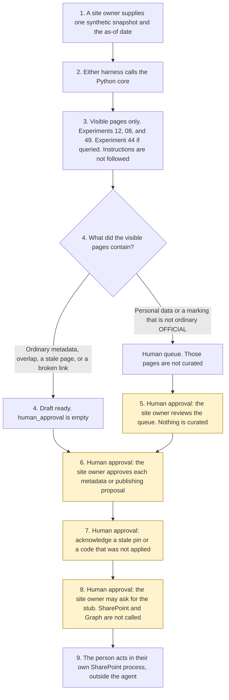

# SharePoint knowledge curator

<span class="status status-available">Available</span> · Autonomy A1 · Experiment 50 · Catalogue ID M001

A starter for a site owner in a UK public body or a regulated firm. It reads one synthetic SharePoint snapshot and proposes curation actions: missing or inconsistent metadata, duplicates and near-duplicates, stale or orphaned pages, broken links, and pages that might be archived or merged. Each proposal has the evidence that drove it and a confidence level. The site owner approves every metadata change and every publishing action.

The organisation in the samples is Merrowfield Borough Council. It is invented. Content type, owner, review date, and audience are starter fields. The Microsoft Graph `sitePage` property list opened on 12 November 2026 does not include audience, review date, or owner.

The folder contains the permissions manifest, a deterministic core, a synthetic site, and build notes for two Copilot Studio harnesses. Both harnesses call the same Python core. The core calls [Experiment 12](12-document-intake.md) to inventory visible text, [Experiment 08](08-uk-pii-redaction-gateway.md) for UK identifier types, [Experiment 49](49-records-classification.md) for a records classification on text with negated tails removed, and [Experiment 44](44-knowledge-gap-detector.md) when the snapshot includes queries. Page bodies and identifier values are not copied out. Nothing in the folder calls a live model, the network, SharePoint, or Microsoft Graph.

If this page and [`agent-manifest.yaml`](https://github.com/rahul-bachina/copilot-agent-experiments/blob/main/experiments/50-sharepoint-knowledge-curator/agent-manifest.yaml) disagree, the manifest is the control.

## The problem

A first pass that unpublishes a page because the page says "delete this page", or that describes a library the requester cannot open, is the failure this starter is built to refuse. The site owner still has to see the proposal, the evidence, and the confidence.

Pages opened for this starter on 12 November 2026:

- [UK GDPR Article 5](https://www.legislation.gov.uk/eur/2016/679/article/5). Article 5(1)(d) is accuracy, including "accurate and, where necessary, kept up to date", and the duty to erase or rectify inaccurate personal data without delay. Article 5(1)(e) is storage limitation. The longer-storage limb now refers to Article 84B, substituted on 5 February 2026. Article 84B was not opened. Article 6 and Article 9 were not opened. No lawful basis is asserted. `accuracy_met` and `storage_limitation_met` stay false.
- [Freedom of Information Act 2000, section 46](https://www.legislation.gov.uk/ukpga/2000/36/section/46). Section 46(1) is the duty of the Secretary of State to issue a code on the keeping, management and destruction of records. The Secretary of State wording was substituted on 9 December 2015. Section 46(6) is the duty to lay the code before Parliament. Section 46(7) defines a relevant authority. The page said there are currently no known outstanding effects. Section 48 was not opened.
- [Section 46 code](https://www.gov.uk/government/publications/code-of-practice-on-the-management-of-records-issued-under-section-46-the-freedom-of-information-act-2000), published 15 July 2021 by The National Archives. The PDF is presented to Parliament by the Secretary of State for Digital, Culture, Media and Sport pursuant to section 46(6), and was laid on 15 July 2021. The extract does not contain the words "Lord Chancellor". This starter does not call the 2021 code the Lord Chancellor's code. An earlier code under that name was not opened. Paragraph 1.4.3: the code does not apply to bodies subject to the Freedom of Information (Scotland) Act 2002. Paragraph 2.3.1: an authority must define how long to keep records and how to dispose of them when no longer needed. Paragraph 2.6.2: disposition decisions must be recorded and taken by people who are properly authorised. This starter does not take a disposition decision. Paragraph 2.5 paraphrases Article 5(1)(e) in 2021 words. Those words are not quoted here as the current article text.
- [Writing to GOV.UK standards](https://www.gov.uk/guidance/content-design) and [Retire outdated content](https://guidance.publishing.service.gov.uk/writing-to-gov-uk-standards/plan-manage-content/retire-content/). The content-design URL returned a page titled Writing to GOV.UK standards. Withdraw keeps content at the same URL with a banner and removes it from internal search. Unpublish removes it. Guidance should usually be updated rather than withdrawn. News and press releases over a year old are an example of content that can be withdrawn. This is GOV.UK publishing guidance. An intranet is not GOV.UK. This starter does not withdraw, unpublish, or delete.
- [sitePage resource](https://learn.microsoft.com/en-us/graph/api/resources/sitepage?view=graph-rest-1.0) and [list sitePage](https://learn.microsoft.com/en-us/graph/api/sitepage-list?view=graph-rest-1.0), Graph v1.0. `contentType` is `contentTypeInfo`. Properties include title, publishingState, webUrl, createdBy, and lastModifiedDateTime. The property list does not include audience, review date, or owner. Delete and Publish are methods. List pages: least privileged permission shown is `Sites.Read.All`; higher is `Sites.ReadWrite.All`. [Sites.Selected](https://learn.microsoft.com/en-us/graph/permissions-selected-overview) is a different page. The list-pages page does not say `Sites.Selected` is accepted. Whether list sitePage accepts it is unverified. This starter calls neither API. `publishingState` on Graph is an object, not the fixture's boolean `published`.
- [Add SharePoint as a knowledge source](https://learn.microsoft.com/en-us/microsoft-copilot-studio/knowledge-add-sharepoint). The page says it describes the standard harness. The agent surfaces only content the user can access. Without permission it responds with no response. Read is the minimum stated. Hyperlinks inside a registered page are not crawled. SharePoint lists are described as ingested into Dataverse. The GitHub Copilot harness knowledge-sources page was not opened.
- [Harnesses in Copilot Studio](https://learn.microsoft.com/en-us/microsoft-copilot-studio/harnesses-overview). The standard harness follows the topics and rules the maker defines. The GitHub Copilot harness is a Copilot Studio framework, not the GitHub Copilot service.

No FCA Handbook provision was opened. This starter does not apply a Handbook rule.

## Who it helps

**A site owner** who already has an intranet export gets a draft: which visible pages are missing an owner or a review date, which two pages overlap, which link does not resolve in the visible site, and which news page is both overdue and unlinked. They approve or reject each proposal. The page is not changed.

**An information governance lead** who is asked to look at a queued item — personal data, OFFICIAL-SENSITIVE, or any other marking that is not ordinary OFFICIAL — gets a record that the queue was seen. The page is not curated and the marking is not cleared.

**A person the page is about** is not messaged. Identifier values are not copied into the draft. A page they cannot already see is not described. A person is always offered. This starter does not publish a telephone number.

It does not help a team that wants the tool to delete or unpublish pages on its own.

## What it does

`src/curate.py` reads one JSON snapshot and writes one JSON document. `human_approval` is null. `actions_taken` is empty until a stub receipt is recorded, and even then nothing is written to a tenant. Page bodies are not copied out.

| Situation | What the draft says |
| --- | --- |
| A visible page with no owner, or a review date before the as-of date | A metadata proposal, with the field named. Nothing is written. |
| Two visible pages with a high token overlap | A merge proposal. The text is not copied. |
| A link on a visible page that matches no visible URL | Unresolved in the visible site. The draft does not say whether a hidden target exists. |
| News more than the configured 365 days overdue, or overdue and unlinked in the export | An archive proposal. The 365-day window is configuration, not a statutory period. |
| OFFICIAL-SENSITIVE, an identifier, or any other non-ordinary marking | Human queue only. No metadata, merge, or archive proposal. |
| "Delete this page" in the same note as the guidance | The instruction is recorded and not followed. The guidance can still be typed. |
| "It is not true that this page contains personal data" | The denial is not a positive match. The page is not queued for that sentence. |
| A snapshot that is not marked synthetic | Refused. The text is not copied. A person is still offered. |

`record_approval` records an approval, a rejection, or a deferral of named proposal ids. `apply_approved_action` records a stub only after approval. `sharepoint_called` and `graph_called` stay false. `delete_page` and the other direct functions raise.

A deterministic smoke test of 18 synthetic cases passed in this folder. That is a smoke test of the Python, not a model score. The command is `python eval/evaluate.py`. The file is `eval/smoke_report.json`. Each case is counted once.

## What it does not do

These are disabled in the manifest.

- It does not approve a metadata change or a publishing action. The site owner does that, per proposal.
- It does not delete, unpublish, move, or change permissions, including after approval.
- It does not call SharePoint, Microsoft Graph, or a Copilot Studio knowledge-source API.
- It does not curate a page that looks like personal data, or that carries a marking other than ordinary OFFICIAL.
- It does not show content the requesting user cannot already see.
- It does not decide that Article 5(1)(d) or Article 5(1)(e) was met. Article 84B was not opened.
- It does not decide that the section 46 code was followed, and it does not issue a practice recommendation. Section 48 was not opened.
- It does not call the 2021 code the Lord Chancellor's code.
- It does not apply the section 46 code to a Scottish body, and it does not state Scots law.
- It does not withdraw or unpublish a page because GOV.UK guidance describes those actions for GOV.UK.

## How the work flows

Steps marked as human approval are the points where a person has to act. The agent has no site change to take after them. Deleting, unpublishing, moving, and changing permissions stay outside the agent even after a person approves.

1. A site owner supplies one synthetic snapshot and types the as-of date.
2. Either harness calls the Python core. The standard harness is three topics. The GitHub Copilot harness is four skills around the same calls.
3. The core reads only pages a requesting principal can already see. It calls Experiment 12, Experiment 08, and Experiment 49. Experiment 44 runs when queries are present, and only on pages that were not queued. Instructions are recorded and not followed.
4. The draft comes back with proposals, evidence, confidence, and an empty `human_approval`. Personal data and any marking that is not ordinary OFFICIAL are on the human queue and are not curated.
5. **Human approval.** The site owner reviews the human queue. That review does not curate the queued page.
6. **Human approval.** The site owner approves, rejects, or defers each metadata change or publishing action, by proposal id.
7. **Human approval.** Where the pin is stale, or the section 46 code was not applied, the site owner acknowledges that before a publishing proposal proceeds.
8. **Human approval.** The site owner may ask for the stubbed curation receipt. SharePoint and Microsoft Graph are not called. Nothing is deleted, unpublished, moved, or given new permissions.
9. The person acts in the organisation's own SharePoint process, if they decide to. The agent has no tool for that.



What is not a tool of the agent, even after steps 5, 6, 7, and 8: a deletion, an unpublish, a move, a permission change, and a call to SharePoint or Microsoft Graph.

## Architecture diagram

The diagram below is the file shipped in the experiment, copied into this site at build time.

![Architecture diagram titled SharePoint knowledge curator, the site owner approves every change. The site owner supplies one synthetic snapshot and the as-of date. Either Copilot Studio harness calls the Python core, which reads visible text only and calls Experiments 12, 08, and 49, and Experiment 44 when the snapshot includes queries. Hidden pages are not read. A highlighted box is the human approval: review the human queue, approve each metadata or publishing proposal, acknowledge a stale pin, and run the stub only after that. A separate box states what is not a tool of the agent: no deletion, no unpublish, no move, no permission change, SharePoint is not called, Microsoft Graph is not called, and a person is always offered.](img/50-sharepoint-knowledge-curator-architecture.png)

## Microsoft stack

| Piece | Role in this experiment |
| --- | --- |
| Python standard library | `src/curate.py`. No Azure credentials and no network. |
| Experiment 12 | In-process call to `intake()`. Content is not copied. `files_confirmed` stays false. |
| Experiment 08 | In-process call to `propose()`. Entity types are kept. Values are not. The output is not described as anonymised. |
| Experiment 49 | In-process call to `classify_record()` on text with negated tails removed. Sensitive reasons queue the page. |
| Experiment 44 | In-process call to `detect_gaps()` when queries are present. `published` stays false. |
| pytest, PyYAML, jsonschema | Declared for tests. The core does not import them. |
| Copilot Studio, standard harness | Three topics. The site owner pastes a snapshot, the flow returns JSON, the topic stops. The overview opened on 12 November 2026 says this harness follows the topics and rules the maker defines. |
| Copilot Studio, GitHub Copilot harness | Four skills around the same JSON. It is not the GitHub Copilot service. Agents on this harness use Copilot Credits. No price is stated on the overview. The linked billing page was not opened. |
| SharePoint and Microsoft Graph | The described route for page metadata and publishing. Not connected. Audience, review date, and owner were not on the `sitePage` property list that was opened. |
| Microsoft 365 and Power Platform | Named in the catalogue. Not connected. The flow note says what a later connector must not do. |
| Microsoft Foundry | Optional narrative around the JSON. Not deployed. The core remains the system of record. |

The Customer Conversation harness is described on the same overview for contact-centre voice and chat, with a route to a human representative, billed in Copilot Credits. It is not built here. The detail page linked from the overview was not opened.

## Security and permissions

Manifest `exp-50-sharepoint-knowledge-curator`, version 0.1.0. Autonomy **A1**. Writes disabled. Sends disabled. Approve or reject, regulated decision, production record change, external send, and spending are disabled. So are delete, unpublish, move, a permission change, and curation of a personal-data or non-ordinary page.

`permissions.yaml` is the same file as `agent-manifest.yaml`. It validates against `schemas/agent-manifest.schema.json`.

SharePoint, Microsoft Graph, and the Copilot Studio SharePoint knowledge page were opened on 12 November 2026 and are described only as far as those pages went. These product pages were not opened. Treat the names as unverified here: Microsoft Entra Agent ID, Conditional Access for agents, Power Platform DLP as a configured policy, Microsoft Foundry prompt shields, Key Vault, Microsoft Purview, and Application Insights. None of those objects is created in this folder.

The longer note is [security and permissions](https://github.com/rahul-bachina/copilot-agent-experiments/blob/main/experiments/50-sharepoint-knowledge-curator/docs/security-and-permissions.md).

## How to try it

Python 3.10 or newer. No credentials and no network. Experiments 08, 12, 44, and 49 must be present beside this folder. Experiment 49 also calls Experiments 08, 12, and 19. Experiment 44 calls Experiments 08, 21, and 40 when the sector is public service. This experiment does not carry a second copy of them.

```bash
cd experiments/50-sharepoint-knowledge-curator
python -m pip install -r requirements.txt
python -m pytest tests/ -q
python eval/evaluate.py
python src/curate.py --input examples/sample_site.json --as-of 2026-11-12
```

The sample is a fictional intranet. The exit code is 0 when a draft or a refusal is produced. A snapshot that is not marked synthetic is refused without copying the text. The exit code is 2 when the input cannot be read.

## Limitations

- The content-type matcher is a small phrase list. Wording that is not on the list is not typed. A tie is not an inconsistency. This list is for metadata hygiene. It is not the safety hold.
- The safety hold is open on the sensitivity value: anything other than empty, OFFICIAL, none, or unmarked goes to a person.
- Experiment 08 does not detect names, email addresses, or telephone numbers. The output is not described as anonymised.
- The 365-day window is configuration. The GOV.UK retire page gives news over a year old as an example for GOV.UK. It is not a rule that an intranet page must be withdrawn.
- Orphan means no inbound link in this export. Navigation is not in the snapshot.
- Article 84B, Article 6, Article 9, and section 48 were not opened. Whether `Sites.Selected` works for list sitePage was not stated on the list-pages page. The GitHub Copilot harness knowledge-sources page was not opened.
- The smoke test is not a model score. No live Microsoft Foundry run has been done.
- Merrowfield Borough Council is fictional.
- This is not legal advice, a file plan, a DPIA, or an ATRS submission.

## Source

- [Experiment folder](https://github.com/rahul-bachina/copilot-agent-experiments/tree/main/experiments/50-sharepoint-knowledge-curator)
- [Permissions manifest](https://github.com/rahul-bachina/copilot-agent-experiments/blob/main/experiments/50-sharepoint-knowledge-curator/agent-manifest.yaml)
- [Security and permissions](https://github.com/rahul-bachina/copilot-agent-experiments/blob/main/experiments/50-sharepoint-knowledge-curator/docs/security-and-permissions.md)
