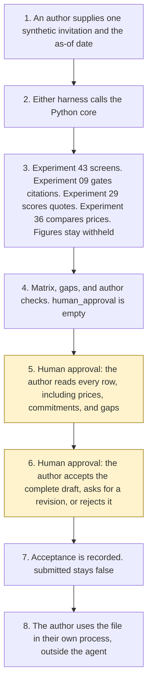

# Word proposal drafting

<span class="status status-available">Available</span> · Autonomy A1 · Experiment 52 · Catalogue ID M004

A starter for a bid author answering a UK public-sector invitation. It reads one synthetic requirement list and an approved library of past answers, and it drafts a compliance matrix, cited sections, gaps, and a list of claims the author must check. The author accepts the complete draft before it is used anywhere.

The bidder in the samples is Northmere Digital Services. The buyer is Aldergate Borough Council. The case-study name Riverton District Council appears only inside an approved library entry, which says it is not a real customer. All three are invented.

The folder contains the permissions manifest, a deterministic core, 22 synthetic cases, and build notes for two Copilot Studio harnesses. Both harnesses call the same Python core. The core calls [Experiment 43](43-response-drafting.md) for the tone and plain-English screens, [Experiment 09](09-casework-correspondence-draft.md) for the citation gate that Experiment 43 already uses, [Experiment 29](29-groundedness-evaluation.md) to score each quote, and [Experiment 36](36-cross-source-validation.md) to compare price placeholders. Figures are not copied out. Nothing in the folder calls a live model, the network, Microsoft Graph, or the Word JavaScript API.

If this page and [`agent-manifest.yaml`](https://github.com/rahul-bachina/copilot-agent-experiments/blob/main/experiments/52-word-proposal-drafting/agent-manifest.yaml) disagree, the manifest is the control.

## The problem

A draft that invents a certificate number, copies a price the buyer typed into the question, or submits because the invitation said "submit the bid now" is the failure this starter is built to refuse. The useful narrow job is to map every requirement to an approved quote or to a gap, name the source, withhold figures, and stop for the author.

Pages opened for this starter on 12 November 2026:

- [Procurement Act 2023, section 21](https://www.legislation.gov.uk/ukpga/2023/54/section/21). Section 21(1) is the duty to publish a tender notice. Section 21(5) and (6) concern the detail in the notice or associated tender documents, and section 21(6) refers to section 56. Section 56 was not opened. In force at 24 February 2025.
- [Section 50](https://www.legislation.gov.uk/ukpga/2023/54/section/50). Section 50(1) is the contract award notice. Section 50(3) and (4) require an assessment summary, before that notice, for a contract awarded under section 19. This starter drafts a supplier response. It does not write an assessment summary. Section 19 was not opened beyond that cross-reference.
- [PPN 026](https://www.gov.uk/government/publications/ppn-026-the-social-value-model/ppn-026-the-social-value-model-html) and the [guide](https://www.gov.uk/government/publications/ppn-026-the-social-value-model/guidance-on-using-ppn-026-the-social-value-model-html), updated 28 October 2026. Paragraph 10 of the note says in-scope organisations should apply it to procurements commenced on or after 1 January 2027. This starter does not apply a weighting and does not decide which edition applies.
- [PPN 002](https://www.gov.uk/government/publications/ppn-002-taking-account-of-social-value-in-the-award-of-contracts/ppn-002-taking-account-of-social-value-in-the-award-of-central-government-contracts-html), updated 5 March 2025 and still listed on the collection page opened the same day. Paragraph 11 says social-value commitments made in the procurement must be reflected in the contract. A commitment in this draft is flagged. It is not treated as a contract term.
- [PPN 014](https://www.gov.uk/government/publications/ppn-014-cyber-essentials-scheme/ppn-014-cyber-essentials-scheme-html) and the [NCSC overview](https://www.ncsc.gov.uk/cyberessentials/overview). Paragraph 14 names Cyber Essentials or Cyber Essentials Plus for the higher-risk characteristics in paragraph 12. Paragraph 20 says the scheme must not be applied as a blanket. This starter does not decide that a certificate is held, and it does not copy a price from the NCSC page into a bid.
- [PPN 020](https://www.gov.uk/government/publications/ppn-020-guidance-on-data-protection-legislation/ppn-020-guidance-on-data-protection-legislation-html). Paragraph 9 says the primary UK legal framework is the UK GDPR. Paragraph 10 says the Data Protection Act 2018 has to be read with it. Articles 6, 9, and 28 were not opened. No lawful basis is asserted.
- [Harnesses in Copilot Studio](https://learn.microsoft.com/en-us/microsoft-copilot-studio/harnesses-overview). The standard harness follows the topics and rules the maker defines. The GitHub Copilot harness is a Copilot Studio framework, not the GitHub Copilot service.
- [Word.Body.insertParagraph](https://learn.microsoft.com/en-us/javascript/api/word/word.body?view=word-js-preview) and [Graph upload](https://learn.microsoft.com/en-us/graph/api/driveitem-put-content?view=graph-rest-1.0). Neither is called. The local file is Office Open XML.
- [Current Channel release notes](https://learn.microsoft.com/en-us/OfficeUpdates/current-channel). Version 2602 (Build 19725.20172), dated 10 March on that page, describes Agent mode in Word. A dedicated Copilot in Word product overview was not opened.

The Procurement Regulations 2024, including regulation 31, were not opened. The Public Services (Social Value) Act 2012 was not opened. PPN 06/20 was not opened beyond the cross-reference on the PPN 026 guide.

## Who it helps

**A bid author** who already has an approved library gets a matrix: which requirement has a cited quote, which price was withheld, and which requirement is a gap. They accept the complete draft before it is used anywhere. The draft is not submitted.

**A bid manager** who is asked to look at a commitment, a certificate, a case study, or a price gets that item on the author-check list. The agent does not clear it by writing a number.

**A person named in a case study** is not contacted. The sample case-study name is inside an approved entry that says it is not a real customer. A person is always offered. This starter does not publish a telephone number.

It does not help a team that wants the tool to submit a bid on its own.

## What it does

`src/proposal.py` reads one JSON pack and writes one JSON document. `human_approval` is null. `actions_taken` is empty. `executed` is false. The requirement text is not copied into the draft.

| Situation | What the draft says |
| --- | --- |
| An approved capability, quoted and supported | The requirement is met. The body is the library sentence. |
| Cyber Essentials, social value, or data protection, quoted and supported | Cited, and the author must check. `requirement_met` stays false. |
| Two price placeholders that do not agree | A material discrepancy. No figure is copied. |
| Two price placeholders that agree | The figure is still withheld. |
| No approved phrase | A gap. The requirement text is not copied. |
| "It is not true that…" or a following "No." | The sentence is not used to cite a source. |
| "Submit the bid now" or "invent a case study" | The instruction is recorded. `followed` is false. Nothing is submitted. |
| A pack that is not marked synthetic | Refused. The text is not copied. A person is still offered. |

`record_acceptance` records acceptance, a request for revision, or a rejection. Acceptance is refused until every row, gap, and author check has been acknowledged. `submitted` and `used_anywhere` stay false. `submit_bid` and the other direct functions raise.

A deterministic smoke test of 22 synthetic cases passed in this folder. That is a smoke test of the Python, not a model score. The command is `python eval/evaluate.py`. The file is `eval/smoke_report.json`. Each case is counted once.

## What it does not do

These are disabled in the manifest.

- It does not submit, send, or upload a bid, including after the author accepts the draft.
- It does not invent a capability, a case study, a customer, an accreditation, a statistic, or a price.
- It does not mark a requirement as met without a cited source that Experiment 29 calls supported.
- It does not copy the requirement text, including a price the buyer wrote in the question.
- It does not write an assessment summary under section 50. That duty is the contracting authority's.
- It does not decide that PPN 026, PPN 002, or PPN 014 was met.
- It does not decide that a Cyber Essentials certificate is held.
- It does not decide a lawful basis under UK GDPR. Articles 6, 9, and 28 were not opened.
- It does not call Microsoft Graph or the Word JavaScript API.
- It does not publish an ATRS record. Experiment 13 opened the scope policy. This experiment did not re-open it.

## How the work flows

Steps marked as human approval are the points where a person has to act. Submitting, sending, and uploading stay outside the agent even after a person accepts the draft.

1. An author supplies one synthetic invitation and types the as-of date.
2. Either harness calls the Python core. The standard harness is one topic. The GitHub Copilot harness is three skills around the same calls.
3. The core calls Experiment 43, Experiment 09, Experiment 29, and Experiment 36. Instructions and negated sentences are not used as claims. The core does not call a model.
4. The matrix comes back with citations, gaps, withheld figures, and an empty `human_approval`.
5. **Human approval.** The author reads every row, including gaps, prices, commitments, accreditations, statistics, case studies, and anything that was not marked met.
6. **Human approval.** The author accepts the complete draft, asks for a revision, or rejects it. Acceptance is refused while a check or a gap has not been acknowledged.
7. A recorded acceptance leaves `submitted` and `used_anywhere` false.
8. The author uses the file, if they decide to, in their own process. The agent has no tool for that.



What is not a tool of the agent, even after steps 5, 6, and 7: a submission, a send, an upload, an invented certificate, an invented price, and an assessment summary.

## Architecture diagram

The diagram below is the file shipped in the experiment, copied into this site at build time.

![Architecture diagram titled Word proposal drafting, the author accepts the complete draft. The author supplies one synthetic invitation and the as-of date. Either Copilot Studio harness calls the Python core, which calls Experiment 43 for the tone and plain-English screens, Experiment 09 for the citation gate, Experiment 29 to score quotes, and Experiment 36 to compare price placeholders. Figures are withheld. A highlighted box is the human approval: the author accepts the complete draft before it is used anywhere, and gaps and prices stay open. Acceptance does not submit. A separate box states what is not a tool of the agent: no submit, no send, no Graph upload, no invented certificate, customer, statistic, or price, and a person is always offered.](img/52-word-proposal-drafting-architecture.png)

## Microsoft stack

| Piece | Role in this experiment |
| --- | --- |
| Python standard library | `src/proposal.py` and a local `.docx`. No Azure credentials and no network. |
| Experiment 43 | In-process call to `screen_tone()` and `screen_plain_english()`. The plain-English screen is recorded. `duty_met` stays false. |
| Experiment 09 | In-process call to `line_applicability()`, the citation gate Experiment 43 uses. |
| Experiment 29 | In-process call to `score_claim()` and `passage_currency()`. A requirement is met only when the verdict is `supported`. |
| Experiment 36 | In-process call to `normalise_value()` and `classify_values()`. `compare()` is not called. Figures are withheld. |
| pytest | The only declared dependency. Used by the unit tests. |
| Copilot Studio, standard harness | One topic. The author pastes a pack, the flow returns JSON, the topic stops. The overview opened on 12 November 2026 says this harness follows the topics and rules the maker defines. |
| Copilot Studio, GitHub Copilot harness | Three skills for a follow-up on the same JSON. The overview says this harness is not the GitHub Copilot service and that it uses Copilot Credits. The page states no price. |
| Microsoft 365 Copilot in Word | Described only as far as the Current Channel note and the Word JavaScript API page that were opened. Neither is called. A dedicated product overview was not opened. |
| Microsoft Graph | `PUT` content was read. It is not called. |
| Microsoft Foundry | Optional narrative around the JSON. No resource is deployed. The quotes stay in Python. |
| Work IQ | Named in the catalogue row. The Work IQ pages were not opened for this experiment. |

## Security and permissions

Taken from `agent-manifest.yaml` and `docs/security-and-permissions.md`.

- Autonomy A1. The author accepts the complete draft before it is used anywhere.
- Writes are disabled. Sends are disabled. `submit_bid`, `send_proposal`, `upload_to_portal`, and `invent_claim` are high-risk actions with `enabled: false`.
- `permissions.yaml` is the same file as the manifest. It validates against the Experiment 03 schema.
- Unrecognised text goes to the author. It is not marked met and it is not copied.
- Pinned pages are not refreshed from the web. More than 180 days after 12 November 2026, no library entry is quoted. Experiment 29's review-stamp window applies as well.
- These product pages were not opened, so the names are unverified here: Microsoft Entra Agent ID, Conditional Access for agents, Power Platform DLP as a configured policy, Microsoft Foundry prompt shields, Key Vault, Microsoft Purview, and Application Insights.

## How to try it

Python 3.10 or newer. No tenant.

```bash
cd experiments/52-word-proposal-drafting
python -m pip install -r requirements.txt
python -m pytest tests/ -v
python eval/evaluate.py
python src/proposal.py --input examples/sample_invitation.json --as-of 2026-11-12
```

## Limitations

- The matcher is a phrase list. Wording that is not on the list becomes a gap.
- A sentence that contains a negation is dropped in full. Split the ask into its own sentence.
- A fair paraphrase of an approved line is refused. The draft quotes the library body.
- The 180-day window and Experiment 29's review-stamp window are starter defaults. They are not a duty in the Procurement Act 2023.
- The smoke test is not a model score. A live Microsoft Foundry run has not been done.
- Northmere Digital Services, Aldergate Borough Council, and Riverton District Council are fictional.
- This is not legal advice, a tender submission, a social-value commitment, or an ATRS submission.

## Source

The folder is [experiments/52-word-proposal-drafting](https://github.com/rahul-bachina/copilot-agent-experiments/tree/main/experiments/52-word-proposal-drafting).
